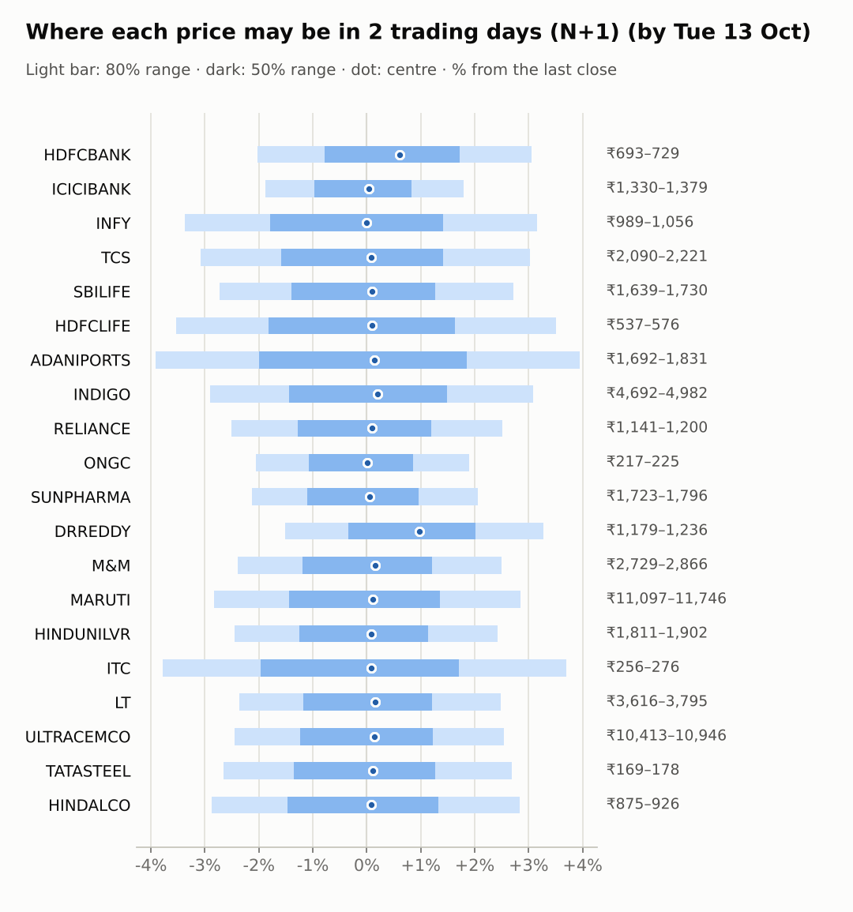
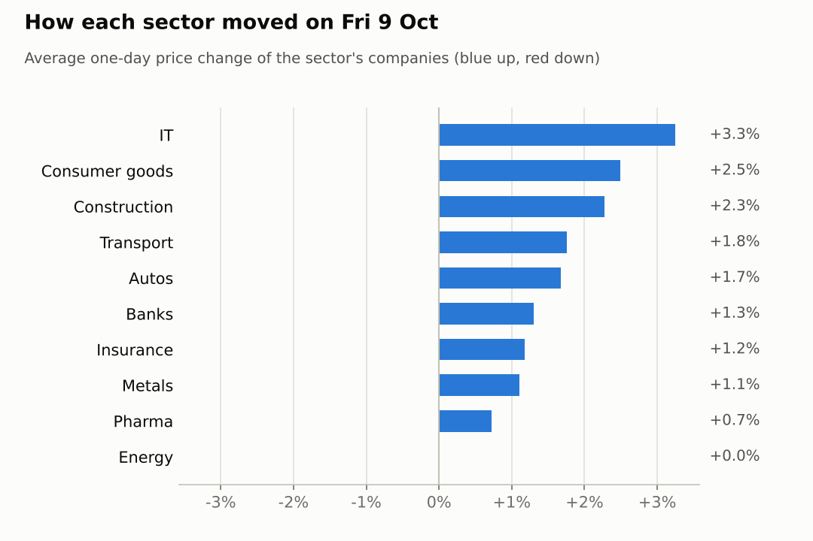
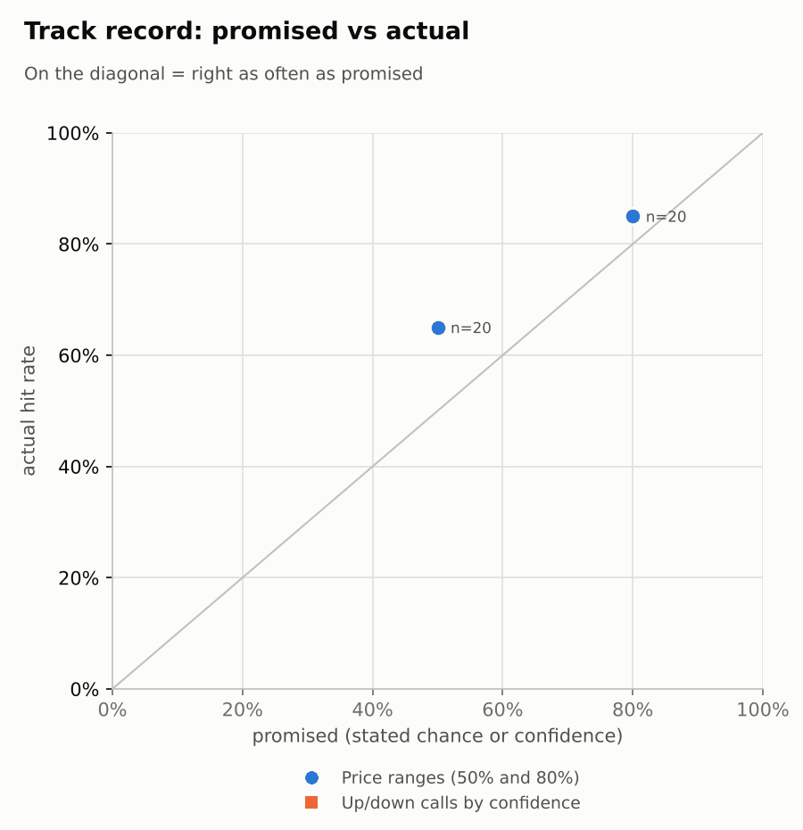

# Market brief: India (NSE), 2026-10-12

_Research log, not investment advice. Generated by a scheduled Claude Code routine._
<!-- report-data: as_of=2026-10-09 regime=CALM outcome=572b8442537b -->

Easy-to-read version with charts and filters: [2026-10-12.html](2026-10-12.html)

## Headline
A calm start after the Nifty 50's +1.3% bounce on 2026-10-09, with foreign investors still selling and results season starting this week (HDFC Life on 2026-10-15, Reliance on 2026-10-16). The only call today is TCS down over 5 sessions, because its dividend goes ex on 2026-10-14 (nse-ann-106811188).

## Top 3 today
- TCS goes ex-dividend on 2026-10-14 after its Q2 results (nse-ann-106811186, nse-ann-106811188); the only call today is TCS down at N+5, confidence 0.55.
- Foreign investors (FII) sold a net -3,569 cr on 2026-10-09 while domestic funds (DII) bought +4,743 cr (ff0d838e75e79cde); the market's mood is CALM with India VIX at 14.3575.
- Results week: HDFCLIFE on 2026-10-15, RELIANCE on 2026-10-16, HDFCBANK and ICICIBANK on 2026-10-17, so their ranges are wider (earnings in horizon).

## Yesterday
The Nifty 50 rose 1.3% on 2026-10-09 and 19 of 20 watchlist stocks rose. ITC led (+4.31%) as it rebounded after the GQG block deal (1d7679f8e3fbc796), and TCS gained 3.85% on its Q2 results (nse-ann-106811186). RELIANCE was the only faller (-0.65%).
The N+1 ranges held 17 of 20 closes inside the 80% band, the same as the naive range. INDIGO closed below its band (₹4,833.00), RELIANCE below (₹1,170.30) and INFY just above (₹1,023.40): a broad rally the ranges did not centre on, plus RELIANCE moving against the market.

Market on 2026-10-09: Nifty 50 22,520.45 (+1.3%) · India VIX 14.38 (-5.9%) · watchlist 19 up / 1 down · best ITC +4.3%, worst RELIANCE -0.7%

### Ranges scored (target date 2026-10-09)

N+1 ranges: **80% hit 17/20** (naive 17/20) · 50% hit 13/20

| Ticker | 80% range | 50% range | Actual | 80% | 50% | Naive 80% |
|---|---|---|---|---|---|---|
| ADANIPORTS | ₹1,681.78–₹1,813.64 | ₹1,713.03–₹1,778.58 | ₹1,761.00 | ✅ | ✅ | ✅ |
| DRREDDY | ₹1,165.43–₹1,219.28 | ₹1,178.34–₹1,205.12 | ₹1,197.00 | ✅ | ✅ | ✅ |
| HDFCBANK | ₹682.01–₹715.61 | ₹690.05–₹706.76 | ₹707.25 | ✅ | ❌ | ✅ |
| HDFCLIFE | ₹525.85–₹564.93 | ₹535.12–₹554.55 | ₹556.65 | ✅ | ❌ | ✅ |
| HINDALCO | ₹884.46–₹935.30 | ₹896.60–₹921.88 | ₹900.35 | ✅ | ✅ | ✅ |
| HINDUNILVR | ₹1,816.80–₹1,910.18 | ₹1,839.15–₹1,885.58 | ₹1,856.70 | ✅ | ✅ | ✅ |
| ICICIBANK | ₹1,326.92–₹1,378.70 | ₹1,339.36–₹1,365.12 | ₹1,355.00 | ✅ | ✅ | ✅ |
| INDIGO | ₹4,846.49–₹5,118.88 | ₹4,911.56–₹5,046.99 | ₹4,833.00 | ❌ | ❌ | ❌ |
| INFY | ₹958.18–₹1,022.36 | ₹973.45–₹1,005.36 | ₹1,023.40 | ❌ | ❌ | ✅ |
| ITC | ₹257.53–₹273.31 | ₹261.29–₹269.14 | ₹266.00 | ✅ | ✅ | ✅ |
| LT | ₹3,615.66–₹3,778.22 | ₹3,654.65–₹3,735.49 | ₹3,703.30 | ✅ | ✅ | ✅ |
| M&M | ₹2,730.62–₹2,862.40 | ₹2,762.19–₹2,827.72 | ₹2,796.20 | ✅ | ✅ | ✅ |
| MARUTI | ₹11,119.39–₹11,753.47 | ₹11,270.81–₹11,586.09 | ₹11,420.00 | ✅ | ✅ | ✅ |
| ONGC | ₹217.24–₹226.23 | ₹219.40–₹223.87 | ₹221.27 | ✅ | ✅ | ✅ |
| RELIANCE | ₹1,177.40–₹1,235.42 | ₹1,191.29–₹1,220.14 | ₹1,170.30 | ❌ | ❌ | ❌ |
| SBILIFE | ₹1,678.55–₹1,769.95 | ₹1,700.40–₹1,745.84 | ₹1,684.60 | ✅ | ❌ | ✅ |
| SUNPHARMA | ₹1,741.19–₹1,817.83 | ₹1,759.58–₹1,797.69 | ₹1,760.00 | ✅ | ✅ | ✅ |
| TATASTEEL | ₹170.84–₹180.04 | ₹173.04–₹177.61 | ₹173.80 | ✅ | ✅ | ✅ |
| TCS | ₹1,988.14–₹2,167.74 | ₹2,030.52–₹2,119.79 | ₹2,156.00 | ✅ | ❌ | ❌ |
| ULTRACEMCO | ₹10,409.71–₹10,881.50 | ₹10,522.85–₹10,757.46 | ₹10,675.00 | ✅ | ✅ | ✅ |

### Calls scored

_none_

## Today (2026-10-12)

**Regime: CALM** · India VIX 14.36 (-6.0%) · benchmark 5d +0.4% · benchmark 10d vol 16.2%

| Ticker | Sector | Close | N+1 80% | N+1 50% | N+5 80% | Call | Cue | Notes |
|---|---|---|---|---|---|---|---|---|
| HDFCBANK | Banks | ₹707.25 | ₹692.91–₹728.87 | ₹701.72–₹719.38 | ₹670.94–₹748.26 | no call | +1.23% | cue +1.23% x0.5; earnings in horizon (x2.0 day); index +0.21% expected from SPX, x beta 1.24 x0.5, own cue +1.23% net x0.5 |
| ICICIBANK | Banks | ₹1,355.00 | ₹1,329.53–₹1,379.37 | ₹1,341.80–₹1,366.29 | ₹1,298.74–₹1,405.96 | no call | +0.07% | cue +0.07% x0.5; earnings in horizon (x2.0 day); index +0.21% expected from SPX, x beta 0.90 x0.5, own cue +0.07% net x0.5 |
| INFY | IT | ₹1,023.40 | ₹988.83–₹1,055.67 | ₹1,005.11–₹1,037.94 | ₹961.81–₹1,079.17 | no call | +0.00% | cue +0.00% x0.5; index +0.21% expected from SPX, x beta 0.68 x0.5, own cue +0.00% net x0.5 |
| TCS | IT | ₹2,156.00 | ₹2,089.72–₹2,221.13 | ₹2,121.79–₹2,186.35 | ₹2,021.27–₹2,250.32 | 5d ▼ down 55% | – | ex-dividend 12 (0.56%); index +0.21% expected from SPX, x beta 0.77 x0.5 |
| SBILIFE | Insurance | ₹1,684.60 | ₹1,638.58–₹1,730.28 | ₹1,661.01–₹1,706.07 | ₹1,599.76–₹1,760.69 | no call | – | index +0.21% expected from SPX, x beta 0.86 x0.5 |
| HDFCLIFE | Insurance | ₹556.65 | ₹536.97–₹576.17 | ₹546.50–₹565.76 | ₹512.88–₹597.02 | no call | – | earnings in horizon (x2.0 day); index +0.21% expected from SPX, x beta 0.97 x0.5 |
| ADANIPORTS | Transport | ₹1,761.00 | ₹1,692.15–₹1,830.61 | ₹1,725.71–₹1,793.72 | ₹1,634.36–₹1,877.02 | no call | – | index +0.21% expected from SPX, x beta 1.36 x0.5 |
| INDIGO | Transport | ₹4,833.00 | ₹4,692.48–₹4,981.74 | ₹4,763.10–₹4,905.20 | ₹4,566.29–₹5,073.33 | no call | – | index +0.21% expected from SPX, x beta 1.81 x0.5 |
| RELIANCE | Energy | ₹1,170.30 | ₹1,140.93–₹1,199.75 | ₹1,155.35–₹1,184.24 | ₹1,103.89–₹1,230.23 | no call | – | earnings in horizon (x2.0 day); index +0.21% expected from SPX, x beta 0.94 x0.5 |
| ONGC | Energy | ₹221.27 | ₹216.73–₹225.47 | ₹218.88–₹223.18 | ₹213.12–₹228.49 | no call | – | index +0.21% expected from SPX, x beta 0.04 x0.5 |
| SUNPHARMA | Pharma | ₹1,760.00 | ₹1,722.50–₹1,796.30 | ₹1,740.64–₹1,776.90 | ₹1,691.31–₹1,820.93 | no call | – | index +0.21% expected from SPX, x beta 0.48 x0.5 |
| DRREDDY | Pharma | ₹1,197.00 | ₹1,178.87–₹1,236.11 | ₹1,192.91–₹1,221.03 | ₹1,157.40–₹1,258.13 | no call | +2.30% | cue +2.30% x0.5; index +0.21% expected from SPX, x beta 0.49 x0.5, own cue +2.30% net x0.5 |
| M&M | Autos | ₹2,796.20 | ₹2,729.34–₹2,866.14 | ₹2,762.88–₹2,830.08 | ₹2,669.40–₹2,909.37 | no call | – | index +0.21% expected from SPX, x beta 1.41 x0.5 |
| MARUTI | Autos | ₹11,420.00 | ₹11,097.26–₹11,745.70 | ₹11,255.75–₹11,574.31 | ₹10,820.86–₹11,958.44 | no call | – | index +0.21% expected from SPX, x beta 1.10 x0.5 |
| HINDUNILVR | Consumer goods | ₹1,856.70 | ₹1,811.33–₹1,901.67 | ₹1,833.48–₹1,877.86 | ₹1,772.90–₹1,931.48 | no call | – | index +0.21% expected from SPX, x beta 0.78 x0.5 |
| ITC | Consumer goods | ₹266.00 | ₹255.93–₹275.84 | ₹260.76–₹270.54 | ₹247.75–₹282.67 | no call | – | index +0.21% expected from SPX, x beta 0.73 x0.5 |
| LT | Construction | ₹3,703.30 | ₹3,615.54–₹3,795.48 | ₹3,659.66–₹3,748.06 | ₹3,536.48–₹3,852.14 | no call | – | index +0.21% expected from SPX, x beta 1.45 x0.5 |
| ULTRACEMCO | Construction | ₹10,675.00 | ₹10,412.62–₹10,945.80 | ₹10,543.28–₹10,805.23 | ₹10,073.08–₹11,218.02 | no call | – | earnings in horizon (x2.0 day); index +0.21% expected from SPX, x beta 1.27 x0.5 |
| TATASTEEL | Metals | ₹173.80 | ₹169.18–₹178.46 | ₹171.45–₹176.01 | ₹165.21–₹181.50 | no call | – | index +0.21% expected from SPX, x beta 1.06 x0.5 |
| HINDALCO | Metals | ₹900.35 | ₹874.52–₹925.84 | ₹887.06–₹912.27 | ₹852.92–₹942.98 | no call | – | index +0.21% expected from SPX, x beta 0.80 x0.5 |

Evidence status of the calls (each cited id as of the call's made_at; the first is the main evidence):

- TCS 5d down: nse-ann-106811188 confirmed_primary, nse-ann-106811186 confirmed_primary

- TCS N+5 down, confidence 0.55: the model's P(up) is near the base rate, adjusted down a little because the interim dividend goes ex on 2026-10-14 inside the window, a mechanical price drop the model cannot see (nse-ann-106811188, nse-ann-106811186). An earlier TCS N+5 down call is still open.
- Abstained on every other ticker and horizon: the signal model's P(up) sits near the base rate for all 20 companies, so it gives no direction alone.
- RELIANCE: results on 2026-10-16 inside the window, and the Jio IPO report and other news pull opposite ways.
- HDFCBANK, ICICIBANK, HDFCLIFE, ULTRACEMCO: results inside the window, no verified directional news.
- LT: order wins confirmed by NSE (nse-ann-106806590, nse-ann-106809242) but a week old and likely priced in.
- DRREDDY: the FDA Form 483 (5ce0400488a43272) is already in the model's news score, and its ADR rose 2.3% overnight.
- SUNPHARMA: the Organon deal headline is unverified, so it cannot support a call.
- No ticker had BLOCKED data and none reports within 1 day.

### Overnight cues and global factors

| Symbol | Name | Last | Change |
|---|---|---|---|
| BRENT | Brent crude | 102.90 | -1.74% |
| DXY | US dollar index | 102.13 | -0.08% |
| GOLD | Gold | 4,235.40 | +0.45% |
| HANGSENG | Hang Seng | 24,388.86 | +0.73% |
| INDIAVIX | India VIX | 14.36 | -6.04% |
| KOSPI | KOSPI | 6,494.53 | -1.98% |
| NASDAQ | Nasdaq Composite (previous US close) | 27,366.17 | +0.64% |
| NIFTY50 | Nifty 50 | 22,520.45 | +1.30% |
| NIKKEI | Nikkei 225 | 69,039.20 | -0.00% |
| SHANGHAI | Shanghai Composite | 3,812.93 | -0.02% |
| SPX | S&P 500 (previous US close) | 7,811.54 | +0.59% |
| STOXX50 | Euro Stoxx 50 | 6,176.93 | +0.82% |
| TAIWAN | Taiwan Weighted | 49,165.60 | -0.30% |
| US10Y | US 10-year yield | 5.24 | +0.25% |
| USDINR | USD/INR | 96.78 | +0.02% |
| USDJPY | USD/JPY | 158.13 | +0.04% |
| USVIX | US VIX | 14.84 | -3.70% |

### ADRs (US-listed shares, previous US session)

| Ticker | ADR | Last | Change |
|---|---|---|---|
| DRREDDY | RDY | 12.48 | +2.30% |
| HDFCBANK | HDB | 22.28 | +1.23% |
| ICICIBANK | IBN | 27.92 | +0.07% |
| INFY | INFY | 10.70 | +0.00% |

## Tomorrow and this week

| Date | Event | Type |
|---|---|---|
| 2026-10-13 | Nifty weekly options expiry (Tuesday) |  |
| 2026-10-14 | Tata Consultancy Services ex-dividend (est. 12, last dividend) | company |
| 2026-10-15 | HDFC Life earnings | company |
| 2026-10-16 | Reliance Industries earnings | company |
| 2026-10-17 | HDFC Bank earnings | company |
| 2026-10-17 | ICICI Bank earnings | company |
| 2026-10-19 | Nifty weekly options expiry (Tuesday) |  |
| 2026-10-19 | UltraTech Cement earnings | company |
| 2026-10-23 | Dr Reddy's earnings | company |
| 2026-10-23 | Infosys earnings | company |
| 2026-10-23 | SBI Life Insurance earnings | company |
| 2026-10-27 | NSE monthly F&O expiry (last Tuesday) | major |
| 2026-10-27 | Nifty weekly options expiry (Tuesday) |  |
| 2026-10-28 | Adani Ports earnings | company |
| 2026-10-28 | Larsen & Toubro earnings | company |
| 2026-10-29 | FOMC rate decision (previous US evening) | major |
| 2026-10-29 | Hindustan Unilever earnings | company |
| 2026-10-29 | ITC earnings | company |
| 2026-10-29 | Maruti Suzuki earnings | company |

Results season starts this week: HDFCLIFE (2026-10-15), RELIANCE (2026-10-16), HDFCBANK and ICICIBANK (2026-10-17), ULTRACEMCO (2026-10-19). The Nifty weekly options expire on 2026-10-13 and TCS goes ex-dividend on 2026-10-14.
Overnight cues are mixed: S&P 500 +0.59% and Nasdaq +0.64% in the previous US session, KOSPI -1.98% this morning, Brent 102.9 (-1.74%). The key risk stays foreign selling: FII net -30,294 cr over the last 5 reported days, offset by DII +30,313 cr. The regime is CALM.

## By sector

### Banks

HDFCBANK rose 2.17% and ICICIBANK 0.44%; both report on 2026-10-17, so no calls. HDFCBANK still lags its peer by 5.32% over 5 days.
Bull: HDFCBANK's ADR rose 1.23% overnight and its CEO pay news is corroborated (bfcf2b2a0256222b). Bear: results in 5 days and ongoing FII selling. They moved together with the market, not on company news.

### IT

TCS rose 3.85% on volume 3.09 times average after its Q2 results (nse-ann-106811186) and INFY rose 2.65%; the Nifty IT index gained 3.02%. Both moved together on sector news.
Bull: TCS results confirmed by the exchange filing. Bear: TCS goes ex-dividend on 2026-10-14 (nse-ann-106811188) and a Jefferies downgrade of IT stocks (345d0f0d94d54b5c).

### Insurance

HDFCLIFE rose 2.23% (20-day +8.3%) while SBILIFE rose only 0.12%: they moved apart, HDFCLIFE ahead of its results on 2026-10-15.
Bull: HDFCLIFE's momentum. Bear: HDFCLIFE's only news is unverified, and its results fall inside the window.

### Transport

ADANIPORTS rose 3.1% on volume 4.07 times average, around a block deal (5e7ed89432910196, single_source); INDIGO rose only 0.41% and closed below its 80% range. They moved apart on company flows.
Bull: lower Brent (-1.74%) helps INDIGO's fuel costs. Bear: ADANIPORTS' jump came on a one-off block trade.

### Energy

RELIANCE fell 0.65% on a rising day while ONGC rose 0.67%: they moved apart on company news.
Bull: the Jio IPO price band report is corroborated (a1d5d8e84f685de4). Bear: RELIANCE reports on 2026-10-16, and the IPO dates are still rumour.

### Pharma

DRREDDY rose 1.44% and SUNPHARMA was flat (+0.01%); the Nifty Pharma index gained 0.54%.
Bull: DRREDDY's ADR rose 2.3% overnight; SUNPHARMA is oversold (RSI 34). Bear: DRREDDY's FDA Form 483 is corroborated (5ce0400488a43272); SUNPHARMA's Organon headline is unverified (cdcfd1321e498664).

### Autos

M&M rose 1.64% and MARUTI 1.71%, a joint bounce from oversold levels (M&M RSI 26, MARUTI RSI 32).
Bull: deeply oversold after 20-day falls (M&M -11.23%, MARUTI -9.49%); M&M's Embraer stake sale is corroborated (7a77dd17884e29fd). Bear: no verified news to drive a lasting turn.

### Consumer goods

ITC rose 4.31% on volume 1.61 times average while HINDUNILVR rose 0.66%: they moved apart, ITC on the rebound after the GQG block deal (1d7679f8e3fbc796).
Bull: ITC's selling overhang may be cleared. Bear: HINDUNILVR's results headline is unverified (8b6e92d9332fe60c).

### Construction

LT rose 2.16% and ULTRACEMCO 2.39%, together with the market.
Bull: LT's order wins are confirmed by NSE (nse-ann-106806590, nse-ann-106809242). Bear: those orders are a week old; ULTRACEMCO reports on 2026-10-19 with only promotional news.

### Metals

HINDALCO rose 1.15% and TATASTEEL 1.07%, a joint bounce after a weak week (HINDALCO 5-day -4.41%, TATASTEEL -2.36%).
Bull: HINDALCO is oversold (RSI 30). Bear: news is single_source or unverified (7362106a91dd76c6).

## Track record

Ranges (targets 50% / 80%; width, score and centre error in % of price, lower is better; naive = last close ± recent typical move, no-change = last close as the centre):

| H | Window | n | 50% cover | 80% cover | Naive 80% | Width | Naive width | Score | Naive score | Centre err | No-change err |
|---|---|---|---|---|---|---|---|---|---|---|---|
| 1d | since start | 20 | 65% | 85% | 85% | 5.38 | 5.65 | 5.862 | 6.464 | 1.22 | 1.21 |
| 1d | last 30 days | 20 | 65% | 85% | 85% | 5.38 | 5.65 | 5.862 | 6.464 | 1.22 | 1.21 |

Ranges by regime (since start):

| H | Regime | n | 50% cover | 80% cover | Naive 80% |
|---|---|---|---|---|---|
| 1d | CALM | 20 | 65% | 85% | 85% |

Up/down calls vs the always-up baseline:

_none_

Calls by confidence band (a band should hit about as often as its confidence):

_none_

Weekly review 2026-W41: 1 proposed range change for a human to decide (low sample) · [review-2026-W41.md](review-2026-W41.md)

## Data quality

- Indicators: 20 OK, partial: none, blocked: none
- Regime notes: none

| H | Calibration | History n | Live n | q10 / q90 |
|---|---|---|---|---|
| 1d | pool | 8720 | 20 | -1.29 / 1.17 |
| 2d | pool | 8700 | 0 | -1.31 / 1.15 |
| 3d | pool | 8680 | 0 | -1.30 / 1.15 |
| 4d | pool | 8660 | 0 | -1.36 / 1.13 |
| 5d | pool | 8640 | 0 | -1.35 / 1.15 |

- collect_relations_india: holdings nse_pledge: 10 per-ticker calls, endpoint returned no rows at all (warning).
- collect_articles: 3 headlines from unvetted outlets skipped (tradingview.com 2, news9live.com 1).
- results_digest: TCS results attachment nse-ann-106811186 not read (pdf_not_parsed); no digest due.
- The inbox imports ran after the collectors instead of before them (company 0, paper trades 0 imported).
- validation: collect, warning NOT_FETCHED: announcements' newest first_seen_at 2026-10-10T18:19:16+00:00 is not from this run; no tickers. All other gates (features, context, news, forecast, lessons, claims, reasoning, traders) passed.
- AI traders: abstention codes: abstained 20 each for news-results, pattern-mood and the Opus combined trader; none for the Sonnet combined trader.
- Head-to-head picks: written; none cost-viable at your cost.
- Neo4j sync: ok.
