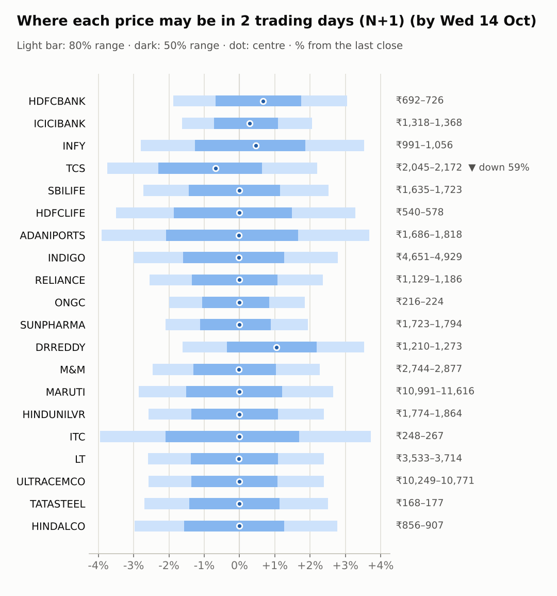
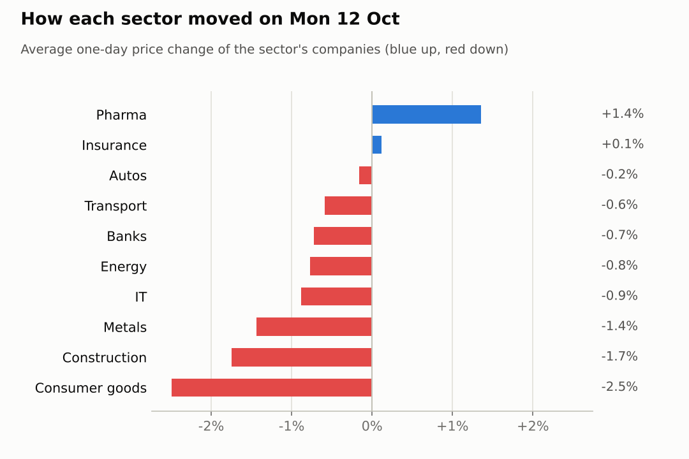
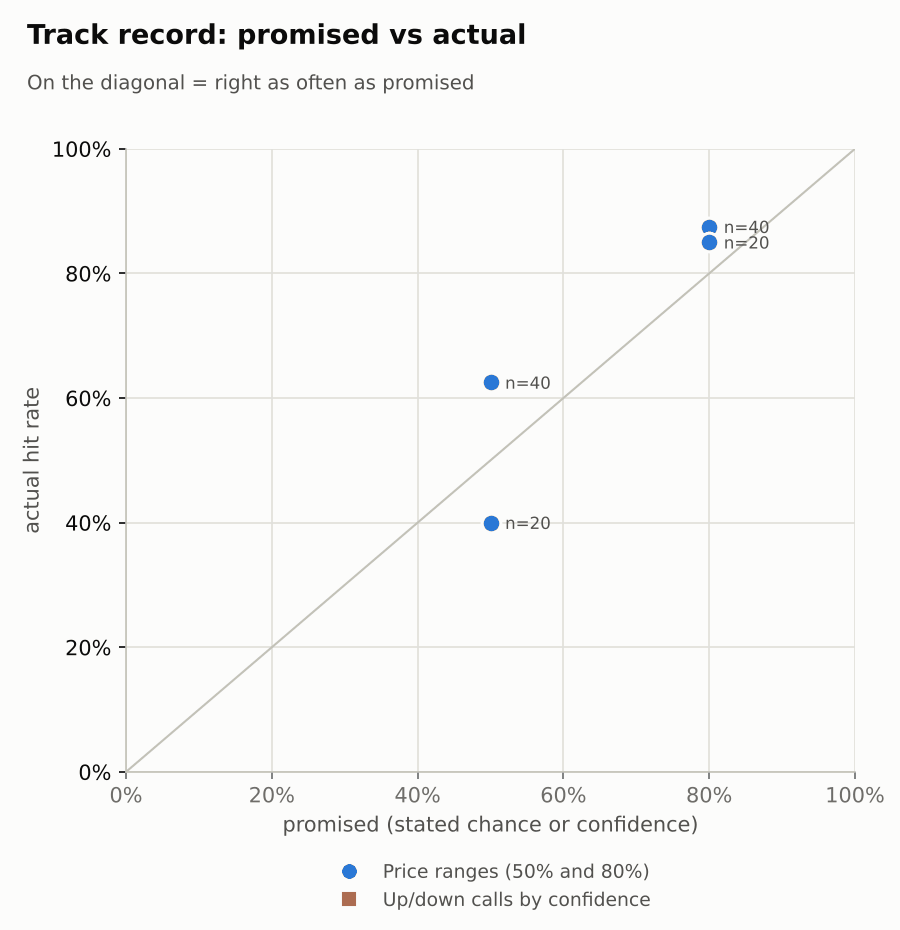

# Market brief: India (NSE), 2026-10-13

_Research log, not investment advice. Generated by a scheduled Claude Code routine._
<!-- report-data: as_of=2026-10-12 regime=CALM outcome=f8a0692b5242 -->

Easy-to-read version with charts and filters: [2026-10-13.html](2026-10-13.html)

## Headline
Asia opened sharply lower (KOSPI -6.2%, Nikkei -2.76%) after the Nifty 50 fell 0.7% on 2026-10-12, but the signal model sees no edge for any company today. The only calls are TCS down at N+1 and N+5, because its interim dividend goes ex on 2026-10-14 (nse-ann-106811188).

## Top 3 today
- TCS goes ex-dividend on 2026-10-14, inside both call windows, so its unadjusted price should drop by about the dividend (nse-ann-106811188).
- Results week: HDFCLIFE reports on 2026-10-15, RELIANCE on 2026-10-16, HDFCBANK and ICICIBANK on 2026-10-17 (nse-ann-106814767), so no calls on them.
- Weak overnight Asia (KOSPI -6.2%, Nikkei -2.76%) and FII selling of 27,304 cr over 5 days point to a soft open; India VIX rose 6.0%.

## Yesterday
The Nifty 50 fell 0.7% on 2026-10-12, with Nifty Bank -0.61% and Nifty IT -0.79%. ITC (-3.05%) and LT (-2.05%) fell most; DRREDDY rose 2.71% while the Nifty Pharma index rose 0.45%.
The N+1 ranges held 18 of 20 closes at 80%. DRREDDY and M&M closed above their ranges: both rose against a falling market, which the ranges, centred on the index, did not expect.

Market on 2026-10-12: Nifty 50 22,363.35 (-0.7%) · India VIX 15.25 (+6.1%) · watchlist 3 up / 16 down · best DRREDDY +2.7%, worst ITC -3.0%

### Ranges scored (target date 2026-10-12)

N+1 ranges: **80% hit 18/20** (naive 18/20) · 50% hit 12/20

| Ticker | 80% range | 50% range | Actual | 80% | 50% | Naive 80% |
|---|---|---|---|---|---|---|
| ADANIPORTS | ₹1,638.79–₹1,769.29 | ₹1,670.22–₹1,734.57 | ₹1,754.00 | ✅ | ❌ | ✅ |
| DRREDDY | ₹1,147.77–₹1,203.37 | ₹1,161.31–₹1,188.73 | ₹1,229.40 | ❌ | ❌ | ❌ |
| HDFCBANK | ₹672.79–₹706.37 | ₹680.96–₹697.53 | ₹704.90 | ✅ | ❌ | ✅ |
| HDFCLIFE | ₹524.40–₹562.48 | ₹533.59–₹552.37 | ₹559.25 | ✅ | ❌ | ✅ |
| HINDALCO | ₹862.86–₹914.40 | ₹875.37–₹900.78 | ₹882.50 | ✅ | ✅ | ✅ |
| HINDUNILVR | ₹1,795.61–₹1,887.49 | ₹1,817.97–₹1,863.29 | ₹1,820.70 | ✅ | ✅ | ✅ |
| ICICIBANK | ₹1,323.45–₹1,374.42 | ₹1,335.91–₹1,361.05 | ₹1,340.00 | ✅ | ✅ | ✅ |
| INDIGO | ₹4,652.62–₹4,948.46 | ₹4,724.29–₹4,870.19 | ₹4,795.00 | ✅ | ✅ | ✅ |
| INFY | ₹966.60–₹1,029.96 | ₹981.94–₹1,013.19 | ₹1,020.00 | ✅ | ❌ | ✅ |
| ITC | ₹245.93–₹263.20 | ₹250.10–₹258.62 | ₹257.90 | ✅ | ✅ | ✅ |
| LT | ₹3,533.34–₹3,701.53 | ₹3,574.32–₹3,657.28 | ₹3,627.50 | ✅ | ✅ | ✅ |
| M&M | ₹2,678.93–₹2,811.87 | ₹2,711.30–₹2,776.87 | ₹2,813.00 | ❌ | ❌ | ❌ |
| MARUTI | ₹10,888.57–₹11,523.79 | ₹11,042.74–₹11,356.03 | ₹11,315.00 | ✅ | ✅ | ✅ |
| ONGC | ₹215.18–₹224.05 | ₹217.35–₹221.72 | ₹220.00 | ✅ | ✅ | ✅ |
| RELIANCE | ₹1,145.61–₹1,206.24 | ₹1,160.35–₹1,190.26 | ₹1,158.90 | ✅ | ❌ | ✅ |
| SBILIFE | ₹1,632.38–₹1,726.76 | ₹1,655.29–₹1,701.84 | ₹1,680.80 | ✅ | ✅ | ✅ |
| SUNPHARMA | ₹1,719.54–₹1,795.65 | ₹1,738.11–₹1,775.65 | ₹1,760.00 | ✅ | ✅ | ✅ |
| TATASTEEL | ₹166.97–₹176.30 | ₹169.24–₹173.84 | ₹172.24 | ✅ | ✅ | ✅ |
| TCS | ₹2,017.24–₹2,128.06 | ₹2,044.17–₹2,098.83 | ₹2,125.00 | ✅ | ❌ | ✅ |
| ULTRACEMCO | ₹10,159.93–₹10,650.94 | ₹10,279.53–₹10,521.71 | ₹10,520.00 | ✅ | ✅ | ✅ |

N+2 ranges that matured on the same date: 80% hit 17/20, 50% hit 8/20.

### Calls scored

_none_

## Today (2026-10-13)

**Regime: CALM** · India VIX 15.24 (+6.0%) · benchmark 5d -0.9% · benchmark 10d vol 16.0%

| Ticker | Sector | Close | N+1 80% | N+1 50% | N+5 80% | Call | Cue | Notes |
|---|---|---|---|---|---|---|---|---|
| HDFCBANK | Banks | ₹704.90 | ₹691.73–₹726.35 | ₹700.17–₹717.26 | ₹670.36–₹745.01 | no call | +1.35% | cue +1.35% x0.5; earnings in horizon (x2.0 day); index -0.02% expected from SPX, x beta 1.23 x0.5, own cue +1.35% net x0.5 |
| ICICIBANK | Banks | ₹1,340.00 | ₹1,318.28–₹1,367.55 | ₹1,330.36–₹1,354.68 | ₹1,287.58–₹1,393.87 | no call | +0.57% | cue +0.57% x0.5; earnings in horizon (x2.0 day); index -0.02% expected from SPX, x beta 0.90 x0.5, own cue +0.57% net x0.5 |
| INFY | IT | ₹1,020.00 | ₹991.46–₹1,056.04 | ₹1,007.13–₹1,039.00 | ₹965.02–₹1,078.71 | no call | +0.93% | cue +0.93% x0.5; index -0.02% expected from SPX, x beta 0.68 x0.5, own cue +0.93% net x0.5 |
| TCS | IT | ₹2,125.00 | ₹2,045.24–₹2,171.79 | ₹2,075.98–₹2,138.43 | ₹1,992.69–₹2,215.45 | 1d ▼ down 59% · 5d ▼ down 57% | – | ex-dividend 12 (0.56%); index -0.02% expected from SPX, x beta 0.77 x0.5 |
| SBILIFE | Insurance | ₹1,680.80 | ₹1,635.11–₹1,723.27 | ₹1,656.58–₹1,700.09 | ₹1,598.87–₹1,754.16 | no call | – | index -0.02% expected from SPX, x beta 0.86 x0.5 |
| HDFCLIFE | Insurance | ₹559.25 | ₹539.65–₹577.63 | ₹548.84–₹567.59 | ₹516.63–₹598.46 | no call | – | earnings in horizon (x2.0 day); index -0.02% expected from SPX, x beta 0.96 x0.5 |
| ADANIPORTS | Transport | ₹1,754.00 | ₹1,685.51–₹1,818.37 | ₹1,717.59–₹1,783.14 | ₹1,631.82–₹1,865.66 | no call | – | index -0.02% expected from SPX, x beta 1.36 x0.5 |
| INDIGO | Transport | ₹4,795.00 | ₹4,650.76–₹4,928.65 | ₹4,718.31–₹4,855.44 | ₹4,537.36–₹5,026.80 | no call | – | index -0.02% expected from SPX, x beta 1.82 x0.5 |
| RELIANCE | Energy | ₹1,158.90 | ₹1,129.38–₹1,186.27 | ₹1,143.25–₹1,171.33 | ₹1,094.38–₹1,217.06 | no call | – | earnings in horizon (x2.0 day); index -0.02% expected from SPX, x beta 0.94 x0.5 |
| ONGC | Energy | ₹220.00 | ₹215.62–₹224.07 | ₹217.69–₹221.86 | ₹212.10–₹226.99 | no call | – | index -0.02% expected from SPX, x beta 0.04 x0.5 |
| SUNPHARMA | Pharma | ₹1,760.00 | ₹1,723.08–₹1,794.17 | ₹1,740.48–₹1,775.57 | ₹1,693.57–₹1,818.85 | no call | – | index -0.02% expected from SPX, x beta 0.46 x0.5 |
| DRREDDY | Pharma | ₹1,229.40 | ₹1,209.60–₹1,272.86 | ₹1,225.02–₹1,256.24 | ₹1,187.04–₹1,298.78 | no call | +2.72% | cue +2.72% x0.5; index -0.02% expected from SPX, x beta 0.47 x0.5, own cue +2.72% net x0.5 |
| M&M | Autos | ₹2,813.00 | ₹2,743.71–₹2,876.90 | ₹2,776.22–₹2,841.95 | ₹2,688.92–₹2,923.59 | no call | – | index -0.02% expected from SPX, x beta 1.40 x0.5 |
| MARUTI | Autos | ₹11,315.00 | ₹10,991.20–₹11,615.95 | ₹11,143.23–₹11,451.53 | ₹10,735.09–₹11,835.47 | no call | – | index -0.02% expected from SPX, x beta 1.11 x0.5 |
| HINDUNILVR | Consumer goods | ₹1,820.70 | ₹1,773.79–₹1,864.25 | ₹1,795.85–₹1,840.49 | ₹1,736.52–₹1,895.88 | no call | – | index -0.02% expected from SPX, x beta 0.79 x0.5 |
| ITC | Consumer goods | ₹257.90 | ₹247.73–₹267.50 | ₹252.50–₹262.25 | ₹239.73–₹274.52 | no call | – | index -0.02% expected from SPX, x beta 0.74 x0.5 |
| LT | Construction | ₹3,627.50 | ₹3,533.38–₹3,714.44 | ₹3,577.53–₹3,666.88 | ₹3,459.03–₹3,778.00 | no call | – | index -0.02% expected from SPX, x beta 1.46 x0.5 |
| ULTRACEMCO | Construction | ₹10,520.00 | ₹10,248.72–₹10,770.85 | ₹10,376.05–₹10,633.72 | ₹9,928.03–₹11,053.91 | no call | – | earnings in horizon (x2.0 day); index -0.02% expected from SPX, x beta 1.29 x0.5 |
| TATASTEEL | Metals | ₹172.24 | ₹167.60–₹176.55 | ₹169.78–₹174.20 | ₹163.92–₹179.69 | no call | – | index -0.02% expected from SPX, x beta 1.07 x0.5 |
| HINDALCO | Metals | ₹882.50 | ₹856.27–₹906.96 | ₹868.60–₹893.61 | ₹835.50–₹924.77 | no call | – | index -0.02% expected from SPX, x beta 0.81 x0.5 |

Evidence status of the calls (each cited id as of the call's made_at; the first is the main evidence):

- TCS 1d down: nse-ann-106811188 confirmed_primary, nse-ann-106811186 confirmed_primary
- TCS 5d down: nse-ann-106811188 confirmed_primary, nse-ann-106811186 confirmed_primary

- TCS N+1 down (confidence 0.59): the model's P(up) of 0.4723 is cut by a small adjustment because the interim dividend goes ex on 2026-10-14, the N+1 exit session, and the model has no dividend input (nse-ann-106811188, nse-ann-106811186).
- TCS N+5 down (confidence 0.57): the same ex-dividend falls inside the N+5 window, but matters less against six sessions of movement (nse-ann-106811188, nse-ann-106811186).
- Abstained on every other company and horizon: the model's P(up) is just under 0.5 everywhere, close to the base rate, and no company had confirmed news the model does not already include.
- HDFCLIFE, RELIANCE, HDFCBANK, ICICIBANK and ULTRACEMCO also have results inside the 5-day window. No ticker was BLOCKED.

### Overnight cues and global factors

| Symbol | Name | Last | Change |
|---|---|---|---|
| BRENT | Brent crude | 105.43 | +0.68% |
| DXY | US dollar index | 102.44 | +0.23% |
| GOLD | Gold | 4,189.00 | -0.65% |
| HANGSENG | Hang Seng | 24,083.43 | -0.77% |
| INDIAVIX | India VIX | 15.24 | +6.02% |
| KOSPI | KOSPI | 5,988.34 | -6.20% |
| NASDAQ | Nasdaq Composite (previous US close) | 27,245.90 | -0.44% |
| NIFTY50 | Nifty 50 | 22,363.35 | -0.70% |
| NIKKEI | Nikkei 225 | 67,124.49 | -2.76% |
| SHANGHAI | Shanghai Composite | 3,763.14 | -0.90% |
| SPX | S&P 500 (previous US close) | 7,807.24 | -0.06% |
| STOXX50 | Euro Stoxx 50 | 6,196.47 | +0.37% |
| TAIWAN | Taiwan Weighted | 48,296.33 | -2.04% |
| US10Y | US 10-year yield | 5.24 | -0.08% |
| USDINR | USD/INR | 95.76 | -1.10% |
| USDJPY | USD/JPY | 158.34 | +0.17% |
| USVIX | US VIX | 15.21 | +2.49% |

### ADRs (US-listed shares, previous US session)

| Ticker | ADR | Last | Change |
|---|---|---|---|
| DRREDDY | RDY | 12.82 | +2.72% |
| HDFCBANK | HDB | 22.58 | +1.35% |
| ICICIBANK | IBN | 28.05 | +0.57% |
| INFY | INFY | 10.83 | +0.93% |

## Tomorrow and this week

| Date | Event | Type |
|---|---|---|
| 2026-10-13 | Nifty weekly options expiry (Tuesday) |  |
| 2026-10-14 | Tata Consultancy Services ex-dividend (est. 12, last dividend) | company |
| 2026-10-15 | HDFC Life earnings | company |
| 2026-10-16 | Reliance Industries earnings | company |
| 2026-10-17 | HDFC Bank earnings | company |
| 2026-10-17 | ICICI Bank earnings | company |
| 2026-10-19 | Nifty weekly options expiry (Tuesday) |  |
| 2026-10-19 | UltraTech Cement earnings | company |
| 2026-10-23 | Dr Reddy's earnings | company |
| 2026-10-23 | Infosys earnings | company |
| 2026-10-23 | SBI Life Insurance earnings | company |
| 2026-10-27 | NSE monthly F&O expiry (last Tuesday) | major |
| 2026-10-27 | Nifty weekly options expiry (Tuesday) |  |
| 2026-10-28 | Adani Ports earnings | company |
| 2026-10-28 | Hindustan Unilever earnings | company |
| 2026-10-28 | Larsen & Toubro earnings | company |
| 2026-10-29 | FOMC rate decision (previous US evening) | major |
| 2026-10-29 | ITC earnings | company |
| 2026-10-29 | Maruti Suzuki earnings | company |

Results season starts this week: HDFCLIFE (2026-10-15), RELIANCE (2026-10-16), HDFCBANK and ICICIBANK (2026-10-17) and ULTRACEMCO (2026-10-19); their ranges are widened for the earnings day. Today is a Nifty weekly options expiry. The regime is CALM, but India VIX rose 6.0% to 15.245 and the Asian sell-off (KOSPI -6.2%) raises the risk of a gap down at the open. Brent at 105.43 is a cost risk for oil users such as INDIGO, while USD/INR fell 1.1% to 95.76.

## By sector

### Banks

HDFCBANK fell 0.33% and ICICIBANK 1.11% as Nifty Bank lost 0.61%: a sector move ahead of both results on 2026-10-17. Bull: the ADRs rose overnight (HDB +1.35%, IBN +0.57%). Bear: results inside the 5-day window and FII selling weigh on banks.

### IT

INFY fell 0.33% and TCS 1.44% with Nifty IT -0.79%, so they moved together. Bull: the INFY ADR rose 0.93%. Bear: TCS goes ex-dividend on 2026-10-14 and its Q2 beat is already in the price after the rally on 2026-10-09.

### Insurance

HDFCLIFE rose 0.47% and SBILIFE fell 0.23%: they moved apart, on company factors. Bull: HDFCLIFE is up 5.32% over 5 days. Bear: that run came on volume of only 0.35 times average, and its results come on 2026-10-15.

### Transport

ADANIPORTS fell 0.4% on volume 3.83 times average, and INDIGO fell 0.79%. Bull: heavy volume with high delivery can mean buyers taking positions home. Bear: INDIGO has a beta of 1.82 to a weak market and Brent is at 105.43.

### Energy

RELIANCE fell 0.97% and ONGC 0.57%: both down with the market. Bull: RELIANCE is oversold (RSI 34) and the Jio IPO price-band report is corroborated (a1d5d8e84f685de4). Bear: RELIANCE is down 9.03% over 20 days and reports on 2026-10-16.

### Pharma

DRREDDY rose 2.71% while SUNPHARMA was flat (0.0%): they moved apart. Bull: the DRREDDY ADR rose 2.72% overnight. Bear: SUNPHARMA filed a director resignation and an NCD (debt) plan after the close (nse-ann-106815017, nse-ann-106815003), which the price has not yet seen.

### Autos

M&M rose 0.6% and MARUTI fell 0.92%: apart, on company factors. Bull: both are oversold (RSI 29 and 30) after falling about 10% over 20 days. Bear: no confirmed catalyst for a rebound, and both have a high beta to a weak market.

### Consumer goods

ITC fell 3.05% and HINDUNILVR 1.94%: both down, a sector sell-off. Bull: HINDUNILVR is oversold at RSI 34. Bear: neither has confirmed news, and ITC has fallen 4.09% over 5 days.

### Construction

LT fell 2.05% and ULTRACEMCO 1.45%: both down together. Bull: LT is near oversold (RSI 35) after an 8.28% fall over 20 days. Bear: LT's order news is a week old, and ULTRACEMCO reports on 2026-10-19.

### Metals

HINDALCO fell 1.98% and TATASTEEL 0.9%: the sector kept falling. Bull: HINDALCO is the most oversold name (RSI 27, down 12.97% over 20 days). Bear: no confirmed catalyst, and HINDALCO is down 5.96% over 5 days.

## Track record

Ranges (targets 50% / 80%; width, score and centre error in % of price, lower is better; naive = last close ± recent typical move, no-change = last close as the centre):

| H | Window | n | 50% cover | 80% cover | Naive 80% | Width | Naive width | Score | Naive score | Centre err | No-change err |
|---|---|---|---|---|---|---|---|---|---|---|---|
| 1d | since start | 40 | 63% | 88% | 88% | 5.38 | 5.72 | 6.186 | 6.517 | 1.29 | 1.27 |
| 1d | last 30 days | 40 | 63% | 88% | 88% | 5.38 | 5.72 | 6.186 | 6.517 | 1.29 | 1.27 |
| 2d | since start | 20 | 40% | 85% | 90% | 6.57 | 6.92 | 7.442 | 7.558 | 2.02 | 1.96 |
| 2d | last 30 days | 20 | 40% | 85% | 90% | 6.57 | 6.92 | 7.442 | 7.558 | 2.02 | 1.96 |

Ranges by regime (since start):

| H | Regime | n | 50% cover | 80% cover | Naive 80% |
|---|---|---|---|---|---|
| 1d | CALM | 40 | 63% | 88% | 88% |
| 2d | CALM | 20 | 40% | 85% | 90% |

Up/down calls vs the always-up baseline:

_none_

Calls by confidence band (a band should hit about as often as its confidence):

_none_

Weekly review 2026-W41: 1 proposed range change for a human to decide (low sample) · [review-2026-W41.md](review-2026-W41.md)

## Data quality

- Indicators: 20 OK, partial: none, blocked: none
- Regime notes: none

| H | Calibration | History n | Live n | q10 / q90 |
|---|---|---|---|---|
| 1d | pool | 8740 | 40 | -1.28 / 1.16 |
| 2d | pool | 8720 | 20 | -1.31 / 1.14 |
| 3d | pool | 8700 | 0 | -1.31 / 1.14 |
| 4d | pool | 8680 | 0 | -1.36 / 1.12 |
| 5d | pool | 8660 | 0 | -1.34 / 1.15 |

- Collectors: all exited cleanly with no failures or warnings; Google News window since the last run (24 h), ok.
- Results digest: the TCS results attachment (nse-ann-106811186) was not read: pdf_not_parsed (no PDF parser configured).
- News articles: 2 unvetted outlets were skipped (bhaskarenglish.in, mid-day.com).
- validation collect: warning NOT_FETCHED: announcements newest first_seen_at 2026-10-12T15:29:32+00:00 is not from this run (the light news runs had stored them; nothing new from NSE this run).
- validation features, context, news, forecast: all passed with no warnings.
- AI traders: all four stored on the first attempt; every abstention has code abstained. News-results abstained on all companies, pattern-mood on all at N+1, combined Sonnet only on horizons with results inside the window, combined Opus on every company except TCS.
- Judge FAIL from the previous run: 2026-10-12, spotcheck, round 1: the 2026-10-07 report's data_quality line miscounted the claim clusters with no claim by one (stored data has one more cluster with claims); nothing dropped.
