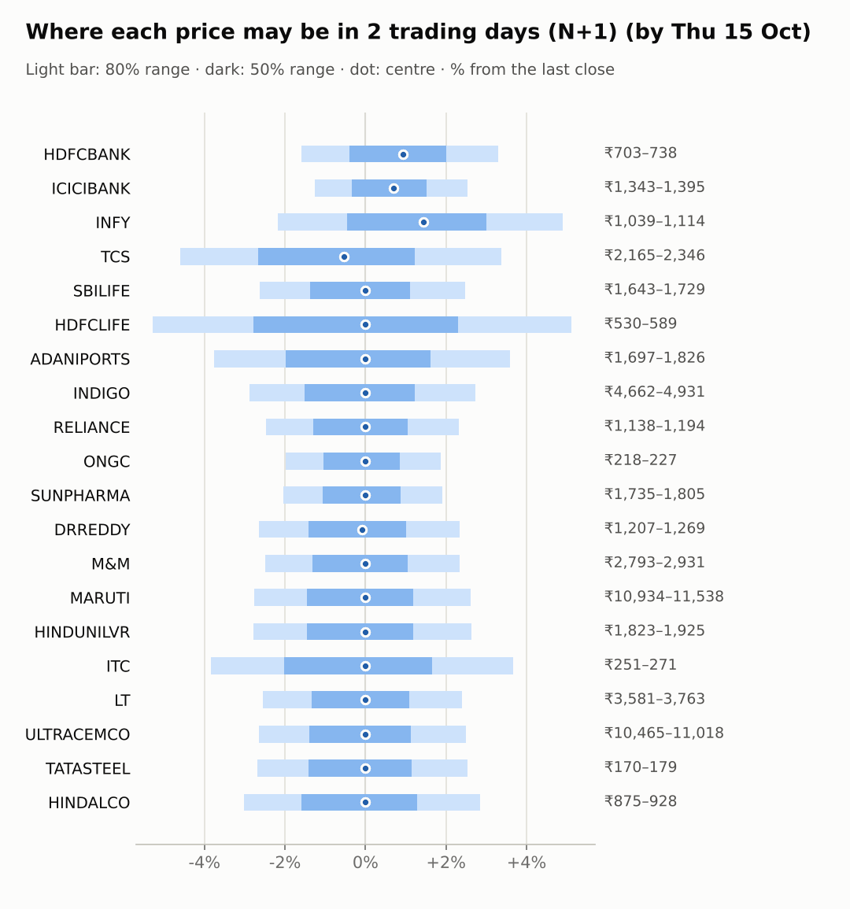
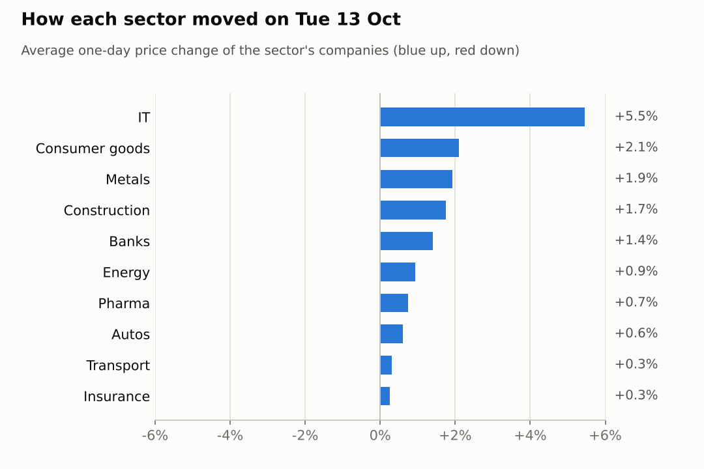
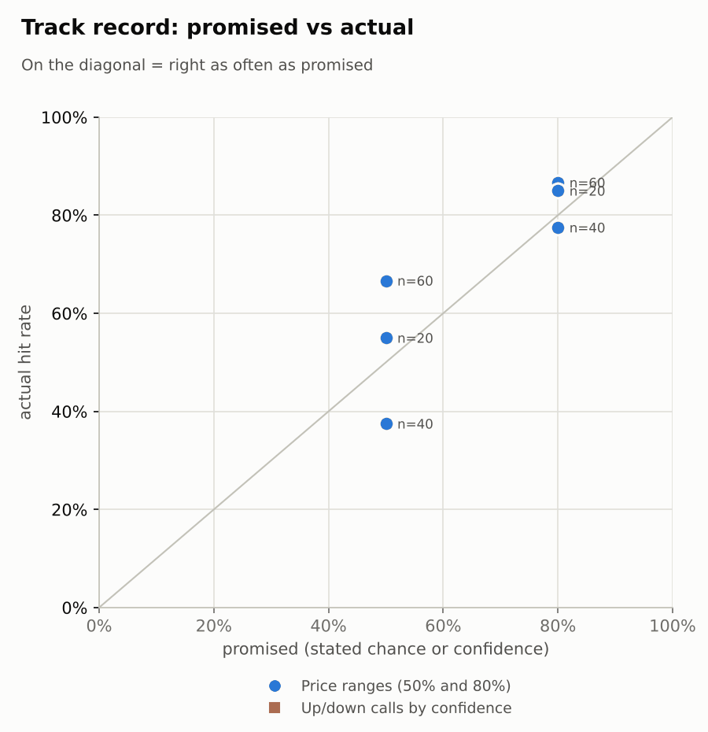

# Market brief: India (NSE), 2026-10-14

_Research log, not investment advice. Generated by a scheduled Claude Code routine._
<!-- report-data: as_of=2026-10-13 regime=CALM outcome=695fa078534e -->

Easy-to-read version with charts and filters: [2026-10-14.html](2026-10-14.html)

## Headline
No calls today: the signal model's chance of going up sits near its base rate for every company, and no verified news gives a specific edge. IT led yesterday's rally (TCS +6.79%, INFY +4.13%), and TCS goes ex-dividend today (nse-ann-106811188).

## Top 3 today
- IT rallied on 2026-10-13: Nifty IT +5.22%, TCS +6.79% and INFY +4.13%; the Infosys ADR rose another 5.72% overnight, so much of it may already be in today's open.
- Results week: HDFCLIFE reports on 2026-10-15 (no call allowed), RELIANCE on 2026-10-16, HDFCBANK and ICICIBANK on 2026-10-17 (nse-ann-106814767).
- INDIGO has $328m of Citi financing for eight Airbus jets (679cacf3e79dc867, corroborated), against an NSE filing of an order passed against it with no stated amount (nse-ann-106816211).

## Yesterday
The Nifty 50 rose 1.6% and India VIX fell, led by IT; 19 of 20 watchlist stocks rose and only MARUTI fell (-0.6%), at a 52-week low per an unverified report (5ffd71360bdfc2fe).
N+1 ranges held for 17 of 20 stocks. The three misses were all above the range: TCS and INFY on the IT rally, and DRREDDY, which kept rising.
Ranges that are narrow on a quiet day can miss a sharp sector move like this one; the naive baseline missed the same three.

Market on 2026-10-13: Nifty 50 22,721.95 (+1.6%) · India VIX 14.12 (-7.4%) · watchlist 19 up / 1 down · best TCS +6.8%, worst MARUTI -0.6%

### Ranges scored (target date 2026-10-13)

N+1 ranges: **80% hit 17/20** (naive 16/20) · 50% hit 15/20

| Ticker | 80% range | 50% range | Actual | 80% | 50% | Naive 80% |
|---|---|---|---|---|---|---|
| ADANIPORTS | ₹1,692.15–₹1,830.61 | ₹1,725.71–₹1,793.72 | ₹1,763.00 | ✅ | ✅ | ✅ |
| DRREDDY | ₹1,178.87–₹1,236.11 | ₹1,192.91–₹1,221.03 | ₹1,240.00 | ❌ | ❌ | ❌ |
| HDFCBANK | ₹692.91–₹728.87 | ₹701.72–₹719.38 | ₹714.00 | ✅ | ✅ | ✅ |
| HDFCLIFE | ₹536.97–₹576.17 | ₹546.50–₹565.76 | ₹560.00 | ✅ | ✅ | ✅ |
| HINDALCO | ₹874.52–₹925.84 | ₹887.06–₹912.27 | ₹902.25 | ✅ | ✅ | ✅ |
| HINDUNILVR | ₹1,811.33–₹1,901.67 | ₹1,833.48–₹1,877.86 | ₹1,875.50 | ✅ | ✅ | ✅ |
| ICICIBANK | ₹1,329.53–₹1,379.37 | ₹1,341.80–₹1,366.29 | ₹1,360.20 | ✅ | ✅ | ✅ |
| INDIGO | ₹4,692.48–₹4,981.74 | ₹4,763.10–₹4,905.20 | ₹4,800.40 | ✅ | ✅ | ✅ |
| INFY | ₹988.83–₹1,055.67 | ₹1,005.11–₹1,037.94 | ₹1,062.10 | ❌ | ❌ | ❌ |
| ITC | ₹255.93–₹275.84 | ₹260.76–₹270.54 | ₹261.00 | ✅ | ✅ | ✅ |
| LT | ₹3,615.54–₹3,795.48 | ₹3,659.66–₹3,748.06 | ₹3,675.00 | ✅ | ✅ | ✅ |
| M&M | ₹2,729.34–₹2,866.14 | ₹2,762.88–₹2,830.08 | ₹2,864.40 | ✅ | ❌ | ❌ |
| MARUTI | ₹11,097.26–₹11,745.70 | ₹11,255.75–₹11,574.31 | ₹11,245.00 | ✅ | ❌ | ✅ |
| ONGC | ₹216.73–₹225.47 | ₹218.88–₹223.18 | ₹222.65 | ✅ | ✅ | ✅ |
| RELIANCE | ₹1,140.93–₹1,199.75 | ₹1,155.35–₹1,184.24 | ₹1,166.70 | ✅ | ✅ | ✅ |
| SBILIFE | ₹1,638.58–₹1,730.28 | ₹1,661.01–₹1,706.07 | ₹1,687.20 | ✅ | ✅ | ✅ |
| SUNPHARMA | ₹1,722.50–₹1,796.30 | ₹1,740.64–₹1,776.90 | ₹1,770.70 | ✅ | ✅ | ✅ |
| TATASTEEL | ₹169.18–₹178.46 | ₹171.45–₹176.01 | ₹175.00 | ✅ | ✅ | ✅ |
| TCS | ₹2,089.72–₹2,221.13 | ₹2,121.79–₹2,186.35 | ₹2,269.30 | ❌ | ❌ | ❌ |
| ULTRACEMCO | ₹10,412.62–₹10,945.80 | ₹10,543.28–₹10,805.23 | ₹10,750.00 | ✅ | ✅ | ✅ |

N+2 ranges that matured on the same date: 80% hit 14/20, 50% hit 7/20. N+3 ranges that matured on the same date: 80% hit 17/20, 50% hit 11/20.

### Calls scored

_none_

## Today (2026-10-14)

**Regime: CALM** · India VIX 14.11 (-7.5%) · benchmark 5d -0.2% · benchmark 10d vol 17.0%

| Ticker | Sector | Close | N+1 80% | N+1 50% | N+5 80% | Call | Cue | Notes |
|---|---|---|---|---|---|---|---|---|
| HDFCBANK | Banks | ₹714.00 | ₹702.65–₹737.57 | ₹711.20–₹728.27 | ₹681.06–₹756.25 | no call | +1.86% | cue +1.86% x0.5; earnings in horizon (x2.0 day); index -0.01% expected from SPX, x beta 1.23 x0.5, own cue +1.86% net x0.5 |
| ICICIBANK | Banks | ₹1,360.20 | ₹1,343.01–₹1,394.61 | ₹1,355.69–₹1,380.93 | ₹1,310.83–₹1,421.99 | no call | +1.39% | cue +1.39% x0.5; earnings in horizon (x2.0 day); index -0.01% expected from SPX, x beta 0.90 x0.5, own cue +1.39% net x0.5 |
| INFY | IT | ₹1,062.10 | ₹1,038.92–₹1,114.23 | ₹1,057.20–₹1,094.02 | ₹1,018.77–₹1,152.55 | no call | +5.72% | cue +5.72% x0.5; index -0.01% expected from SPX, x beta 0.71 x0.5, own cue +5.72% net x0.5 |
| TCS | IT | ₹2,269.30 | ₹2,164.78–₹2,345.90 | ₹2,208.58–₹2,297.13 | ₹2,091.35–₹2,409.61 | no call | – | ex-dividend 12 (0.53%); index -0.01% expected from SPX, x beta 0.82 x0.5 |
| SBILIFE | Insurance | ₹1,687.20 | ₹1,643.01–₹1,728.86 | ₹1,664.00–₹1,705.99 | ₹1,607.48–₹1,758.50 | no call | – | index -0.01% expected from SPX, x beta 0.85 x0.5 |
| HDFCLIFE | Insurance | ₹560.00 | ₹530.44–₹588.65 | ₹544.39–₹572.84 | ₹518.68–₹597.93 | no call | – | earnings in horizon (x2.0 day); index -0.01% expected from SPX, x beta 0.95 x0.5 |
| ADANIPORTS | Transport | ₹1,763.00 | ₹1,696.68–₹1,826.21 | ₹1,728.09–₹1,791.41 | ₹1,643.95–₹1,871.61 | no call | – | index -0.01% expected from SPX, x beta 1.34 x0.5 |
| INDIGO | Transport | ₹4,800.40 | ₹4,661.73–₹4,931.14 | ₹4,727.48–₹4,859.22 | ₹4,550.82–₹5,024.65 | no call | – | index -0.01% expected from SPX, x beta 1.79 x0.5 |
| RELIANCE | Energy | ₹1,166.70 | ₹1,137.93–₹1,193.77 | ₹1,151.60–₹1,178.91 | ₹1,103.43–₹1,223.68 | no call | – | earnings in horizon (x2.0 day); index -0.01% expected from SPX, x beta 0.94 x0.5 |
| ONGC | Energy | ₹222.65 | ₹218.23–₹226.80 | ₹220.33–₹224.53 | ₹214.64–₹229.74 | no call | – | index -0.01% expected from SPX, x beta 0.05 x0.5 |
| SUNPHARMA | Pharma | ₹1,770.70 | ₹1,734.67–₹1,804.50 | ₹1,751.82–₹1,785.97 | ₹1,705.51–₹1,828.41 | no call | – | index -0.01% expected from SPX, x beta 0.46 x0.5 |
| DRREDDY | Pharma | ₹1,240.00 | ₹1,207.29–₹1,269.02 | ₹1,222.39–₹1,252.58 | ₹1,181.68–₹1,290.27 | no call | -0.16% | cue -0.16% x0.5; index -0.01% expected from SPX, x beta 0.47 x0.5, own cue -0.16% net x0.5 |
| M&M | Autos | ₹2,864.40 | ₹2,793.04–₹2,931.45 | ₹2,826.92–₹2,894.61 | ₹2,735.72–₹2,979.22 | no call | – | index -0.01% expected from SPX, x beta 1.40 x0.5 |
| MARUTI | Autos | ₹11,245.00 | ₹10,934.20–₹11,538.22 | ₹11,081.75–₹11,377.13 | ₹10,684.83–₹11,747.24 | no call | – | index -0.01% expected from SPX, x beta 1.09 x0.5 |
| HINDUNILVR | Consumer goods | ₹1,875.50 | ₹1,823.21–₹1,924.89 | ₹1,848.04–₹1,897.77 | ₹1,781.22–₹1,960.07 | no call | – | index -0.01% expected from SPX, x beta 0.80 x0.5 |
| ITC | Consumer goods | ₹261.00 | ₹251.00–₹270.55 | ₹255.74–₹265.30 | ₹243.04–₹277.41 | no call | – | index -0.01% expected from SPX, x beta 0.74 x0.5 |
| LT | Construction | ₹3,675.00 | ₹3,581.13–₹3,763.25 | ₹3,625.69–₹3,714.75 | ₹3,505.78–₹3,826.16 | no call | – | index -0.01% expected from SPX, x beta 1.45 x0.5 |
| ULTRACEMCO | Construction | ₹10,750.00 | ₹10,465.42–₹11,017.97 | ₹10,600.51–₹10,870.72 | ₹10,125.15–₹11,314.81 | no call | – | earnings in horizon (x2.0 day); index -0.01% expected from SPX, x beta 1.29 x0.5 |
| TATASTEEL | Metals | ₹175.00 | ₹170.31–₹179.42 | ₹172.54–₹176.99 | ₹166.54–₹182.57 | no call | – | index -0.01% expected from SPX, x beta 1.07 x0.5 |
| HINDALCO | Metals | ₹902.25 | ₹875.06–₹927.99 | ₹887.97–₹913.85 | ₹853.28–₹946.35 | no call | – | index -0.01% expected from SPX, x beta 0.81 x0.5 |

No calls today. The forecaster abstained on every ticker at N+1 and N+5:
- HDFCLIFE: hard block, results on 2026-10-15 (earnings within 1 day).
- HDFCBANK, ICICIBANK, RELIANCE, ULTRACEMCO: results fall inside the call windows.
- TCS, INFY: the IT rally and the ADR gap are already in the price; TCS's ex-dividend is mechanical (nse-ann-106811188).
- INDIGO: the financing news (679cacf3e79dc867) is routine and already in the model's news term.
- DRREDDY: the FDA Form 483 news (d4c571a25839c74c, corroborated) is 6 days old and the stock has risen since.
- All others: the model sits near its base rate and no news strong and verified enough to support a call was found.

### Overnight cues and global factors

| Symbol | Name | Last | Change |
|---|---|---|---|
| BRENT | Brent crude | 106.94 | +0.27% |
| DXY | US dollar index | 102.14 | -0.43% |
| GOLD | Gold | 4,180.00 | -0.25% |
| HANGSENG | Hang Seng | 24,310.52 | -0.14% |
| INDIAVIX | India VIX | 14.11 | -7.48% |
| KOSPI | KOSPI | 6,096.87 | +1.02% |
| NASDAQ | Nasdaq Composite (previous US close) | 27,204.38 | -0.15% |
| NIFTY50 | Nifty 50 | 22,721.95 | +1.60% |
| NIKKEI | Nikkei 225 | 68,110.82 | +0.49% |
| SHANGHAI | Shanghai Composite | 3,808.73 | +0.21% |
| SPX | S&P 500 (previous US close) | 7,805.45 | -0.02% |
| STOXX50 | Euro Stoxx 50 | 6,165.45 | -0.58% |
| TAIWAN | Taiwan Weighted | 48,853.42 | +1.06% |
| US10Y | US 10-year yield | 5.22 | -0.44% |
| USDINR | USD/INR | 95.28 | -1.55% |
| USDJPY | USD/JPY | 158.37 | -0.09% |
| USVIX | US VIX | 15.27 | +0.39% |

### ADRs (US-listed shares, previous US session)

| Ticker | ADR | Last | Change |
|---|---|---|---|
| DRREDDY | RDY | 12.80 | -0.16% |
| HDFCBANK | HDB | 23.00 | +1.86% |
| ICICIBANK | IBN | 28.44 | +1.39% |
| INFY | INFY | 11.45 | +5.72% |

## Tomorrow and this week

| Date | Event | Type |
|---|---|---|
| 2026-10-14 | Tata Consultancy Services ex-dividend (est. 12, last dividend) | company |
| 2026-10-15 | HDFC Life earnings | company |
| 2026-10-16 | Reliance Industries earnings | company |
| 2026-10-17 | HDFC Bank earnings | company |
| 2026-10-17 | ICICI Bank earnings | company |
| 2026-10-19 | Nifty weekly options expiry (Tuesday) |  |
| 2026-10-19 | UltraTech Cement earnings | company |
| 2026-10-23 | Dr Reddy's earnings | company |
| 2026-10-23 | Infosys earnings | company |
| 2026-10-23 | SBI Life Insurance earnings | company |
| 2026-10-27 | Maruti Suzuki earnings | company |
| 2026-10-27 | NSE monthly F&O expiry (last Tuesday) | major |
| 2026-10-27 | Nifty weekly options expiry (Tuesday) |  |
| 2026-10-28 | Adani Ports earnings | company |
| 2026-10-28 | Hindustan Unilever earnings | company |
| 2026-10-28 | Larsen & Toubro earnings | company |
| 2026-10-29 | FOMC rate decision (previous US evening) | major |
| 2026-10-29 | ITC earnings | company |
| 2026-11-03 | InterGlobe Aviation earnings | company |
| 2026-11-03 | Nifty weekly options expiry (Tuesday) |  |

Risks this week: four results in four days (HDFCLIFE, RELIANCE, HDFCBANK, ICICIBANK), with ranges widened for the earnings days.
Overnight cues are mixed but calm: S&P 500 -0.02%, KOSPI +1.02%, Brent 106.94, and the regime is CALM.
Foreign investors kept selling: FII net -25,647 cr over the last 5 reported days, matched by DII buying of +25,527 cr.

## By sector

### Banks

HDFCBANK (+1.29%) and ICICIBANK (+1.51%) rose together with Nifty Bank (+1.03%), on low volume (0.6 times average for both), so a sector move.
Bull: both ADRs rose overnight (HDFCBANK +1.86%, ICICIBANK +1.39%).
Bear: results on 2026-10-17 make the next days a coin flip; HDFCBANK has a US class-action reminder (01c56bd5f220e4f1, promotional).

### IT

TCS (+6.79%) and INFY (+4.13%) moved together with Nifty IT (+5.22%), a sector rally.
Bull: the Infosys ADR rose 5.72% overnight; Nilekani dismissed AI job-loss fears (e1176ecae3162151, corroborated).
Bear: the move came fast on 2.59 times average volume for TCS, and TCS goes ex-dividend today (nse-ann-106811188).

### Insurance

HDFCLIFE (+0.13%) and SBILIFE (+0.38%) barely moved; HDFCLIFE leads SBILIFE by 6.54 points over 5 days, company-driven.
Bull: HDFCLIFE's trend is up (d20 +5.66%).
Bear: HDFCLIFE reports on 2026-10-15, so no call; SBILIFE has no verified news.

### Transport

ADANIPORTS (+0.51%) and INDIGO (+0.11%) moved little; over 5 days they split apart, company news.
Bull: INDIGO's $328m aircraft financing (679cacf3e79dc867, corroborated).
Bear: INDIGO is down 4.95% over 5 days and has an NSE order filing with no stated amount (nse-ann-106816211); GQG cut its ADANIPORTS stake per an unverified report (32f1ff7db62f165d).

### Energy

RELIANCE (+0.67%) and ONGC (+1.2%) rose with the market, but over 5 days RELIANCE lags ONGC by 3.52 points.
Bull: the Jio Platforms IPO price band is set (abdda2b816a98e8e); RELIANCE has RSI 36, near oversold.
Bear: RELIANCE reports on 2026-10-16 after a d20 of -7.22%; ONGC's beta of 0.05 gives it little lift from index rallies.

### Pharma

DRREDDY (+0.86%) and SUNPHARMA (+0.61%) rose while Nifty Pharma was flat (-0.01%), each on company news.
Bull: SUNPHARMA's NCD programme got AAA ratings (nse-ann-106816165); DRREDDY has the strongest trend (RSI 61, d20 +6.39%).
Bear: DRREDDY has an FDA Form 483 for a plant (d4c571a25839c74c, corroborated); SUNPHARMA filed a director resignation (nse-ann-106815017).

### Autos

M&M (+1.83%) and MARUTI (-0.62%) moved apart, company news.
Bull: both are oversold (M&M RSI 36, MARUTI RSI 29).
Bear: MARUTI is down 9.31% over 20 days at a 52-week low after a delayed hearing on a CCI fine (5ffd71360bdfc2fe, unverified).

### Consumer goods

HINDUNILVR (+3.01%) and ITC (+1.2%) both rose with the market.
Bull: HINDUNILVR's jump came on 1.57 times average volume.
Bear: neither has verified news, and ITC is down 2.14% over 5 days.

### Construction

LT (+1.31%) and ULTRACEMCO (+2.19%) rose together with the market.
Bull: LT is in a pullback (RSI 40, d20 -6.51%) with earlier order wins.
Bear: ULTRACEMCO's rise came on 0.68 times average volume, and it reports on 2026-10-19.

### Metals

HINDALCO (+2.24%) and TATASTEEL (+1.6%) bounced together, a sector move.
Bull: both are oversold (HINDALCO RSI 35, TATASTEEL RSI 39).
Bear: HINDALCO is still down 8.07% over 20 days and neither has verified news.

## Track record

Ranges (targets 50% / 80%; width, score and centre error in % of price, lower is better; naive = last close ± recent typical move, no-change = last close as the centre):

| H | Window | n | 50% cover | 80% cover | Naive 80% | Width | Naive width | Score | Naive score | Centre err | No-change err |
|---|---|---|---|---|---|---|---|---|---|---|---|
| 1d | since start | 60 | 67% | 87% | 85% | 5.41 | 5.77 | 6.480 | 6.886 | 1.27 | 1.28 |
| 1d | last 30 days | 60 | 67% | 87% | 85% | 5.41 | 5.77 | 6.480 | 6.886 | 1.27 | 1.28 |
| 2d | since start | 40 | 38% | 78% | 85% | 6.58 | 7.01 | 10.426 | 10.157 | 2.28 | 2.24 |
| 2d | last 30 days | 40 | 38% | 78% | 85% | 6.58 | 7.01 | 10.426 | 10.157 | 2.28 | 2.24 |
| 3d | since start | 20 | 55% | 85% | 90% | 7.55 | 7.99 | 11.417 | 11.603 | 2.29 | 2.20 |
| 3d | last 30 days | 20 | 55% | 85% | 90% | 7.55 | 7.99 | 11.417 | 11.603 | 2.29 | 2.20 |

Ranges by regime (since start):

| H | Regime | n | 50% cover | 80% cover | Naive 80% |
|---|---|---|---|---|---|
| 1d | CALM | 60 | 67% | 87% | 85% |
| 2d | CALM | 40 | 38% | 78% | 85% |
| 3d | CALM | 20 | 55% | 85% | 90% |

Up/down calls vs the always-up baseline:

_none_

Calls by confidence band (a band should hit about as often as its confidence):

_none_

Weekly review 2026-W41: 1 proposed range change for a human to decide (low sample) · [review-2026-W41.md](review-2026-W41.md)

## Data quality

- Indicators: 20 OK, partial: none, blocked: none
- Regime notes: none

| H | Calibration | History n | Live n | q10 / q90 |
|---|---|---|---|---|
| 1d | pool | 8760 | 60 | -1.27 / 1.17 |
| 2d | pool | 8740 | 40 | -1.29 / 1.16 |
| 3d | pool | 8720 | 20 | -1.30 / 1.15 |
| 4d | pool | 8700 | 0 | -1.35 / 1.12 |
| 5d | pool | 8680 | 0 | -1.34 / 1.14 |

- collect: all collectors exited cleanly; Yahoo lacked the 2026-10-13 bar for SBILIFE, INDIGO and SUNPHARMA at first, resolved through NSE (no bar filled from the bhavcopy).
- collect_articles: 1 article page blocked (businesswire.com).
- results digests: no release due; the TCS results attachment nse-ann-106811186 was not read (pdf_not_parsed, no PDF parser yet).
- news verification: the SUNPHARMA debt-raise event lists director-resignation filings (nse-ann-106815017) as its primary source; the matching looks wrong, raised for a fix. No call used it.
- flows: no NSE index file for 2026-10-14 yet (published after the close).
- validate collect: warning NOT_FETCHED, announcements: newest first_seen_at 2026-10-13T15:30:04+00:00 is not from this run (the light news runs had already stored them).
- validate: features, context, news and forecast gates passed with no failures or warnings.
- Judge FAIL 2026-10-12, spotcheck round 1: the 2026-10-07 report's data_quality claims line said 11 of 15 clusters (4 none), stored data shows 12 of 15 (3 none); nothing dropped.
