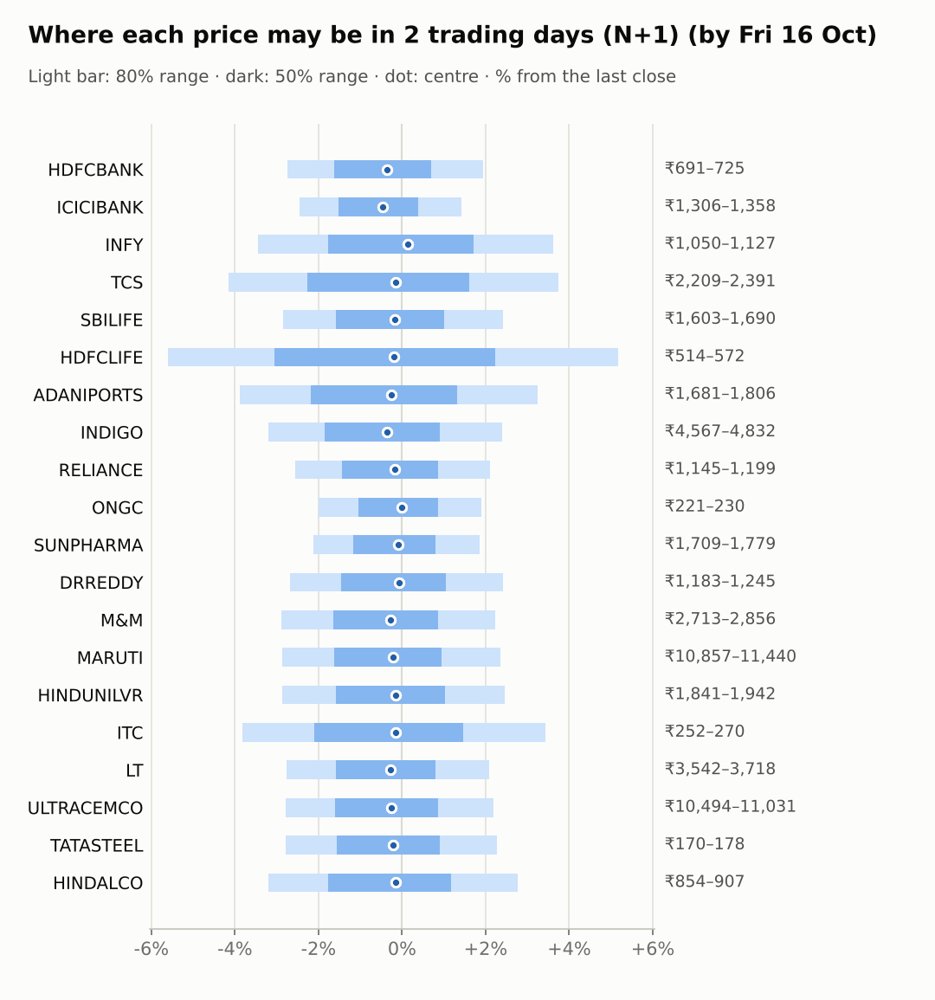
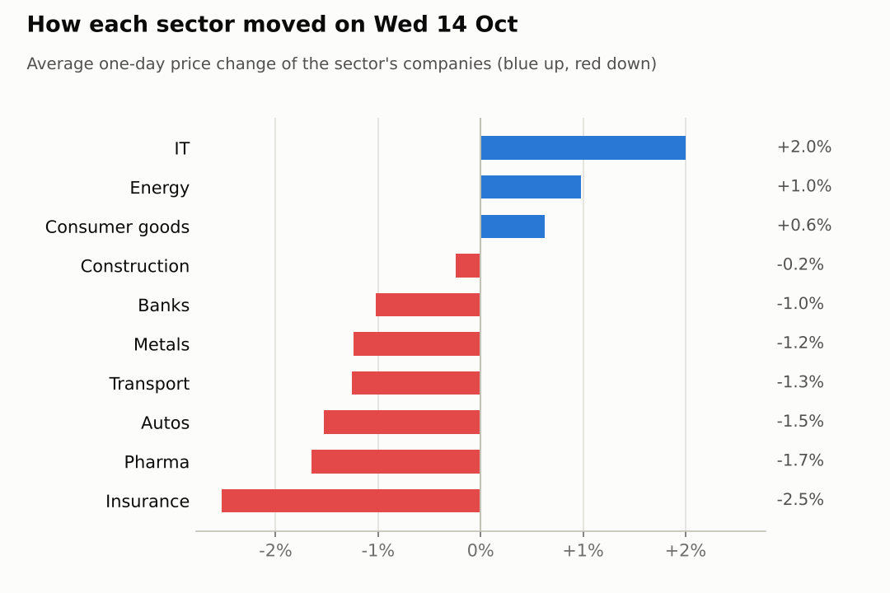
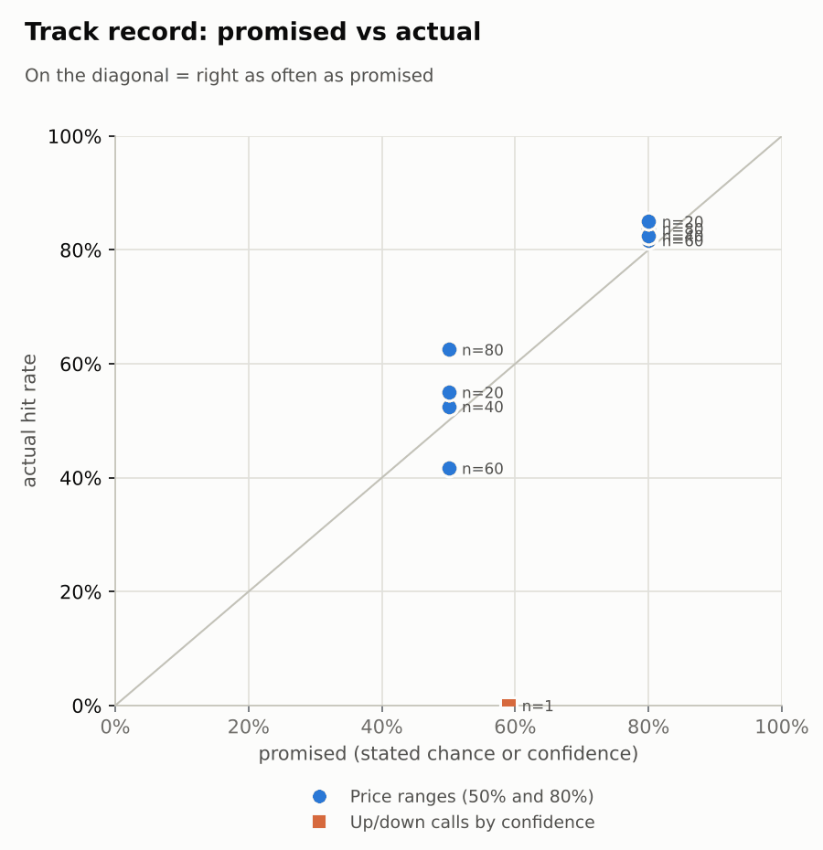

# Market brief: India (NSE), 2026-10-15

_Research log, not investment advice. Generated by a scheduled Claude Code routine._
<!-- report-data: as_of=2026-10-14 regime=CALM outcome=695fa078534e -->

Easy-to-read version with charts and filters: [2026-10-15.html](2026-10-15.html)

## Headline
No calls today: the forecaster and the Opus trader abstained on all 20 companies because the signal model sits near its base rate. Asia sold off hard overnight (KOSPI -7.57%, Nikkei -4.62%), so expect a weak open.

## Top 3 today
- Global risk-off: KOSPI fell 7.57%, the Nikkei 4.62% and the Nasdaq 1.88% overnight; today's ranges assume an index move of -0.39% from the S&P 500.
- Reliance: Jio Platforms set its IPO price band at Rs 1,065-1,119, opening October 21 (647fa4d8b1c2abf2, corroborated; nse-ann-106817653), but the band is below street estimates (4db31728d6abc1c6).
- Dr Reddy's: a US FDA Form 483 with three observations (239ea10a497aa9f6, unverified) and halted semaglutide supplies (3a337bdba8c87aac) weigh on the stock.

## Yesterday
The Nifty 50 fell 0.44% on October 14 while IT rallied: INFY rose 2.44% and TCS 1.57%, extending the IT rally (2296bbe93fb1739b). Pharma fell (18bd747210e51034): DRREDDY dropped 1.94% and SUNPHARMA 1.37% (a64ba7f1d8a741c4). HDFCLIFE fell 2.85% ahead of today's results.
FIIs sold a net 1,857 crore and DIIs bought 2,670 crore. N+1 80% ranges held 15 of 20; HINDUNILVR (up 1.07%) closed above its range.

Market on 2026-10-14: Nifty 50 22,622.70 (-0.4%) · India VIX 14.62 (+3.6%) · watchlist 7 up / 13 down · best INFY +2.4%, worst HDFCLIFE -2.8%

### Ranges scored (target date 2026-10-14)

N+1 ranges: **80% hit 15/20** (naive 16/20) · 50% hit 10/20

| Ticker | 80% range | 50% range | Actual | 80% | 50% | Naive 80% |
|---|---|---|---|---|---|---|
| ADANIPORTS | ₹1,685.51–₹1,818.37 | ₹1,717.59–₹1,783.14 | ₹1,748.70 | ✅ | ✅ | ✅ |
| DRREDDY | ₹1,209.60–₹1,272.86 | ₹1,225.02–₹1,256.24 | ₹1,216.00 | ✅ | ❌ | ✅ |
| HDFCBANK | ₹691.73–₹726.35 | ₹700.17–₹717.26 | ₹710.70 | ✅ | ✅ | ✅ |
| HDFCLIFE | ₹539.65–₹577.63 | ₹548.84–₹567.59 | ₹544.05 | ✅ | ❌ | ✅ |
| HINDALCO | ₹856.27–₹906.96 | ₹868.60–₹893.61 | ₹882.50 | ✅ | ✅ | ✅ |
| HINDUNILVR | ₹1,773.79–₹1,864.25 | ₹1,795.85–₹1,840.49 | ₹1,895.50 | ❌ | ❌ | ❌ |
| ICICIBANK | ₹1,318.28–₹1,367.55 | ₹1,330.36–₹1,354.68 | ₹1,338.60 | ✅ | ✅ | ✅ |
| INDIGO | ₹4,650.76–₹4,928.65 | ₹4,718.31–₹4,855.44 | ₹4,718.50 | ✅ | ✅ | ✅ |
| INFY | ₹991.46–₹1,056.04 | ₹1,007.13–₹1,039.00 | ₹1,088.00 | ❌ | ❌ | ❌ |
| ITC | ₹247.73–₹267.50 | ₹252.50–₹262.25 | ₹261.50 | ✅ | ✅ | ✅ |
| LT | ₹3,533.38–₹3,714.44 | ₹3,577.53–₹3,666.88 | ₹3,642.00 | ✅ | ✅ | ✅ |
| M&M | ₹2,743.71–₹2,876.90 | ₹2,776.22–₹2,841.95 | ₹2,793.70 | ✅ | ✅ | ✅ |
| MARUTI | ₹10,991.20–₹11,615.95 | ₹11,143.23–₹11,451.53 | ₹11,178.00 | ✅ | ✅ | ✅ |
| ONGC | ₹215.62–₹224.07 | ₹217.69–₹221.86 | ₹225.50 | ❌ | ❌ | ❌ |
| RELIANCE | ₹1,129.38–₹1,186.27 | ₹1,143.25–₹1,171.33 | ₹1,174.60 | ✅ | ❌ | ✅ |
| SBILIFE | ₹1,635.11–₹1,723.27 | ₹1,656.58–₹1,700.09 | ₹1,650.00 | ✅ | ❌ | ✅ |
| SUNPHARMA | ₹1,723.08–₹1,794.17 | ₹1,740.48–₹1,775.57 | ₹1,746.40 | ✅ | ✅ | ✅ |
| TATASTEEL | ₹167.60–₹176.55 | ₹169.78–₹174.20 | ₹174.49 | ✅ | ❌ | ✅ |
| TCS | ₹2,045.24–₹2,171.79 | ₹2,075.98–₹2,138.43 | ₹2,304.90 | ❌ | ❌ | ❌ |
| ULTRACEMCO | ₹10,248.72–₹10,770.85 | ₹10,376.05–₹10,633.72 | ₹10,795.00 | ❌ | ❌ | ✅ |

N+2 ranges that matured on the same date: 80% hit 18/20, 50% hit 10/20. N+3 ranges that matured on the same date: 80% hit 16/20, 50% hit 10/20. N+4 ranges that matured on the same date: 80% hit 17/20, 50% hit 11/20.

### Calls scored

| Ticker | H | Call | Conf. | Move | Hit |
|---|---|---|---|---|---|
| TCS | 1d · open→close | down | 59% | +6.86% | ❌ |

## Today (2026-10-15)

**Regime: CALM** · India VIX 14.62 (+3.6%) · benchmark 5d +0.1% · benchmark 10d vol 17.1%

| Ticker | Sector | Close | N+1 80% | N+1 50% | N+5 80% | Call | Cue | Notes |
|---|---|---|---|---|---|---|---|---|
| HDFCBANK | Banks | ₹710.70 | ₹691.19–₹724.55 | ₹699.22–₹715.63 | ₹670.34–₹742.25 | no call | -0.70% | cue -0.70% x0.5; earnings in horizon (x2.0 day); index -0.39% expected from SPX, x beta 1.23 x0.5, own cue -0.70% net x0.5 |
| ICICIBANK | Banks | ₹1,338.60 | ₹1,305.77–₹1,357.62 | ₹1,318.29–₹1,343.79 | ₹1,273.15–₹1,384.94 | no call | -0.95% | cue -0.95% x0.5; earnings in horizon (x2.0 day); index -0.39% expected from SPX, x beta 0.91 x0.5, own cue -0.95% net x0.5 |
| INFY | IT | ₹1,088.00 | ₹1,050.39–₹1,127.42 | ₹1,068.76–₹1,106.63 | ₹1,003.18–₹1,169.01 | no call | +0.26% | cue +0.26% x0.5; earnings in horizon (x2.0 day); index -0.39% expected from SPX, x beta 0.70 x0.5, own cue +0.26% net x0.5 |
| TCS | IT | ₹2,304.90 | ₹2,209.44–₹2,390.91 | ₹2,252.58–₹2,341.79 | ₹2,138.13–₹2,457.73 | no call | – | index -0.39% expected from SPX, x beta 0.81 x0.5 |
| SBILIFE | Insurance | ₹1,650.00 | ₹1,602.95–₹1,689.86 | ₹1,623.82–₹1,666.56 | ₹1,551.53–₹1,739.11 | no call | – | earnings in horizon (x2.0 day); index -0.39% expected from SPX, x beta 0.86 x0.5 |
| HDFCLIFE | Insurance | ₹544.05 | ₹513.62–₹572.18 | ₹527.38–₹556.16 | ₹502.43–₹582.35 | no call | – | earnings in horizon (x2.0 day); index -0.39% expected from SPX, x beta 0.96 x0.5 |
| ADANIPORTS | Transport | ₹1,748.70 | ₹1,680.83–₹1,805.58 | ₹1,710.57–₹1,771.90 | ₹1,633.54–₹1,853.55 | no call | – | index -0.39% expected from SPX, x beta 1.35 x0.5 |
| INDIGO | Transport | ₹4,718.50 | ₹4,567.20–₹4,831.84 | ₹4,630.65–₹4,760.79 | ₹4,472.26–₹4,939.70 | no call | – | index -0.39% expected from SPX, x beta 1.80 x0.5 |
| RELIANCE | Energy | ₹1,174.60 | ₹1,144.51–₹1,199.29 | ₹1,157.69–₹1,184.63 | ₹1,112.31–₹1,230.60 | no call | – | earnings in horizon (x2.0 day); index -0.39% expected from SPX, x beta 0.94 x0.5 |
| ONGC | Energy | ₹225.50 | ₹221.01–₹229.77 | ₹223.12–₹227.43 | ₹217.31–₹232.74 | no call | – | index -0.39% expected from SPX, x beta 0.04 x0.5 |
| SUNPHARMA | Pharma | ₹1,746.40 | ₹1,709.22–₹1,778.92 | ₹1,726.03–₹1,760.32 | ₹1,681.23–₹1,804.11 | no call | – | index -0.39% expected from SPX, x beta 0.46 x0.5 |
| DRREDDY | Pharma | ₹1,216.00 | ₹1,183.48–₹1,245.46 | ₹1,198.37–₹1,228.85 | ₹1,144.88–₹1,278.43 | no call | -0.16% | cue -0.16% x0.5; earnings in horizon (x2.0 day); index -0.39% expected from SPX, x beta 0.48 x0.5, own cue -0.16% net x0.5 |
| M&M | Autos | ₹2,793.70 | ₹2,713.12–₹2,856.16 | ₹2,747.48–₹2,817.82 | ₹2,660.41–₹2,912.92 | no call | – | index -0.39% expected from SPX, x beta 1.41 x0.5 |
| MARUTI | Autos | ₹11,178.00 | ₹10,857.08–₹11,440.35 | ₹10,997.14–₹11,283.98 | ₹10,635.06–₹11,664.03 | no call | – | index -0.39% expected from SPX, x beta 1.09 x0.5 |
| HINDUNILVR | Consumer goods | ₹1,895.50 | ₹1,841.17–₹1,942.02 | ₹1,865.38–₹1,914.98 | ₹1,801.71–₹1,979.53 | no call | – | index -0.39% expected from SPX, x beta 0.80 x0.5 |
| ITC | Consumer goods | ₹261.50 | ₹251.51–₹270.47 | ₹256.03–₹265.35 | ₹244.03–₹277.42 | no call | – | index -0.39% expected from SPX, x beta 0.74 x0.5 |
| LT | Construction | ₹3,642.00 | ₹3,541.62–₹3,718.18 | ₹3,584.08–₹3,670.91 | ₹3,477.25–₹3,789.00 | no call | – | index -0.39% expected from SPX, x beta 1.45 x0.5 |
| ULTRACEMCO | Construction | ₹10,795.00 | ₹10,493.69–₹11,031.31 | ₹10,622.90–₹10,887.30 | ₹10,184.40–₹11,345.87 | no call | – | earnings in horizon (x2.0 day); index -0.39% expected from SPX, x beta 1.29 x0.5 |
| TATASTEEL | Metals | ₹174.49 | ₹169.64–₹178.44 | ₹171.75–₹176.08 | ₹166.29–₹181.82 | no call | – | index -0.39% expected from SPX, x beta 1.08 x0.5 |
| HINDALCO | Metals | ₹882.50 | ₹854.28–₹906.99 | ₹866.90–₹892.82 | ₹833.63–₹926.54 | no call | – | index -0.39% expected from SPX, x beta 0.82 x0.5 |

No calls. The forecaster abstained on all 20 companies at N+1 and N+5: model P(up) for 19 of them sits at the base rate, and the track record is one settled call (a miss).
- HDFCLIFE: hard block, results today.
- HDFCBANK, ICICIBANK: results on October 17; only promotional evidence (4c49dda48cd8f3b9, promotional; 1df5ac9829605c6e, promotional).
- RELIANCE: model P(up) above 0.5 comes only from the untrained news prior; results fall inside the N+5 window.
- DRREDDY: the fresh Form 483 report is unverified (239ea10a497aa9f6, unverified); the earlier corroborated one (d4c571a25839c74c, corroborated) is already priced.
- TCS, INFY: extended after a 5-day rally; the last down call on TCS against IT momentum missed.
- The others: no verified catalyst; oversold names (MARUTI, M&M, HINDALCO) have no news behind a bounce.
AI traders (paper, separate from these calls): the pattern trader bought MARUTI, M&M and HINDALCO at N+3/N+5, the news trader went up on RELIANCE at N+1 and down on DRREDDY at N+1/N+3, the Sonnet combined trader kept the model's weak leans, and the Opus trader abstained.

### Overnight cues and global factors

| Symbol | Name | Last | Change |
|---|---|---|---|
| BRENT | Brent crude | 104.29 | -1.32% |
| DXY | US dollar index | 102.12 | -0.05% |
| GOLD | Gold | 4,158.00 | -0.46% |
| HANGSENG | Hang Seng | 24,061.20 | -1.04% |
| INDIAVIX | India VIX | 14.62 | +3.58% |
| KOSPI | KOSPI | 5,554.19 | -7.57% |
| NASDAQ | Nasdaq Composite (previous US close) | 26,692.87 | -1.88% |
| NIFTY50 | Nifty 50 | 22,622.70 | -0.44% |
| NIKKEI | Nikkei 225 | 64,612.52 | -4.62% |
| SHANGHAI | Shanghai Composite | 3,708.84 | -1.55% |
| SPX | S&P 500 (previous US close) | 7,718.94 | -1.11% |
| STOXX50 | Euro Stoxx 50 | 6,193.70 | +0.43% |
| TAIWAN | Taiwan Weighted | 47,192.87 | -2.95% |
| US10Y | US 10-year yield | 5.19 | -0.52% |
| USDINR | USD/INR | 95.14 | -0.66% |
| USDJPY | USD/JPY | 157.66 | -0.42% |
| USVIX | US VIX | 16.85 | +10.35% |

### ADRs (US-listed shares, previous US session)

| Ticker | ADR | Last | Change |
|---|---|---|---|
| DRREDDY | RDY | 12.75 | -0.16% |
| HDFCBANK | HDB | 22.60 | -0.70% |
| ICICIBANK | IBN | 28.27 | -0.95% |
| INFY | INFY | 11.43 | +0.26% |

## Tomorrow and this week

| Date | Event | Type |
|---|---|---|
| 2026-10-14 | Tata Consultancy Services ex-dividend (est. 12, last dividend) | company |
| 2026-10-15 | HDFC Life earnings | company |
| 2026-10-17 | HDFC Bank earnings | company |
| 2026-10-17 | ICICI Bank earnings | company |
| 2026-10-19 | Nifty weekly options expiry (Tuesday) |  |
| 2026-10-19 | UltraTech Cement earnings | company |
| 2026-10-21 | Reliance Industries earnings | company |
| 2026-10-23 | Dr Reddy's earnings | company |
| 2026-10-23 | Infosys earnings | company |
| 2026-10-23 | SBI Life Insurance earnings | company |
| 2026-10-27 | Larsen & Toubro earnings | company |
| 2026-10-27 | Maruti Suzuki earnings | company |
| 2026-10-27 | NSE monthly F&O expiry (last Tuesday) | major |
| 2026-10-27 | Nifty weekly options expiry (Tuesday) |  |
| 2026-10-28 | Adani Ports earnings | company |
| 2026-10-28 | Hindustan Unilever earnings | company |
| 2026-10-29 | FOMC rate decision (previous US evening) | major |
| 2026-10-29 | ITC earnings | company |
| 2026-11-03 | InterGlobe Aviation earnings | company |
| 2026-11-03 | Nifty weekly options expiry (Tuesday) |  |

Key risks: whether the Asian sell-off carries into India's open, continued FII selling (21,384 crore sold over the last 5 days), and the results of HDFC Life today and HDFC Bank and ICICI Bank on October 17. Later: Reliance on October 21, the F&O expiry on October 27 and the FOMC on October 29. India VIX is calm at 14.62, so ranges are not wide; the regime is CALM.

## By sector

### Banks

HDFCBANK fell 0.46% and ICICIBANK 1.59%; both ADRs were lower overnight. Both report on October 17.
Bull: HDFCBANK named a new CEO ahead of results (bbfaf6e7a7ff6731, promotional).
Bear: HSBC cut its HDFC Bank target (4c49dda48cd8f3b9) and Erste lowered ICICI Bank estimates (1df5ac9829605c6e). Mostly sector and market moves.

### IT

TCS rose 1.57% and INFY 2.44%, moving together with Nifty IT, which is up 8.69% over 5 days (2296bbe93fb1739b).
Bull: sector momentum; TCS signed a deal with MyState Bank (nse-ann-106816882).
Bear: both are stretched after the rally (TCS up 10.8% in 5 days), and the US suspended green card filings for TCS and other IT firms (0fdcc0f9c12347d0).

### Insurance

HDFCLIFE fell 2.85% and SBILIFE 2.2%, a sector move before HDFC Life's results today.
Bull: SBILIFE is near oversold (RSI 37) with no negative news.
Bear: HDFCLIFE's results today are a binary risk; no call is allowed on it.

### Transport

INDIGO fell 1.71% and ADANIPORTS 0.81%.
Bull: IndiGo secured $328 million in aircraft financing (679cacf3e79dc867, corroborated).
Bear: INDIGO is down 5.44% over 5 days with a beta of 1.8, so a weak market hits it hardest.

### Energy

ONGC rose 1.28% and RELIANCE 0.68%; they moved apart on company news.
Bull: Jio Platforms' IPO price band is set, opening October 21 (647fa4d8b1c2abf2, corroborated); ONGC's subsidiary MRPL reported higher profit (835d9af5e7c2b2e0, single_source).
Bear: the Jio band is below street estimates (4db31728d6abc1c6), and Reliance is near a 52-week low (28de01ec79a8b818).

### Pharma

DRREDDY fell 1.94% and SUNPHARMA 1.37% with Nifty Pharma down 1.3%: a sector move plus company news at Dr Reddy's (18bd747210e51034).
Bull: SUNPHARMA is oversold (RSI 33) and raised debt (nse-ann-106815017).
Bear: Dr Reddy's got an FDA Form 483 (d4c571a25839c74c, corroborated) and halted semaglutide supplies (3a337bdba8c87aac).

### Autos

M&M fell 2.47% and MARUTI 0.6%; both are down sharply over 20 days (M&M 7.78%, MARUTI 8.61%).
Bull: both are oversold (MARUTI RSI 28, M&M RSI 31).
Bear: Kotak cut its M&M target (e34d4b94903f11d4, promotional); the trend is still down.

### Consumer goods

HINDUNILVR rose 1.07% on heavy volume and ITC 0.19%.
Bull: HINDUNILVR's volume was 2.43 times its average.
Bear: no verified catalyst for either; ITC is down 1.58% over 5 days.

### Construction

LT fell 0.9% and ULTRACEMCO rose 0.42%; they moved apart.
Bull: ULTRACEMCO is up 1.29% over 5 days ahead of its results on October 19.
Bear: LT is down 5.42% over 20 days with negative on-balance volume.

### Metals

HINDALCO fell 2.19% and TATASTEEL 0.29%, both in a 20-day downtrend.
Bull: HINDALCO is oversold (RSI 31).
Bear: no catalyst; HINDALCO is down 7.95% over 20 days.

## Track record

Ranges (targets 50% / 80%; width, score and centre error in % of price, lower is better; naive = last close ± recent typical move, no-change = last close as the centre):

| H | Window | n | 50% cover | 80% cover | Naive 80% | Width | Naive width | Score | Naive score | Centre err | No-change err |
|---|---|---|---|---|---|---|---|---|---|---|---|
| 1d | since start | 80 | 63% | 84% | 84% | 5.41 | 5.80 | 7.709 | 7.957 | 1.46 | 1.46 |
| 1d | last 30 days | 80 | 63% | 84% | 84% | 5.41 | 5.80 | 7.709 | 7.957 | 1.46 | 1.46 |
| 2d | since start | 60 | 42% | 82% | 87% | 6.62 | 7.06 | 10.253 | 10.051 | 2.14 | 2.13 |
| 2d | last 30 days | 60 | 42% | 82% | 87% | 6.62 | 7.06 | 10.253 | 10.051 | 2.14 | 2.13 |
| 3d | since start | 40 | 53% | 83% | 90% | 7.58 | 8.09 | 12.651 | 12.701 | 2.41 | 2.35 |
| 3d | last 30 days | 40 | 53% | 83% | 90% | 7.58 | 8.09 | 12.651 | 12.701 | 2.41 | 2.35 |
| 4d | since start | 20 | 55% | 85% | 85% | 8.51 | 8.93 | 14.133 | 14.552 | 2.71 | 2.65 |
| 4d | last 30 days | 20 | 55% | 85% | 85% | 8.51 | 8.93 | 14.133 | 14.552 | 2.71 | 2.65 |

Ranges by regime (since start):

| H | Regime | n | 50% cover | 80% cover | Naive 80% |
|---|---|---|---|---|---|
| 1d | CALM | 80 | 63% | 84% | 84% |
| 2d | CALM | 60 | 42% | 82% | 87% |
| 3d | CALM | 40 | 53% | 83% | 90% |
| 4d | CALM | 20 | 55% | 85% | 85% |

Up/down calls vs the always-up baseline:

| H | Window | n | Hit rate | Always-up |
|---|---|---|---|---|
| 1d · open→close | since start | 1 | 0% | 100% |
| 1d · open→close | last 30 days | 1 | 0% | 100% |

Calls by confidence band (a band should hit about as often as its confidence):

| Band | n | Avg confidence | Hit rate |
|---|---|---|---|
| 0.50-0.59 · open→close | 1 | 59% | 0% |

Weekly review 2026-W41: 1 proposed range change for a human to decide (low sample) · [review-2026-W41.md](review-2026-W41.md)

## Data quality

- Indicators: 20 OK, partial: none, blocked: none
- Regime notes: none

| H | Calibration | History n | Live n | q10 / q90 |
|---|---|---|---|---|
| 1d | pool | 8780 | 80 | -1.26 / 1.18 |
| 2d | pool | 8760 | 60 | -1.28 / 1.16 |
| 3d | pool | 8740 | 40 | -1.29 / 1.15 |
| 4d | pool | 8720 | 20 | -1.35 / 1.12 |
| 5d | pool | 8700 | 0 | -1.34 / 1.14 |

- Collectors: all ran (exit 0). collect_relations_india warning: NSE pledge endpoint returned no rows at all for 10 per-ticker calls (check it is still live). collect_articles warning: 2 of 2 Google News links not decoded. collect_flows_india note: no NSE index file for 2026-10-15 yet (published after the close).
- collect_prices: ULTRACEMCO's Yahoo bar was stale (newest 2026-10-13); NSE resolved it, no bars filled from the bhavcopy.
- Results digest: TCS earnings-call text (TCS-concall-nse-ann-106817267) stored as text_unavailable; NSE PDFs not parsed (nse-ann-106811186, nse-ann-106817267).
- News enrichment: the background (non-watchlist) items were scored by keyword rules, partly in groups, so their scores are rough; every watchlist item was scored individually.
- Earnings date conflict: Reliance results are October 21 in the events calendar but October 16 in Yahoo's earnings estimates; not resolved.
- validation: collect warning NOT_FETCHED (announcements: newest first_seen_at 2026-10-14T15:46:19+00:00 is not from this run; tickers none). All other gates passed.
- Judge FAIL from a previous run: spotcheck run of 2026-10-12, round 1: the claims line of the 2026-10-07 report miscounted the clusters with claims by one. Nothing dropped.
