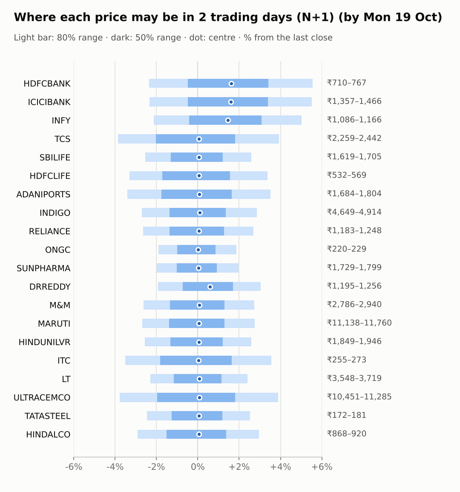
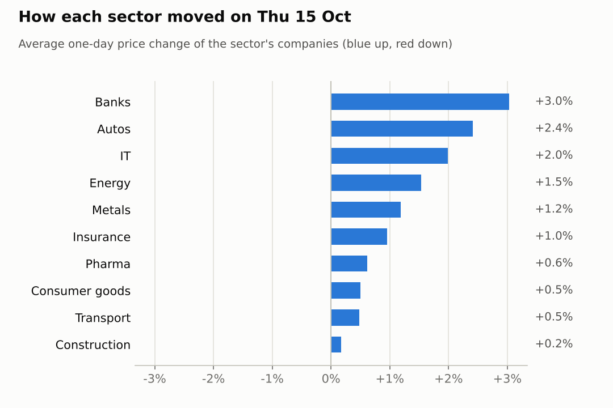
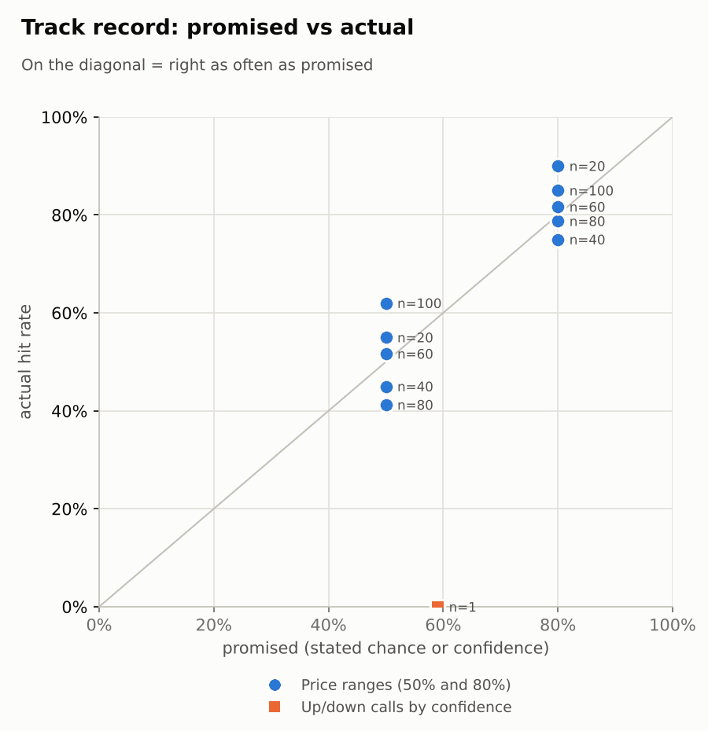

# Market brief: India (NSE), 2026-10-16

_Research log, not investment advice. Generated by a scheduled Claude Code routine._
<!-- report-data: as_of=2026-10-15 regime=TRENDING outcome=695fa078534e -->

Easy-to-read version with charts and filters: [2026-10-16.html](2026-10-16.html)

## Headline
Asian markets rose overnight (KOSPI +2.69%, Nikkei +1.63%) after the Nifty 50 gained 1.66% on Oct 15, but the system made no calls today: the signal model's P(up) sits near its base rate for all 20 companies. HDFCBANK and ICICIBANK report results on Oct 17.

## Top 3 today
- RELIANCE: the Jio Platforms IPO price band is confirmed by an NSE filing (nse-ann-106817653); the issue opens Oct 21, the same day as Reliance's Q2 results.
- MARUTI: a tax tribunal (ITAT) ruling in Maruti's favour was reported after the Oct 15 close (81e2a52cf419dc55, corroborated), so the Oct 15 close does not reflect it yet.
- HDFCBANK and ICICIBANK report results on Oct 17; their US-listed shares (ADRs) rose 3.98% and 4.14% overnight. No calls on either (earnings within 1 day).

## Yesterday
The Nifty 50 rose 1.66% on Oct 15 and 17 of the 20 watchlist stocks closed up. ICICIBANK led with +3.8% and RELIANCE rose 3.44% as the Jio IPO price band was confirmed (647fa4d8b1c2abf2, confirmed_primary); ONGC was the weakest at -0.4%.
The N+1 80% ranges held for 18 of 20 stocks. The two misses were upside breaks: RELIANCE closed at ₹1,215.00 above its range on the IPO news, and TCS at ₹2,350.00 above its range as the IT rally continued.
The one call scored, a TCS 1-day down call at 59% confidence, missed: TCS moved +6.86% (open to close).

Market on 2026-10-15: Nifty 50 22,997.35 (+1.7%) · India VIX 14.03 (-4.1%) · watchlist 17 up / 3 down · best ICICIBANK +3.8%, worst ONGC -0.4%

### Ranges scored (target date 2026-10-15)

N+1 ranges: **80% hit 18/20** (naive 17/20) · 50% hit 12/20

| Ticker | 80% range | 50% range | Actual | 80% | 50% | Naive 80% |
|---|---|---|---|---|---|---|
| ADANIPORTS | ₹1,696.68–₹1,826.21 | ₹1,728.09–₹1,791.41 | ₹1,743.20 | ✅ | ✅ | ✅ |
| DRREDDY | ₹1,207.29–₹1,269.02 | ₹1,222.39–₹1,252.58 | ₹1,218.80 | ✅ | ❌ | ✅ |
| HDFCBANK | ₹702.65–₹737.57 | ₹711.20–₹728.27 | ₹726.85 | ✅ | ✅ | ✅ |
| HDFCLIFE | ₹530.44–₹588.65 | ₹544.39–₹572.84 | ₹550.55 | ✅ | ✅ | ✅ |
| HINDALCO | ₹875.06–₹927.99 | ₹887.97–₹913.85 | ₹893.85 | ✅ | ✅ | ✅ |
| HINDUNILVR | ₹1,823.21–₹1,924.89 | ₹1,848.04–₹1,897.77 | ₹1,897.10 | ✅ | ✅ | ✅ |
| ICICIBANK | ₹1,343.01–₹1,394.61 | ₹1,355.69–₹1,380.93 | ₹1,389.40 | ✅ | ❌ | ❌ |
| INDIGO | ₹4,661.73–₹4,931.14 | ₹4,727.48–₹4,859.22 | ₹4,778.30 | ✅ | ✅ | ✅ |
| INFY | ₹1,038.92–₹1,114.23 | ₹1,057.20–₹1,094.02 | ₹1,110.00 | ✅ | ❌ | ❌ |
| ITC | ₹251.00–₹270.55 | ₹255.74–₹265.30 | ₹263.90 | ✅ | ✅ | ✅ |
| LT | ₹3,581.13–₹3,763.25 | ₹3,625.69–₹3,714.75 | ₹3,632.00 | ✅ | ✅ | ✅ |
| M&M | ₹2,793.04–₹2,931.45 | ₹2,826.92–₹2,894.61 | ₹2,861.70 | ✅ | ✅ | ✅ |
| MARUTI | ₹10,934.20–₹11,538.22 | ₹11,081.75–₹11,377.13 | ₹11,445.00 | ✅ | ❌ | ✅ |
| ONGC | ₹218.23–₹226.80 | ₹220.33–₹224.53 | ₹224.64 | ✅ | ❌ | ✅ |
| RELIANCE | ₹1,137.93–₹1,193.77 | ₹1,151.60–₹1,178.91 | ₹1,215.00 | ❌ | ❌ | ❌ |
| SBILIFE | ₹1,643.01–₹1,728.86 | ₹1,664.00–₹1,705.99 | ₹1,661.80 | ✅ | ❌ | ✅ |
| SUNPHARMA | ₹1,734.67–₹1,804.50 | ₹1,751.82–₹1,785.97 | ₹1,764.00 | ✅ | ✅ | ✅ |
| TATASTEEL | ₹170.31–₹179.42 | ₹172.54–₹176.99 | ₹176.40 | ✅ | ✅ | ✅ |
| TCS | ₹2,164.78–₹2,345.90 | ₹2,208.58–₹2,297.13 | ₹2,350.00 | ❌ | ❌ | ✅ |
| ULTRACEMCO | ₹10,465.42–₹11,017.97 | ₹10,600.51–₹10,870.72 | ₹10,862.00 | ✅ | ✅ | ✅ |

N+2 ranges that matured on the same date: 80% hit 14/20, 50% hit 8/20. N+3 ranges that matured on the same date: 80% hit 16/20, 50% hit 10/20. N+4 ranges that matured on the same date: 80% hit 13/20, 50% hit 7/20. N+5 ranges that matured on the same date: 80% hit 18/20, 50% hit 11/20.

### Calls scored

| Ticker | H | Call | Conf. | Move | Hit |
|---|---|---|---|---|---|
| TCS | 1d · open→close | down | 59% | +6.86% | ❌ |

## Today (2026-10-16)

**Regime: TRENDING** · India VIX 14.05 (-4.0%) · benchmark 5d +3.4% · benchmark 10d vol 18.9%

| Ticker | Sector | Close | N+1 80% | N+1 50% | N+5 80% | Call | Cue | Notes |
|---|---|---|---|---|---|---|---|---|
| HDFCBANK | Banks | ₹726.85 | ₹709.72–₹767.29 | ₹723.39–₹751.68 | ₹699.87–₹778.61 | no call | +3.98% | cue +3.98% x0.5; earnings in horizon (x2.0 day); index +0.11% expected from SPX, x beta 1.23 x0.5, own cue +3.98% net x0.5 |
| ICICIBANK | Banks | ₹1,389.40 | ₹1,356.90–₹1,466.12 | ₹1,382.84–₹1,436.51 | ₹1,339.43–₹1,488.97 | no call | +4.14% | cue +4.14% x0.5; earnings in horizon (x2.0 day); index +0.11% expected from SPX, x beta 0.93 x0.5, own cue +4.14% net x0.5 |
| INFY | IT | ₹1,110.00 | ₹1,086.35–₹1,165.63 | ₹1,105.23–₹1,144.19 | ₹1,053.47–₹1,226.73 | no call | +6.10% | cue +6.10% x0.5; earnings in horizon (x2.0 day); index +0.11% expected from SPX, x beta 0.71 x0.5, own cue +6.10% net x0.5 |
| TCS | IT | ₹2,350.00 | ₹2,259.06–₹2,442.34 | ₹2,302.59–₹2,392.63 | ₹2,182.33–₹2,504.44 | no call | – | index +0.11% expected from SPX, x beta 0.82 x0.5 |
| SBILIFE | Insurance | ₹1,661.80 | ₹1,619.44–₹1,704.83 | ₹1,639.93–₹1,681.89 | ₹1,565.47–₹1,749.36 | no call | – | earnings in horizon (x2.0 day); index +0.11% expected from SPX, x beta 0.86 x0.5 |
| HDFCLIFE | Insurance | ₹550.55 | ₹532.34–₹569.09 | ₹541.11–₹559.16 | ₹516.76–₹581.37 | no call | – | index +0.11% expected from SPX, x beta 0.96 x0.5 |
| ADANIPORTS | Transport | ₹1,743.20 | ₹1,683.75–₹1,804.46 | ₹1,712.51–₹1,771.83 | ₹1,632.35–₹1,844.52 | no call | – | index +0.11% expected from SPX, x beta 1.33 x0.5 |
| INDIGO | Transport | ₹4,778.30 | ₹4,649.17–₹4,914.28 | ₹4,712.67–₹4,842.97 | ₹4,533.35–₹4,999.49 | no call | – | index +0.11% expected from SPX, x beta 1.78 x0.5 |
| RELIANCE | Energy | ₹1,215.00 | ₹1,182.87–₹1,247.75 | ₹1,198.43–₹1,230.31 | ₹1,141.90–₹1,281.59 | no call | – | earnings in horizon (x2.0 day); index +0.11% expected from SPX, x beta 0.95 x0.5 |
| ONGC | Energy | ₹224.64 | ₹220.35–₹228.82 | ₹222.39–₹226.56 | ₹216.75–₹231.66 | no call | – | index +0.11% expected from SPX, x beta 0.04 x0.5 |
| SUNPHARMA | Pharma | ₹1,764.00 | ₹1,729.11–₹1,798.85 | ₹1,745.92–₹1,780.20 | ₹1,699.04–₹1,821.84 | no call | – | index +0.11% expected from SPX, x beta 0.46 x0.5 |
| DRREDDY | Pharma | ₹1,218.80 | ₹1,195.37–₹1,255.86 | ₹1,209.89–₹1,239.63 | ₹1,157.59–₹1,287.95 | no call | +1.18% | cue +1.18% x0.5; earnings in horizon (x2.0 day); index +0.11% expected from SPX, x beta 0.47 x0.5, own cue +1.18% net x0.5 |
| M&M | Autos | ₹2,861.70 | ₹2,786.42–₹2,939.89 | ₹2,823.20–₹2,898.63 | ₹2,719.75–₹2,989.68 | no call | – | index +0.11% expected from SPX, x beta 1.41 x0.5 |
| MARUTI | Autos | ₹11,445.00 | ₹11,137.92–₹11,759.78 | ₹11,286.93–₹11,592.57 | ₹10,869.91–₹11,963.79 | no call | – | index +0.11% expected from SPX, x beta 1.09 x0.5 |
| HINDUNILVR | Consumer goods | ₹1,897.10 | ₹1,848.53–₹1,946.31 | ₹1,871.98–₹1,920.04 | ₹1,806.54–₹1,978.59 | no call | – | index +0.11% expected from SPX, x beta 0.79 x0.5 |
| ITC | Consumer goods | ₹263.90 | ₹254.63–₹273.28 | ₹259.07–₹268.23 | ₹246.79–₹279.56 | no call | – | index +0.11% expected from SPX, x beta 0.74 x0.5 |
| LT | Construction | ₹3,632.00 | ₹3,548.35–₹3,719.37 | ₹3,589.44–₹3,673.51 | ₹3,473.34–₹3,774.22 | no call | – | index +0.11% expected from SPX, x beta 1.43 x0.5 |
| ULTRACEMCO | Construction | ₹10,862.00 | ₹10,450.83–₹11,284.95 | ₹10,649.00–₹11,058.83 | ₹10,265.91–₹11,402.18 | no call | – | earnings in horizon (x2.0 day); index +0.11% expected from SPX, x beta 1.28 x0.5 |
| TATASTEEL | Metals | ₹176.40 | ₹172.07–₹180.84 | ₹174.18–₹178.49 | ₹168.27–₹183.70 | no call | – | index +0.11% expected from SPX, x beta 1.07 x0.5 |
| HINDALCO | Metals | ₹893.85 | ₹867.73–₹920.33 | ₹880.31–₹906.16 | ₹845.30–₹937.82 | no call | – | index +0.11% expected from SPX, x beta 0.82 x0.5 |

No calls today. The forecaster abstained on all 20 companies at both horizons.
- HDFCBANK, ICICIBANK: hard block, results on Oct 17 (earnings within 1 day).
- RELIANCE: the model's 0.521 rests only on the untrained news prior; the confirmed IPO news (nse-ann-106817653) moved the stock on Oct 15, and the Q2 results and the IPO opening on Oct 21 fall inside the 5-day window.
- MARUTI: the tax ruling (81e2a52cf419dc55, corroborated) came after the close, so it lands in today's open, which an open-to-close call does not capture; the model is a coin flip.
- DRREDDY: the USFDA observations are only single-source (d942c00315589da1, single_source), which cannot be a call's main evidence; results on Oct 23 fall inside the 5-day window.
- INFY, SBILIFE: results on Oct 23 fall inside the 5-day window; no verified catalyst.
- ULTRACEMCO: results on Oct 19.
- HDFCLIFE: mixed Q2 results, single-source coverage (971db646d0823db7, single_source).
- TCS: overbought after the rally, but three 5-day down calls are already open and the last 1-day down call missed.
- All others (ADANIPORTS, HINDALCO, HINDUNILVR, INDIGO, ITC, LT, M&M, ONGC, SUNPHARMA, TATASTEEL): no verified news beyond what the model already weighs; the model sits near its base rate.
Paper strategies (not calls): the AI news trader leaned up on MARUTI, the pattern trader up on TCS and INFY, the combined Sonnet trader mostly thin down leans; the Opus combined trader abstained on all.

### Overnight cues and global factors

| Symbol | Name | Last | Change |
|---|---|---|---|
| BRENT | Brent crude | 105.49 | -0.54% |
| DXY | US dollar index | 102.02 | -0.52% |
| GOLD | Gold | 4,175.50 | +1.65% |
| HANGSENG | Hang Seng | 24,292.21 | +0.95% |
| INDIAVIX | India VIX | 14.05 | -3.98% |
| KOSPI | KOSPI | 5,703.75 | +2.69% |
| NASDAQ | Nasdaq Composite (previous US close) | 26,713.03 | +0.08% |
| NIFTY50 | Nifty 50 | 22,997.35 | +1.66% |
| NIKKEI | Nikkei 225 | 65,474.10 | +1.63% |
| SHANGHAI | Shanghai Composite | 3,729.98 | +0.61% |
| SPX | S&P 500 (previous US close) | 7,744.06 | +0.33% |
| STOXX50 | Euro Stoxx 50 | 6,164.13 | -0.42% |
| TAIWAN | Taiwan Weighted | 47,430.39 | +0.98% |
| US10Y | US 10-year yield | 5.09 | -1.95% |
| USDINR | USD/INR | 95.05 | -0.11% |
| USDJPY | USD/JPY | 158.00 | +0.03% |
| USVIX | US VIX | 16.46 | -2.43% |

### ADRs (US-listed shares, previous US session)

| Ticker | ADR | Last | Change |
|---|---|---|---|
| DRREDDY | RDY | 12.90 | +1.18% |
| HDFCBANK | HDB | 23.53 | +3.98% |
| ICICIBANK | IBN | 29.44 | +4.14% |
| INFY | INFY | 12.18 | +6.10% |

## Tomorrow and this week

| Date | Event | Type |
|---|---|---|
| 2026-10-15 | HDFC Life earnings | company |
| 2026-10-17 | HDFC Bank earnings | company |
| 2026-10-17 | ICICI Bank earnings | company |
| 2026-10-19 | Nifty weekly options expiry (Tuesday) |  |
| 2026-10-19 | UltraTech Cement earnings | company |
| 2026-10-21 | Reliance Industries earnings | company |
| 2026-10-23 | Dr Reddy's earnings | company |
| 2026-10-23 | Infosys earnings | company |
| 2026-10-23 | SBI Life Insurance earnings | company |
| 2026-10-27 | Larsen & Toubro earnings | company |
| 2026-10-27 | Maruti Suzuki earnings | company |
| 2026-10-27 | NSE monthly F&O expiry (last Tuesday) | major |
| 2026-10-27 | Nifty weekly options expiry (Tuesday) |  |
| 2026-10-28 | Adani Ports earnings | company |
| 2026-10-28 | Hindustan Unilever earnings | company |
| 2026-10-29 | FOMC rate decision (previous US evening) | major |
| 2026-10-29 | ITC earnings | company |
| 2026-11-03 | InterGlobe Aviation earnings | company |
| 2026-11-03 | Nifty weekly options expiry (Tuesday) |  |
| 2026-11-05 | Mahindra & Mahindra earnings | company |
| 2026-11-05 | Sun Pharma earnings | company |

Overnight cues point to a firm open: Asia is up (KOSPI +2.69%, Nikkei +1.63%, Hang Seng +0.95%) and the INFY ADR rose 6.1%. The regime is TRENDING with India VIX at 14.05.
Risks: FIIs keep selling (net -5,285 crore on Oct 15, -13,725 crore over 5 reported days), and the Nifty 50 is up 3.44% in 5 days, so a pullback is possible.
This week and next: HDFCBANK and ICICIBANK results on Oct 17, ULTRACEMCO on Oct 19, RELIANCE results and the Jio IPO opening on Oct 21, then DRREDDY, INFY and SBILIFE on Oct 23. The FOMC decision is on Oct 29.

## By sector

### Banks

HDFCBANK rose 2.27% and ICICIBANK 3.8% on Oct 15, together, ahead of both results on Oct 17; their ADRs added 3.98% and 4.14% overnight.
Bull: strong trend into results, ICICIBANK at its 20-day high. Bear: much of the move is already in the price before the print. No calls (earnings within 1 day).

### IT

TCS and INFY kept rallying with the sector: Nifty IT is up 10.76% in 5 days, TCS 13.2% and INFY 11.33%. Both moved together, so this is sector money, not company news.
Bull: momentum and the INFY ADR's +6.1% overnight. Bear: RSI 67 for TCS and 63 for INFY after a sharp run; INFY reports Oct 23.

### Insurance

HDFCLIFE rose 1.19% and SBILIFE 0.72%. HDFCLIFE filed Q2 results (nse-ann-106818660); profit growth was reported by one outlet (971db646d0823db7, single_source).
Bull: HDFCLIFE's profit and new-business value grew. Bear: HDFCLIFE's EPS of 2.34 was below the 2.5 consensus, and proposed IRDAI rules are a risk.

### Transport

INDIGO rose 1.27% while ADANIPORTS fell 0.31%, so they moved apart on company news.
Bull: INDIGO's Airbus financing is corroborated (679cacf3e79dc867, corroborated). Bear: ADANIPORTS has only an unverified report of GQG trimming its stake (32f1ff7db62f165d, unverified).

### Energy

RELIANCE rose 3.44% on heavy volume while ONGC fell 0.38%: company news, not sector.
Bull: RELIANCE's Jio IPO price band is confirmed (d4da9b26c54c0f3c, confirmed_primary). Bear: the IPO and Q2 results both land on Oct 21, a sell-the-news risk; ONGC has no catalyst and Brent is down 0.54%.

### Pharma

SUNPHARMA rose 1.01% and DRREDDY 0.23%; Nifty Pharma rose 0.31%.
Bull: DRREDDY's 20-day trend is up 6.91%. Bear: DRREDDY got three USFDA observations at its FTO-9 plant, so far single-source (d942c00315589da1, single_source); SUNPHARMA is down 4.83% over 20 days.

### Autos

M&M rose 2.43% and MARUTI 2.39%, together with the market.
Bull: MARUTI's tax tribunal win came after the close (81e2a52cf419dc55, corroborated) and M&M launched a CNG XUV 3XO (aff622c9a2d4ef7c, corroborated). Bear: both are still down over 20 days (M&M -6.79%, MARUTI -5.93%).

### Consumer goods

ITC rose 0.92% and HINDUNILVR 0.08%, lagging the market.
Bull: ITC's delivery share rose, so buyers took shares home. Bear: no verified news for either; HINDUNILVR is down 3.31% over 20 days.

### Construction

ULTRACEMCO rose 0.62% while LT fell 0.27%, so they moved apart.
Bull: ULTRACEMCO is near its 20-day high. Bear: LT is down 4.61% over 20 days, and ULTRACEMCO reports on Oct 19, so its range is doubled.

### Metals

HINDALCO rose 1.29% and TATASTEEL 1.09%, together.
Bull: HINDALCO's RSI of 35 leaves room for a bounce. Bear: HINDALCO is down 8.11% over 20 days; TATASTEEL's subsidiary merger approval is low-impact news (2c1d47cc0e3d61e1, unverified).

## Track record

Ranges (targets 50% / 80%; width, score and centre error in % of price, lower is better; naive = last close ± recent typical move, no-change = last close as the centre):

| H | Window | n | 50% cover | 80% cover | Naive 80% | Width | Naive width | Score | Naive score | Centre err | No-change err |
|---|---|---|---|---|---|---|---|---|---|---|---|
| 1d | since start | 100 | 62% | 85% | 84% | 5.47 | 5.87 | 7.508 | 7.825 | 1.46 | 1.49 |
| 1d | last 30 days | 100 | 62% | 85% | 84% | 5.47 | 5.87 | 7.508 | 7.825 | 1.46 | 1.49 |
| 2d | since start | 80 | 41% | 79% | 84% | 6.67 | 7.11 | 11.548 | 11.265 | 2.29 | 2.28 |
| 2d | last 30 days | 80 | 41% | 79% | 84% | 6.67 | 7.11 | 11.548 | 11.265 | 2.29 | 2.28 |
| 3d | since start | 60 | 52% | 82% | 88% | 7.67 | 8.16 | 12.723 | 12.626 | 2.36 | 2.34 |
| 3d | last 30 days | 60 | 52% | 82% | 88% | 7.67 | 8.16 | 12.723 | 12.626 | 2.36 | 2.34 |
| 4d | since start | 40 | 45% | 75% | 80% | 8.63 | 9.05 | 16.104 | 15.744 | 3.02 | 2.98 |
| 4d | last 30 days | 40 | 45% | 75% | 80% | 8.63 | 9.05 | 16.104 | 15.744 | 3.02 | 2.98 |
| 5d | since start | 20 | 55% | 90% | 90% | 9.44 | 9.78 | 16.378 | 16.724 | 2.82 | 2.73 |
| 5d | last 30 days | 20 | 55% | 90% | 90% | 9.44 | 9.78 | 16.378 | 16.724 | 2.82 | 2.73 |

Ranges by regime (since start):

| H | Regime | n | 50% cover | 80% cover | Naive 80% |
|---|---|---|---|---|---|
| 1d | CALM | 100 | 62% | 85% | 84% |
| 2d | CALM | 80 | 41% | 79% | 84% |
| 3d | CALM | 60 | 52% | 82% | 88% |
| 4d | CALM | 40 | 45% | 75% | 80% |
| 5d | CALM | 20 | 55% | 90% | 90% |

Up/down calls vs the always-up baseline:

| H | Window | n | Hit rate | Always-up |
|---|---|---|---|---|
| 1d · open→close | since start | 1 | 0% | 100% |
| 1d · open→close | last 30 days | 1 | 0% | 100% |

Calls by confidence band (a band should hit about as often as its confidence):

| Band | n | Avg confidence | Hit rate |
|---|---|---|---|
| 0.50-0.59 · open→close | 1 | 59% | 0% |

Weekly review 2026-W41: 1 proposed range change for a human to decide (low sample) · [review-2026-W41.md](review-2026-W41.md)

## Data quality

- Indicators: 20 OK, partial: none, blocked: none
- Regime notes: none

| H | Calibration | History n | Live n | q10 / q90 |
|---|---|---|---|---|
| 1d | pool | 8800 | 100 | -1.24 / 1.19 |
| 2d | pool | 8780 | 80 | -1.27 / 1.20 |
| 3d | pool | 8760 | 60 | -1.28 / 1.16 |
| 4d | pool | 8740 | 40 | -1.33 / 1.15 |
| 5d | pool | 8720 | 20 | -1.33 / 1.14 |

- Collectors: all ran. NSE financials: 2 old LT Integrated Filing XML files (2025) returned HTTP 404 from nsearchives.nseindia.com (`collect_nse_india` failed entries).
- Yahoo's crumb request was rate-limited (too many requests); the collectors continued without it and nothing failed.
- Prices: Yahoo was a session behind for INDIGO, DRREDDY and ULTRACEMCO; NSE's bhavcopy confirmed the bars (`resolved_by_nse`), none filled from NSE.
- Articles: 7 candidates; 5 skipped as unvetted outlets (upstox.com, pluang.com, gurufocus.com, bwautoworld.com, latestly.com), 1 paywalled, 1 read in full.
- Claims: 15 high-materiality clusters checked and their claims stored; 3 clusters had nothing checkable (share-price moves only).
- Results digests: none due; 2 NSE results attachments not read (PDF parser not configured: nse-ann-106811186, nse-ann-106817267).
- News scoring: the news analyst scored 1,921 pending items; many watchlist and all background items were scored in groups with shared summaries, so background sentiment is rough.
- Earnings dates: RELIANCE has two stored dates (Oct 16 first seen Oct 5, and Oct 21 first seen Oct 15); the pack and the forecaster use Oct 21. If Reliance reports today, a call would have been blocked; none was made.
- validation: collect, warning NOT_FETCHED: the newest NSE announcement (first seen 2026-10-15T15:29Z) is not from this run; tickers: none listed; nothing dropped.
- validation: collect, warning COLLECTOR_FAILED: nse_india 2 failed (the LT financials files above); nothing dropped.
- validation: features, context, news and forecast gates passed with no failures or warnings.
- AI traders: news_results 3 predictions (abstained 17, earnings_window 2); pattern_mood 4 predictions (abstained 18, earnings_window 2); combined Sonnet thin down leans on most companies (abstained 6, earnings_window 2); combined Opus 0 predictions (abstained 18, earnings_window 2). All lines passed the gate on the first attempt.
- Judge FAIL from a previous run: 2026-10-12, spotcheck, round 1: the 2026-10-07 report's data_quality claims line said 11 of 15 clusters, stored data shows 12 of 15; nothing dropped.
