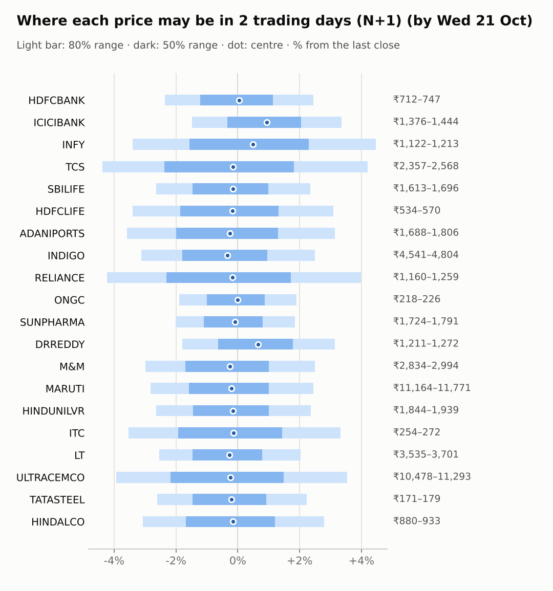
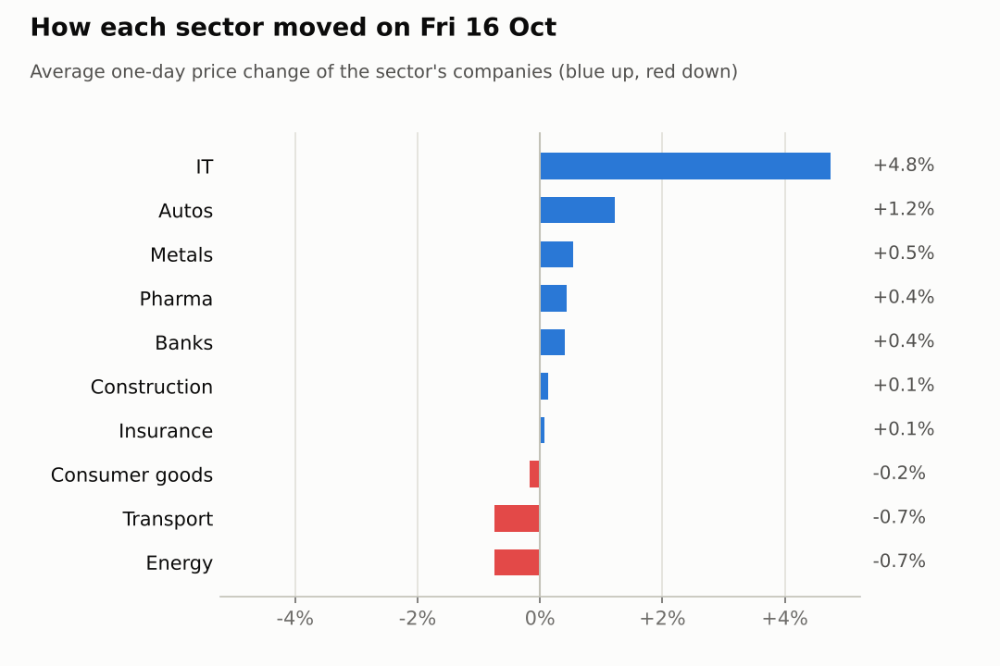
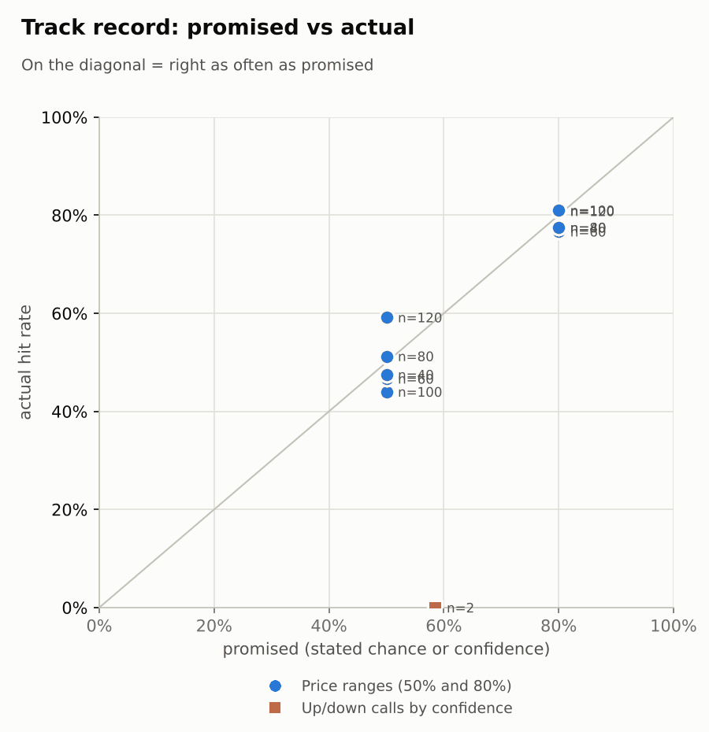

# Market brief: India (NSE), 2026-10-19

_Research log, not investment advice. Generated by a scheduled Claude Code routine._
<!-- report-data: as_of=2026-10-16 regime=TRENDING outcome=70248abff9bf -->

Easy-to-read version with charts and filters: [2026-10-19.html](2026-10-19.html)

## Headline
No calls today: the signal model sits near its base rate for every company, and the overnight cues are risk-off (Nasdaq -2.15%, US VIX up 21.39% to 19.98). ICICIBANK opens on its Saturday Q2 results (nse-ann-106821125); ULTRACEMCO reports today.

## Top 3 today
- ICICIBANK reacts today to its Q2 results filed on Saturday, after the as-of close (nse-ann-106821125); its ADR rose 1.87% before the results.
- IT is stretched after the rally: TCS is up 14.33% and INFY 13.46% over 5 days (RSI 74 and 70), while the Nasdaq fell 2.15% overnight (no news id; price data).
- RELIANCE reports on Oct 21, the day the Jio Platforms IPO opens (nse-ann-106817653); ULTRACEMCO reports today.

## Yesterday
The Nifty 50 rose 0.65% on Oct 16, led by IT: TCS rose 4.89% and INFY 4.61%, and Nifty IT rose 3.92%. INDIGO fell 1.91% and ONGC 1.18%.
The N+1 80% ranges held for 12 of 20 companies. Eight closed above their bands (HDFCBANK, HINDALCO, ICICIBANK, INFY, M&M, MARUTI, RELIANCE, TCS): a broad up day that the ranges, built on a weaker US cue, did not expect.
The one call scored, TCS down at 5 days, missed: TCS rose 18.17% over the window as the IT rally continued.

Market on 2026-10-16: Nifty 50 23,146.15 (+0.6%) · India VIX 14.03 (+0.0%) · watchlist 11 up / 9 down · best TCS +4.9%, worst INDIGO -1.9%

### Ranges scored (target date 2026-10-16)

N+1 ranges: **80% hit 12/20** (naive 15/20) · 50% hit 9/20

| Ticker | 80% range | 50% range | Actual | 80% | 50% | Naive 80% |
|---|---|---|---|---|---|---|
| ADANIPORTS | ₹1,680.83–₹1,805.58 | ₹1,710.57–₹1,771.90 | ₹1,750.80 | ✅ | ✅ | ✅ |
| DRREDDY | ₹1,183.48–₹1,245.46 | ₹1,198.37–₹1,228.85 | ₹1,233.00 | ✅ | ❌ | ✅ |
| HDFCBANK | ₹691.19–₹724.55 | ₹699.22–₹715.63 | ₹728.85 | ❌ | ❌ | ✅ |
| HDFCLIFE | ₹513.62–₹572.18 | ₹527.38–₹556.16 | ₹553.00 | ✅ | ✅ | ✅ |
| HINDALCO | ₹854.28–₹906.99 | ₹866.90–₹892.82 | ₹908.00 | ❌ | ❌ | ✅ |
| HINDUNILVR | ₹1,841.17–₹1,942.02 | ₹1,865.38–₹1,914.98 | ₹1,893.80 | ✅ | ✅ | ✅ |
| ICICIBANK | ₹1,305.77–₹1,357.62 | ₹1,318.29–₹1,343.79 | ₹1,397.00 | ❌ | ❌ | ❌ |
| INDIGO | ₹4,567.20–₹4,831.84 | ₹4,630.65–₹4,760.79 | ₹4,686.90 | ✅ | ✅ | ✅ |
| INFY | ₹1,050.39–₹1,127.42 | ₹1,068.76–₹1,106.63 | ₹1,161.20 | ❌ | ❌ | ❌ |
| ITC | ₹251.51–₹270.47 | ₹256.03–₹265.35 | ₹263.50 | ✅ | ✅ | ✅ |
| LT | ₹3,541.62–₹3,718.18 | ₹3,584.08–₹3,670.91 | ₹3,627.10 | ✅ | ✅ | ✅ |
| M&M | ₹2,713.12–₹2,856.16 | ₹2,747.48–₹2,817.82 | ₹2,920.90 | ❌ | ❌ | ❌ |
| MARUTI | ₹10,857.08–₹11,440.35 | ₹10,997.14–₹11,283.98 | ₹11,489.00 | ❌ | ❌ | ✅ |
| ONGC | ₹221.01–₹229.77 | ₹223.12–₹227.43 | ₹222.00 | ✅ | ❌ | ✅ |
| RELIANCE | ₹1,144.51–₹1,199.29 | ₹1,157.69–₹1,184.63 | ₹1,211.20 | ❌ | ❌ | ❌ |
| SBILIFE | ₹1,602.95–₹1,689.86 | ₹1,623.82–₹1,666.56 | ₹1,656.80 | ✅ | ✅ | ✅ |
| SUNPHARMA | ₹1,709.22–₹1,778.92 | ₹1,726.03–₹1,760.32 | ₹1,758.80 | ✅ | ✅ | ✅ |
| TATASTEEL | ₹169.64–₹178.44 | ₹171.75–₹176.08 | ₹175.50 | ✅ | ✅ | ✅ |
| TCS | ₹2,209.44–₹2,390.91 | ₹2,252.58–₹2,341.79 | ₹2,465.00 | ❌ | ❌ | ❌ |
| ULTRACEMCO | ₹10,493.69–₹11,031.31 | ₹10,622.90–₹10,887.30 | ₹10,907.00 | ✅ | ❌ | ✅ |

N+2 ranges that matured on the same date: 80% hit 18/20, 50% hit 11/20. N+3 ranges that matured on the same date: 80% hit 13/20, 50% hit 10/20. N+4 ranges that matured on the same date: 80% hit 16/20, 50% hit 10/20. N+5 ranges that matured on the same date: 80% hit 13/20, 50% hit 8/20.

### Calls scored

| Ticker | H | Call | Conf. | Move | Hit |
|---|---|---|---|---|---|
| TCS | 5d · open→close | down | 58% | +18.17% | ❌ |

## Today (2026-10-19)

**Regime: TRENDING** · India VIX 14.01 (-0.2%) · benchmark 5d +2.8% · benchmark 10d vol 18.0%

| Ticker | Sector | Close | N+1 80% | N+1 50% | N+5 80% | Call | Cue | Notes |
|---|---|---|---|---|---|---|---|---|
| HDFCBANK | Banks | ₹728.85 | ₹711.70–₹746.71 | ₹719.99–₹737.17 | ₹692.43–₹763.67 | no call | +0.08% | cue +0.08% x0.5; index -0.37% expected from SPX, x beta 1.23 x0.5, own cue +0.08% net x0.5; major event x1.15 |
| ICICIBANK | Banks | ₹1,397.00 | ₹1,376.43–₹1,443.86 | ₹1,392.40–₹1,425.48 | ₹1,339.29–₹1,476.53 | no call | +1.87% | cue +1.87% x0.5; index -0.37% expected from SPX, x beta 0.92 x0.5, own cue +1.87% net x0.5; major event x1.15 |
| INFY | IT | ₹1,161.20 | ₹1,121.70–₹1,213.11 | ₹1,143.10–₹1,187.92 | ₹1,052.44–₹1,279.93 | no call | +0.98% | cue +0.98% x0.5; earnings in horizon (x2.0 day); index -0.37% expected from SPX, x beta 0.72 x0.5, own cue +0.98% net x0.5; major event x1.15 |
| TCS | IT | ₹2,465.00 | ₹2,356.97–₹2,568.34 | ₹2,406.29–₹2,509.93 | ₹2,247.51–₹2,677.80 | no call | – | index -0.37% expected from SPX, x beta 0.83 x0.5; major event x1.15 |
| SBILIFE | Insurance | ₹1,656.80 | ₹1,613.01–₹1,695.74 | ₹1,632.58–₹1,673.17 | ₹1,551.15–₹1,757.60 | no call | – | earnings in horizon (x2.0 day); index -0.37% expected from SPX, x beta 0.85 x0.5; major event x1.15 |
| HDFCLIFE | Insurance | ₹553.00 | ₹534.23–₹570.11 | ₹542.67–₹560.27 | ₹515.66–₹588.77 | no call | – | index -0.37% expected from SPX, x beta 0.96 x0.5; major event x1.15 |
| ADANIPORTS | Transport | ₹1,750.80 | ₹1,688.16–₹1,805.89 | ₹1,715.83–₹1,773.57 | ₹1,628.34–₹1,868.38 | no call | – | index -0.37% expected from SPX, x beta 1.33 x0.5; major event x1.15 |
| INDIGO | Transport | ₹4,686.90 | ₹4,540.74–₹4,803.84 | ₹4,602.84–₹4,731.90 | ₹4,411.39–₹4,948.46 | no call | – | index -0.37% expected from SPX, x beta 1.77 x0.5; major event x1.15 |
| RELIANCE | Energy | ₹1,211.20 | ₹1,160.03–₹1,259.40 | ₹1,183.25–₹1,231.97 | ₹1,131.05–₹1,287.87 | no call | – | earnings in horizon (x2.0 day); index -0.37% expected from SPX, x beta 0.95 x0.5; major event x1.15 |
| ONGC | Energy | ₹222.00 | ₹217.78–₹226.21 | ₹219.78–₹223.92 | ₹213.11–₹230.28 | no call | – | index -0.37% expected from SPX, x beta 0.03 x0.5; major event x1.15 |
| SUNPHARMA | Pharma | ₹1,758.80 | ₹1,723.52–₹1,791.21 | ₹1,739.61–₹1,772.82 | ₹1,687.42–₹1,825.35 | no call | – | index -0.37% expected from SPX, x beta 0.46 x0.5; major event x1.15 |
| DRREDDY | Pharma | ₹1,233.00 | ₹1,210.85–₹1,271.64 | ₹1,225.24–₹1,255.06 | ₹1,163.55–₹1,315.00 | no call | +1.32% | cue +1.32% x0.5; earnings in horizon (x2.0 day); index -0.37% expected from SPX, x beta 0.47 x0.5, own cue +1.32% net x0.5; major event x1.15 |
| M&M | Autos | ₹2,920.90 | ₹2,833.74–₹2,993.70 | ₹2,871.51–₹2,949.99 | ₹2,753.38–₹3,079.71 | no call | – | index -0.37% expected from SPX, x beta 1.41 x0.5; major event x1.15 |
| MARUTI | Autos | ₹11,489.00 | ₹11,163.97–₹11,770.69 | ₹11,307.36–₹11,605.01 | ₹10,715.37–₹12,229.85 | no call | – | earnings in horizon (x2.0 day); index -0.37% expected from SPX, x beta 1.09 x0.5; major event x1.15 |
| HINDUNILVR | Consumer goods | ₹1,893.80 | ₹1,843.85–₹1,938.65 | ₹1,866.28–₹1,912.79 | ₹1,794.39–₹1,987.59 | no call | – | index -0.37% expected from SPX, x beta 0.79 x0.5; major event x1.15 |
| ITC | Consumer goods | ₹263.50 | ₹254.18–₹272.26 | ₹258.43–₹267.30 | ₹244.73–₹281.55 | no call | – | index -0.37% expected from SPX, x beta 0.74 x0.5; major event x1.15 |
| LT | Construction | ₹3,627.10 | ₹3,535.00–₹3,700.60 | ₹3,574.25–₹3,655.49 | ₹3,414.84–₹3,828.57 | no call | – | earnings in horizon (x2.0 day); index -0.37% expected from SPX, x beta 1.42 x0.5; major event x1.15 |
| ULTRACEMCO | Construction | ₹10,907.00 | ₹10,478.43–₹11,292.96 | ₹10,669.31–₹11,068.76 | ₹10,247.54–₹11,534.14 | no call | – | earnings in horizon (x2.0 day); index -0.37% expected from SPX, x beta 1.27 x0.5; major event x1.15 |
| TATASTEEL | Metals | ₹175.50 | ₹170.92–₹179.42 | ₹172.93–₹177.10 | ₹166.58–₹183.91 | no call | – | index -0.37% expected from SPX, x beta 1.07 x0.5; major event x1.15 |
| HINDALCO | Metals | ₹908.00 | ₹880.17–₹933.42 | ₹892.73–₹918.85 | ₹852.42–₹960.90 | no call | – | index -0.37% expected from SPX, x beta 0.83 x0.5; major event x1.15 |

No calls today. The forecaster abstained on every company and horizon:
- HDFCBANK, HDFCLIFE: data failed validation (the collect gate failed on duplicate news ids naming them).
- ULTRACEMCO: earnings today (hard block).
- ICICIBANK: the model already includes its Q2 results (nse-ann-106821125) and, after lowering for the risk-off US tape and a track record of 0 hits in 2 calls, no edge is left.
- INFY, DRREDDY, SBILIFE: results on Oct 23 inside the N+3 and N+5 windows; INFY's guidance-cut item is from one source only (f4fe86d76ab67823).
- TCS: two earlier down calls missed on the IT rally, and two TCS 5-day calls are still open.
- RELIANCE: results on Oct 21 inside every window.
- All others: the model's P(up) is within about one point of its base rate and no verified company news gives a specific edge.
AI traders (paper only): Sonnet combined leaned most companies down on the model alone; pattern-mood called TCS and INFY down; news-results called ICICIBANK up at N+1 and N+3; the Opus combined trader abstained on all.

### Overnight cues and global factors

| Symbol | Name | Last | Change |
|---|---|---|---|
| BRENT | Brent crude | 107.97 | -1.72% |
| DXY | US dollar index | 101.82 | -0.02% |
| GOLD | Gold | 4,197.40 | +0.39% |
| HANGSENG | Hang Seng | 24,186.83 | +0.52% |
| INDIAVIX | India VIX | 14.01 | -0.18% |
| KOSPI | KOSPI | 5,639.16 | -0.51% |
| NASDAQ | Nasdaq Composite (previous US close) | 26,140.03 | -2.15% |
| NIFTY50 | Nifty 50 | 23,146.15 | +0.65% |
| NIKKEI | Nikkei 225 | 64,412.70 | -1.40% |
| SHANGHAI | Shanghai Composite | 3,699.40 | -0.45% |
| SPX | S&P 500 (previous US close) | 7,659.44 | -1.09% |
| STOXX50 | Euro Stoxx 50 | 6,203.26 | +0.57% |
| TAIWAN | Taiwan Weighted | 46,335.94 | -1.65% |
| US10Y | US 10-year yield | 5.10 | +0.18% |
| USDINR | USD/INR | 94.95 | +0.45% |
| USDJPY | USD/JPY | 157.91 | -0.15% |
| USVIX | US VIX | 19.98 | +21.39% |

### ADRs (US-listed shares, previous US session)

| Ticker | ADR | Last | Change |
|---|---|---|---|
| DRREDDY | RDY | 13.07 | +1.32% |
| HDFCBANK | HDB | 23.55 | +0.08% |
| ICICIBANK | IBN | 29.99 | +1.87% |
| INFY | INFY | 12.25 | +0.98% |

## Tomorrow and this week

| Date | Event | Type |
|---|---|---|
| 2026-10-19 | Nifty weekly options expiry (Tuesday) |  |
| 2026-10-19 | UltraTech Cement earnings | company |
| 2026-10-21 | Reliance Industries earnings | company |
| 2026-10-23 | Dr Reddy's earnings | company |
| 2026-10-23 | Infosys earnings | company |
| 2026-10-23 | SBI Life Insurance earnings | company |
| 2026-10-27 | Larsen & Toubro earnings | company |
| 2026-10-27 | Maruti Suzuki earnings | company |
| 2026-10-27 | NSE monthly F&O expiry (last Tuesday) | major |
| 2026-10-27 | Nifty weekly options expiry (Tuesday) |  |
| 2026-10-28 | Adani Ports earnings | company |
| 2026-10-28 | Hindustan Unilever earnings | company |
| 2026-10-29 | FOMC rate decision (previous US evening) | major |
| 2026-10-30 | Sun Pharma earnings | company |
| 2026-11-02 | ITC earnings | company |
| 2026-11-03 | InterGlobe Aviation earnings | company |
| 2026-11-03 | Nifty weekly options expiry (Tuesday) |  |
| 2026-11-05 | Mahindra & Mahindra earnings | company |
| 2026-11-06 | Hindalco earnings | company |
| 2026-11-06 | ONGC earnings | company |
| 2026-11-06 | US jobs report (usually first Friday, 08:30 ET; check for shifts) | major |

Today: ULTRACEMCO results and the Nifty weekly expiry. Oct 21: RELIANCE results and the Jio Platforms IPO opening. Oct 23: INFY, DRREDDY and SBILIFE results. Oct 27: LT and MARUTI results and the monthly F&O expiry. Overnight cues are risk-off (Nasdaq -2.15%, Nikkei -1.4%, Taiwan -1.65%) and USD/INR rose 0.45% to 94.95; Brent fell 1.72% to 107.97. The regime is TRENDING.

## By sector

### Banks

ICICIBANK closed at its 20-day high before its results; HDFCBANK rose 0.28%. Bull: ICICIBANK's Q2 profit rose, per its results filing (nse-ann-106821125). Bear: its margin is under pressure next quarter (b0b34637763616ae). HDFCBANK is not analysed today: its news rows failed the collect gate. Both moved with their own results, not sector news (Nifty Bank +0.06%).

### IT

TCS rose 4.89% and INFY 4.61% with Nifty IT up 3.92%: a sector move. Bull: momentum and the INFY ADR up 0.98%. Bear: TCS (RSI 74) and INFY (RSI 70) are overbought, the Nasdaq fell 2.15%, and INFY reports on Oct 23 with a guidance-cut worry from one source (f4fe86d76ab67823).

### Insurance

SBILIFE fell 0.3%; HDFCLIFE rose 0.45%. Bull: SBILIFE is near oversold (RSI 39). Bear: SBILIFE reports on Oct 23 and has fallen 6.23% over 20 days. HDFCLIFE is not analysed today: its news rows failed the collect gate.

### Transport

INDIGO fell 1.91% while ADANIPORTS rose 0.44%: company moves, apart. Bull: INDIGO is oversold (RSI 37). Bear: INDIGO's Saudi flight cancellations run to Oct 24 (3286ee06cb3c0e73) and its beta is 1.77 into a risk-off open; ADANIPORTS traded on low volume (0.42 of average).

### Energy

ONGC fell 1.18% and RELIANCE 0.31%. Bull: RELIANCE's Jio Platforms IPO opens Oct 21 (nse-ann-106817653). Bear: RELIANCE reports on Oct 21 after a 3.49% 5-day run, and a food-regulator licence suspension hit Reliance retail warehouses (c9d1d7963b3fd2f7). ONGC has fallen 4.49% over 20 days.

### Pharma

DRREDDY rose 1.17% and SUNPHARMA fell 0.29%: apart. Bull: the DRREDDY ADR rose 1.32%. Bear: DRREDDY's FDA Form 483 item (8ade91f63f2567ba) and its results on Oct 23; SUNPHARMA has fallen 5.81% over 20 days.

### Autos

M&M rose 2.07% and MARUTI 0.38%. Bull: MARUTI's tax-tribunal win (81e2a52cf419dc55) and an oversold RSI of 39. Bear: MARUTI reports on Oct 27 and has fallen 6.88% over 20 days; M&M's beta is 1.41 into a weak open.

### Consumer goods

HINDUNILVR fell 0.17% and ITC 0.15%: together. Bull: HINDUNILVR is up 2.0% over 5 days. Bear: the food regulator's labelling notices (2962d5b47ec4b1b5) do not state HINDUNILVR's own exposure; ITC has fallen 0.94% over 5 days with no catalyst.

### Construction

ULTRACEMCO rose 0.41% and LT fell 0.13%. Bull: LT is oversold (RSI 37). Bear: LT's OBV is falling and it reports on Oct 27; ULTRACEMCO reports today, so no call.

### Metals

HINDALCO rose 1.58% and TATASTEEL fell 0.51%: apart. Bull: both are near oversold (RSI 40 and 41). Bear: TATASTEEL's quarter may show lower EBITDA (b37df890a7710a16), and HINDALCO has fallen 7.39% over 20 days.

## Track record

Ranges (targets 50% / 80%; width, score and centre error in % of price, lower is better; naive = last close ± recent typical move, no-change = last close as the centre):

| H | Window | n | 50% cover | 80% cover | Naive 80% | Width | Naive width | Score | Naive score | Centre err | No-change err |
|---|---|---|---|---|---|---|---|---|---|---|---|
| 1d | since start | 120 | 59% | 81% | 83% | 5.50 | 5.89 | 8.350 | 8.415 | 1.60 | 1.60 |
| 1d | last 30 days | 120 | 59% | 81% | 83% | 5.50 | 5.89 | 8.350 | 8.415 | 1.60 | 1.60 |
| 2d | since start | 100 | 44% | 81% | 83% | 6.75 | 7.19 | 11.425 | 11.393 | 2.24 | 2.26 |
| 2d | last 30 days | 100 | 44% | 81% | 83% | 6.75 | 7.19 | 11.425 | 11.393 | 2.24 | 2.26 |
| 3d | since start | 80 | 51% | 78% | 84% | 7.74 | 8.21 | 14.640 | 14.501 | 2.62 | 2.61 |
| 3d | last 30 days | 80 | 51% | 78% | 84% | 7.74 | 8.21 | 14.640 | 14.501 | 2.62 | 2.61 |
| 4d | since start | 60 | 47% | 77% | 82% | 8.75 | 9.12 | 17.090 | 16.618 | 3.01 | 3.00 |
| 4d | last 30 days | 60 | 47% | 77% | 82% | 8.75 | 9.12 | 17.090 | 16.618 | 3.01 | 3.00 |
| 5d | since start | 40 | 48% | 78% | 80% | 9.56 | 9.91 | 20.806 | 20.148 | 3.52 | 3.46 |
| 5d | last 30 days | 40 | 48% | 78% | 80% | 9.56 | 9.91 | 20.806 | 20.148 | 3.52 | 3.46 |

Ranges by regime (since start):

| H | Regime | n | 50% cover | 80% cover | Naive 80% |
|---|---|---|---|---|---|
| 1d | CALM | 120 | 59% | 81% | 83% |
| 2d | CALM | 100 | 44% | 81% | 83% |
| 3d | CALM | 80 | 51% | 78% | 84% |
| 4d | CALM | 60 | 47% | 77% | 82% |
| 5d | CALM | 40 | 48% | 78% | 80% |

Up/down calls vs the always-up baseline:

| H | Window | n | Hit rate | Always-up |
|---|---|---|---|---|
| 1d · open→close | since start | 1 | 0% | 100% |
| 1d · open→close | last 30 days | 1 | 0% | 100% |
| 5d · open→close | since start | 1 | 0% | 100% |
| 5d · open→close | last 30 days | 1 | 0% | 100% |

Calls by confidence band (a band should hit about as often as its confidence):

| Band | n | Avg confidence | Hit rate |
|---|---|---|---|
| 0.50-0.59 · open→close | 2 | 59% | 0% |

Weekly review 2026-W42: 1 proposed range change for a human to decide · [review-2026-W42.md](review-2026-W42.md)

## Data quality

- Indicators: 20 OK, partial: none, blocked: none
- Regime notes: none

| H | Calibration | History n | Live n | q10 / q90 |
|---|---|---|---|---|
| 1d | pool | 8820 | 120 | -1.23 / 1.21 |
| 2d | pool | 8800 | 100 | -1.26 / 1.20 |
| 3d | pool | 8780 | 80 | -1.28 / 1.18 |
| 4d | pool | 8760 | 60 | -1.32 / 1.16 |
| 5d | pool | 8740 | 40 | -1.31 / 1.18 |

- validation collect DUPLICATE_ID (blocking): news, 7 duplicated ids (c87957fb358a5acd, 755f4cb4259741a1, 1f1fd6f003ff4e47, 5c66d704e9684ab8, 5b1698e315f0ef0b, 79231c5340c2e6ae, 1fd33d4652a4c734). Items first stored 2026-10-04/05 came back from the same outlets re-dated to Oct 16-18 and were stored again under the same id (the collector de-duplicates only within 9 days; open GitHub issue on news de-duplication). Dropping the run's own duplicate lines was blocked by the session's permission settings, so the lines stay stored; the forecaster abstained on HDFCBANK and HDFCLIFE (the tickers they name) and none of the ids is cited. Until that issue is fixed, later collect gates will block on these ids.
- validation collect COLLECTOR_FAILED: nse_india, 2 failed (LT financials 101648 and 101645: HTTP 404 from nsearchives.nseindia.com for 2025 XML files).
- collect_relations_india warning: holdings nse_pledge endpoint returned no rows at all for 10 per-ticker calls.
- results digests: HDFCBANK-results-2026-09-30 and HDFCLIFE-results-2026-09-30 stored as text_unavailable; 4 NSE attachments not read (pdf_not_parsed: nse-ann-106817267, nse-ann-106818660, nse-ann-106818670, nse-ann-106821066).
- news: the news analyst scored watchlist items by headline rules and background items in groups, so those scores are rough.
- AI traders: abstention codes ai.combined.opus.v1 abstained nineteen, earnings_window one; ai.combined.sonnet.v1 abstained eight, earnings_window one; ai.news_results.sonnet.v1 abstained nineteen, earnings_window one; ai.pattern_mood.sonnet.v1 abstained nineteen, earnings_window one (written as words: the counts are not in the pack).
- Other gates (features, context, news, forecast): all passed.
- Judge FAIL (spot-check of 2026-10-12, round 1): the 2026-10-07 report's data_quality claims line said 11 of 15 clusters (4 none); stored data shows 12 of 15 (3 none). Nothing dropped.
