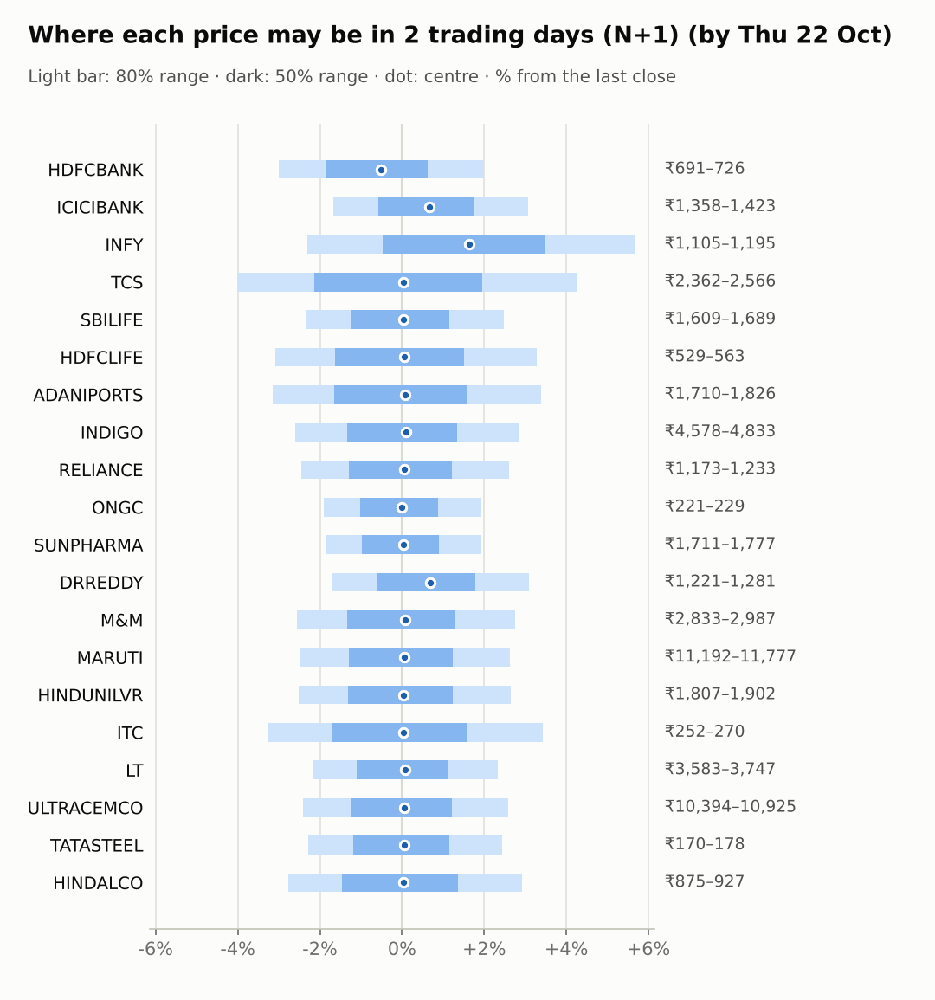
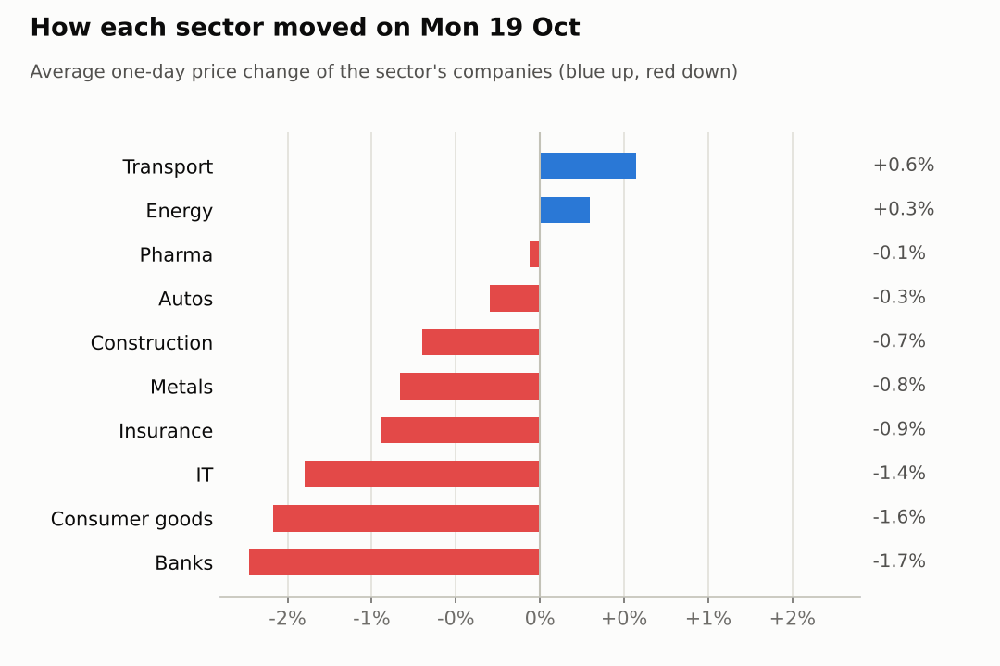
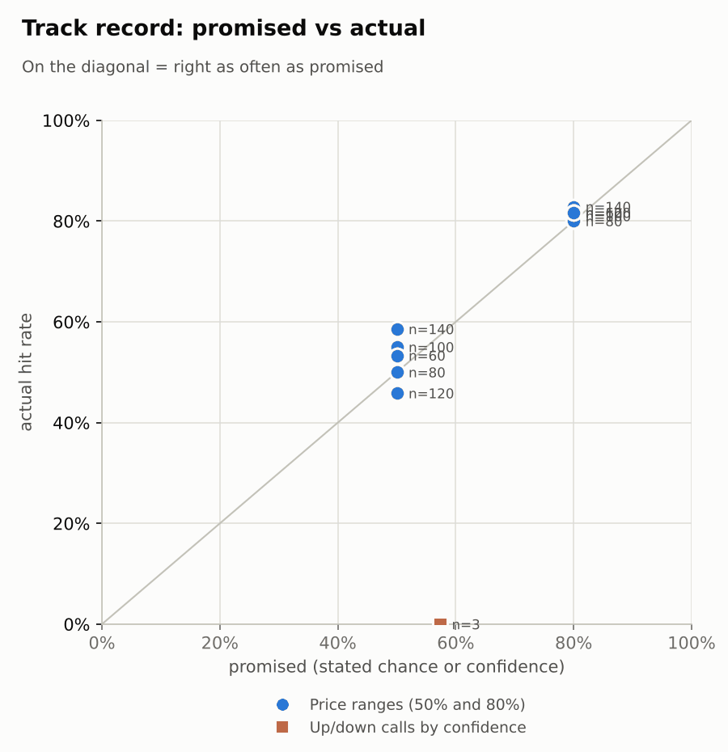

# Market brief: India (NSE), 2026-10-21

_Research log, not investment advice. Generated by a scheduled Claude Code routine._
<!-- report-data: as_of=2026-10-19 regime=TRENDING outcome=70248abff9bf -->

Easy-to-read version with charts and filters: [2026-10-21.html](2026-10-21.html)

## Headline
No calls today: the forecaster abstained on every company because the signal model sits near its base rate everywhere and firm overnight cues (KOSPI +4.25%, Nikkei +1.62%) argue against the model's slight down tilt. The Jio Platforms IPO opens today (nse-ann-106817653).

## Top 3 today
- Asian markets rose overnight after Monday's 1.11% Nifty fall and Tuesday's holiday: KOSPI +4.25%, Taiwan +1.88%, US VIX -6.13%; FIIs still sold a net 1,149 crore on Oct 19.
- Reliance's Jio Platforms IPO opens today (nse-ann-106817653); the anchor book drew strong bids (545039fb252f978d, corroborated). Reliance, Infosys and Dr Reddy's report on Oct 23.
- Q2 results of the big private banks were sold on Oct 19: HDFCBANK fell 2.31% (2a64ed7bcc129665, corroborated) and ICICIBANK 1.15% (nse-ann-106821125); ICICIBANK's ADR rose 1.36% overnight.

## Yesterday
On Oct 19 the Nifty 50 fell 1.11%, led by private banks after their weekend Q2 results (nse-ann-106821066, nse-ann-106821125). Nifty IT fell 1.28% after its 11.17% 5-day rally; INFY fell 2.63%. ULTRACEMCO fell 2.36% on its results day although profit rose (1d9d682cedb942c0, corroborated). Oct 20 was a market holiday.
The N+1 ranges held: 19 of 20 closes fell inside the 80% range. TCS closed above every horizon's range again, so the ranges keep underestimating the IT rally.

Market on 2026-10-19: Nifty 50 22,888.95 (-1.1%) · India VIX 14.77 (+5.3%) · watchlist 5 up / 15 down · best ONGC +1.4%, worst INFY -2.6%

### Ranges scored (target date 2026-10-19)

N+1 ranges: **80% hit 19/20** (naive 19/20) · 50% hit 11/20

| Ticker | 80% range | 50% range | Actual | 80% | 50% | Naive 80% |
|---|---|---|---|---|---|---|
| ADANIPORTS | ₹1,683.75–₹1,804.46 | ₹1,712.51–₹1,771.83 | ₹1,766.00 | ✅ | ✅ | ✅ |
| DRREDDY | ₹1,195.37–₹1,255.86 | ₹1,209.89–₹1,239.63 | ₹1,242.50 | ✅ | ❌ | ✅ |
| HDFCBANK | ₹709.72–₹767.29 | ₹723.39–₹751.68 | ₹712.00 | ✅ | ❌ | ✅ |
| HDFCLIFE | ₹532.34–₹569.09 | ₹541.11–₹559.16 | ₹545.50 | ✅ | ✅ | ✅ |
| HINDALCO | ₹867.73–₹920.33 | ₹880.31–₹906.16 | ₹900.45 | ✅ | ✅ | ✅ |
| HINDUNILVR | ₹1,848.53–₹1,946.31 | ₹1,871.98–₹1,920.04 | ₹1,853.20 | ✅ | ❌ | ✅ |
| ICICIBANK | ₹1,356.90–₹1,466.12 | ₹1,382.84–₹1,436.51 | ₹1,381.00 | ✅ | ❌ | ✅ |
| INDIGO | ₹4,649.17–₹4,914.28 | ₹4,712.67–₹4,842.97 | ₹4,700.00 | ✅ | ❌ | ✅ |
| INFY | ₹1,086.35–₹1,165.63 | ₹1,105.23–₹1,144.19 | ₹1,130.70 | ✅ | ✅ | ✅ |
| ITC | ₹254.63–₹273.28 | ₹259.07–₹268.23 | ₹260.80 | ✅ | ✅ | ✅ |
| LT | ₹3,548.35–₹3,719.37 | ₹3,589.44–₹3,673.51 | ₹3,661.90 | ✅ | ✅ | ✅ |
| M&M | ₹2,786.42–₹2,939.89 | ₹2,823.20–₹2,898.63 | ₹2,907.00 | ✅ | ❌ | ✅ |
| MARUTI | ₹11,137.92–₹11,759.78 | ₹11,286.93–₹11,592.57 | ₹11,475.00 | ✅ | ✅ | ✅ |
| ONGC | ₹220.35–₹228.82 | ₹222.39–₹226.56 | ₹225.00 | ✅ | ✅ | ✅ |
| RELIANCE | ₹1,182.87–₹1,247.75 | ₹1,198.43–₹1,230.31 | ₹1,202.00 | ✅ | ✅ | ✅ |
| SBILIFE | ₹1,619.44–₹1,704.83 | ₹1,639.93–₹1,681.89 | ₹1,647.80 | ✅ | ✅ | ✅ |
| SUNPHARMA | ₹1,729.11–₹1,798.85 | ₹1,745.92–₹1,780.20 | ₹1,743.00 | ✅ | ❌ | ✅ |
| TATASTEEL | ₹172.07–₹180.84 | ₹174.18–₹178.49 | ₹174.04 | ✅ | ❌ | ✅ |
| TCS | ₹2,259.06–₹2,442.34 | ₹2,302.59–₹2,392.63 | ₹2,460.90 | ❌ | ❌ | ❌ |
| ULTRACEMCO | ₹10,450.83–₹11,284.95 | ₹10,649.00–₹11,058.83 | ₹10,650.00 | ✅ | ✅ | ✅ |

N+2 ranges that matured on the same date: 80% hit 17/20, 50% hit 11/20. N+3 ranges that matured on the same date: 80% hit 19/20, 50% hit 14/20. N+4 ranges that matured on the same date: 80% hit 18/20, 50% hit 12/20. N+5 ranges that matured on the same date: 80% hit 18/20, 50% hit 13/20.

### Calls scored

| Ticker | H | Call | Conf. | Move | Hit |
|---|---|---|---|---|---|
| TCS | 5d · open→close | down | 55% | +12.63% | ❌ |

## Today (2026-10-21)

**Regime: TRENDING** · India VIX 14.76 (+5.0%) · benchmark 5d +2.4% · benchmark 10d vol 19.3%

| Ticker | Sector | Close | N+1 80% | N+1 50% | N+5 80% | Call | Cue | Notes |
|---|---|---|---|---|---|---|---|---|
| HDFCBANK | Banks | ₹712.00 | ₹690.67–₹726.23 | ₹698.88–₹716.47 | ₹671.19–₹743.66 | no call | -1.04% | cue -1.04% x0.5; index +0.10% expected from SPX, x beta 1.24 x0.5, own cue -1.04% net x0.5; major event x1.15 |
| ICICIBANK | Banks | ₹1,381.00 | ₹1,357.91–₹1,423.34 | ₹1,373.04–₹1,405.39 | ₹1,322.00–₹1,455.32 | no call | +1.36% | cue +1.36% x0.5; index +0.10% expected from SPX, x beta 0.93 x0.5, own cue +1.36% net x0.5; major event x1.15 |
| INFY | IT | ₹1,130.70 | ₹1,104.64–₹1,195.05 | ₹1,125.29–₹1,169.97 | ₹1,036.42–₹1,261.73 | no call | +3.28% | cue +3.28% x0.5; earnings in horizon (x2.0 day); index +0.10% expected from SPX, x beta 0.73 x0.5, own cue +3.28% net x0.5; major event x1.15 |
| TCS | IT | ₹2,460.90 | ₹2,361.91–₹2,565.58 | ₹2,408.34–₹2,508.99 | ₹2,252.25–₹2,666.64 | no call | – | index +0.10% expected from SPX, x beta 0.83 x0.5; major event x1.15 |
| SBILIFE | Insurance | ₹1,647.80 | ₹1,608.99–₹1,688.76 | ₹1,627.42–₹1,666.87 | ₹1,546.46–₹1,745.36 | no call | – | earnings in horizon (x2.0 day); index +0.10% expected from SPX, x beta 0.85 x0.5; major event x1.15 |
| HDFCLIFE | Insurance | ₹545.50 | ₹528.62–₹563.36 | ₹536.60–₹553.77 | ₹509.56–₹580.26 | no call | – | index +0.10% expected from SPX, x beta 0.96 x0.5; major event x1.15 |
| ADANIPORTS | Transport | ₹1,766.00 | ₹1,710.23–₹1,825.68 | ₹1,736.73–₹1,793.80 | ₹1,620.96–₹1,908.62 | no call | – | earnings in horizon (x2.0 day); index +0.10% expected from SPX, x beta 1.32 x0.5; major event x1.15 |
| INDIGO | Transport | ₹4,700.00 | ₹4,577.85–₹4,833.27 | ₹4,636.73–₹4,763.02 | ₹4,434.48–₹4,954.33 | no call | – | index +0.10% expected from SPX, x beta 1.76 x0.5; major event x1.15 |
| RELIANCE | Energy | ₹1,202.00 | ₹1,172.53–₹1,233.21 | ₹1,186.54–₹1,216.55 | ₹1,125.01–₹1,276.31 | no call | – | earnings in horizon (x2.0 day); index +0.10% expected from SPX, x beta 0.94 x0.5; major event x1.15 |
| ONGC | Energy | ₹225.00 | ₹220.73–₹229.34 | ₹222.72–₹226.98 | ₹215.96–₹233.51 | no call | – | index +0.10% expected from SPX, x beta 0.02 x0.5; major event x1.15 |
| SUNPHARMA | Pharma | ₹1,743.00 | ₹1,710.62–₹1,776.63 | ₹1,725.93–₹1,758.58 | ₹1,673.73–₹1,808.25 | no call | – | index +0.10% expected from SPX, x beta 0.46 x0.5; major event x1.15 |
| DRREDDY | Pharma | ₹1,242.50 | ₹1,221.40–₹1,280.96 | ₹1,235.17–₹1,264.62 | ₹1,175.18–₹1,323.75 | no call | +1.36% | cue +1.36% x0.5; earnings in horizon (x2.0 day); index +0.10% expected from SPX, x beta 0.46 x0.5, own cue +1.36% net x0.5; major event x1.15 |
| M&M | Autos | ₹2,907.00 | ₹2,832.73–₹2,987.02 | ₹2,868.32–₹2,944.61 | ₹2,746.47–₹3,060.57 | no call | – | index +0.10% expected from SPX, x beta 1.41 x0.5; major event x1.15 |
| MARUTI | Autos | ₹11,475.00 | ₹11,191.60–₹11,776.86 | ₹11,326.69–₹11,616.09 | ₹10,732.79–₹12,191.86 | no call | – | earnings in horizon (x2.0 day); index +0.10% expected from SPX, x beta 1.09 x0.5; major event x1.15 |
| HINDUNILVR | Consumer goods | ₹1,853.20 | ₹1,806.61–₹1,902.24 | ₹1,828.68–₹1,875.97 | ₹1,731.95–₹1,970.40 | no call | – | earnings in horizon (x2.0 day); index +0.10% expected from SPX, x beta 0.80 x0.5; major event x1.15 |
| ITC | Consumer goods | ₹260.80 | ₹252.31–₹269.72 | ₹256.31–₹264.91 | ₹242.81–₹278.25 | no call | – | index +0.10% expected from SPX, x beta 0.74 x0.5; major event x1.15 |
| LT | Construction | ₹3,661.90 | ₹3,583.11–₹3,747.30 | ₹3,621.10–₹3,702.30 | ₹3,452.87–₹3,862.24 | no call | – | earnings in horizon (x2.0 day); index +0.10% expected from SPX, x beta 1.41 x0.5; major event x1.15 |
| ULTRACEMCO | Construction | ₹10,650.00 | ₹10,394.19–₹10,924.69 | ₹10,516.70–₹10,779.03 | ₹10,097.04–₹11,177.23 | no call | – | index +0.10% expected from SPX, x beta 1.28 x0.5; major event x1.15 |
| TATASTEEL | Metals | ₹174.04 | ₹170.06–₹178.28 | ₹171.96–₹176.03 | ₹163.58–₹184.10 | no call | – | earnings in horizon (x2.0 day); index +0.10% expected from SPX, x beta 1.06 x0.5; major event x1.15 |
| HINDALCO | Metals | ₹900.45 | ₹875.45–₹926.79 | ₹887.27–₹912.66 | ₹847.13–₹951.67 | no call | – | index +0.10% expected from SPX, x beta 0.83 x0.5; major event x1.15 |

No calls. The forecaster abstained on all 20 companies.
- HDFCBANK, HDFCLIFE, INDIGO: data failed validation (collect gate DUPLICATE_ID on stored news rows that name them).
- RELIANCE, INFY, DRREDDY: results on Oct 23 fall inside the N+3 and N+5 windows; the known IPO and ADR news is already in the model score.
- ICICIBANK, ULTRACEMCO: the verified results are positive but both stocks fell on them; no new evidence for either side.
- TCS: past down calls against the IT rally all missed (lessons); its only recent news comes from one outlet.
- All others: the model is near its base rate and no confirmed or corroborated news of their own.
AI traders (paper only, never orders): the pattern-mood trader leaned six companies up for N+1; the Sonnet combined trader leaned most companies down on the model alone; the news-results and Opus combined traders abstained on all.

### Overnight cues and global factors

| Symbol | Name | Last | Change |
|---|---|---|---|
| BRENT | Brent crude | 110.20 | +0.59% |
| DXY | US dollar index | 101.80 | -0.18% |
| GOLD | Gold | 4,137.10 | -0.55% |
| HANGSENG | Hang Seng | 23,993.34 | +0.53% |
| INDIAVIX | India VIX | 14.76 | +5.00% |
| KOSPI | KOSPI | 5,788.79 | +4.25% |
| NASDAQ | Nasdaq Composite (previous US close) | 26,424.82 | -0.02% |
| NIFTY50 | Nifty 50 | 22,888.95 | -1.11% |
| NIKKEI | Nikkei 225 | 65,110.80 | +1.62% |
| SHANGHAI | Shanghai Composite | 3,737.48 | +0.06% |
| SPX | S&P 500 (previous US close) | 7,712.57 | +0.28% |
| STOXX50 | Euro Stoxx 50 | 6,124.94 | -0.32% |
| TAIWAN | Taiwan Weighted | 47,163.90 | +1.88% |
| US10Y | US 10-year yield | 5.12 | -0.37% |
| USDINR | USD/INR | 94.77 | -0.24% |
| USDJPY | USD/JPY | 158.25 | -0.17% |
| USVIX | US VIX | 17.31 | -6.13% |

### ADRs (US-listed shares, previous US session)

| Ticker | ADR | Last | Change |
|---|---|---|---|
| DRREDDY | RDY | 13.26 | +1.36% |
| HDFCBANK | HDB | 22.84 | -1.04% |
| ICICIBANK | IBN | 29.88 | +1.36% |
| INFY | INFY | 12.60 | +3.28% |

## Tomorrow and this week

| Date | Event | Type |
|---|---|---|
| 2026-10-19 | UltraTech Cement earnings | company |
| 2026-10-23 | Dr Reddy's earnings | company |
| 2026-10-23 | Infosys earnings | company |
| 2026-10-23 | Reliance Industries earnings | company |
| 2026-10-27 | Larsen & Toubro earnings | company |
| 2026-10-27 | Maruti Suzuki earnings | company |
| 2026-10-27 | NSE monthly F&O expiry (last Tuesday) | major |
| 2026-10-27 | Nifty weekly options expiry (Tuesday) |  |
| 2026-10-27 | SBI Life Insurance earnings | company |
| 2026-10-27 | Tata Steel earnings | company |
| 2026-10-28 | Adani Ports earnings | company |
| 2026-10-28 | Hindustan Unilever earnings | company |
| 2026-10-29 | FOMC rate decision (previous US evening) | major |
| 2026-10-30 | Sun Pharma earnings | company |
| 2026-11-02 | ITC earnings | company |
| 2026-11-03 | InterGlobe Aviation earnings | company |
| 2026-11-03 | Nifty weekly options expiry (Tuesday) |  |
| 2026-11-05 | Mahindra & Mahindra earnings | company |
| 2026-11-06 | Hindalco earnings | company |
| 2026-11-06 | ONGC earnings | company |
| 2026-11-06 | US jobs report (usually first Friday, 08:30 ET; check for shifts) | major |
| 2026-11-09 | Nifty weekly options expiry (Tuesday) |  |

Firm Asian cues point to a higher open, against FII selling and Brent at 110.2. The Jio IPO runs from today; Reliance, Infosys and Dr Reddy's report on Oct 23, and L&T, Maruti, SBI Life and Tata Steel on Oct 27, the monthly F&O expiry. The FOMC decision lands on Oct 29. The regime is TRENDING with India VIX up 5.0%.

## By sector

### Banks

HDFCBANK fell 2.31% and ICICIBANK 1.15% on Oct 19 after Q2 results, so both moved together on sector selling.
Bull: ICICIBANK's ADR rose 1.36% overnight and its results showed profit growth (nse-ann-106821125).
Bear: HDFCBANK's ADR fell 1.04%; its margin was weak (2a64ed7bcc129665, corroborated). HDFCBANK is blocked today (data failed validation).

### IT

Nifty IT fell 1.28% after an 11.17% 5-day rally; INFY fell 2.63% while TCS slipped 0.17% (company-specific gaps).
Bull: INFY's ADR rose 3.28% overnight; TCS delivery stayed high.
Bear: TCS RSI is 73 after 15.81% in 5 days; a US H-1B cut is a headwind (6a5291fceb4f7c39). Infosys reports on Oct 23 (nse-ann-106821945).

### Insurance

HDFCLIFE fell 1.36% and SBILIFE 0.54%: a mild sector drift with no company news of weight.
Bull: SBILIFE is oversold at RSI 38.
Bear: the only SBILIFE item is an analyst target trim (4b45dd26dc677043, promotional). HDFCLIFE is blocked today (data failed validation).

### Transport

ADANIPORTS rose 0.87% and INDIGO 0.28%; they moved apart from the falling index.
Bull: ADANIPORTS has a beta of 1.32 and outperformed peers by 2.67% over 5 days.
Bear: INDIGO faces a fuel-cost squeeze (d7d88e849d332788); its broker note is single-source (24b7b6ac930ef1f4, single_source). INDIGO is blocked today (data failed validation).

### Energy

ONGC rose 1.35% and RELIANCE fell 0.76%: they moved apart on company news.
Bull: Jio's anchor book drew strong demand (545039fb252f978d, corroborated) and the IPO opens today (nse-ann-106817653).
Bear: RELIANCE is up 3.72% over 5 days with low delivery; a holding-company discount is a risk (58a2042967db09fb).

### Pharma

DRREDDY rose 0.77% and SUNPHARMA fell 0.9% while Nifty Pharma fell 0.65%: company news drove each.
Bull: SUNPHARMA is oversold at RSI 34 and its cancer drug won a guideline listing (nse-ann-106822793); DRREDDY's ADR rose 1.36%.
Bear: an NPPA margin cap on cancer drugs hits both (28a770b13f628bc3); the report of a fund raise for the Organon deal is only a rumour (013eaabead468907). DRREDDY reports on Oct 23.

### Autos

M&M fell 0.48% and MARUTI 0.12%, a small joint dip with the market.
Bull: MARUTI is oversold at RSI 38; M&M is up 3.34% over 5 days.
Bear: MARUTI's festive discounts (10ccda10f1b504db, unverified) and its Oct 27 results fall inside the N+5 window.

### Consumer goods

HINDUNILVR fell 2.14% and ITC 1.02% on Oct 19: both fell with the sector.
Bull: both are low-beta defensives after a dip.
Bear: HINDUNILVR has an FSSAI notice (eff5f80af60cce3e); ITC has no catalyst.

### Construction

LT rose 0.96% on an airport order (nse-ann-106821513) while ULTRACEMCO fell 2.36% after results: they moved apart on company news.
Bull: ULTRACEMCO's profit and revenue rose (1d9d682cedb942c0, corroborated); the L&T order report is broad (f5fcabae4ad17e7b, unverified).
Bear: ULTRACEMCO faces fuel-cost pressure (59e7c2228e9d705e) and board exits (nse-ann-106821834); LT reports on Oct 27.

### Metals

HINDALCO and TATASTEEL both fell 0.83%: sector drift with no news of weight.
Bull: HINDALCO and TATASTEEL are oversold at RSI 39 and Asian cues are firm.
Bear: HINDALCO is down 8.72% over 20 days and its only item is promotional (a73d27771b2f54de, promotional); TATASTEEL reports on Oct 27.

## Track record

Ranges (targets 50% / 80%; width, score and centre error in % of price, lower is better; naive = last close ± recent typical move, no-change = last close as the centre):

| H | Window | n | 50% cover | 80% cover | Naive 80% | Width | Naive width | Score | Naive score | Centre err | No-change err |
|---|---|---|---|---|---|---|---|---|---|---|---|
| 1d | since start | 140 | 59% | 83% | 84% | 5.57 | 5.92 | 8.065 | 8.128 | 1.58 | 1.58 |
| 1d | last 30 days | 140 | 59% | 83% | 84% | 5.57 | 5.92 | 8.065 | 8.128 | 1.58 | 1.58 |
| 2d | since start | 120 | 46% | 82% | 83% | 6.84 | 7.21 | 11.017 | 10.977 | 2.16 | 2.17 |
| 2d | last 30 days | 120 | 46% | 82% | 83% | 6.84 | 7.21 | 11.017 | 10.977 | 2.16 | 2.17 |
| 3d | since start | 100 | 55% | 81% | 85% | 7.87 | 8.30 | 13.741 | 13.689 | 2.45 | 2.45 |
| 3d | last 30 days | 100 | 55% | 81% | 85% | 7.87 | 8.30 | 13.741 | 13.689 | 2.45 | 2.45 |
| 4d | since start | 80 | 50% | 80% | 84% | 8.86 | 9.18 | 17.313 | 16.842 | 2.97 | 2.99 |
| 4d | last 30 days | 80 | 50% | 80% | 84% | 8.86 | 9.18 | 17.313 | 16.842 | 2.97 | 2.99 |
| 5d | since start | 60 | 53% | 82% | 83% | 9.75 | 9.99 | 19.708 | 19.045 | 3.19 | 3.17 |
| 5d | last 30 days | 60 | 53% | 82% | 83% | 9.75 | 9.99 | 19.708 | 19.045 | 3.19 | 3.17 |

Ranges by regime (since start):

| H | Regime | n | 50% cover | 80% cover | Naive 80% |
|---|---|---|---|---|---|
| 1d | CALM | 120 | 59% | 81% | 83% |
| 1d | TRENDING | 20 | 55% | 95% | 95% |
| 2d | CALM | 120 | 46% | 82% | 83% |
| 3d | CALM | 100 | 55% | 81% | 85% |
| 4d | CALM | 80 | 50% | 80% | 84% |
| 5d | CALM | 60 | 53% | 82% | 83% |

Up/down calls vs the always-up baseline:

| H | Window | n | Hit rate | Always-up |
|---|---|---|---|---|
| 1d · open→close | since start | 1 | 0% | 100% |
| 1d · open→close | last 30 days | 1 | 0% | 100% |
| 5d · open→close | since start | 2 | 0% | 100% |
| 5d · open→close | last 30 days | 2 | 0% | 100% |

Calls by confidence band (a band should hit about as often as its confidence):

| Band | n | Avg confidence | Hit rate |
|---|---|---|---|
| 0.50-0.59 · open→close | 3 | 57% | 0% |

Weekly review 2026-W42: 1 proposed range change for a human to decide · [review-2026-W42.md](review-2026-W42.md)

## Data quality

- Indicators: 20 OK, partial: none, blocked: none
- Regime notes: none

| H | Calibration | History n | Live n | q10 / q90 |
|---|---|---|---|---|
| 1d | pool | 8840 | 140 | -1.21 / 1.21 |
| 2d | pool | 8820 | 120 | -1.25 / 1.21 |
| 3d | pool | 8800 | 100 | -1.27 / 1.18 |
| 4d | pool | 8780 | 80 | -1.31 / 1.16 |
| 5d | pool | 8760 | 60 | -1.30 / 1.18 |

- validation collect DUPLICATE_ID (blocking): news, duplicated ids again. Twenty more items first stored 2026-10-05/07 came back from the same outlets re-dated to Oct 19-21 and were stored under their old ids (25c775d6fba20b66, f1fd163510be1071, d4e2d3121c0d06f4, 27dc8ee75b3215db and others; the 7 ids of Oct 19 are still stored). Root cause: the collector checks ids only against the newest 10 daily news files, and with no news files for Oct 17, 18 and 20 that reached back only to Oct 8 (open GitHub issue on news de-duplication, waiting for an owner decision). Dropping the run's own duplicate lines was blocked by the session's permission settings, so they stay stored. The forecaster and the AI traders abstained on HDFCBANK, HDFCLIFE and INDIGO (the tickers they name), and none of the ids is cited.
- validation collect COLLECTOR_FAILED: nse_india, 2 failed (LT financials 101648 and 101645: HTTP 404 from nsearchives.nseindia.com).
- collect_relations_india warning: holdings nse_pledge endpoint returned no rows at all for 10 per-ticker calls.
- results digests: nothing due; 4 NSE attachments not read (pdf_not_parsed: nse-ann-106817267, nse-ann-106818660, nse-ann-106818670, nse-ann-106821066).
- news: the news analyst scored background items in topic groups with shared summaries, so those scores are rough.
- earnings dates disagree: RELIANCE (Oct 21 in the Yahoo estimates, Oct 23 in the events list) and SBILIFE (Oct 23 vs Oct 27); no decision changed.
- AI traders: abstention codes ai.combined.opus.v1 abstained twenty; ai.combined.sonnet.v1 abstained twelve; ai.news_results.sonnet.v1 abstained twenty; ai.pattern_mood.sonnet.v1 abstained nineteen (written as words: the counts are not in the pack).
- Other gates (features, context, news, forecast): all passed.
- Judge FAIL (spot-check of 2026-10-19, round 1): both 2026-10-12 TCS call rationales said "Q2 beat already priced", which neither cited id states (nse-ann-106811186: margin below Street). Nothing dropped.
