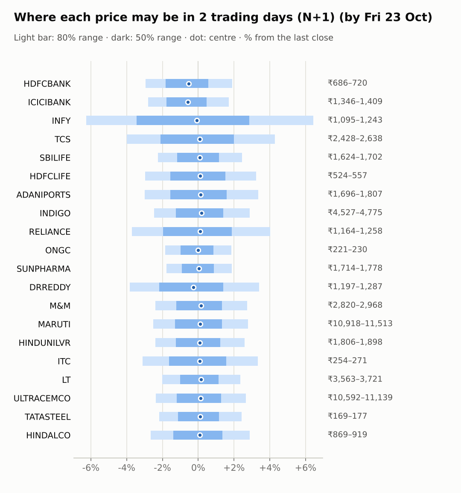
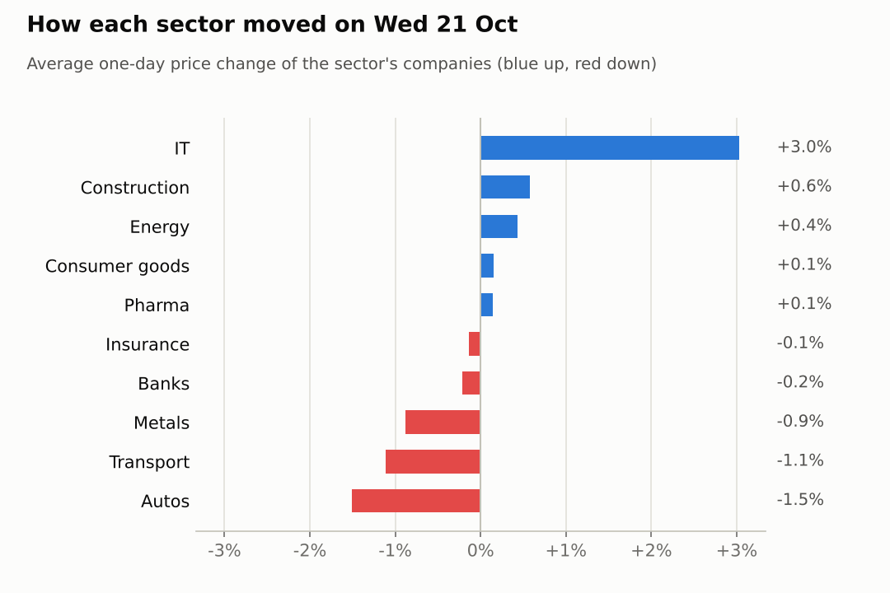
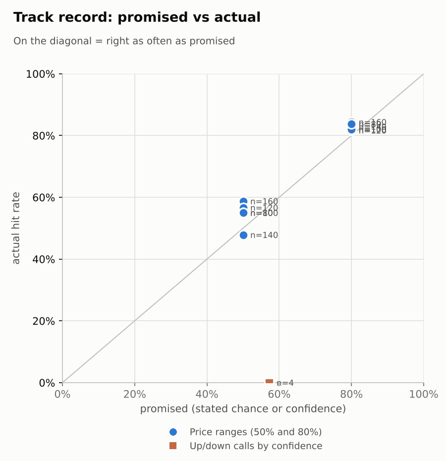

# Market brief: India (NSE), 2026-10-22

_Research log, not investment advice. Generated by a scheduled Claude Code routine._
<!-- report-data: as_of=2026-10-21 regime=CALM outcome=70248abff9bf -->

Easy-to-read version with charts and filters: [2026-10-22.html](2026-10-22.html)

## Headline
No calls today: the signal model sits just below a coin flip for every company the rules allow, and Infosys, Dr Reddy's and Reliance report results tomorrow. HDFC Bank closed below its range after a corroborated report that senior executives leaked confidential information (31517522a43fe707).

## Top 3 today
- HDFC Bank: a probe finding that senior executives leaked confidential information is corroborated (31517522a43fe707); the stock closed below its 1-day 80% range.
- Infosys, Dr Reddy's and Reliance report results on Oct 23, so no new calls on them today (results within 1 day).
- IT keeps leading: INFY rose 3.3% after its Truist collaboration filing (nse-ann-106821932), while Asia is weaker this morning.

## Yesterday
The Nifty 50 fell 0.34% on Oct 21 and India VIX rose 6.13%. IT led again: INFY rose 3.3% (nse-ann-106821932) and TCS 2.77%; MARUTI fell 2.4%.
HDFCBANK fell 0.71% on the corroborated probe report (31517522a43fe707) and was the one 1-day close outside its 80% range (19 of 20 inside). The range did not include the news shock; the 2-day range also missed it.
The one call scored, the TCS 5-day down call, missed: TCS rose 17.25% with the IT rally.

Market on 2026-10-21: Nifty 50 22,811.35 (-0.3%) · India VIX 15.68 (+6.1%) · watchlist 10 up / 10 down · best INFY +3.3%, worst MARUTI -2.4%

### Ranges scored (target date 2026-10-21)

N+1 ranges: **80% hit 19/20** (naive 19/20) · 50% hit 12/20

| Ticker | 80% range | 50% range | Actual | 80% | 50% | Naive 80% |
|---|---|---|---|---|---|---|
| ADANIPORTS | ₹1,688.16–₹1,805.89 | ₹1,715.83–₹1,773.57 | ₹1,748.80 | ✅ | ✅ | ✅ |
| DRREDDY | ₹1,210.85–₹1,271.64 | ₹1,225.24–₹1,255.06 | ₹1,244.50 | ✅ | ✅ | ✅ |
| HDFCBANK | ₹711.70–₹746.71 | ₹719.99–₹737.17 | ₹706.95 | ❌ | ❌ | ❌ |
| HDFCLIFE | ₹534.23–₹570.11 | ₹542.67–₹560.27 | ₹539.65 | ✅ | ❌ | ✅ |
| HINDALCO | ₹880.17–₹933.42 | ₹892.73–₹918.85 | ₹892.85 | ✅ | ✅ | ✅ |
| HINDUNILVR | ₹1,843.85–₹1,938.65 | ₹1,866.28–₹1,912.79 | ₹1,850.20 | ✅ | ❌ | ✅ |
| ICICIBANK | ₹1,376.43–₹1,443.86 | ₹1,392.40–₹1,425.48 | ₹1,385.00 | ✅ | ❌ | ✅ |
| INDIGO | ₹4,540.74–₹4,803.84 | ₹4,602.84–₹4,731.90 | ₹4,641.50 | ✅ | ✅ | ✅ |
| INFY | ₹1,121.70–₹1,213.11 | ₹1,143.10–₹1,187.92 | ₹1,168.00 | ✅ | ✅ | ✅ |
| ITC | ₹254.18–₹272.26 | ₹258.43–₹267.30 | ₹262.00 | ✅ | ✅ | ✅ |
| LT | ₹3,535.00–₹3,700.60 | ₹3,574.25–₹3,655.49 | ₹3,636.00 | ✅ | ✅ | ✅ |
| M&M | ₹2,833.74–₹2,993.70 | ₹2,871.51–₹2,949.99 | ₹2,889.00 | ✅ | ✅ | ✅ |
| MARUTI | ₹11,163.97–₹11,770.69 | ₹11,307.36–₹11,605.01 | ₹11,200.00 | ✅ | ❌ | ✅ |
| ONGC | ₹217.78–₹226.21 | ₹219.78–₹223.92 | ₹225.62 | ✅ | ❌ | ✅ |
| RELIANCE | ₹1,160.03–₹1,259.40 | ₹1,183.25–₹1,231.97 | ₹1,209.00 | ✅ | ✅ | ✅ |
| SBILIFE | ₹1,613.01–₹1,695.74 | ₹1,632.58–₹1,673.17 | ₹1,661.00 | ✅ | ✅ | ✅ |
| SUNPHARMA | ₹1,723.52–₹1,791.21 | ₹1,739.61–₹1,772.82 | ₹1,745.10 | ✅ | ✅ | ✅ |
| TATASTEEL | ₹170.92–₹179.42 | ₹172.93–₹177.10 | ₹172.45 | ✅ | ❌ | ✅ |
| TCS | ₹2,356.97–₹2,568.34 | ₹2,406.29–₹2,509.93 | ₹2,529.00 | ✅ | ❌ | ✅ |
| ULTRACEMCO | ₹10,478.43–₹11,292.96 | ₹10,669.31–₹11,068.76 | ₹10,849.00 | ✅ | ✅ | ✅ |

N+2 ranges that matured on the same date: 80% hit 18/20, 50% hit 12/20. N+3 ranges that matured on the same date: 80% hit 17/20, 50% hit 13/20. N+4 ranges that matured on the same date: 80% hit 18/20, 50% hit 15/20. N+5 ranges that matured on the same date: 80% hit 18/20, 50% hit 12/20.

### Calls scored

| Ticker | H | Call | Conf. | Move | Hit |
|---|---|---|---|---|---|
| TCS | 5d · open→close | down | 57% | +17.25% | ❌ |

## Today (2026-10-22)

**Regime: CALM** · India VIX 15.68 (+6.1%) · benchmark 5d +0.4% · benchmark 10d vol 18.8%

| Ticker | Sector | Close | N+1 80% | N+1 50% | N+5 80% | Call | Cue | Notes |
|---|---|---|---|---|---|---|---|---|
| HDFCBANK | Banks | ₹706.95 | ₹686.17–₹720.42 | ₹694.04–₹711.01 | ₹667.45–₹737.53 | no call | -1.06% | cue -1.06% x0.5; index +0.21% expected from SPX, x beta 1.24 x0.5, own cue -1.06% net x0.5; major event x1.15 |
| ICICIBANK | Banks | ₹1,385.00 | ₹1,346.05–₹1,408.52 | ₹1,360.41–₹1,391.38 | ₹1,311.80–₹1,439.66 | no call | -1.14% | cue -1.14% x0.5; index +0.21% expected from SPX, x beta 0.93 x0.5, own cue -1.14% net x0.5; major event x1.15 |
| INFY | IT | ₹1,168.00 | ₹1,094.84–₹1,243.24 | ₹1,127.88–₹1,201.32 | ₹1,050.29–₹1,285.23 | no call | -0.16% | cue -0.16% x0.5; earnings in horizon (x2.0 day); index +0.21% expected from SPX, x beta 0.73 x0.5, own cue -0.16% net x0.5; major event x1.15 |
| TCS | IT | ₹2,529.00 | ₹2,428.01–₹2,637.61 | ₹2,475.50–₹2,579.33 | ₹2,314.42–₹2,742.64 | no call | – | index +0.21% expected from SPX, x beta 0.83 x0.5; major event x1.15 |
| SBILIFE | Insurance | ₹1,661.00 | ₹1,623.62–₹1,701.84 | ₹1,641.59–₹1,680.37 | ₹1,561.61–₹1,757.44 | no call | – | earnings in horizon (x2.0 day); index +0.21% expected from SPX, x beta 0.84 x0.5; major event x1.15 |
| HDFCLIFE | Insurance | ₹539.65 | ₹523.64–₹557.09 | ₹531.28–₹547.86 | ₹505.03–₹573.38 | no call | – | index +0.21% expected from SPX, x beta 0.96 x0.5; major event x1.15 |
| ADANIPORTS | Transport | ₹1,748.80 | ₹1,696.29–₹1,807.33 | ₹1,721.64–₹1,776.67 | ₹1,609.25–₹1,887.01 | no call | – | earnings in horizon (x2.0 day); index +0.21% expected from SPX, x beta 1.32 x0.5; major event x1.15 |
| INDIGO | Transport | ₹4,641.50 | ₹4,527.20–₹4,775.00 | ₹4,583.99–₹4,706.83 | ₹4,384.04–₹4,890.20 | no call | – | index +0.21% expected from SPX, x beta 1.76 x0.5; major event x1.15 |
| RELIANCE | Energy | ₹1,209.00 | ₹1,164.15–₹1,257.56 | ₹1,185.36–₹1,231.64 | ₹1,134.02–₹1,281.91 | no call | – | earnings in horizon (x2.0 day); index +0.21% expected from SPX, x beta 0.94 x0.5; major event x1.15 |
| ONGC | Energy | ₹225.62 | ₹221.48–₹229.80 | ₹223.40–₹227.53 | ₹216.88–₹233.92 | no call | – | index +0.21% expected from SPX, x beta 0.02 x0.5; major event x1.15 |
| SUNPHARMA | Pharma | ₹1,745.10 | ₹1,714.23–₹1,777.89 | ₹1,728.92–₹1,760.48 | ₹1,678.28–₹1,808.54 | no call | – | index +0.21% expected from SPX, x beta 0.46 x0.5; major event x1.15 |
| DRREDDY | Pharma | ₹1,244.50 | ₹1,196.80–₹1,286.77 | ₹1,217.27–₹1,261.85 | ₹1,168.78–₹1,311.38 | no call | -0.53% | cue -0.53% x0.5; earnings in horizon (x2.0 day); index +0.21% expected from SPX, x beta 0.46 x0.5, own cue -0.53% net x0.5; major event x1.15 |
| M&M | Autos | ₹2,889.00 | ₹2,819.61–₹2,968.07 | ₹2,853.66–₹2,927.25 | ₹2,734.54–₹3,037.90 | no call | – | index +0.21% expected from SPX, x beta 1.41 x0.5; major event x1.15 |
| MARUTI | Autos | ₹11,200.00 | ₹10,917.77–₹11,512.64 | ₹11,054.12–₹11,349.00 | ₹10,447.18–₹11,935.97 | no call | – | earnings in horizon (x2.0 day); index +0.21% expected from SPX, x beta 1.09 x0.5; major event x1.15 |
| HINDUNILVR | Consumer goods | ₹1,850.20 | ₹1,806.09–₹1,898.06 | ₹1,827.20–₹1,872.79 | ₹1,733.51–₹1,963.79 | no call | – | earnings in horizon (x2.0 day); index +0.21% expected from SPX, x beta 0.80 x0.5; major event x1.15 |
| ITC | Consumer goods | ₹262.00 | ₹253.86–₹270.73 | ₹257.71–₹266.07 | ₹244.55–₹279.04 | no call | – | index +0.21% expected from SPX, x beta 0.74 x0.5; major event x1.15 |
| LT | Construction | ₹3,636.00 | ₹3,562.59–₹3,721.10 | ₹3,599.05–₹3,677.65 | ₹3,434.22–₹3,830.92 | no call | – | earnings in horizon (x2.0 day); index +0.21% expected from SPX, x beta 1.41 x0.5; major event x1.15 |
| ULTRACEMCO | Construction | ₹10,849.00 | ₹10,592.15–₹11,138.91 | ₹10,717.60–₹10,988.66 | ₹10,279.74–₹11,397.23 | no call | – | index +0.21% expected from SPX, x beta 1.27 x0.5; major event x1.15 |
| TATASTEEL | Metals | ₹172.45 | ₹168.69–₹176.65 | ₹170.52–₹174.46 | ₹162.33–₹182.26 | no call | – | earnings in horizon (x2.0 day); index +0.21% expected from SPX, x beta 1.06 x0.5; major event x1.15 |
| HINDALCO | Metals | ₹892.85 | ₹869.13–₹918.55 | ₹880.44–₹904.94 | ₹841.50–₹942.55 | no call | – | index +0.21% expected from SPX, x beta 0.83 x0.5; major event x1.15 |

No calls. The forecaster abstained on all 20 companies for N+1 and N+5:
- RELIANCE, INFY, DRREDDY: results on Oct 23 (earnings within 1 day, hard block).
- TCS, MARUTI, HDFCLIFE, M&M, HDFCBANK, INDIGO: data failed validation (the collect gate failed on duplicated stored news ids).
- The other 11: the signal model's P(up) is below 0.5 but close to its base rate, so a down call would carry little more than coin-flip confidence, and all 4 settled open-to-close calls missed. ICICIBANK and ULTRACEMCO have verified Q2 results (nse-ann-106821125, nse-ann-106821834) that point up against the model; SUNPHARMA's main negative item is only a rumour (013eaabead468907); LT's order reports are single_source (daf4b929f84f603c) or unverified (36cb0521ce6f843b).
AI traders (paper only): pattern-mood leaned HINDALCO and SUNPHARMA up on oversold readings; the Sonnet combined trader leaned 11 companies slightly down on the model alone; news-results and the Opus combined trader abstained on all.

### Overnight cues and global factors

| Symbol | Name | Last | Change |
|---|---|---|---|
| BRENT | Brent crude | 110.33 | +1.42% |
| DXY | US dollar index | 101.72 | -0.01% |
| GOLD | Gold | 4,128.40 | -0.34% |
| HANGSENG | Hang Seng | 23,154.85 | -2.10% |
| INDIAVIX | India VIX | 15.68 | +6.13% |
| KOSPI | KOSPI | 5,632.99 | -1.79% |
| NASDAQ | Nasdaq Composite (previous US close) | 26,702.86 | +1.05% |
| NIFTY50 | Nifty 50 | 22,811.35 | -0.34% |
| NIKKEI | Nikkei 225 | 64,031.60 | -0.91% |
| SHANGHAI | Shanghai Composite | 3,678.61 | -0.93% |
| SPX | S&P 500 (previous US close) | 7,757.17 | +0.58% |
| STOXX50 | Euro Stoxx 50 | 6,207.52 | +1.40% |
| TAIWAN | Taiwan Weighted | 46,975.74 | +0.19% |
| US10Y | US 10-year yield | 5.15 | +0.57% |
| USDINR | USD/INR | 94.45 | -0.28% |
| USDJPY | USD/JPY | 158.03 | -0.15% |
| USVIX | US VIX | 16.68 | -3.64% |

### ADRs (US-listed shares, previous US session)

| Ticker | ADR | Last | Change |
|---|---|---|---|
| DRREDDY | RDY | 13.19 | -0.53% |
| HDFCBANK | HDB | 22.81 | -1.06% |
| ICICIBANK | IBN | 29.54 | -1.14% |
| INFY | INFY | 12.64 | -0.16% |

## Tomorrow and this week

| Date | Event | Type |
|---|---|---|
| 2026-10-23 | Dr Reddy's earnings | company |
| 2026-10-23 | Infosys earnings | company |
| 2026-10-23 | Reliance Industries earnings | company |
| 2026-10-27 | Larsen & Toubro earnings | company |
| 2026-10-27 | Maruti Suzuki earnings | company |
| 2026-10-27 | NSE monthly F&O expiry (last Tuesday) | major |
| 2026-10-27 | Nifty weekly options expiry (Tuesday) |  |
| 2026-10-27 | SBI Life Insurance earnings | company |
| 2026-10-27 | Tata Steel earnings | company |
| 2026-10-28 | Adani Ports earnings | company |
| 2026-10-28 | Hindustan Unilever earnings | company |
| 2026-10-29 | FOMC rate decision (previous US evening) | major |
| 2026-10-30 | Sun Pharma earnings | company |
| 2026-11-02 | ITC earnings | company |
| 2026-11-03 | InterGlobe Aviation earnings | company |
| 2026-11-03 | Nifty weekly options expiry (Tuesday) |  |
| 2026-11-05 | Mahindra & Mahindra earnings | company |
| 2026-11-06 | Hindalco earnings | company |
| 2026-11-06 | ONGC earnings | company |
| 2026-11-06 | US jobs report (usually first Friday, 08:30 ET; check for shifts) | major |
| 2026-11-09 | Nifty weekly options expiry (Tuesday) |  |

Tomorrow brings results from Infosys, Dr Reddy's and Reliance, so those ranges are wider. Next week LT, Maruti, SBI Life and Tata Steel report on Oct 27, the day of the monthly F&O expiry, and the FOMC decides on Oct 29. Asia is weaker this morning (Hang Seng -2.1%, KOSPI -1.79%), US stocks rose (S&P 500 +0.58%), and Brent is at 110.33 (+1.42%). The regime is CALM, but India VIX rose 6.13%.

## By sector

### Banks

HDFCBANK fell 0.71% on the probe report (31517522a43fe707) while ICICIBANK rose 0.29%, so they moved apart on company news. Both ADRs fell overnight.
Bull: ICICIBANK's Q2 profit rose 20% (nse-ann-106821125). Bear: HDFCBANK's governance news is fresh and both ADRs are lower; HDFCBANK is blocked today.

### IT

INFY rose 3.3% and TCS 2.77%, a sector move: Nifty IT rose 2.88%.
Bull: the IT rally keeps going (Nifty IT +8.69% over 5 days). Bear: TCS has RSI 76 and INFY reports tomorrow.

### Insurance

HDFCLIFE fell 1.07% and SBILIFE rose 0.8%, so they moved apart with no verified company news.
Bull: SBILIFE has RSI 41 after a weak month. Bear: SBILIFE reports on Oct 27, inside the 5-day window.

### Transport

ADANIPORTS fell 0.97% and INDIGO 1.24%, together, with no verified news.
Bull: INDIGO has RSI 35. Bear: Brent at 110.33 weighs on airlines; ADANIPORTS reports on Oct 28.

### Energy

RELIANCE rose 0.58% and ONGC 0.28% on a firm oil price.
Bull: the Jio Platforms IPO was fully subscribed on day 1 (dce89e34aa63d81b, corroborated). Bear: Reliance reports tomorrow, so no call.

### Pharma

DRREDDY rose 0.16% and SUNPHARMA 0.12% while Nifty Pharma fell 0.19%.
Bull: SUNPHARMA has RSI 35 after a weak month. Bear: the report of SUNPHARMA raising funds for the Organon deal is only a rumour (013eaabead468907); Dr Reddy's reports tomorrow.

### Autos

MARUTI fell 2.4% and M&M 0.62%, both down with no verified news.
Bull: MARUTI has RSI 33. Bear: MARUTI reports on Oct 27; both are blocked today by the news data failure.

### Consumer goods

HINDUNILVR fell 0.16% and ITC rose 0.46%, small moves apart.
Bull: ITC has RSI 48 and low beta. Bear: HINDUNILVR reports on Oct 28 and has no verified news.

### Construction

ULTRACEMCO rose 1.87% after its Q2 results (nse-ann-106821834) while LT fell 0.71%: company news, not a sector move.
Bull: LT filed new orders (nse-ann-106822983). Bear: LT reports on Oct 27; the order size reports are single-source (daf4b929f84f603c).

### Metals

HINDALCO fell 0.84% and TATASTEEL 0.91%, together with the metals group.
Bull: both have RSI 37 after a weak month. Bear: TATASTEEL reports on Oct 27 and its Linde news is single-source (dac8a6a71d7ceb41).

## Track record

Ranges (targets 50% / 80%; width, score and centre error in % of price, lower is better; naive = last close ± recent typical move, no-change = last close as the centre):

| H | Window | n | 50% cover | 80% cover | Naive 80% | Width | Naive width | Score | Naive score | Centre err | No-change err |
|---|---|---|---|---|---|---|---|---|---|---|---|
| 1d | since start | 160 | 59% | 84% | 86% | 5.60 | 5.93 | 7.823 | 7.881 | 1.53 | 1.54 |
| 1d | last 30 days | 160 | 59% | 84% | 86% | 5.60 | 5.93 | 7.823 | 7.881 | 1.53 | 1.54 |
| 2d | since start | 140 | 48% | 83% | 84% | 6.92 | 7.25 | 10.706 | 10.727 | 2.10 | 2.10 |
| 2d | last 30 days | 140 | 48% | 83% | 84% | 6.92 | 7.25 | 10.706 | 10.727 | 2.10 | 2.10 |
| 3d | since start | 120 | 57% | 82% | 85% | 7.95 | 8.33 | 13.438 | 13.381 | 2.36 | 2.37 |
| 3d | last 30 days | 120 | 57% | 82% | 85% | 7.95 | 8.33 | 13.438 | 13.381 | 2.36 | 2.37 |
| 4d | since start | 100 | 55% | 82% | 85% | 8.96 | 9.28 | 16.553 | 16.280 | 2.84 | 2.87 |
| 4d | last 30 days | 100 | 55% | 82% | 85% | 8.96 | 9.28 | 16.553 | 16.280 | 2.84 | 2.87 |
| 5d | since start | 80 | 55% | 84% | 85% | 9.81 | 10.05 | 20.222 | 19.617 | 3.20 | 3.20 |
| 5d | last 30 days | 80 | 55% | 84% | 85% | 9.81 | 10.05 | 20.222 | 19.617 | 3.20 | 3.20 |

Ranges by regime (since start):

| H | Regime | n | 50% cover | 80% cover | Naive 80% |
|---|---|---|---|---|---|
| 1d | CALM | 120 | 59% | 81% | 83% |
| 1d | TRENDING | 40 | 58% | 95% | 95% |
| 2d | CALM | 120 | 46% | 82% | 83% |
| 2d | TRENDING | 20 | 60% | 90% | 90% |
| 3d | CALM | 120 | 57% | 82% | 85% |
| 4d | CALM | 100 | 55% | 82% | 85% |
| 5d | CALM | 80 | 55% | 84% | 85% |

Up/down calls vs the always-up baseline:

| H | Window | n | Hit rate | Always-up |
|---|---|---|---|---|
| 1d · open→close | since start | 1 | 0% | 100% |
| 1d · open→close | last 30 days | 1 | 0% | 100% |
| 5d · open→close | since start | 3 | 0% | 100% |
| 5d · open→close | last 30 days | 3 | 0% | 100% |

Calls by confidence band (a band should hit about as often as its confidence):

| Band | n | Avg confidence | Hit rate |
|---|---|---|---|
| 0.50-0.59 · open→close | 4 | 57% | 0% |

Weekly review 2026-W42: 1 proposed range change for a human to decide · [review-2026-W42.md](review-2026-W42.md)

## Data quality

- Indicators: 20 OK, partial: none, blocked: none
- Regime notes: none

| H | Calibration | History n | Live n | q10 / q90 |
|---|---|---|---|---|
| 1d | pool | 8860 | 160 | -1.21 / 1.19 |
| 2d | pool | 8840 | 140 | -1.25 / 1.20 |
| 3d | pool | 8820 | 120 | -1.26 / 1.18 |
| 4d | pool | 8800 | 100 | -1.31 / 1.16 |
| 5d | pool | 8780 | 80 | -1.29 / 1.18 |

- validation, collect, DUPLICATE_ID: news has 20 duplicated ids in the stored data (e.g. 0c1247b603f33b38, 126b2b6301c7fc88, 18ba6f3345bd8e50), no tickers named. News items seen again more than 9 days later keep being stored under their old ids (10 more today). The rows cannot be removed (append-only). The duplicated ids were not cited. The forecaster and the AI traders abstained on the tickers those rows name: TCS, MARUTI, HDFCLIFE, M&M, HDFCBANK, INDIGO. The rule strategies (lab.py predict) do not read the collect gate, so they still predicted for these tickers.
- validation, collect, COLLECTOR_FAILED (warning): nse_india, 2 old LT financials XML files returned HTTP 404 from NSE's archive.
- validation: the news, features, context and forecast gates passed with no failures or warnings.
- news-analyst: the pending items were scored with keyword rules because of the time box, so relevance, sentiment and summaries are coarse.
- results digests: ICICIBANK-results-2026-09-30 stored as text_unavailable; 5 NSE results PDFs were not read (no PDF parser yet).
- articles: 63 headlines from unvetted outlets were skipped, 9 pages were blocked and 7 paywalled.
- flows: the NSE index file for 2026-10-22 is not published yet (published after the close).
- AI traders: ai.news_results.sonnet.v1 abstained 17 / earnings_window 3; ai.pattern_mood.sonnet.v1 abstained 15 / earnings_window 3; ai.combined.sonnet.v1 abstained 6 / earnings_window 3; ai.combined.opus.v1 abstained 17 / earnings_window 3.
- Judge FAIL from a previous run: 2026-10-19, spotcheck, round 1. Both 2026-10-12 TCS call rationales said "Q2 beat already priced", and neither cited id states it (nse-ann-106811186: margin below Street). Nothing was dropped (already published).
