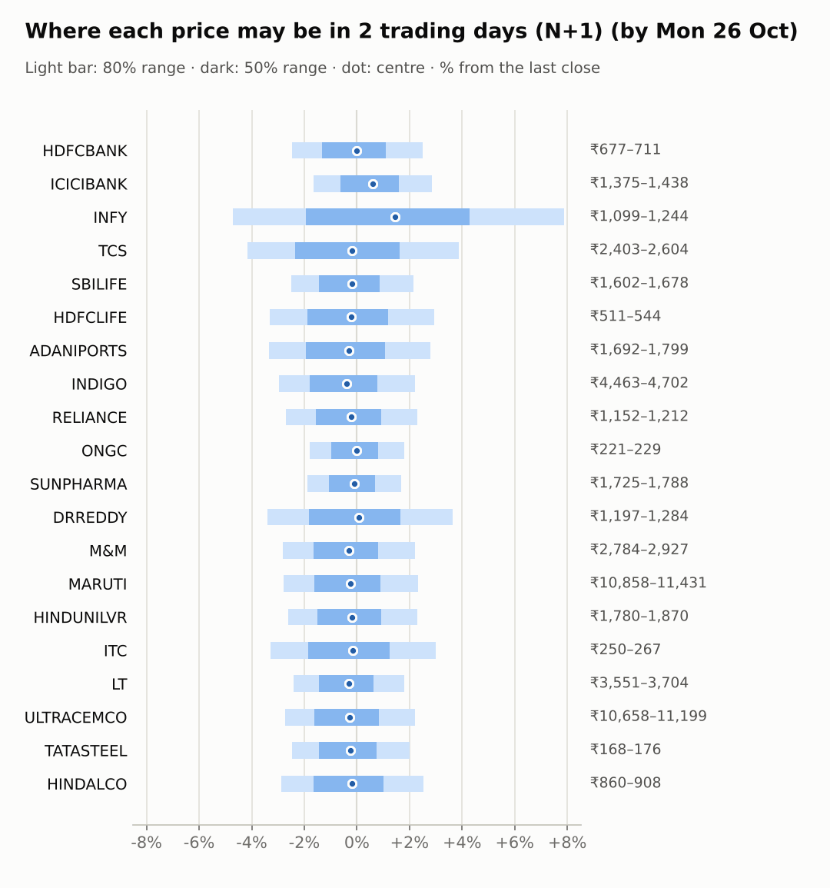
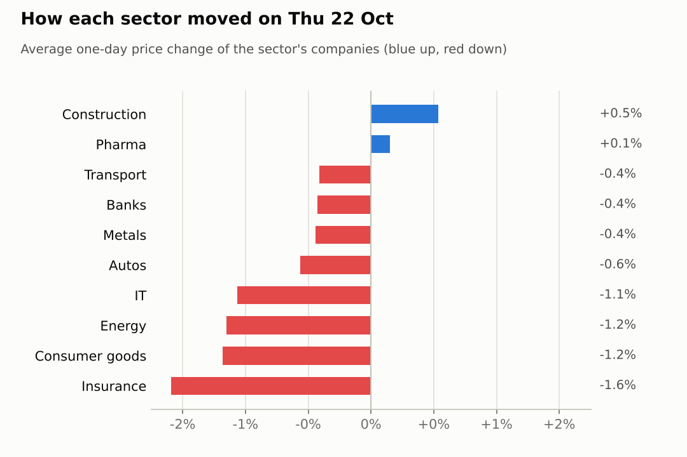
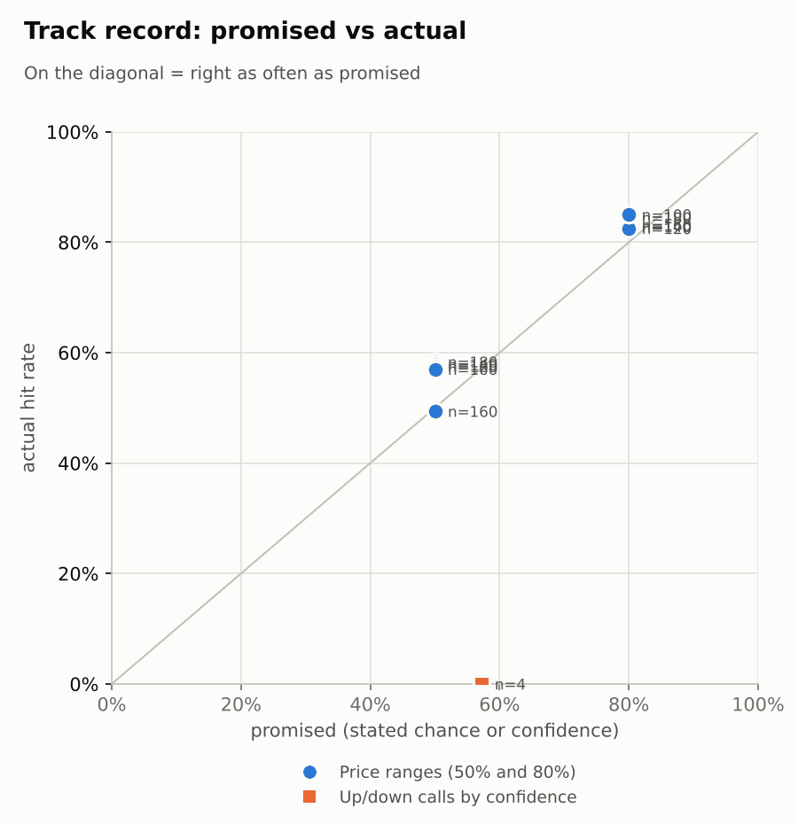

# Market brief: India (NSE), 2026-10-23

_Research log, not investment advice. Generated by a scheduled Claude Code routine._
<!-- report-data: as_of=2026-10-22 regime=CALM outcome=70248abff9bf -->

Easy-to-read version with charts and filters: [2026-10-23.html](2026-10-23.html)

## Headline
Global markets sold off overnight (Nasdaq -2.6%, S&P 500 -1.21%) and Brent crude jumped 5.15% to 114.42, so India is likely to open under pressure. No calls today: the model sees no edge on any stock, ten stocks are held back by a data check, and Infosys and Dr Reddy's report results today.

## Top 3 today
- Risk-off overnight: Nasdaq -2.6%, Nikkei -1.89%, KOSPI -1.99%, US VIX up 14.09% to 19.03, and Brent up 5.15% to 114.42; oil had already pushed the Nifty down on 22 Oct (20ab9997ded25657).
- HDFCBANK: an internal probe found senior executives leaked information (31517522a43fe707, corroborated); the stock fell 1.82% to ₹694.05, but no call because its stored news failed a data check.
- Results today from Infosys (INFY) and Dr Reddy's (DRREDDY): no calls on results day; the INFY ADR rose 2.9% overnight.

## Yesterday
The Nifty 50 fell 0.54% to 22,687.65 on 22 Oct as crude topped $110 (20ab9997ded25657); 15 of 20 watchlist stocks fell, and metals were weak (d5abc8cd696d226b). FIIs sold a net ₹3,459 crore while DIIs bought ₹2,891 crore.
Worst were HDFCLIFE (-2.09%), RELIANCE (-2.03%) and HDFCBANK (-1.82%, executive leak probe, 31517522a43fe707); best were ULTRACEMCO (+1.0%) and ICICIBANK (+0.97%).
N+1 ranges: the 80% range held for 17 of 20 stocks. HDFCLIFE and MARUTI closed below their ranges on the broad sell-off (MARUTI was among the stocks at 52-week lows, a371b9733fc6e865), and ULTRACEMCO closed above its range at ₹10,958.00.
The one call scored, TCS 5-day down, missed: TCS rose 17.25% in the IT rally.

Market on 2026-10-22: Nifty 50 22,687.65 (-0.5%) · India VIX 15.76 (+0.6%) · watchlist 5 up / 15 down · best ULTRACEMCO +1.0%, worst HDFCLIFE -2.1%

### Ranges scored (target date 2026-10-22)

N+1 ranges: **80% hit 17/20** (naive 19/20) · 50% hit 11/20

| Ticker | 80% range | 50% range | Actual | 80% | 50% | Naive 80% |
|---|---|---|---|---|---|---|
| ADANIPORTS | ₹1,710.23–₹1,825.68 | ₹1,736.73–₹1,793.80 | ₹1,750.00 | ✅ | ✅ | ✅ |
| DRREDDY | ₹1,221.40–₹1,280.96 | ₹1,235.17–₹1,264.62 | ₹1,239.00 | ✅ | ✅ | ✅ |
| HDFCBANK | ₹690.67–₹726.23 | ₹698.88–₹716.47 | ₹694.05 | ✅ | ❌ | ✅ |
| HDFCLIFE | ₹528.62–₹563.36 | ₹536.60–₹553.77 | ₹528.35 | ❌ | ❌ | ✅ |
| HINDALCO | ₹875.45–₹926.79 | ₹887.27–₹912.66 | ₹885.60 | ✅ | ❌ | ✅ |
| HINDUNILVR | ₹1,806.61–₹1,902.24 | ₹1,828.68–₹1,875.97 | ₹1,828.30 | ✅ | ❌ | ✅ |
| ICICIBANK | ₹1,357.91–₹1,423.34 | ₹1,373.04–₹1,405.39 | ₹1,398.50 | ✅ | ✅ | ✅ |
| INDIGO | ₹4,577.85–₹4,833.27 | ₹4,636.73–₹4,763.02 | ₹4,600.00 | ✅ | ❌ | ✅ |
| INFY | ₹1,104.64–₹1,195.05 | ₹1,125.29–₹1,169.97 | ₹1,153.35 | ✅ | ✅ | ✅ |
| ITC | ₹252.31–₹269.72 | ₹256.31–₹264.91 | ₹258.90 | ✅ | ✅ | ✅ |
| LT | ₹3,583.11–₹3,747.30 | ₹3,621.10–₹3,702.30 | ₹3,638.30 | ✅ | ✅ | ✅ |
| M&M | ₹2,832.73–₹2,987.02 | ₹2,868.32–₹2,944.61 | ₹2,864.10 | ✅ | ❌ | ✅ |
| MARUTI | ₹11,191.60–₹11,776.86 | ₹11,326.69–₹11,616.09 | ₹11,170.00 | ❌ | ❌ | ✅ |
| ONGC | ₹220.73–₹229.34 | ₹222.72–₹226.98 | ₹225.00 | ✅ | ✅ | ✅ |
| RELIANCE | ₹1,172.53–₹1,233.21 | ₹1,186.54–₹1,216.55 | ₹1,184.50 | ✅ | ❌ | ✅ |
| SBILIFE | ₹1,608.99–₹1,688.76 | ₹1,627.42–₹1,666.87 | ₹1,642.90 | ✅ | ✅ | ✅ |
| SUNPHARMA | ₹1,710.62–₹1,776.63 | ₹1,725.93–₹1,758.58 | ₹1,758.00 | ✅ | ✅ | ✅ |
| TATASTEEL | ₹170.06–₹178.28 | ₹171.96–₹176.03 | ₹172.33 | ✅ | ✅ | ✅ |
| TCS | ₹2,361.91–₹2,565.58 | ₹2,408.34–₹2,508.99 | ₹2,506.90 | ✅ | ✅ | ✅ |
| ULTRACEMCO | ₹10,394.19–₹10,924.69 | ₹10,516.70–₹10,779.03 | ₹10,958.00 | ❌ | ❌ | ❌ |

N+2 ranges that matured on the same date: 80% hit 17/20, 50% hit 12/20. N+3 ranges that matured on the same date: 80% hit 18/20, 50% hit 13/20. N+4 ranges that matured on the same date: 80% hit 17/20, 50% hit 14/20. N+5 ranges that matured on the same date: 80% hit 18/20, 50% hit 13/20.

### Calls scored

| Ticker | H | Call | Conf. | Move | Hit |
|---|---|---|---|---|---|
| TCS | 5d · open→close | down | 57% | +17.25% | ❌ |

## Today (2026-10-23)

**Regime: CALM** · India VIX 15.76 (+0.5%) · benchmark 5d +0.3% · benchmark 10d vol 18.6%

| Ticker | Sector | Close | N+1 80% | N+1 50% | N+5 80% | Call | Cue | Notes |
|---|---|---|---|---|---|---|---|---|
| HDFCBANK | Banks | ₹694.05 | ₹676.91–₹711.34 | ₹684.76–₹701.76 | ₹658.50–₹728.56 | no call | -0.00% | cue -0.00% x0.5; index -0.44% expected from SPX, x beta 1.24 x0.5, own cue -0.00% net x0.5; major event x1.15 |
| ICICIBANK | Banks | ₹1,398.50 | ₹1,375.44–₹1,438.29 | ₹1,389.78–₹1,420.82 | ₹1,341.68–₹1,469.62 | no call | +1.18% | cue +1.18% x0.5; index -0.44% expected from SPX, x beta 0.92 x0.5, own cue +1.18% net x0.5; major event x1.15 |
| INFY | IT | ₹1,153.35 | ₹1,098.94–₹1,244.35 | ₹1,131.12–₹1,202.78 | ₹1,056.48–₹1,285.50 | no call | +2.90% | cue +2.90% x0.5; earnings in horizon (x2.0 day); index -0.44% expected from SPX, x beta 0.73 x0.5, own cue +2.90% net x0.5; major event x1.15 |
| TCS | IT | ₹2,506.90 | ₹2,402.77–₹2,604.33 | ₹2,448.15–₹2,547.59 | ₹2,301.74–₹2,712.45 | no call | – | index -0.44% expected from SPX, x beta 0.83 x0.5; major event x1.15 |
| SBILIFE | Insurance | ₹1,642.90 | ₹1,601.85–₹1,678.07 | ₹1,619.24–₹1,656.88 | ₹1,546.69–₹1,737.00 | no call | – | earnings in horizon (x2.0 day); index -0.44% expected from SPX, x beta 0.85 x0.5; major event x1.15 |
| HDFCLIFE | Insurance | ₹528.35 | ₹510.88–₹543.83 | ₹518.35–₹534.61 | ₹494.48–₹561.67 | no call | – | index -0.44% expected from SPX, x beta 0.96 x0.5; major event x1.15 |
| ADANIPORTS | Transport | ₹1,750.00 | ₹1,691.71–₹1,798.90 | ₹1,716.02–₹1,768.93 | ₹1,615.85–₹1,883.68 | no call | – | earnings in horizon (x2.0 day); index -0.44% expected from SPX, x beta 1.32 x0.5; major event x1.15 |
| INDIGO | Transport | ₹4,600.00 | ₹4,463.20–₹4,702.22 | ₹4,517.61–₹4,635.62 | ₹4,298.78–₹4,896.71 | no call | – | earnings in horizon (x2.0 day); index -0.44% expected from SPX, x beta 1.76 x0.5; major event x1.15 |
| RELIANCE | Energy | ₹1,184.50 | ₹1,152.45–₹1,211.86 | ₹1,165.99–₹1,195.32 | ₹1,109.68–₹1,258.03 | no call | – | earnings in horizon (x2.0 day); index -0.44% expected from SPX, x beta 0.95 x0.5; major event x1.15 |
| ONGC | Energy | ₹225.00 | ₹220.97–₹229.03 | ₹222.81–₹226.79 | ₹216.62–₹233.03 | no call | – | index -0.44% expected from SPX, x beta 0.02 x0.5; major event x1.15 |
| SUNPHARMA | Pharma | ₹1,758.00 | ₹1,724.79–₹1,787.74 | ₹1,739.21–₹1,770.30 | ₹1,678.06–₹1,835.16 | no call | – | earnings in horizon (x2.0 day); index -0.44% expected from SPX, x beta 0.45 x0.5; major event x1.15 |
| DRREDDY | Pharma | ₹1,239.00 | ₹1,196.67–₹1,284.05 | ₹1,216.42–₹1,259.54 | ₹1,170.23–₹1,307.96 | no call | +0.15% | cue +0.15% x0.5; earnings in horizon (x2.0 day); index -0.44% expected from SPX, x beta 0.46 x0.5, own cue +0.15% net x0.5; major event x1.15 |
| M&M | Autos | ₹2,864.10 | ₹2,783.82–₹2,927.23 | ₹2,816.49–₹2,887.29 | ₹2,715.59–₹3,008.37 | no call | – | index -0.44% expected from SPX, x beta 1.41 x0.5; major event x1.15 |
| MARUTI | Autos | ₹11,170.00 | ₹10,857.90–₹11,431.16 | ₹10,988.43–₹11,271.47 | ₹10,448.29–₹11,880.27 | no call | – | earnings in horizon (x2.0 day); index -0.44% expected from SPX, x beta 1.09 x0.5; major event x1.15 |
| HINDUNILVR | Consumer goods | ₹1,828.30 | ₹1,780.44–₹1,870.10 | ₹1,800.88–₹1,845.15 | ₹1,715.33–₹1,939.16 | no call | – | earnings in horizon (x2.0 day); index -0.44% expected from SPX, x beta 0.80 x0.5; major event x1.15 |
| ITC | Consumer goods | ₹258.90 | ₹250.38–₹266.70 | ₹254.08–₹262.13 | ₹242.14–₹275.39 | no call | – | index -0.44% expected from SPX, x beta 0.74 x0.5; major event x1.15 |
| LT | Construction | ₹3,638.30 | ₹3,550.69–₹3,703.66 | ₹3,585.65–₹3,661.19 | ₹3,444.43–₹3,826.91 | no call | – | earnings in horizon (x2.0 day); index -0.44% expected from SPX, x beta 1.41 x0.5; major event x1.15 |
| ULTRACEMCO | Construction | ₹10,958.00 | ₹10,658.25–₹11,198.73 | ₹10,781.41–₹11,048.28 | ₹10,398.23–₹11,501.35 | no call | – | index -0.44% expected from SPX, x beta 1.27 x0.5; major event x1.15 |
| TATASTEEL | Metals | ₹172.33 | ₹168.10–₹175.78 | ₹169.85–₹173.64 | ₹162.62–₹181.81 | no call | – | earnings in horizon (x2.0 day); index -0.44% expected from SPX, x beta 1.06 x0.5; major event x1.15 |
| HINDALCO | Metals | ₹885.60 | ₹860.24–₹907.98 | ₹871.10–₹894.67 | ₹836.32–₹933.66 | no call | – | index -0.44% expected from SPX, x beta 0.83 x0.5; major event x1.15 |

No calls today: the forecaster abstained on all 20 stocks.
- HDFCBANK, HDFCLIFE, ICICIBANK, INDIGO, INFY, M&M, MARUTI, ONGC, TATASTEEL, TCS: data failed validation (the collect gate found news rows stored twice that name these stocks).
- INFY, DRREDDY: results today (earnings within 1 day, hard block).
- RELIANCE: the model is a coin flip and the Jio IPO news is already in its news score; results on 27 Oct fall inside the window.
- ULTRACEMCO: the strong Q2 results (confirmed_primary, nse-ann-106821834) came out on 19 Oct and look priced in.
- LT, SBILIFE, ADANIPORTS, HINDUNILVR: no verified news, and results fall inside the 5-day window.
- HINDALCO, ITC, SUNPHARMA: no verified news; the model sits near its base rate.
AI traders (paper only): the Sonnet combined trader made 14 small down predictions and the pattern trader 3 one-day down predictions (ADANIPORTS, ULTRACEMCO, LT); the news trader and the Opus combined trader abstained on everything.

### Overnight cues and global factors

| Symbol | Name | Last | Change |
|---|---|---|---|
| BRENT | Brent crude | 114.42 | +5.15% |
| DXY | US dollar index | 101.68 | -0.10% |
| GOLD | Gold | 4,004.60 | -3.50% |
| HANGSENG | Hang Seng | 22,886.93 | -0.21% |
| INDIAVIX | India VIX | 15.76 | +0.53% |
| KOSPI | KOSPI | 5,423.59 | -1.99% |
| NASDAQ | Nasdaq Composite (previous US close) | 26,008.86 | -2.60% |
| NIFTY50 | Nifty 50 | 22,687.65 | -0.54% |
| NIKKEI | Nikkei 225 | 61,721.12 | -1.89% |
| SHANGHAI | Shanghai Composite | 3,593.44 | -1.77% |
| SPX | S&P 500 (previous US close) | 7,663.43 | -1.21% |
| STOXX50 | Euro Stoxx 50 | 6,087.01 | -1.94% |
| TAIWAN | Taiwan Weighted | 46,041.43 | -1.80% |
| US10Y | US 10-year yield | 4.95 | -3.75% |
| USDINR | USD/INR | 94.81 | +0.53% |
| USDJPY | USD/JPY | 156.89 | -0.79% |
| USVIX | US VIX | 19.03 | +14.09% |

### ADRs (US-listed shares, previous US session)

| Ticker | ADR | Last | Change |
|---|---|---|---|
| DRREDDY | RDY | 13.21 | +0.15% |
| HDFCBANK | HDB | 22.67 | -0.00% |
| ICICIBANK | IBN | 29.89 | +1.18% |
| INFY | INFY | 13.12 | +2.90% |

## Tomorrow and this week

| Date | Event | Type |
|---|---|---|
| 2026-10-23 | Dr Reddy's earnings | company |
| 2026-10-23 | Infosys earnings | company |
| 2026-10-27 | Larsen & Toubro earnings | company |
| 2026-10-27 | Maruti Suzuki earnings | company |
| 2026-10-27 | NSE monthly F&O expiry (last Tuesday) | major |
| 2026-10-27 | Nifty weekly options expiry (Tuesday) |  |
| 2026-10-27 | Reliance Industries earnings | company |
| 2026-10-27 | SBI Life Insurance earnings | company |
| 2026-10-27 | Tata Steel earnings | company |
| 2026-10-28 | Adani Ports earnings | company |
| 2026-10-28 | Hindustan Unilever earnings | company |
| 2026-10-29 | FOMC rate decision (previous US evening) | major |
| 2026-10-29 | InterGlobe Aviation earnings | company |
| 2026-10-30 | Sun Pharma earnings | company |
| 2026-11-02 | ITC earnings | company |
| 2026-11-03 | Nifty weekly options expiry (Tuesday) |  |
| 2026-11-05 | Mahindra & Mahindra earnings | company |
| 2026-11-06 | Hindalco earnings | company |
| 2026-11-06 | ONGC earnings | company |
| 2026-11-06 | US jobs report (usually first Friday, 08:30 ET; check for shifts) | major |
| 2026-11-09 | Nifty weekly options expiry (Tuesday) |  |

Today: a weak open is likely after the US sell-off and the jump in oil; a high oil price weighs on the rupee (2e70a67c0bed8645) and on oil users. The regime is still CALM with India VIX at 15.76.
Next week: results from LT, MARUTI, RELIANCE, SBILIFE and TATASTEEL on 27 Oct, the same day as the monthly F&O expiry; ADANIPORTS and HINDUNILVR on 28 Oct; the US Fed decision on 29 Oct.

## By sector

### Banks

HDFCBANK fell 1.82% on the executive leak probe (31517522a43fe707, corroborated), while ICICIBANK rose 0.97%: company news, not a sector move.
Bull: ICICIBANK's ADR rose 1.18% overnight. Bear: the HDFCBANK probe has no end date yet, and the stock is near its 52-week low (99f109aa81183889).

### IT

INFY reports today; its ADR rose 2.9% overnight. TCS is up 19.09% in 20 days after the IT rally.
Bull: INFY's results preview expects profit growth (1f287756143298b1). Bear: IBM fell on AI spending caution (9435b6572e68ea9e, promotional), and TCS is stretched with an RSI of 73.

### Insurance

Both fell: HDFCLIFE -2.09% (below its 80% range) and SBILIFE -1.09%, with the broad market.
Bull: no verified news against either. Bear: SBILIFE reports on 27 Oct, inside the 5-day window.

### Transport

INDIGO fell 0.89% and ADANIPORTS was flat (+0.07%).
Bull: Adani Ports set up an Oman step-down subsidiary (nse-ann-106824764). Bear: INDIGO has the highest beta, 1.76, and fuel costs rise with Brent at 114.42.

### Energy

RELIANCE fell 2.03% while ONGC slipped 0.27%: they moved apart.
Bull: the Jio Platforms IPO drew ₹2.5 lakh crore of anchor demand (545039fb252f978d, corroborated). Bear: the IPO drains market liquidity (f7903e48bf3b91e9, single_source), and RELIANCE reports on 27 Oct.

### Pharma

SUNPHARMA rose 0.74% and DRREDDY fell 0.44%; DRREDDY reports today.
Bull: Dr Reddy's got Indian approval to expand Zytorvi's use (b386f177220bc95d, single_source). Bear: US pricing pressure may weigh on its Q2 (98ba8ecc4aa860d7, single_source).

### Autos

Both fell: M&M -0.86% and MARUTI -0.27%; MARUTI closed below its 80% range and is among the stocks at 52-week lows (a371b9733fc6e865).
Bull: MARUTI's RSI of 33 is oversold. Bear: MARUTI reports on 27 Oct, and no verified news supports either stock.

### Consumer goods

HINDUNILVR and ITC both fell 1.18%, together with the market.
Bull: no stock-specific bad news. Bear: HINDUNILVR reports on 28 Oct, and its news is unverified (3937b6c20e775998, unverified).

### Construction

ULTRACEMCO rose 1.0% and closed above its 80% range; LT was flat (+0.06%): company news.
Bull: UltraTech's Q2 profit rose 21% (confirmed_primary, nse-ann-106821834). Bear: those results date from 19 Oct, and LT reports on 27 Oct.

### Metals

HINDALCO fell 0.81% and TATASTEEL 0.07%, as the Nifty Metal index fell on 22 Oct (d5abc8cd696d226b).
Bull: Motilal Oswal targets ₹1,170 for Hindalco (a23d5b9988d88693, single_source). Bear: TATASTEEL reports on 27 Oct, and global risk-off hurts metals.

## Track record

Ranges (targets 50% / 80%; width, score and centre error in % of price, lower is better; naive = last close ± recent typical move, no-change = last close as the centre):

| H | Window | n | 50% cover | 80% cover | Naive 80% | Width | Naive width | Score | Naive score | Centre err | No-change err |
|---|---|---|---|---|---|---|---|---|---|---|---|
| 1d | since start | 180 | 58% | 84% | 87% | 5.58 | 5.93 | 7.589 | 7.669 | 1.51 | 1.53 |
| 1d | last 30 days | 180 | 58% | 84% | 87% | 5.58 | 5.93 | 7.589 | 7.669 | 1.51 | 1.53 |
| 2d | since start | 160 | 49% | 83% | 84% | 6.94 | 7.26 | 10.415 | 10.413 | 2.05 | 2.05 |
| 2d | last 30 days | 160 | 49% | 83% | 84% | 6.94 | 7.26 | 10.415 | 10.413 | 2.05 | 2.05 |
| 3d | since start | 140 | 58% | 83% | 86% | 8.01 | 8.37 | 12.911 | 12.806 | 2.32 | 2.33 |
| 3d | last 30 days | 140 | 58% | 83% | 86% | 8.01 | 8.37 | 12.911 | 12.806 | 2.32 | 2.33 |
| 4d | since start | 120 | 58% | 83% | 85% | 9.02 | 9.31 | 15.744 | 15.459 | 2.71 | 2.73 |
| 4d | last 30 days | 120 | 58% | 83% | 85% | 9.02 | 9.31 | 15.744 | 15.459 | 2.71 | 2.73 |
| 5d | since start | 100 | 57% | 85% | 86% | 9.89 | 10.16 | 18.653 | 18.323 | 3.06 | 3.08 |
| 5d | last 30 days | 100 | 57% | 85% | 86% | 9.89 | 10.16 | 18.653 | 18.323 | 3.06 | 3.08 |

Ranges by regime (since start):

| H | Regime | n | 50% cover | 80% cover | Naive 80% |
|---|---|---|---|---|---|
| 1d | CALM | 120 | 59% | 81% | 83% |
| 1d | TRENDING | 60 | 57% | 92% | 95% |
| 2d | CALM | 120 | 46% | 82% | 83% |
| 2d | TRENDING | 40 | 60% | 88% | 88% |
| 3d | CALM | 120 | 57% | 82% | 85% |
| 3d | TRENDING | 20 | 65% | 90% | 90% |
| 4d | CALM | 120 | 58% | 83% | 85% |
| 5d | CALM | 100 | 57% | 85% | 86% |

Up/down calls vs the always-up baseline:

| H | Window | n | Hit rate | Always-up |
|---|---|---|---|---|
| 1d · open→close | since start | 1 | 0% | 100% |
| 1d · open→close | last 30 days | 1 | 0% | 100% |
| 5d · open→close | since start | 3 | 0% | 100% |
| 5d · open→close | last 30 days | 3 | 0% | 100% |

Calls by confidence band (a band should hit about as often as its confidence):

| Band | n | Avg confidence | Hit rate |
|---|---|---|---|
| 0.50-0.59 · open→close | 4 | 57% | 0% |

Weekly review 2026-W42: 1 proposed range change for a human to decide · [review-2026-W42.md](review-2026-W42.md)

## Data quality

- Indicators: 20 OK, partial: none, blocked: none
- Regime notes: none

| H | Calibration | History n | Live n | q10 / q90 |
|---|---|---|---|---|
| 1d | pool | 8880 | 180 | -1.21 / 1.19 |
| 2d | pool | 8860 | 160 | -1.25 / 1.19 |
| 3d | pool | 8840 | 140 | -1.26 / 1.18 |
| 4d | pool | 8820 | 120 | -1.30 / 1.17 |
| 5d | pool | 8800 | 100 | -1.28 / 1.18 |

- validation, collect, DUPLICATE_ID (blocking, not fixable by a retry): news has duplicated ids in the stored data (the gate lists 20, e.g. 0667d5cf90e07ac4, 0c1247b603f33b38, 126b2b6301c7fc88; more were re-stored this run). News items seen again more than 9 days later are stored again under their old ids; stored rows cannot be removed (append-only). The forecaster and the AI traders abstained on the 10 tickers those rows name: HDFCBANK, HDFCLIFE, ICICIBANK, INDIGO, INFY, M&M, MARUTI, ONGC, TATASTEEL, TCS. None of the duplicated ids is cited. The rule strategies (lab.py predict) do not read the collect gate, so they still predicted.
- validation, collect, COLLECTOR_FAILED (warning): nse_india, 2 old LT financials XML files (101648, 101645) returned HTTP 404 from NSE's archive.
- validation: the news, features, context and forecast gates passed with no failures or warnings.
- validation, report, REPORT_STATUS_UNCITED (warning): the status word confirmed_primary written with the NSE announcement id nse-ann-106821834 (ULTRACEMCO) is not checked by the gate; it is that event's status in the context pack. The first report check also flagged run-statistic numbers (UNMATCHED_NUMBER), which were reworded.
- news-analyst: the watchlist headlines were scored one by one; the background items were scored with keyword rules (many share a generic summary), so their scores are rough.
- results digests: nothing due; 5 NSE attachments not read (pdf_not_parsed: nse-ann-106817267, nse-ann-106818660, nse-ann-106818670, nse-ann-106821066, nse-ann-106821125).
- articles: 42 article pages on outlets not in the allowlist were skipped (skipped_unlisted), as designed.
- head-to-head picks: 72 picks written, all without a candidate; no cost-viable rows today.
- AI traders' abstentions (strategy_abstentions rows): each trader abstained on every company it did not predict; codes abstained and earnings_window (DRREDDY, INFY); rule strategies: earnings_window only.
- Judge FAIL, 2026-10-19, spotcheck (round 1): both 2026-10-12 TCS call rationales say 'Q2 beat already priced', but neither cited id states it (nse-ann-106811186: margin below Street); nothing dropped.
