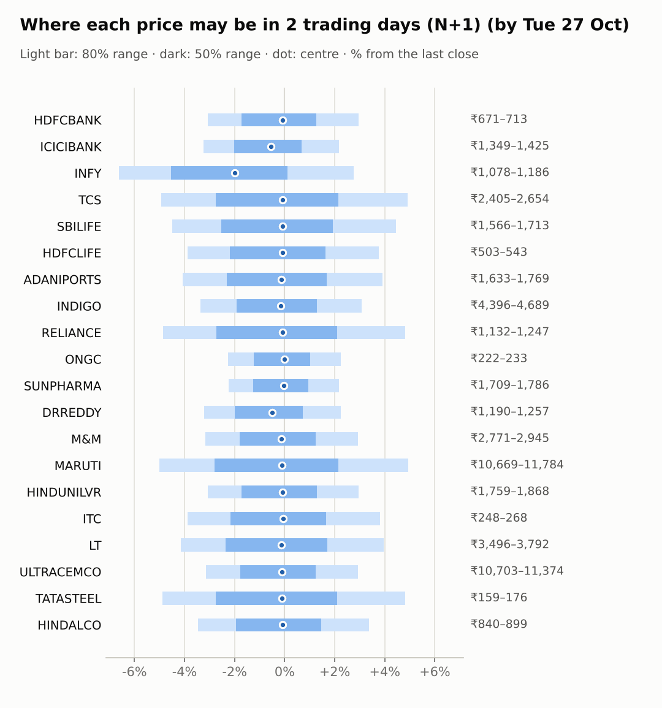
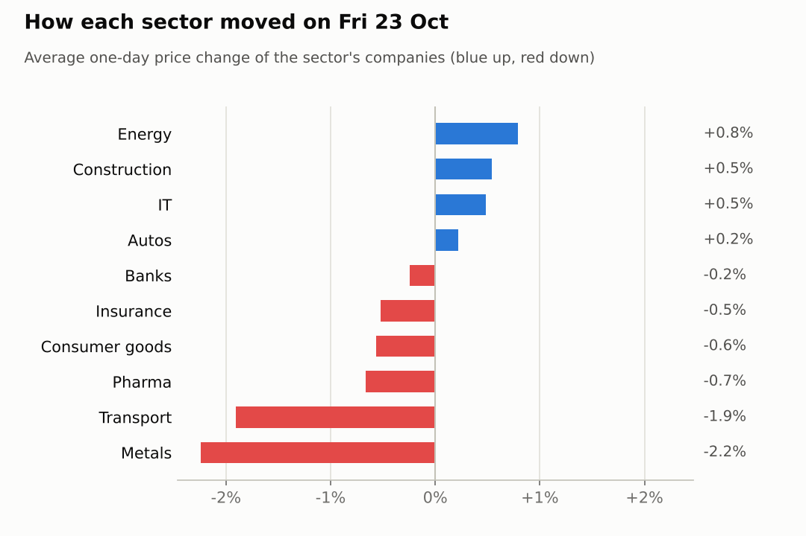
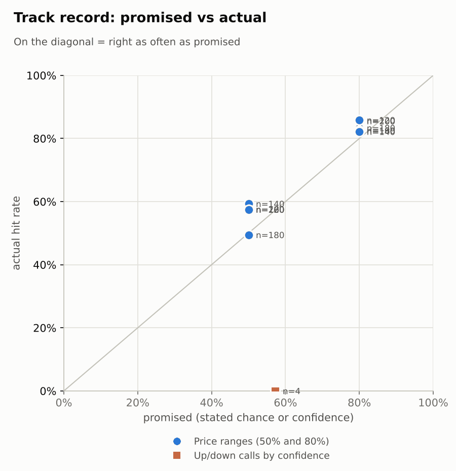

# Market brief: India (NSE), 2026-10-26

_Research log, not investment advice. Generated by a scheduled Claude Code routine._
<!-- report-data: as_of=2026-10-23 regime=EVENT_HEAVY outcome=70248abff9bf -->

Easy-to-read version with charts and filters: [2026-10-26.html](2026-10-26.html)

## Headline
INFY's ADR fell 6.43% after Infosys cut its FY27 revenue guidance to 1% to 2% (11e54bcc741353d6, single_source), so Infosys may open lower; Brent fell 5.83% to 109.92, which helps oil importers. No calls today: the model sits near its base rate and many companies are blocked.

## Top 3 today
- INFY: Q2 profit rose 6% to Rs 7,823 crore (ac7ea25b2cf3e60f, corroborated), but guidance was cut to 1% to 2% (11e54bcc741353d6, single_source) and the INFY ADR fell 6.43%.
- Results tomorrow (Oct 27) for RELIANCE, LT, MARUTI, SBILIFE and TATASTEEL, on the day of the NSE monthly F&O expiry; FOMC on Oct 29.
- Brent fell 5.83% to 109.92 this morning, easing pressure on the rupee and oil importers such as INDIGO.

## Yesterday
The Nifty 50 fell 0.39% to 22,600 on Oct 23 with 7 watchlist stocks up and 13 down; metals led the fall, TATASTEEL down 2.7% and HINDALCO down 1.78% (04f3552754c5fdb4, 22924aa3fe744059). ONGC rose 1.11%.
DRREDDY fell 0.77% as its Q2 net profit fell 31% (1592341fa3dea494, corroborated).
Ranges: 19 of 20 N+1 80% ranges held; only TATASTEEL closed below its band on the metals sell-off. The open TCS 5-day down call missed: TCS rose 17.25% over its window.

Market on 2026-10-23: Nifty 50 22,600.00 (-0.4%) · India VIX 16.86 (+7.0%) · watchlist 7 up / 13 down · best ONGC +1.1%, worst TATASTEEL -2.7%

### Ranges scored (target date 2026-10-23)

N+1 ranges: **80% hit 19/20** (naive 19/20) · 50% hit 10/20

| Ticker | 80% range | 50% range | Actual | 80% | 50% | Naive 80% |
|---|---|---|---|---|---|---|
| ADANIPORTS | ₹1,696.29–₹1,807.33 | ₹1,721.64–₹1,776.67 | ₹1,702.70 | ✅ | ❌ | ✅ |
| DRREDDY | ₹1,196.80–₹1,286.77 | ₹1,217.27–₹1,261.85 | ₹1,229.50 | ✅ | ✅ | ✅ |
| HDFCBANK | ₹686.17–₹720.42 | ₹694.04–₹711.01 | ₹692.80 | ✅ | ❌ | ✅ |
| HDFCLIFE | ₹523.64–₹557.09 | ₹531.28–₹547.86 | ₹523.75 | ✅ | ❌ | ✅ |
| HINDALCO | ₹869.13–₹918.55 | ₹880.44–₹904.94 | ₹869.85 | ✅ | ❌ | ✅ |
| HINDUNILVR | ₹1,806.09–₹1,898.06 | ₹1,827.20–₹1,872.79 | ₹1,814.70 | ✅ | ❌ | ✅ |
| ICICIBANK | ₹1,346.05–₹1,408.52 | ₹1,360.41–₹1,391.38 | ₹1,394.20 | ✅ | ❌ | ✅ |
| INDIGO | ₹4,527.20–₹4,775.00 | ₹4,583.99–₹4,706.83 | ₹4,549.00 | ✅ | ❌ | ✅ |
| INFY | ₹1,094.84–₹1,243.24 | ₹1,127.88–₹1,201.32 | ₹1,153.80 | ✅ | ✅ | ✅ |
| ITC | ₹253.86–₹270.73 | ₹257.71–₹266.07 | ₹257.90 | ✅ | ✅ | ✅ |
| LT | ₹3,562.59–₹3,721.10 | ₹3,599.05–₹3,677.65 | ₹3,647.00 | ✅ | ✅ | ✅ |
| M&M | ₹2,819.61–₹2,968.07 | ₹2,853.66–₹2,927.25 | ₹2,861.20 | ✅ | ✅ | ✅ |
| MARUTI | ₹10,917.77–₹11,512.64 | ₹11,054.12–₹11,349.00 | ₹11,230.00 | ✅ | ✅ | ✅ |
| ONGC | ₹221.48–₹229.80 | ₹223.40–₹227.53 | ₹227.50 | ✅ | ✅ | ✅ |
| RELIANCE | ₹1,164.15–₹1,257.56 | ₹1,185.36–₹1,231.64 | ₹1,190.00 | ✅ | ✅ | ✅ |
| SBILIFE | ₹1,623.62–₹1,701.84 | ₹1,641.59–₹1,680.37 | ₹1,640.00 | ✅ | ❌ | ✅ |
| SUNPHARMA | ₹1,714.23–₹1,777.89 | ₹1,728.92–₹1,760.48 | ₹1,748.00 | ✅ | ✅ | ✅ |
| TATASTEEL | ₹168.69–₹176.65 | ₹170.52–₹174.46 | ₹167.67 | ❌ | ❌ | ❌ |
| TCS | ₹2,428.01–₹2,637.61 | ₹2,475.50–₹2,579.33 | ₹2,530.00 | ✅ | ✅ | ✅ |
| ULTRACEMCO | ₹10,592.15–₹11,138.91 | ₹10,717.60–₹10,988.66 | ₹11,050.00 | ✅ | ❌ | ✅ |

N+2 ranges that matured on the same date: 80% hit 17/20, 50% hit 10/20. N+3 ranges that matured on the same date: 80% hit 16/20, 50% hit 11/20. N+4 ranges that matured on the same date: 80% hit 16/20, 50% hit 14/20. N+5 ranges that matured on the same date: 80% hit 18/20, 50% hit 12/20.

### Calls scored

| Ticker | H | Call | Conf. | Move | Hit |
|---|---|---|---|---|---|
| TCS | 5d · open→close | down | 57% | +17.25% | ❌ |

## Today (2026-10-26)

**Regime: EVENT_HEAVY** · India VIX 16.86 (+7.0%) · benchmark 5d -1.7% · benchmark 10d vol 16.3% · major events: NSE monthly F&O expiry (last Tuesday)

| Ticker | Sector | Close | N+1 80% | N+1 50% | N+5 80% | Call | Cue | Notes |
|---|---|---|---|---|---|---|---|---|
| HDFCBANK | Banks | ₹692.80 | ₹671.46–₹713.26 | ₹680.80–₹701.64 | ₹655.01–₹729.05 | no call | -0.16% | cue -0.16% x0.5; index -0.19% expected from SPX, x beta 1.24 x0.5, own cue -0.16% net x0.5; major event x1.15; regime EVENT_HEAVY x1.1 |
| ICICIBANK | Banks | ₹1,394.20 | ₹1,349.07–₹1,424.58 | ₹1,365.98–₹1,403.63 | ₹1,319.22–₹1,453.00 | no call | -1.07% | cue -1.07% x0.5; index -0.19% expected from SPX, x beta 0.92 x0.5, own cue -1.07% net x0.5; major event x1.15; regime EVENT_HEAVY x1.1 |
| INFY | IT | ₹1,153.80 | ₹1,077.52–₹1,185.66 | ₹1,101.36–₹1,155.21 | ₹1,022.51–₹1,211.49 | no call | -6.43% | cue -6.43% x0.5; index -0.19% expected from SPX, x beta 0.73 x0.5, own cue -6.43% net x0.5; major event x1.15; regime EVENT_HEAVY x1.1 |
| TCS | IT | ₹2,530.00 | ₹2,405.36–₹2,654.30 | ₹2,460.17–₹2,584.14 | ₹2,311.79–₹2,752.93 | no call | – | index -0.19% expected from SPX, x beta 0.82 x0.5; major event x1.15; regime EVENT_HEAVY x1.1 |
| SBILIFE | Insurance | ₹1,640.00 | ₹1,566.28–₹1,712.88 | ₹1,598.67–₹1,671.69 | ₹1,539.13–₹1,740.42 | no call | – | earnings in horizon (x2.0 day); index -0.19% expected from SPX, x beta 0.85 x0.5; major event x1.15; regime EVENT_HEAVY x1.1 |
| HDFCLIFE | Insurance | ₹523.75 | ₹503.41–₹543.49 | ₹512.31–₹532.28 | ₹488.26–₹559.31 | no call | – | index -0.19% expected from SPX, x beta 0.96 x0.5; major event x1.15; regime EVENT_HEAVY x1.1 |
| ADANIPORTS | Transport | ₹1,702.70 | ₹1,633.20–₹1,769.29 | ₹1,663.39–₹1,731.19 | ₹1,556.49–₹1,852.00 | no call | – | earnings in horizon (x2.0 day); index -0.19% expected from SPX, x beta 1.32 x0.5; major event x1.15; regime EVENT_HEAVY x1.1 |
| INDIGO | Transport | ₹4,549.00 | ₹4,395.81–₹4,688.85 | ₹4,461.20–₹4,607.26 | ₹4,231.33–₹4,867.99 | no call | – | earnings in horizon (x2.0 day); index -0.19% expected from SPX, x beta 1.76 x0.5; major event x1.15; regime EVENT_HEAVY x1.1 |
| RELIANCE | Energy | ₹1,190.00 | ₹1,132.09–₹1,247.40 | ₹1,157.49–₹1,214.92 | ₹1,110.86–₹1,269.19 | no call | – | earnings in horizon (x2.0 day); index -0.19% expected from SPX, x beta 0.95 x0.5; major event x1.15; regime EVENT_HEAVY x1.1 |
| ONGC | Energy | ₹227.50 | ₹222.37–₹232.63 | ₹224.68–₹229.79 | ₹218.30–₹236.47 | no call | – | index -0.19% expected from SPX, x beta 0.02 x0.5; major event x1.15; regime EVENT_HEAVY x1.1 |
| SUNPHARMA | Pharma | ₹1,748.00 | ₹1,708.82–₹1,785.74 | ₹1,726.12–₹1,764.48 | ₹1,663.77–₹1,830.72 | no call | – | earnings in horizon (x2.0 day); index -0.19% expected from SPX, x beta 0.45 x0.5; major event x1.15; regime EVENT_HEAVY x1.1 |
| DRREDDY | Pharma | ₹1,229.50 | ₹1,190.03–₹1,257.09 | ₹1,205.05–₹1,238.48 | ₹1,163.53–₹1,282.33 | no call | -0.98% | cue -0.98% x0.5; index -0.19% expected from SPX, x beta 0.46 x0.5, own cue -0.98% net x0.5; major event x1.15; regime EVENT_HEAVY x1.1 |
| M&M | Autos | ₹2,861.20 | ₹2,770.53–₹2,945.18 | ₹2,809.55–₹2,896.61 | ₹2,705.40–₹3,015.18 | no call | – | index -0.19% expected from SPX, x beta 1.41 x0.5; major event x1.15; regime EVENT_HEAVY x1.1 |
| MARUTI | Autos | ₹11,230.00 | ₹10,669.24–₹11,784.03 | ₹10,914.61–₹11,469.75 | ₹10,465.49–₹11,996.28 | no call | – | earnings in horizon (x2.0 day); index -0.19% expected from SPX, x beta 1.09 x0.5; major event x1.15; regime EVENT_HEAVY x1.1 |
| HINDUNILVR | Consumer goods | ₹1,814.70 | ₹1,758.95–₹1,868.25 | ₹1,783.38–₹1,837.86 | ₹1,696.03–₹1,933.31 | no call | – | earnings in horizon (x2.0 day); index -0.19% expected from SPX, x beta 0.80 x0.5; major event x1.15; regime EVENT_HEAVY x1.1 |
| ITC | Consumer goods | ₹257.90 | ₹247.90–₹267.72 | ₹252.30–₹262.18 | ₹236.58–₹279.60 | no call | – | earnings in horizon (x2.0 day); index -0.19% expected from SPX, x beta 0.74 x0.5; major event x1.15; regime EVENT_HEAVY x1.1 |
| LT | Construction | ₹3,647.00 | ₹3,495.73–₹3,791.60 | ₹3,561.31–₹3,708.73 | ₹3,442.72–₹3,849.22 | no call | – | earnings in horizon (x2.0 day); index -0.19% expected from SPX, x beta 1.41 x0.5; major event x1.15; regime EVENT_HEAVY x1.1 |
| ULTRACEMCO | Construction | ₹11,050.00 | ₹10,702.94–₹11,374.10 | ₹10,852.92–₹11,187.48 | ₹10,451.29–₹11,641.57 | no call | – | index -0.19% expected from SPX, x beta 1.26 x0.5; major event x1.15; regime EVENT_HEAVY x1.1 |
| TATASTEEL | Metals | ₹167.67 | ₹159.48–₹175.75 | ₹163.06–₹171.17 | ₹156.50–₹178.84 | no call | – | earnings in horizon (x2.0 day); index -0.19% expected from SPX, x beta 1.07 x0.5; major event x1.15; regime EVENT_HEAVY x1.1 |
| HINDALCO | Metals | ₹869.85 | ₹839.68–₹899.07 | ₹852.91–₹882.51 | ₹817.07–₹922.35 | no call | – | index -0.19% expected from SPX, x beta 0.83 x0.5; major event x1.15; regime EVENT_HEAVY x1.1 |

No calls today: the forecaster abstained on all 20 companies.
- Model near its base rate and all 4 settled open-to-close calls missed, so no edge: ADANIPORTS, DRREDDY, HDFCBANK, HDFCLIFE, HINDUNILVR, ICICIBANK, ONGC.
- Earnings within 1 day (Oct 27), a hard block: LT, SBILIFE, and also MARUTI, RELIANCE, TATASTEEL.
- Data failed validation (collect gate DUPLICATE_ID on their news rows): INFY, TCS, MARUTI, HINDALCO, TATASTEEL, M&M, ULTRACEMCO, INDIGO, SUNPHARMA, RELIANCE, ITC.
AI traders (paper only, never orders): the Sonnet combined trader leaned every allowed company down on the model alone; pattern-mood called HINDALCO up at N+3 and N+5, INFY down at N+1; the Opus combined trader called INFY down at N+3 and N+5; news-results abstained on all.

### Overnight cues and global factors

| Symbol | Name | Last | Change |
|---|---|---|---|
| BRENT | Brent crude | 109.92 | -5.83% |
| DXY | US dollar index | 101.63 | -0.18% |
| GOLD | Gold | 4,003.00 | -0.12% |
| HANGSENG | Hang Seng | 23,101.39 | +0.03% |
| INDIAVIX | India VIX | 16.86 | +6.98% |
| KOSPI | KOSPI | 5,496.40 | -0.97% |
| NASDAQ | Nasdaq Composite (previous US close) | 25,955.34 | -0.21% |
| NIFTY50 | Nifty 50 | 22,600.00 | -0.39% |
| NIKKEI | Nikkei 225 | 62,590.27 | -0.16% |
| SHANGHAI | Shanghai Composite | 3,671.41 | -0.52% |
| SPX | S&P 500 (previous US close) | 7,623.68 | -0.52% |
| STOXX50 | Euro Stoxx 50 | 6,068.22 | -0.31% |
| TAIWAN | Taiwan Weighted | 46,099.28 | -1.68% |
| US10Y | US 10-year yield | 4.99 | +0.71% |
| USDINR | USD/INR | 94.93 | +0.23% |
| USDJPY | USD/JPY | 156.69 | +0.13% |
| USVIX | US VIX | 19.45 | +2.21% |

### ADRs (US-listed shares, previous US session)

| Ticker | ADR | Last | Change |
|---|---|---|---|
| DRREDDY | RDY | 13.10 | -0.98% |
| HDFCBANK | HDB | 22.41 | -0.16% |
| ICICIBANK | IBN | 29.62 | -1.07% |
| INFY | INFY | 12.37 | -6.43% |

## Tomorrow and this week

| Date | Event | Type |
|---|---|---|
| 2026-10-27 | Larsen & Toubro earnings | company |
| 2026-10-27 | Maruti Suzuki earnings | company |
| 2026-10-27 | NSE monthly F&O expiry (last Tuesday) | major |
| 2026-10-27 | Nifty weekly options expiry (Tuesday) |  |
| 2026-10-27 | Reliance Industries earnings | company |
| 2026-10-27 | SBI Life Insurance earnings | company |
| 2026-10-27 | Tata Steel earnings | company |
| 2026-10-28 | Adani Ports earnings | company |
| 2026-10-28 | Hindustan Unilever earnings | company |
| 2026-10-29 | FOMC rate decision (previous US evening) | major |
| 2026-10-29 | InterGlobe Aviation earnings | company |
| 2026-10-30 | Sun Pharma earnings | company |
| 2026-11-02 | ITC earnings | company |
| 2026-11-03 | Infosys ex-dividend (est. 25, last dividend) | company |
| 2026-11-03 | Nifty weekly options expiry (Tuesday) |  |
| 2026-11-05 | Mahindra & Mahindra earnings | company |
| 2026-11-06 | Hindalco earnings | company |
| 2026-11-06 | ONGC earnings | company |
| 2026-11-06 | US jobs report (usually first Friday, 08:30 ET; check for shifts) | major |
| 2026-11-09 | Nifty weekly options expiry (Tuesday) |  |

Tomorrow is heavy: NSE monthly F&O expiry plus results from RELIANCE, LT, MARUTI, SBILIFE and TATASTEEL; ADANIPORTS and HINDUNILVR report on Oct 28, INDIGO on Oct 29 and SUNPHARMA on Oct 30, so their ranges are widened. The FOMC decision lands on Oct 29. The regime is EVENT_HEAVY with India VIX up 6.98% to 16.86; overnight cues are mildly negative (S&P 500 -0.52%, KOSPI -0.97%), while the Brent drop of 5.83% is a relief for importers.

## By sector

### Banks

HDFCBANK slipped 0.18% and is down 4.68% over 5 days; it was among the biggest market-cap losers of the week (1e6e0dd8cc989909), after the internal probe on leaked information (31517522a43fe707, corroborated). ICICIBANK fell 0.31% but is 5.03% ahead of its peers over 5 days.
Bull: ICICIBANK's Q2 profit grew about 20% (253e23dca35b0f8a, unverified). Bear: Nifty Bank fell 1.16% and the ICICIBANK ADR fell 1.07% overnight. Both moved with the sector.

### IT

INFY rose 0.04% before its results; after them its ADR fell 6.43% on the guidance cut (11e54bcc741353d6, single_source). TCS rose 0.92% and is up 21.08% over 20 days (RSI 74).
Bull: TCS momentum is strong. Bear: INFY's guidance cut may weigh on the whole sector at the open. The two moved apart: company news.

### Insurance

HDFCLIFE fell 0.87% and is down 4.87% over 5 days on thin volume; SBILIFE fell 0.18% and reports tomorrow.
Bull: HDFCLIFE's reported VNB growth (91825387415712fe, unverified). Bear: both are in a 20-day downtrend. They moved together.

### Transport

ADANIPORTS fell 2.7% and INDIGO 1.11%; both report this week (Oct 28 and Oct 29).
Bull: the 5.83% Brent drop helps INDIGO's fuel costs; a broker target for ADANIPORTS (5e778c8ecbd122f6, unverified). Bear: INDIGO is down 9.54% over 20 days. They moved together.

### Energy

RELIANCE rose 0.46% ahead of tomorrow's results while the Jio Platforms IPO drew strong demand (545039fb252f978d, corroborated); ONGC rose 1.11%.
Bull: Jio IPO demand for RELIANCE. Bear: the 5.83% Brent fall is a headwind for ONGC as a producer. Both rose, each on its own news.

### Pharma

DRREDDY fell 0.77% after Q2 net profit fell 31% (1592341fa3dea494, corroborated); SUNPHARMA fell 0.57% while a report says it will buy Organon for about $11.75 billion (05baf73f2df5b8af, unverified).
Bull: DRREDDY's fall was small for the size of the profit drop. Bear: Nifty Pharma fell 1.04% and is down 6.71% over 20 days. Both fell with the sector.

### Autos

MARUTI rose 0.54% ahead of tomorrow's results; M&M fell 0.1%.
Bull: MARUTI is oversold (RSI 35). Bear: MARUTI is down 8.18% over 20 days. They moved apart, no sector news.

### Consumer goods

HINDUNILVR fell 0.74% and ITC 0.39%; HINDUNILVR reports on Oct 28 and ITC on Nov 2.
Bull: HINDUNILVR is near oversold (RSI 36). Bear: HINDUNILVR is down 4.34% over 5 days. They moved together, no stock-specific news.

### Construction

ULTRACEMCO rose 0.84% and LT 0.24%; LT reports tomorrow.
Bull: ULTRACEMCO is up 1.73% over 5 days after its Q2 results. Bear: LT is down 7.2% over 20 days. They moved together.

### Metals

TATASTEEL fell 2.7% and HINDALCO 1.78% in a metals sell-off (04f3552754c5fdb4, 22924aa3fe744059); TATASTEEL closed below its 80% range and reports tomorrow.
Bull: TATASTEEL and HINDALCO are oversold. Bear: TATASTEEL is down 12.13% and HINDALCO 13.34% over 20 days. They moved together on sector news.

## Track record

Ranges (targets 50% / 80%; width, score and centre error in % of price, lower is better; naive = last close ± recent typical move, no-change = last close as the centre):

| H | Window | n | 50% cover | 80% cover | Naive 80% | Width | Naive width | Score | Naive score | Centre err | No-change err |
|---|---|---|---|---|---|---|---|---|---|---|---|
| 1d | since start | 200 | 58% | 86% | 88% | 5.61 | 5.92 | 7.443 | 7.493 | 1.51 | 1.52 |
| 1d | last 30 days | 200 | 58% | 86% | 88% | 5.61 | 5.92 | 7.443 | 7.493 | 1.51 | 1.52 |
| 2d | since start | 180 | 49% | 83% | 85% | 6.97 | 7.26 | 10.139 | 10.099 | 2.04 | 2.05 |
| 2d | last 30 days | 180 | 49% | 83% | 85% | 6.97 | 7.26 | 10.139 | 10.099 | 2.04 | 2.05 |
| 3d | since start | 160 | 58% | 83% | 85% | 8.07 | 8.39 | 12.582 | 12.418 | 2.34 | 2.33 |
| 3d | last 30 days | 160 | 58% | 83% | 85% | 8.07 | 8.39 | 12.582 | 12.418 | 2.34 | 2.33 |
| 4d | since start | 140 | 59% | 82% | 84% | 9.12 | 9.36 | 15.152 | 14.768 | 2.70 | 2.72 |
| 4d | last 30 days | 140 | 59% | 82% | 84% | 9.12 | 9.36 | 15.152 | 14.768 | 2.70 | 2.72 |
| 5d | since start | 120 | 58% | 86% | 87% | 9.99 | 10.20 | 17.615 | 17.249 | 2.99 | 3.00 |
| 5d | last 30 days | 120 | 58% | 86% | 87% | 9.99 | 10.20 | 17.615 | 17.249 | 2.99 | 3.00 |

Ranges by regime (since start):

| H | Regime | n | 50% cover | 80% cover | Naive 80% |
|---|---|---|---|---|---|
| 1d | CALM | 140 | 58% | 83% | 84% |
| 1d | TRENDING | 60 | 57% | 92% | 95% |
| 2d | CALM | 120 | 46% | 82% | 83% |
| 2d | TRENDING | 60 | 57% | 87% | 88% |
| 3d | CALM | 120 | 57% | 82% | 85% |
| 3d | TRENDING | 40 | 60% | 85% | 85% |
| 4d | CALM | 120 | 58% | 83% | 85% |
| 4d | TRENDING | 20 | 70% | 80% | 80% |
| 5d | CALM | 120 | 58% | 86% | 87% |

Up/down calls vs the always-up baseline:

| H | Window | n | Hit rate | Always-up |
|---|---|---|---|---|
| 1d · open→close | since start | 1 | 0% | 100% |
| 1d · open→close | last 30 days | 1 | 0% | 100% |
| 5d · open→close | since start | 3 | 0% | 100% |
| 5d · open→close | last 30 days | 3 | 0% | 100% |

Calls by confidence band (a band should hit about as often as its confidence):

| Band | n | Avg confidence | Hit rate |
|---|---|---|---|
| 0.50-0.59 · open→close | 4 | 57% | 0% |

Weekly review 2026-W43: 0 proposed range changes for a human to decide · [review-2026-W43.md](review-2026-W43.md)

## Data quality

- Indicators: 20 OK, partial: none, blocked: none
- Regime notes: none

| H | Calibration | History n | Live n | q10 / q90 |
|---|---|---|---|---|
| 1d | pool | 8900 | 200 | -1.20 / 1.18 |
| 2d | pool | 8880 | 180 | -1.25 / 1.18 |
| 3d | pool | 8860 | 160 | -1.27 / 1.17 |
| 4d | pool | 8840 | 140 | -1.31 / 1.16 |
| 5d | pool | 8820 | 120 | -1.26 / 1.18 |

- All collectors ran. collect_relations_india warning: NSE pledge endpoint returned no rows at all for 3 per-ticker calls.
- Inbox import: no company commands or paper trades pending (run after the collectors this time, not before).
- validate collect: FAIL DUPLICATE_ID, news: 20 duplicated ids (e.g. 0415c8916fa68bb4, 0667d5cf90e07ac4); no tickers named; the forecaster abstained ("data failed validation") on the tickers the duplicated rows tag: INFY, TCS, MARUTI, HINDALCO, TATASTEEL, M&M, ULTRACEMCO, INDIGO, SUNPHARMA, RELIANCE, ITC (no fix possible in the run: data files are append-only; the news de-duplication issue is still open).
- Results digests: INFY, DRREDDY, ULTRACEMCO Q2 stored as text_unavailable (NSE PDFs not parsed: no PDF parser yet).
- collect_flows_india note: no NSE index file for 2026-10-26 yet (published after the close).
- News analyst: about two thirds of the watchlist items and all background items were scored by keyword rules because of the time box; their summaries are coarse.
- validate features, context, news and forecast: all passed with no warnings. Claims: 40 records valid and appended; lessons: none due.
- AI traders' abstentions (strategy_abstentions rows): codes abstained and earnings_window (LT, MARUTI, RELIANCE, SBILIFE, TATASTEEL) for each of the four traders; no gate_failed, timeout or killed.
- Judge FAIL from the previous run: 2026-10-19 spotcheck round 1: both 2026-10-12 TCS call rationales said 'Q2 beat already priced'; neither cited id states it (nse-ann-106811186); nothing dropped.
