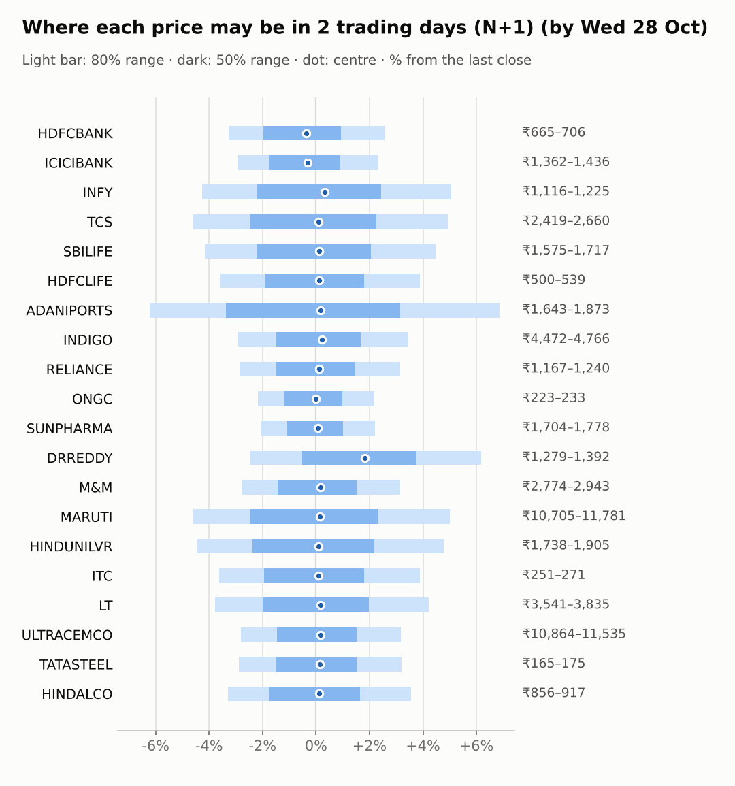
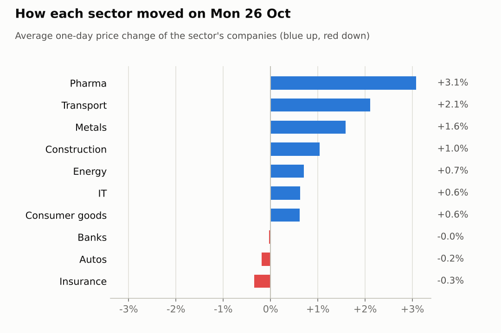
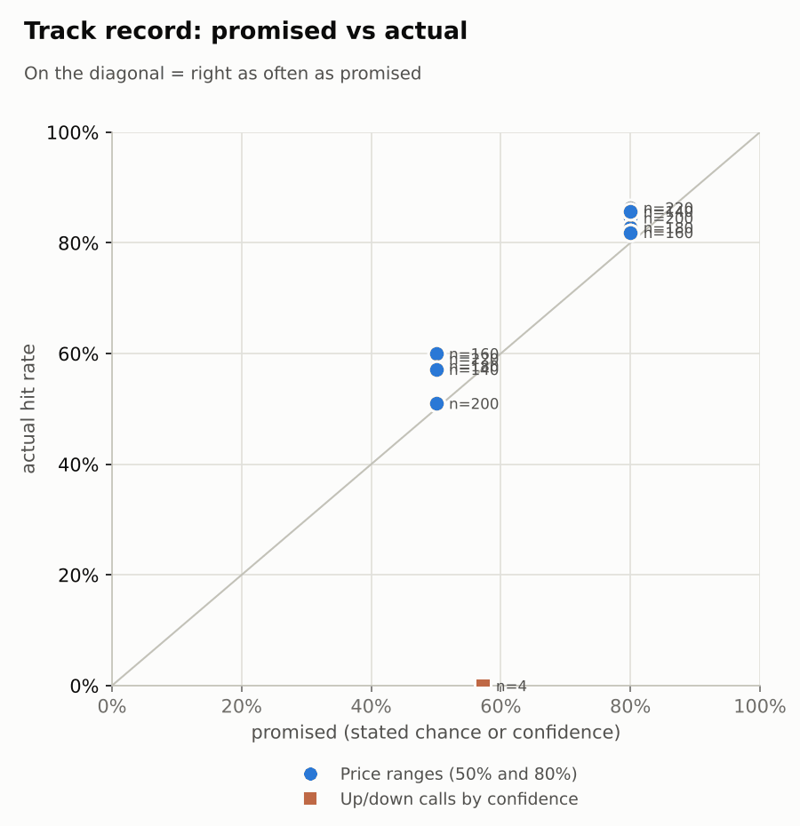

# Market brief: India (NSE), 2026-10-27

_Research log, not investment advice. Generated by a scheduled Claude Code routine._
<!-- report-data: as_of=2026-10-26 regime=EVENT_HEAVY outcome=70248abff9bf -->

Easy-to-read version with charts and filters: [2026-10-27.html](2026-10-27.html)

## Headline
No calls today: the signal model sits near its base rate, 15 companies are blocked by a data-validation failure and 5 report results today or tomorrow. The day is EVENT_HEAVY: NSE monthly F&O expiry (the day monthly futures and options contracts settle) today and the US Fed decision on Oct 29, with firm overnight cues (S&P 500 +0.7%, Nikkei +1.92%) and Brent down 5.97%.

## Top 3 today
- Results today from LT, MARUTI and SBILIFE, and from ADANIPORTS and HINDUNILVR tomorrow; MARUTI's preview expects profit to fall (89a2ac83a1da551d, single_source).
- RELIANCE: the exchange filing confirms the Jio Platforms IPO listing (confirmed_primary, nse-ann-106827783).
- DRREDDY jumped 6.62% after its Q2 results with its ADR up 4.09% overnight, but the share of traded stock taken for delivery was about half its usual level.

## Yesterday
The Nifty 50 rose 0.68% on Oct 26 and 15 of 20 watchlist stocks rose. DRREDDY led with +6.62% on 3.87 times its average volume after its Q2 results; HDFCLIFE fell most, 0.91%.
Ranges: 19 of 20 1-day closes fell inside the 80% range. DRREDDY closed above all five of its ranges: the post-results jump was larger than the range allowed for.

Market on 2026-10-26: Nifty 50 22,753.20 (+0.7%) · India VIX 17.16 (+1.8%) · watchlist 15 up / 5 down · best DRREDDY +6.6%, worst HDFCLIFE -0.9%

### Ranges scored (target date 2026-10-26)

N+1 ranges: **80% hit 19/20** (naive 19/20) · 50% hit 15/20

| Ticker | 80% range | 50% range | Actual | 80% | 50% | Naive 80% |
|---|---|---|---|---|---|---|
| ADANIPORTS | ₹1,691.71–₹1,798.90 | ₹1,716.02–₹1,768.93 | ₹1,752.50 | ✅ | ✅ | ✅ |
| DRREDDY | ₹1,196.67–₹1,284.05 | ₹1,216.42–₹1,259.54 | ₹1,310.90 | ❌ | ❌ | ❌ |
| HDFCBANK | ₹676.91–₹711.34 | ₹684.76–₹701.76 | ₹688.05 | ✅ | ✅ | ✅ |
| HDFCLIFE | ₹510.88–₹543.83 | ₹518.35–₹534.61 | ₹519.00 | ✅ | ✅ | ✅ |
| HINDALCO | ₹860.24–₹907.98 | ₹871.10–₹894.67 | ₹885.65 | ✅ | ✅ | ✅ |
| HINDUNILVR | ₹1,780.44–₹1,870.10 | ₹1,800.88–₹1,845.15 | ₹1,818.60 | ✅ | ✅ | ✅ |
| ICICIBANK | ₹1,375.44–₹1,438.29 | ₹1,389.78–₹1,420.82 | ₹1,403.00 | ✅ | ✅ | ✅ |
| INDIGO | ₹4,463.20–₹4,702.22 | ₹4,517.61–₹4,635.62 | ₹4,608.00 | ✅ | ✅ | ✅ |
| INFY | ₹1,098.94–₹1,244.35 | ₹1,131.12–₹1,202.78 | ₹1,166.00 | ✅ | ✅ | ✅ |
| ITC | ₹250.38–₹266.70 | ₹254.08–₹262.13 | ₹260.50 | ✅ | ✅ | ✅ |
| LT | ₹3,550.69–₹3,703.66 | ₹3,585.65–₹3,661.19 | ₹3,680.00 | ✅ | ❌ | ✅ |
| M&M | ₹2,783.82–₹2,927.23 | ₹2,816.49–₹2,887.29 | ₹2,853.10 | ✅ | ✅ | ✅ |
| MARUTI | ₹10,857.90–₹11,431.16 | ₹10,988.43–₹11,271.47 | ₹11,220.00 | ✅ | ✅ | ✅ |
| ONGC | ₹220.97–₹229.03 | ₹222.81–₹226.79 | ₹228.44 | ✅ | ❌ | ✅ |
| RELIANCE | ₹1,152.45–₹1,211.86 | ₹1,165.99–₹1,195.32 | ₹1,201.80 | ✅ | ❌ | ✅ |
| SBILIFE | ₹1,601.85–₹1,678.07 | ₹1,619.24–₹1,656.88 | ₹1,643.70 | ✅ | ✅ | ✅ |
| SUNPHARMA | ₹1,724.79–₹1,787.74 | ₹1,739.21–₹1,770.30 | ₹1,740.00 | ✅ | ✅ | ✅ |
| TATASTEEL | ₹168.10–₹175.78 | ₹169.85–₹173.64 | ₹169.94 | ✅ | ✅ | ✅ |
| TCS | ₹2,402.77–₹2,604.33 | ₹2,448.15–₹2,547.59 | ₹2,535.00 | ✅ | ✅ | ✅ |
| ULTRACEMCO | ₹10,658.25–₹11,198.73 | ₹10,781.41–₹11,048.28 | ₹11,180.00 | ✅ | ❌ | ✅ |

N+2 ranges that matured on the same date: 80% hit 19/20, 50% hit 13/20. N+3 ranges that matured on the same date: 80% hit 17/20, 50% hit 12/20. N+4 ranges that matured on the same date: 80% hit 16/20, 50% hit 13/20. N+5 ranges that matured on the same date: 80% hit 17/20, 50% hit 11/20.

### Calls scored

| Ticker | H | Call | Conf. | Move | Hit |
|---|---|---|---|---|---|
| TCS | 5d · open→close | down | 57% | +17.25% | ❌ |

## Today (2026-10-27)

**Regime: EVENT_HEAVY** · India VIX 17.16 (+1.8%) · benchmark 5d -1.7% · benchmark 10d vol 15.4% · major events: NSE monthly F&O expiry (last Tuesday), FOMC rate decision (previous US evening)

| Ticker | Sector | Close | N+1 80% | N+1 50% | N+5 80% | Call | Cue | Notes |
|---|---|---|---|---|---|---|---|---|
| HDFCBANK | Banks | ₹688.05 | ₹665.48–₹705.68 | ₹674.54–₹694.54 | ₹649.63–₹721.03 | no call | -0.75% | cue -0.75% x0.5; index +0.25% expected from SPX, x beta 1.24 x0.5, own cue -0.75% net x0.5; major event x1.15; regime EVENT_HEAVY x1.1 |
| ICICIBANK | Banks | ₹1,403.00 | ₹1,361.86–₹1,435.86 | ₹1,378.58–₹1,415.39 | ₹1,332.57–₹1,464.01 | no call | -0.61% | cue -0.61% x0.5; index +0.25% expected from SPX, x beta 0.92 x0.5, own cue -0.61% net x0.5; major event x1.15; regime EVENT_HEAVY x1.1 |
| INFY | IT | ₹1,166.00 | ₹1,116.24–₹1,224.83 | ₹1,140.39–₹1,194.36 | ₹1,051.42–₹1,240.10 | no call | +0.65% | cue +0.65% x0.5; ex-dividend 25 (2.14%); index +0.25% expected from SPX, x beta 0.73 x0.5, own cue +0.65% net x0.5; major event x1.15; regime EVENT_HEAVY x1.1 |
| TCS | IT | ₹2,535.00 | ₹2,418.89–₹2,659.85 | ₹2,472.45–₹2,592.19 | ₹2,323.92–₹2,751.33 | no call | – | index +0.25% expected from SPX, x beta 0.82 x0.5; major event x1.15; regime EVENT_HEAVY x1.1 |
| SBILIFE | Insurance | ₹1,643.70 | ₹1,575.30–₹1,717.34 | ₹1,606.98–₹1,677.58 | ₹1,546.08–₹1,741.28 | no call | – | earnings in horizon (x2.0 day); index +0.25% expected from SPX, x beta 0.84 x0.5; major event x1.15; regime EVENT_HEAVY x1.1 |
| HDFCLIFE | Insurance | ₹519.00 | ₹500.46–₹539.14 | ₹509.13–₹528.36 | ₹484.80–₹553.41 | no call | – | index +0.25% expected from SPX, x beta 0.95 x0.5; major event x1.15; regime EVENT_HEAVY x1.1 |
| ADANIPORTS | Transport | ₹1,752.50 | ₹1,643.27–₹1,872.97 | ₹1,693.61–₹1,807.65 | ₹1,597.21–₹1,912.56 | no call | – | earnings in horizon (x2.0 day); index +0.25% expected from SPX, x beta 1.33 x0.5; major event x1.15; regime EVENT_HEAVY x1.1 |
| INDIGO | Transport | ₹4,608.00 | ₹4,472.26–₹4,766.08 | ₹4,538.37–₹4,684.50 | ₹4,290.67–₹4,928.34 | no call | – | earnings in horizon (x2.0 day); index +0.25% expected from SPX, x beta 1.76 x0.5; major event x1.15; regime EVENT_HEAVY x1.1 |
| RELIANCE | Energy | ₹1,201.80 | ₹1,167.34–₹1,239.55 | ₹1,183.61–₹1,219.53 | ₹1,123.58–₹1,280.45 | no call | – | earnings in horizon (x2.0 day); index +0.25% expected from SPX, x beta 0.95 x0.5; major event x1.15; regime EVENT_HEAVY x1.1 |
| ONGC | Energy | ₹228.44 | ₹223.46–₹233.44 | ₹225.73–₹230.69 | ₹219.48–₹237.21 | no call | – | index +0.25% expected from SPX, x beta 0.01 x0.5; major event x1.15; regime EVENT_HEAVY x1.1 |
| SUNPHARMA | Pharma | ₹1,740.00 | ₹1,703.87–₹1,778.22 | ₹1,720.74–₹1,757.73 | ₹1,658.64–₹1,820.28 | no call | – | earnings in horizon (x2.0 day); index +0.25% expected from SPX, x beta 0.45 x0.5; major event x1.15; regime EVENT_HEAVY x1.1 |
| DRREDDY | Pharma | ₹1,310.90 | ₹1,278.64–₹1,392.00 | ₹1,303.93–₹1,360.28 | ₹1,237.36–₹1,439.07 | no call | +4.09% | cue +4.09% x0.5; index +0.25% expected from SPX, x beta 0.48 x0.5, own cue +4.09% net x0.5; major event x1.15; regime EVENT_HEAVY x1.1 |
| M&M | Autos | ₹2,853.10 | ₹2,774.28–₹2,942.90 | ₹2,812.29–₹2,896.16 | ₹2,703.06–₹3,002.04 | no call | – | index +0.25% expected from SPX, x beta 1.40 x0.5; major event x1.15; regime EVENT_HEAVY x1.1 |
| MARUTI | Autos | ₹11,220.00 | ₹10,705.04–₹11,781.49 | ₹10,944.22–₹11,479.16 | ₹10,482.92–₹11,961.61 | no call | – | earnings in horizon (x2.0 day); index +0.25% expected from SPX, x beta 1.09 x0.5; major event x1.15; regime EVENT_HEAVY x1.1 |
| HINDUNILVR | Consumer goods | ₹1,818.60 | ₹1,737.88–₹1,905.27 | ₹1,775.13–₹1,858.32 | ₹1,703.78–₹1,933.82 | no call | – | earnings in horizon (x2.0 day); index +0.25% expected from SPX, x beta 0.80 x0.5; major event x1.15; regime EVENT_HEAVY x1.1 |
| ITC | Consumer goods | ₹260.50 | ₹251.08–₹270.60 | ₹255.45–₹265.15 | ₹239.52–₹281.94 | no call | – | earnings in horizon (x2.0 day); index +0.25% expected from SPX, x beta 0.74 x0.5; major event x1.15; regime EVENT_HEAVY x1.1 |
| LT | Construction | ₹3,680.00 | ₹3,541.15–₹3,834.95 | ₹3,606.84–₹3,752.91 | ₹3,477.76–₹3,881.24 | no call | – | earnings in horizon (x2.0 day); index +0.25% expected from SPX, x beta 1.40 x0.5; major event x1.15; regime EVENT_HEAVY x1.1 |
| ULTRACEMCO | Construction | ₹11,180.00 | ₹10,864.45–₹11,534.81 | ₹11,015.51–₹11,348.94 | ₹10,583.64–₹11,772.43 | no call | – | index +0.25% expected from SPX, x beta 1.26 x0.5; major event x1.15; regime EVENT_HEAVY x1.1 |
| TATASTEEL | Metals | ₹169.94 | ₹165.02–₹175.37 | ₹167.35–₹172.50 | ₹160.73–₹179.10 | no call | – | index +0.25% expected from SPX, x beta 1.06 x0.5; major event x1.15; regime EVENT_HEAVY x1.1 |
| HINDALCO | Metals | ₹885.65 | ₹856.47–₹917.17 | ₹870.10–₹900.29 | ₹831.83–₹939.52 | no call | – | index +0.25% expected from SPX, x beta 0.84 x0.5; major event x1.15; regime EVENT_HEAVY x1.1 |

No calls. Abstentions (1-day and 5-day):
- DRREDDY: the model's P(up) is only a small lean down, its ADR rose 4.09% overnight, and none of its news events has a verified source.
- ADANIPORTS, HINDUNILVR: results tomorrow (earnings within 1 day, hard block).
- LT, MARUTI, SBILIFE: results today (hard block).
- HDFCBANK, HDFCLIFE, HINDALCO, ICICIBANK, INDIGO, INFY, ITC, M&M, ONGC, RELIANCE, SUNPHARMA, TATASTEEL, TCS, ULTRACEMCO (and MARUTI): data failed validation (collect gate DUPLICATE_ID on stored news rows that name them).
AI traders (paper only): the Sonnet combined trader called DRREDDY down at N+1, N+3 and N+5 on the model score alone; the news-results, pattern-mood and Opus combined traders abstained on all 20.

### Overnight cues and global factors

| Symbol | Name | Last | Change |
|---|---|---|---|
| BRENT | Brent crude | 109.75 | -5.97% |
| DXY | US dollar index | 102.06 | +0.24% |
| GOLD | Gold | 4,024.30 | +0.41% |
| HANGSENG | Hang Seng | 23,117.03 | -0.41% |
| INDIAVIX | India VIX | 17.16 | +1.78% |
| KOSPI | KOSPI | 5,712.16 | +4.44% |
| NASDAQ | Nasdaq Composite (previous US close) | 26,169.38 | +0.82% |
| NIFTY50 | Nifty 50 | 22,753.20 | +0.68% |
| NIKKEI | Nikkei 225 | 63,383.22 | +1.92% |
| SHANGHAI | Shanghai Composite | 3,690.92 | -0.18% |
| SPX | S&P 500 (previous US close) | 7,676.77 | +0.70% |
| STOXX50 | Euro Stoxx 50 | 6,116.23 | +0.79% |
| TAIWAN | Taiwan Weighted | 46,235.49 | +0.42% |
| US10Y | US 10-year yield | 4.99 | -0.04% |
| USDINR | USD/INR | 95.17 | +0.25% |
| USDJPY | USD/JPY | 157.60 | +0.49% |
| USVIX | US VIX | 18.39 | -5.45% |

### ADRs (US-listed shares, previous US session)

| Ticker | ADR | Last | Change |
|---|---|---|---|
| DRREDDY | RDY | 13.75 | +4.09% |
| HDFCBANK | HDB | 21.92 | -0.75% |
| ICICIBANK | IBN | 29.28 | -0.61% |
| INFY | INFY | 12.43 | +0.65% |

## Tomorrow and this week

| Date | Event | Type |
|---|---|---|
| 2026-10-27 | Larsen & Toubro earnings | company |
| 2026-10-27 | Maruti Suzuki earnings | company |
| 2026-10-27 | NSE monthly F&O expiry (last Tuesday) | major |
| 2026-10-27 | Nifty weekly options expiry (Tuesday) |  |
| 2026-10-27 | SBI Life Insurance earnings | company |
| 2026-10-28 | Adani Ports earnings | company |
| 2026-10-28 | Hindustan Unilever earnings | company |
| 2026-10-29 | FOMC rate decision (previous US evening) | major |
| 2026-10-29 | InterGlobe Aviation earnings | company |
| 2026-10-29 | Reliance Industries earnings | company |
| 2026-10-30 | Sun Pharma earnings | company |
| 2026-11-02 | ITC earnings | company |
| 2026-11-03 | Infosys ex-dividend (est. 25, last dividend) | company |
| 2026-11-03 | Nifty weekly options expiry (Tuesday) |  |
| 2026-11-05 | Mahindra & Mahindra earnings | company |
| 2026-11-06 | Hindalco earnings | company |
| 2026-11-06 | ONGC earnings | company |
| 2026-11-06 | US jobs report (usually first Friday, 08:30 ET; check for shifts) | major |
| 2026-11-07 | Tata Steel earnings | company |
| 2026-11-09 | Nifty weekly options expiry (Tuesday) |  |

Key risks: today's F&O expiry and the results of LT, MARUTI and SBILIFE; ADANIPORTS and HINDUNILVR report on Oct 28, the Jio Platforms listing is on Oct 28, and the Fed decision is on Oct 29. Overnight cues are firm (Nasdaq +0.82%, KOSPI +4.44%), US VIX fell 5.45%, but FIIs sold a net 1,462 crore on Oct 26 and USD/INR rose 0.25% to 95.175. Brent's 5.97% fall helps oil importers and weighs on ONGC.

## By sector

### Banks

HDFCBANK fell 0.69% and is down 5.6% over 5 days, 6.03% behind ICICIBANK, which rose 0.63%. The stocks moved apart: company news, not sector news. Bull: HDFCBANK's RSI 39 is near oversold; ICICIBANK's Q2 net profit grew from a year earlier. Bear: HDFCBANK's ADR fell 0.75% overnight and ICICIBANK's 0.61%.

### IT

INFY rose 1.06% and TCS 0.2%; TCS is up 21.47% over 20 days. Bull: the IT rally holds and INFY's ADR rose 0.65% overnight. Bear: INFY's Q2 results (ac7ea25b2cf3e60f, corroborated) came with an EPS below consensus, and TCS's RSI of 75 is stretched.

### Insurance

HDFCLIFE fell 0.91% and is down 6.15% over 5 days, 5.36% behind SBILIFE, which rose 0.23%. SBILIFE reports today. Bull: both have an RSI of 39, near oversold. Bear: HDFCLIFE's delivery of traded shares is low and its last EPS missed consensus.

### Transport

ADANIPORTS rose 2.92% and INDIGO 1.3%; both moved with the firm market. Bull: a Motilal Oswal target for ADANIPORTS (81b4897c6c8c295b, single_source). Bear: both report soon (ADANIPORTS Oct 28, INDIGO Oct 29), and INDIGO lost money last quarter.

### Energy

RELIANCE rose 0.99% and ONGC 0.41%. Bull: the Jio Platforms listing, confirmed_primary (nse-ann-106827783). Bear: Brent fell 5.97% overnight, a headwind for ONGC; RELIANCE reports on Oct 29.

### Pharma

DRREDDY rose 6.62% after its Q2 results while SUNPHARMA fell 0.46%: company news, not sector news. Bull: DRREDDY's ADR added 4.09% overnight. Bear: DRREDDY's Q2 net profit fell from a year earlier and delivery was low, which reads as short-term trading; a reported SUNPHARMA deal for Organon is unverified (cdcfd1321e498664, unverified).

### Autos

M&M fell 0.28% and MARUTI 0.09%; both are down over 20 days (M&M 4.35%, MARUTI 6.42%). Bull: MARUTI's RSI of 35 is near oversold ahead of today's results. Bear: its preview expects lower profit (89a2ac83a1da551d, single_source).

### Consumer goods

ITC rose 1.01% and HINDUNILVR 0.21%; HINDUNILVR is down 3.97% over 5 days and reports tomorrow. Bull: ITC's beta of 0.74 is defensive in an event-heavy week. Bear: HINDUNILVR's last quarterly net profit fell from a year earlier.

### Construction

ULTRACEMCO rose 1.18% to near its 20-day high and LT 0.9%; LT reports today. Bull: ULTRACEMCO's Q2 net profit grew from a year earlier. Bear: LT is down 4.62% over 20 days and its result decides the move.

### Metals

HINDALCO rose 1.82% and TATASTEEL 1.35%, together: sector moves after a weak month (HINDALCO -9.81%, TATASTEEL -9.62% over 20 days). Bull: both have an RSI below 40, near oversold. Bear: TATASTEEL's results were moved to Nov 7 (7398dab6870d97d9, unverified).

## Track record

Ranges (targets 50% / 80%; width, score and centre error in % of price, lower is better; naive = last close ± recent typical move, no-change = last close as the centre):

| H | Window | n | 50% cover | 80% cover | Naive 80% | Width | Naive width | Score | Naive score | Centre err | No-change err |
|---|---|---|---|---|---|---|---|---|---|---|---|
| 1d | since start | 220 | 59% | 86% | 88% | 5.61 | 5.92 | 7.373 | 7.494 | 1.47 | 1.48 |
| 1d | last 30 days | 220 | 59% | 86% | 88% | 5.61 | 5.92 | 7.373 | 7.494 | 1.47 | 1.48 |
| 2d | since start | 200 | 51% | 85% | 86% | 6.99 | 7.25 | 9.912 | 9.917 | 1.98 | 1.98 |
| 2d | last 30 days | 200 | 51% | 85% | 86% | 6.99 | 7.25 | 9.912 | 9.917 | 1.98 | 1.98 |
| 3d | since start | 180 | 58% | 83% | 86% | 8.09 | 8.38 | 12.210 | 12.126 | 2.29 | 2.30 |
| 3d | last 30 days | 180 | 58% | 83% | 86% | 8.09 | 8.38 | 12.210 | 12.126 | 2.29 | 2.30 |
| 4d | since start | 160 | 60% | 82% | 84% | 9.16 | 9.38 | 14.639 | 14.368 | 2.66 | 2.69 |
| 4d | last 30 days | 160 | 60% | 82% | 84% | 9.16 | 9.38 | 14.639 | 14.368 | 2.66 | 2.69 |
| 5d | since start | 140 | 57% | 86% | 86% | 10.06 | 10.25 | 16.940 | 16.572 | 2.97 | 2.99 |
| 5d | last 30 days | 140 | 57% | 86% | 86% | 10.06 | 10.25 | 16.940 | 16.572 | 2.97 | 2.99 |

Ranges by regime (since start):

| H | Regime | n | 50% cover | 80% cover | Naive 80% |
|---|---|---|---|---|---|
| 1d | CALM | 160 | 60% | 84% | 86% |
| 1d | TRENDING | 60 | 57% | 92% | 95% |
| 2d | CALM | 140 | 49% | 84% | 85% |
| 2d | TRENDING | 60 | 57% | 87% | 88% |
| 3d | CALM | 120 | 57% | 82% | 85% |
| 3d | TRENDING | 60 | 60% | 85% | 87% |
| 4d | CALM | 120 | 58% | 83% | 85% |
| 4d | TRENDING | 40 | 68% | 80% | 83% |
| 5d | CALM | 120 | 58% | 86% | 87% |
| 5d | TRENDING | 20 | 55% | 85% | 85% |

Up/down calls vs the always-up baseline:

| H | Window | n | Hit rate | Always-up |
|---|---|---|---|---|
| 1d · open→close | since start | 1 | 0% | 100% |
| 1d · open→close | last 30 days | 1 | 0% | 100% |
| 5d · open→close | since start | 3 | 0% | 100% |
| 5d · open→close | last 30 days | 3 | 0% | 100% |

Calls by confidence band (a band should hit about as often as its confidence):

| Band | n | Avg confidence | Hit rate |
|---|---|---|---|
| 0.50-0.59 · open→close | 4 | 57% | 0% |

Weekly review 2026-W43: 0 proposed range changes for a human to decide · [review-2026-W43.md](review-2026-W43.md)

## Data quality

- Indicators: 20 OK, partial: none, blocked: none
- Regime notes: none

| H | Calibration | History n | Live n | q10 / q90 |
|---|---|---|---|---|
| 1d | pool | 8920 | 220 | -1.19 / 1.17 |
| 2d | pool | 8900 | 200 | -1.24 / 1.17 |
| 3d | pool | 8880 | 180 | -1.26 / 1.17 |
| 4d | pool | 8860 | 160 | -1.31 / 1.16 |
| 5d | pool | 8840 | 140 | -1.25 / 1.18 |

- validation, collect, DUPLICATE_ID (blocking, not fixable by a retry): news has 20 duplicated ids in the stored data (e.g. 01c46d25603b38c9, 0415c8916fa68bb4, 0667d5cf90e07ac4); 8 more old items were stored again under their old ids this run. The collector checks ids only against the newest 10 daily news files (the news de-duplication issue is still open). Stored rows cannot be removed (append-only). None of the duplicated ids is cited. The forecaster and the AI traders abstained ("data failed validation") on the 15 tickers those rows name: HDFCBANK, HDFCLIFE, HINDALCO, ICICIBANK, INDIGO, INFY, ITC, M&M, MARUTI, ONGC, RELIANCE, SUNPHARMA, TATASTEEL, TCS, ULTRACEMCO. The rule strategies (lab.py predict) do not read the collect gate, so they still predicted.
- validation, collect, COLLECTOR_FAILED (warning): events: ADANIPORTS, Yahoo returned no dividends (3 stored).
- collect_relations_india: NSE's pledge endpoint returned no rows at all for 3 per-ticker calls; check it is still live.
- results digests: 3 NSE results attachments not read (nse-ann-106821066, nse-ann-106821125, nse-ann-106821830): no PDF parser yet.
- news: the news analyst scored every watchlist item one by one; background items were scored by keyword rules.
- AI traders' abstention codes: news-results 15 abstained + 5 earnings_window; pattern-mood 15 + 5; Sonnet combined 14 + 5 (and 3 DRREDDY predictions); Opus combined 15 + 5.
- validation: the features, context, news and forecast gates passed with no failures or warnings.
- validation, report, REPORT_STATUS_UNCITED (warning): the status word confirmed_primary next to the NSE announcement id nse-ann-106827783 (RELIANCE) is not read as cited by the gate, so it is unchecked; it is that id's stored status in the context pack's events table.
- Judge FAIL from the previous run: 2026-10-26, spotcheck, round 1: the 2026-10-22 report cited nse-ann-106821834 (UltraTech vice-chairman resignation) as ULTRACEMCO's Q2 results, which are nse-ann-106821830; it gave RELIANCE/ONGC an uncited "firm oil" cause and miscounted the duplicate news ids. Nothing dropped (the output was already published).
