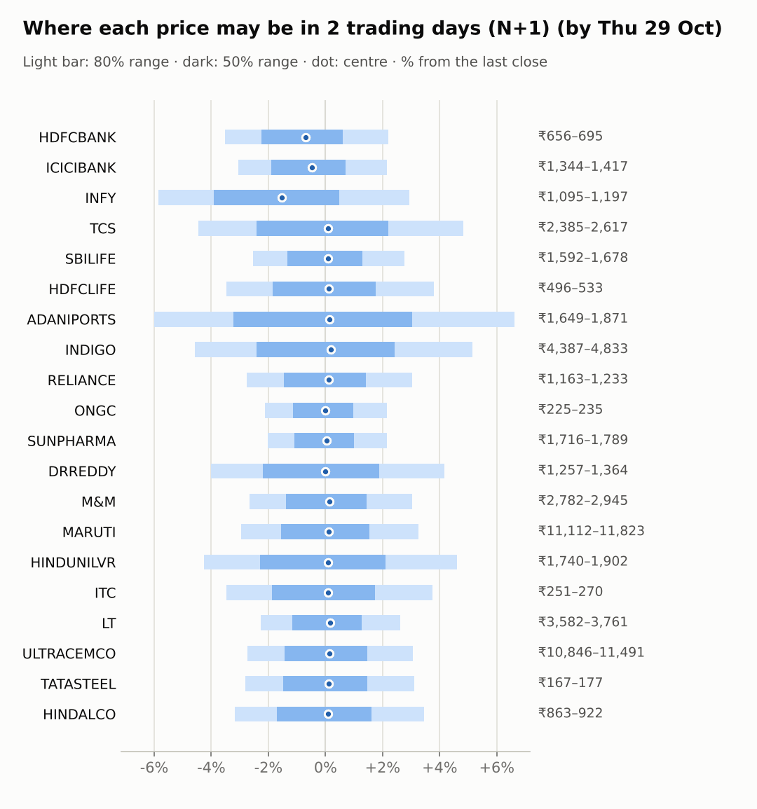
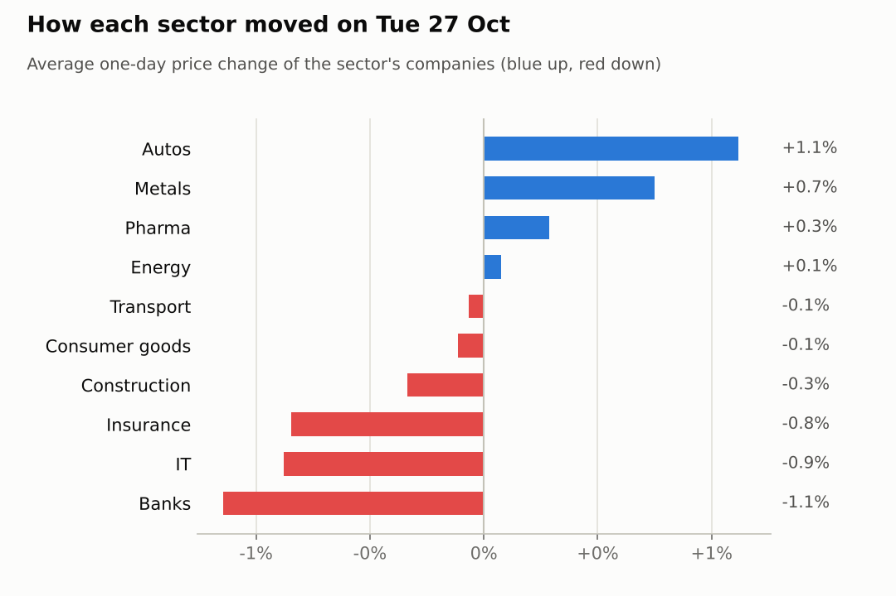
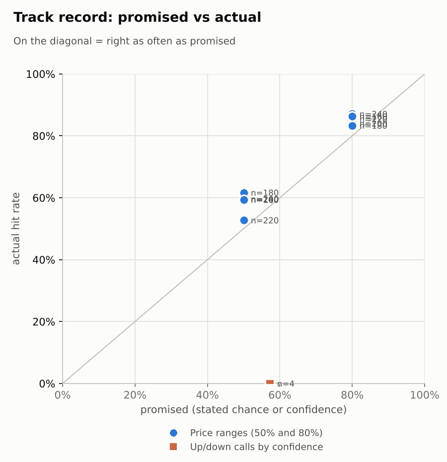

# Market brief: India (NSE), 2026-10-28

_Research log, not investment advice. Generated by a scheduled Claude Code routine._
<!-- report-data: as_of=2026-10-27 regime=EVENT_HEAVY outcome=70248abff9bf -->

Easy-to-read version with charts and filters: [2026-10-28.html](2026-10-28.html)

## Headline
No calls today: 15 of 20 companies are blocked by a data check on duplicated news ids, and the rest have model scores near the base rate. The day's news is results: MARUTI's Q2 profit fell 26% (a4ec50cd40a83545) and LT reported a beat after the close (nse-ann-106830479), with the FOMC decision due on Oct 29.

## Top 3 today
- MARUTI: reports after the close say Q2 profit fell 26% to Rs 2,466 crore (a4ec50cd40a83545, corroborated); the stock had risen 2.05% on Oct 27.
- LT: after the close it filed Q2 results (nse-ann-106830479); a report says profit rose 33% to Rs 5,202 crore and revenue 16% (5b70d2f1343e36b3, contradicted), but outlets disagree on the growth figure.
- RELIANCE: Jio Platforms lists today, confirmed by the exchange filing (nse-ann-106827783); RELIANCE reports results on Oct 30.

## Yesterday
The Nifty 50 was flat (-0.02%) on Oct 27 while India VIX fell 4.41%; 7 watchlist stocks rose and 13 fell. MARUTI rose 2.05% before its results; TCS fell 1.5% after a 20-day gain of 19.93%, and HDFCBANK and ICICIBANK fell 1.14% and 1.15%. Nifty Pharma rose 1.91%.
N+1 ranges: 19 of 20 closes fell inside the 80% range. DRREDDY closed at 1310.0, above its 80% range: the range was set before its 6.62% jump on Oct 26 after its Q2 results.

Market on 2026-10-27: Nifty 50 22,749.75 (-0.0%) · India VIX 16.40 (-4.4%) · watchlist 7 up / 13 down · best MARUTI +2.0%, worst TCS -1.5%

### Ranges scored (target date 2026-10-27)

N+1 ranges: **80% hit 19/20** (naive 19/20) · 50% hit 13/20

| Ticker | 80% range | 50% range | Actual | 80% | 50% | Naive 80% |
|---|---|---|---|---|---|---|
| ADANIPORTS | ₹1,633.20–₹1,769.29 | ₹1,663.39–₹1,731.19 | ₹1,754.50 | ✅ | ❌ | ✅ |
| DRREDDY | ₹1,190.03–₹1,257.09 | ₹1,205.05–₹1,238.48 | ₹1,310.00 | ❌ | ❌ | ❌ |
| HDFCBANK | ₹671.46–₹713.26 | ₹680.80–₹701.64 | ₹680.20 | ✅ | ❌ | ✅ |
| HDFCLIFE | ₹503.41–₹543.49 | ₹512.31–₹532.28 | ₹513.60 | ✅ | ✅ | ✅ |
| HINDALCO | ₹839.68–₹899.07 | ₹852.91–₹882.51 | ₹891.20 | ✅ | ❌ | ✅ |
| HINDUNILVR | ₹1,758.95–₹1,868.25 | ₹1,783.38–₹1,837.86 | ₹1,818.00 | ✅ | ✅ | ✅ |
| ICICIBANK | ₹1,349.07–₹1,424.58 | ₹1,365.98–₹1,403.63 | ₹1,386.90 | ✅ | ✅ | ✅ |
| INDIGO | ₹4,395.81–₹4,688.85 | ₹4,461.20–₹4,607.26 | ₹4,596.50 | ✅ | ✅ | ✅ |
| INFY | ₹1,077.52–₹1,185.66 | ₹1,101.36–₹1,155.21 | ₹1,163.00 | ✅ | ❌ | ✅ |
| ITC | ₹247.90–₹267.72 | ₹252.30–₹262.18 | ₹260.00 | ✅ | ✅ | ✅ |
| LT | ₹3,495.73–₹3,791.60 | ₹3,561.31–₹3,708.73 | ₹3,665.10 | ✅ | ✅ | ✅ |
| M&M | ₹2,770.53–₹2,945.18 | ₹2,809.55–₹2,896.61 | ₹2,858.40 | ✅ | ✅ | ✅ |
| MARUTI | ₹10,669.24–₹11,784.03 | ₹10,914.61–₹11,469.75 | ₹11,450.00 | ✅ | ✅ | ✅ |
| ONGC | ₹222.37–₹232.63 | ₹224.68–₹229.79 | ₹229.85 | ✅ | ❌ | ✅ |
| RELIANCE | ₹1,132.09–₹1,247.40 | ₹1,157.49–₹1,214.92 | ₹1,196.20 | ✅ | ✅ | ✅ |
| SBILIFE | ₹1,566.28–₹1,712.88 | ₹1,598.67–₹1,671.69 | ₹1,633.00 | ✅ | ✅ | ✅ |
| SUNPHARMA | ₹1,708.82–₹1,785.74 | ₹1,726.12–₹1,764.48 | ₹1,751.20 | ✅ | ✅ | ✅ |
| TATASTEEL | ₹159.48–₹175.75 | ₹163.06–₹171.17 | ₹171.42 | ✅ | ❌ | ✅ |
| TCS | ₹2,405.36–₹2,654.30 | ₹2,460.17–₹2,584.14 | ₹2,496.90 | ✅ | ✅ | ✅ |
| ULTRACEMCO | ₹10,702.94–₹11,374.10 | ₹10,852.92–₹11,187.48 | ₹11,150.00 | ✅ | ✅ | ✅ |

N+2 ranges that matured on the same date: 80% hit 19/20, 50% hit 14/20. N+3 ranges that matured on the same date: 80% hit 19/20, 50% hit 15/20. N+4 ranges that matured on the same date: 80% hit 19/20, 50% hit 15/20. N+5 ranges that matured on the same date: 80% hit 18/20, 50% hit 15/20.

### Calls scored

| Ticker | H | Call | Conf. | Move | Hit |
|---|---|---|---|---|---|
| TCS | 5d · open→close | down | 57% | +17.25% | ❌ |

## Today (2026-10-28)

**Regime: EVENT_HEAVY** · India VIX 16.40 (-4.4%) · benchmark 5d -0.6% · benchmark 10d vol 14.8% · major events: FOMC rate decision (previous US evening)

| Ticker | Sector | Close | N+1 80% | N+1 50% | N+5 80% | Call | Cue | Notes |
|---|---|---|---|---|---|---|---|---|
| HDFCBANK | Banks | ₹680.20 | ₹656.21–₹695.18 | ₹664.95–₹684.36 | ₹640.49–₹709.90 | no call | -1.38% | cue -1.38% x0.5; index +0.21% expected from SPX, x beta 1.23 x0.5, own cue -1.38% net x0.5; major event x1.15; regime EVENT_HEAVY x1.1 |
| ICICIBANK | Banks | ₹1,386.90 | ₹1,344.49–₹1,416.70 | ₹1,360.72–₹1,396.69 | ₹1,315.27–₹1,443.87 | no call | -0.96% | cue -0.96% x0.5; index +0.21% expected from SPX, x beta 0.92 x0.5, own cue -0.96% net x0.5; major event x1.15; regime EVENT_HEAVY x1.1 |
| INFY | IT | ₹1,163.00 | ₹1,094.85–₹1,197.27 | ₹1,117.53–₹1,168.51 | ₹1,031.81–₹1,210.20 | no call | -3.06% | cue -3.06% x0.5; ex-dividend 25 (2.15%); index +0.21% expected from SPX, x beta 0.74 x0.5, own cue -3.06% net x0.5; major event x1.15; regime EVENT_HEAVY x1.1 |
| TCS | IT | ₹2,496.90 | ₹2,385.46–₹2,617.30 | ₹2,436.73–₹2,552.12 | ₹2,292.26–₹2,704.57 | no call | – | index +0.21% expected from SPX, x beta 0.83 x0.5; major event x1.15; regime EVENT_HEAVY x1.1 |
| SBILIFE | Insurance | ₹1,633.00 | ₹1,591.59–₹1,678.22 | ₹1,611.05–₹1,654.21 | ₹1,555.12–₹1,709.28 | no call | – | index +0.21% expected from SPX, x beta 0.85 x0.5; major event x1.15; regime EVENT_HEAVY x1.1 |
| HDFCLIFE | Insurance | ₹513.60 | ₹495.77–₹533.04 | ₹504.08–₹522.64 | ₹480.40–₹546.69 | no call | – | index +0.21% expected from SPX, x beta 0.97 x0.5; major event x1.15; regime EVENT_HEAVY x1.1 |
| ADANIPORTS | Transport | ₹1,754.50 | ₹1,649.35–₹1,870.80 | ₹1,697.68–₹1,807.81 | ₹1,603.54–₹1,908.35 | no call | – | earnings in horizon (x2.0 day); index +0.21% expected from SPX, x beta 1.32 x0.5; major event x1.15; regime EVENT_HEAVY x1.1 |
| INDIGO | Transport | ₹4,596.50 | ₹4,386.51–₹4,833.12 | ₹4,485.11–₹4,707.38 | ₹4,289.01–₹4,903.68 | no call | – | earnings in horizon (x2.0 day); index +0.21% expected from SPX, x beta 1.77 x0.5; major event x1.15; regime EVENT_HEAVY x1.1 |
| RELIANCE | Energy | ₹1,196.20 | ₹1,163.07–₹1,232.51 | ₹1,178.64–₹1,213.23 | ₹1,120.38–₹1,271.66 | no call | – | earnings in horizon (x2.0 day); index +0.21% expected from SPX, x beta 0.95 x0.5; major event x1.15; regime EVENT_HEAVY x1.1 |
| ONGC | Energy | ₹229.85 | ₹225.00–₹234.78 | ₹227.20–₹232.08 | ₹221.01–₹238.43 | no call | – | index +0.21% expected from SPX, x beta 0.01 x0.5; major event x1.15; regime EVENT_HEAVY x1.1 |
| SUNPHARMA | Pharma | ₹1,751.20 | ₹1,715.82–₹1,788.78 | ₹1,732.28–₹1,768.64 | ₹1,670.76–₹1,829.86 | no call | – | earnings in horizon (x2.0 day); index +0.21% expected from SPX, x beta 0.45 x0.5; major event x1.15; regime EVENT_HEAVY x1.1 |
| DRREDDY | Pharma | ₹1,310.00 | ₹1,257.33–₹1,364.48 | ₹1,281.12–₹1,334.48 | ₹1,214.86–₹1,405.62 | no call | +0.00% | cue +0.00% x0.5; index +0.21% expected from SPX, x beta 0.48 x0.5, own cue +0.00% net x0.5; major event x1.15; regime EVENT_HEAVY x1.1 |
| M&M | Autos | ₹2,858.40 | ₹2,782.18–₹2,944.91 | ₹2,818.68–₹2,899.75 | ₹2,712.46–₹3,001.84 | no call | – | index +0.21% expected from SPX, x beta 1.40 x0.5; major event x1.15; regime EVENT_HEAVY x1.1 |
| MARUTI | Autos | ₹11,450.00 | ₹11,112.34–₹11,822.85 | ₹11,271.37–₹11,625.30 | ₹10,814.10–₹12,077.87 | no call | – | index +0.21% expected from SPX, x beta 1.09 x0.5; major event x1.15; regime EVENT_HEAVY x1.1 |
| HINDUNILVR | Consumer goods | ₹1,818.00 | ₹1,740.46–₹1,901.60 | ₹1,776.16–₹1,856.37 | ₹1,706.60–₹1,928.64 | no call | – | earnings in horizon (x2.0 day); index +0.21% expected from SPX, x beta 0.79 x0.5; major event x1.15; regime EVENT_HEAVY x1.1 |
| ITC | Consumer goods | ₹260.00 | ₹250.96–₹269.72 | ₹255.14–₹264.49 | ₹239.67–₹280.55 | no call | – | earnings in horizon (x2.0 day); index +0.21% expected from SPX, x beta 0.74 x0.5; major event x1.15; regime EVENT_HEAVY x1.1 |
| LT | Construction | ₹3,665.10 | ₹3,581.97–₹3,760.79 | ₹3,622.20–₹3,711.31 | ₹3,504.13–₹3,822.17 | no call | – | index +0.21% expected from SPX, x beta 1.40 x0.5; major event x1.15; regime EVENT_HEAVY x1.1 |
| ULTRACEMCO | Construction | ₹11,150.00 | ₹10,846.40–₹11,490.82 | ₹10,990.87–₹11,311.92 | ₹10,572.23–₹11,718.30 | no call | – | index +0.21% expected from SPX, x beta 1.27 x0.5; major event x1.15; regime EVENT_HEAVY x1.1 |
| TATASTEEL | Metals | ₹171.42 | ₹166.59–₹176.76 | ₹168.87–₹173.93 | ₹162.31–₹180.40 | no call | – | index +0.21% expected from SPX, x beta 1.07 x0.5; major event x1.15; regime EVENT_HEAVY x1.1 |
| HINDALCO | Metals | ₹891.20 | ₹862.83–₹921.92 | ₹876.03–₹905.47 | ₹838.40–₹943.53 | no call | – | index +0.21% expected from SPX, x beta 0.83 x0.5; major event x1.15; regime EVENT_HEAVY x1.1 |

No calls today.
- HDFCBANK, HDFCLIFE, HINDALCO, ICICIBANK, INDIGO, INFY, ITC, M&M, MARUTI, ONGC, RELIANCE, SUNPHARMA, TATASTEEL, TCS, ULTRACEMCO: abstain, data failed validation (collect gate DUPLICATE_ID on stored news rows that name them).
- ADANIPORTS, HINDUNILVR: hard block, results today (days to earnings 0).
- DRREDDY: abstain; the model's P(up) is near the base rate, and the only stock-specific note is a conditional broker view (bbacb42327e043cf, single_source).
- LT: abstain; the results event (5b70d2f1343e36b3, contradicted) cannot be the main evidence, and the Dhaka Metro order report (2b1416f8499a37e1, single_source) is too thin.
- SBILIFE: abstain; Q2 profit rose about 10% (7c7a6c4d2a6e9a2e, corroborated) but fell against Q1, a mixed picture.
AI traders (paper only, never orders): the pattern-mood trader called DRREDDY and SBILIFE up at N+1, N+3 and N+5; the Sonnet combined trader called DRREDDY, LT and SBILIFE down on the model score alone; the news-and-results trader and the Opus combined trader abstained on all.

### Overnight cues and global factors

| Symbol | Name | Last | Change |
|---|---|---|---|
| BRENT | Brent crude | 111.20 | -3.98% |
| DXY | US dollar index | 102.39 | +0.43% |
| GOLD | Gold | 4,061.50 | +0.57% |
| HANGSENG | Hang Seng | 23,066.86 | +0.11% |
| INDIAVIX | India VIX | 16.40 | -4.41% |
| KOSPI | KOSPI | 5,983.88 | +6.13% |
| NASDAQ | Nasdaq Composite (previous US close) | 26,477.81 | +1.18% |
| NIFTY50 | Nifty 50 | 22,749.75 | -0.02% |
| NIKKEI | Nikkei 225 | 64,153.43 | +1.40% |
| SHANGHAI | Shanghai Composite | 3,670.22 | +0.60% |
| SPX | S&P 500 (previous US close) | 7,722.60 | +0.60% |
| STOXX50 | Euro Stoxx 50 | 6,164.69 | +0.79% |
| TAIWAN | Taiwan Weighted | 46,862.92 | +1.66% |
| US10Y | US 10-year yield | 4.99 | +0.14% |
| USDINR | USD/INR | 95.11 | -0.09% |
| USDJPY | USD/JPY | 157.96 | +0.27% |
| USVIX | US VIX | 17.52 | -4.73% |

### ADRs (US-listed shares, previous US session)

| Ticker | ADR | Last | Change |
|---|---|---|---|
| DRREDDY | RDY | 13.75 | +0.00% |
| HDFCBANK | HDB | 21.41 | -1.38% |
| ICICIBANK | IBN | 29.00 | -0.96% |
| INFY | INFY | 12.05 | -3.06% |

## Tomorrow and this week

| Date | Event | Type |
|---|---|---|
| 2026-10-27 | Larsen & Toubro earnings | company |
| 2026-10-27 | Maruti Suzuki earnings | company |
| 2026-10-27 | SBI Life Insurance earnings | company |
| 2026-10-28 | Adani Ports earnings | company |
| 2026-10-28 | Hindustan Unilever earnings | company |
| 2026-10-29 | FOMC rate decision (previous US evening) | major |
| 2026-10-29 | InterGlobe Aviation earnings | company |
| 2026-10-30 | Reliance Industries earnings | company |
| 2026-10-30 | Sun Pharma earnings | company |
| 2026-11-02 | ITC earnings | company |
| 2026-11-03 | Infosys ex-dividend (est. 25, last dividend) | company |
| 2026-11-03 | Nifty weekly options expiry (Tuesday) |  |
| 2026-11-05 | Mahindra & Mahindra earnings | company |
| 2026-11-05 | ONGC earnings | company |
| 2026-11-06 | Hindalco earnings | company |
| 2026-11-06 | US jobs report (usually first Friday, 08:30 ET; check for shifts) | major |
| 2026-11-07 | Tata Steel earnings | company |
| 2026-11-09 | Nifty weekly options expiry (Tuesday) |  |
| 2026-11-17 | Nifty weekly options expiry (Tuesday) |  |

The FOMC decision lands on Oct 29 (Indian time), which keeps the regime EVENT_HEAVY. Results continue: ADANIPORTS and HINDUNILVR today, INDIGO on Oct 29, RELIANCE and SUNPHARMA on Oct 30, ITC on Nov 2. Overnight cues are firm (S&P 500 +0.6%, KOSPI +6.13%, Brent -3.98%), but the INFY ADR fell 3.06%. A warning that the RBI may raise its repo rate (069b585f14d4622d) is a rate risk to watch.

## By sector

### Banks

HDFCBANK fell 1.14% and is down 4.47% over 5 days; Anup Bagchi took over as MD and CEO (355d993b3196c9cf, corroborated). ICICIBANK fell 1.15% but is up 4.53% over 20 days. Both ADRs fell overnight (HDFCBANK -1.38%, ICICIBANK -0.96%), so they moved together with the sector (Nifty Bank -0.72%).
Bull: ICICIBANK's relative strength. Bear: HDFCBANK near its 20-day low (RSI 36) and weak ADRs.

### IT

TCS fell 1.5% and INFY 0.26% after strong 20-day runs (TCS +19.93%, INFY +16.28%). INFY carries a downgrade (41e801a0754b0060, single_source) and a report of a US H-1B probe (4bf39c1ba0eb0a7c, single_source); its ADR fell 3.06%.
Bull: momentum (INFY RSI 65, TCS RSI 69). Bear: stretched gains and negative company news; both moved with the sector (Nifty IT -0.26%).

### Insurance

SBILIFE fell 0.65% before its results; Q2 profit rose about 10% to Rs 549 crore (7c7a6c4d2a6e9a2e, corroborated). HDFCLIFE fell 1.04% and is down 5.85% over 5 days.
Bull: SBILIFE's delivery and an oversold RSI of 37. Bear: profit below Q1 and HDFCLIFE's weak trend; the two moved together.

### Transport

ADANIPORTS rose 0.11% and INDIGO fell 0.25%. ADANIPORTS reports today and INDIGO on Oct 29, so both are in the results window.
Bull: lower crude (Brent -3.98%) helps INDIGO's costs. Bear: INDIGO is down 6.95% over 20 days (RSI 36).

### Energy

ONGC rose 0.62% on 1.89 times average volume; a report says it will operate Venezuelan blocks (781564760a16f03e). RELIANCE fell 0.47%; Jio Platforms lists today (nse-ann-106827783) and results come on Oct 30.
Bull: the Jio listing for RELIANCE. Bear: Brent's 3.98% fall weighs on ONGC; the two moved apart on company news.

### Pharma

DRREDDY was flat (-0.07%) after its 6.62% jump on Oct 26 and is up 5.43% over 5 days (RSI 70); SUNPHARMA rose 0.64% and reports on Oct 30. Nifty Pharma rose 1.91%.
Bull: sector strength and a conditional broker note on a biosimilar approval (bbacb42327e043cf, single_source). Bear: DRREDDY looks stretched and its ADR was flat.

### Autos

MARUTI rose 2.05% before its results; reports after the close say Q2 profit fell 26% (a4ec50cd40a83545, corroborated). M&M rose 0.19%; a report says it plans a Nagpur plant (13c87874f0b104e1, single_source).
Bull: MARUTI's revenue growth and price hikes. Bear: MARUTI's profit drop is not yet in its price; the two moved apart on company news.

### Consumer goods

HINDUNILVR was flat (-0.03%) on 2.41 times average volume at a multi-year low (9ba49c80be3c93da, single_source) and reports today. ITC fell 0.19% and reports on Nov 2.
Bull: low expectations into HINDUNILVR's results. Bear: margin pressure and HINDUNILVR's 20-day fall of 6.43%.

### Construction

LT fell 0.4% before its results; a report after the close says Q2 profit rose 33% (5b70d2f1343e36b3, contradicted), with the filing in nse-ann-106830479. ULTRACEMCO fell 0.27% but is up 4.69% over 5 days after its results; its call notes (4efc57ef64b66d02, unverified) mention strong volumes.
Bull: LT's beat and order inflow. Bear: LT's 20-day fall of 5.45% shows weak interest; the two moved apart on company news.

### Metals

HINDALCO rose 0.63% and TATASTEEL 0.87%, both down about 8.8% over 20 days, moving together. HINDALCO reports on Nov 6 and TATASTEEL on Nov 7.
Bull: an oversold bounce (RSI 40 each). Bear: the 20-day downtrend.

## Track record

Ranges (targets 50% / 80%; width, score and centre error in % of price, lower is better; naive = last close ± recent typical move, no-change = last close as the centre):

| H | Window | n | 50% cover | 80% cover | Naive 80% | Width | Naive width | Score | Naive score | Centre err | No-change err |
|---|---|---|---|---|---|---|---|---|---|---|---|
| 1d | since start | 240 | 60% | 87% | 89% | 5.75 | 5.91 | 7.547 | 7.518 | 1.48 | 1.47 |
| 1d | last 30 days | 240 | 60% | 87% | 89% | 5.75 | 5.91 | 7.547 | 7.518 | 1.48 | 1.47 |
| 2d | since start | 220 | 53% | 85% | 87% | 7.13 | 7.25 | 9.843 | 9.788 | 1.91 | 1.92 |
| 2d | last 30 days | 220 | 53% | 85% | 87% | 7.13 | 7.25 | 9.843 | 9.788 | 1.91 | 1.92 |
| 3d | since start | 200 | 60% | 84% | 86% | 8.25 | 8.37 | 11.994 | 11.828 | 2.22 | 2.23 |
| 3d | last 30 days | 200 | 60% | 84% | 86% | 8.25 | 8.37 | 11.994 | 11.828 | 2.22 | 2.23 |
| 4d | since start | 180 | 62% | 83% | 84% | 9.37 | 9.37 | 14.248 | 13.929 | 2.56 | 2.60 |
| 4d | last 30 days | 180 | 62% | 83% | 84% | 9.37 | 9.37 | 14.248 | 13.929 | 2.56 | 2.60 |
| 5d | since start | 160 | 59% | 86% | 86% | 10.32 | 10.27 | 16.462 | 16.101 | 2.89 | 2.91 |
| 5d | last 30 days | 160 | 59% | 86% | 86% | 10.32 | 10.27 | 16.462 | 16.101 | 2.89 | 2.91 |

Ranges by regime (since start):

| H | Regime | n | 50% cover | 80% cover | Naive 80% |
|---|---|---|---|---|---|
| 1d | CALM | 160 | 60% | 84% | 86% |
| 1d | EVENT_HEAVY | 20 | 65% | 95% | 95% |
| 1d | TRENDING | 60 | 57% | 92% | 95% |
| 2d | CALM | 160 | 51% | 85% | 86% |
| 2d | TRENDING | 60 | 57% | 87% | 88% |
| 3d | CALM | 140 | 59% | 84% | 86% |
| 3d | TRENDING | 60 | 60% | 85% | 87% |
| 4d | CALM | 120 | 58% | 83% | 85% |
| 4d | TRENDING | 60 | 70% | 85% | 82% |
| 5d | CALM | 120 | 58% | 86% | 87% |
| 5d | TRENDING | 40 | 65% | 88% | 85% |

Up/down calls vs the always-up baseline:

| H | Window | n | Hit rate | Always-up |
|---|---|---|---|---|
| 1d · open→close | since start | 1 | 0% | 100% |
| 1d · open→close | last 30 days | 1 | 0% | 100% |
| 5d · open→close | since start | 3 | 0% | 100% |
| 5d · open→close | last 30 days | 3 | 0% | 100% |

Calls by confidence band (a band should hit about as often as its confidence):

| Band | n | Avg confidence | Hit rate |
|---|---|---|---|
| 0.50-0.59 · open→close | 4 | 57% | 0% |

Weekly review 2026-W43: 0 proposed range changes for a human to decide · [review-2026-W43.md](review-2026-W43.md)

## Data quality

- Indicators: 20 OK, partial: none, blocked: none
- Regime notes: none

| H | Calibration | History n | Live n | q10 / q90 |
|---|---|---|---|---|
| 1d | pool | 8940 | 240 | -1.18 / 1.17 |
| 2d | pool | 8920 | 220 | -1.23 / 1.17 |
| 3d | pool | 8900 | 200 | -1.26 / 1.17 |
| 4d | pool | 8880 | 180 | -1.30 / 1.16 |
| 5d | pool | 8860 | 160 | -1.25 / 1.17 |

- validation collect DUPLICATE_ID (blocking, not fixable in the run): news has duplicated ids in the stored data (e.g. 00e1474cd8f04071, 01c46d25603b38c9, 0415c8916fa68bb4); old news items seen again after more than 9 days were stored again under their old ids (22 rows today). Stored rows cannot be removed (append-only). The forecaster and the AI traders abstained on the tickers those rows name: HDFCBANK, HDFCLIFE, HINDALCO, ICICIBANK, INDIGO, INFY, ITC, M&M, MARUTI, ONGC, RELIANCE, SUNPHARMA, TATASTEEL, TCS, ULTRACEMCO.
- validation collect COLLECTOR_FAILED (warning): nse_india, 2 failed: two old LT Integrated Filing files (financials:LT:101648, financials:LT:101645) returned HTTP 404 from nsearchives.nseindia.com.
- validation collect PRICE_BASIS (warning): BRENT, Yahoo's close differs from the stored close on 2026-10-26; not recorded as a re-base.
- collect_relations_india: NSE's pledge endpoint returned no rows at all for 3 per-ticker calls.
- collect_prices: SUNPHARMA's Yahoo bar was stale; NSE resolved it with no new dates to fill.
- results digests: 2 due releases stored without text (NSE PDF attachments not parsed: nse-ann-106821830, nse-ann-106830077, nse-ann-106830479).
- news: the news analyst scored watchlist items one by one from headlines only and background items in groups; macro-keyword background items carry headline copies as summaries.
- validation features, context, news, forecast: passed with no failures or warnings.
- validation report UNMATCHED_NUMBER (fixed on the one retry): LT's growth figures from the filing table, a yield and an item count had no matching source number; those sentences were rewritten from cited news text.
- Judge FAIL from 2026-10-26 (spotcheck, round 1): the 2026-10-22 report cited nse-ann-106821834 (an UltraTech vice-chairman resignation) as ULTRACEMCO's Q2 results instead of nse-ann-106821830, gave RELIANCE and ONGC an uncited cause, and misstated a duplicate count; nothing was dropped.
