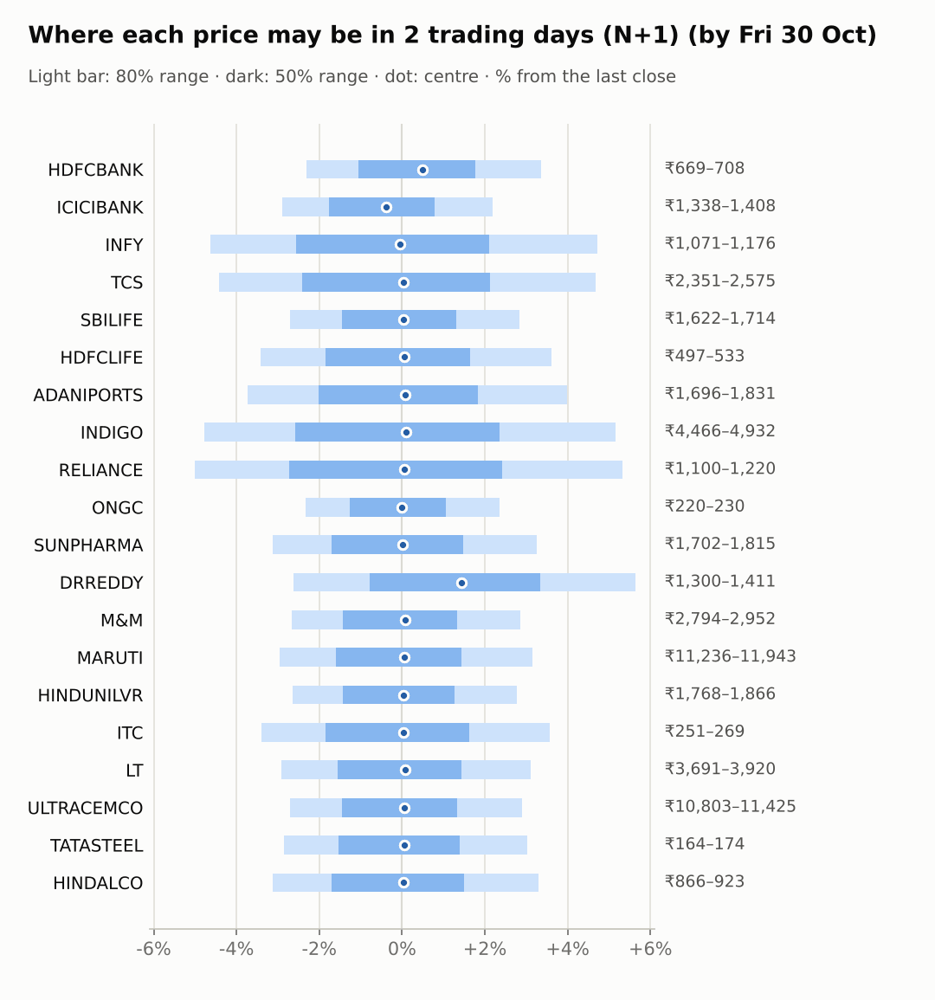
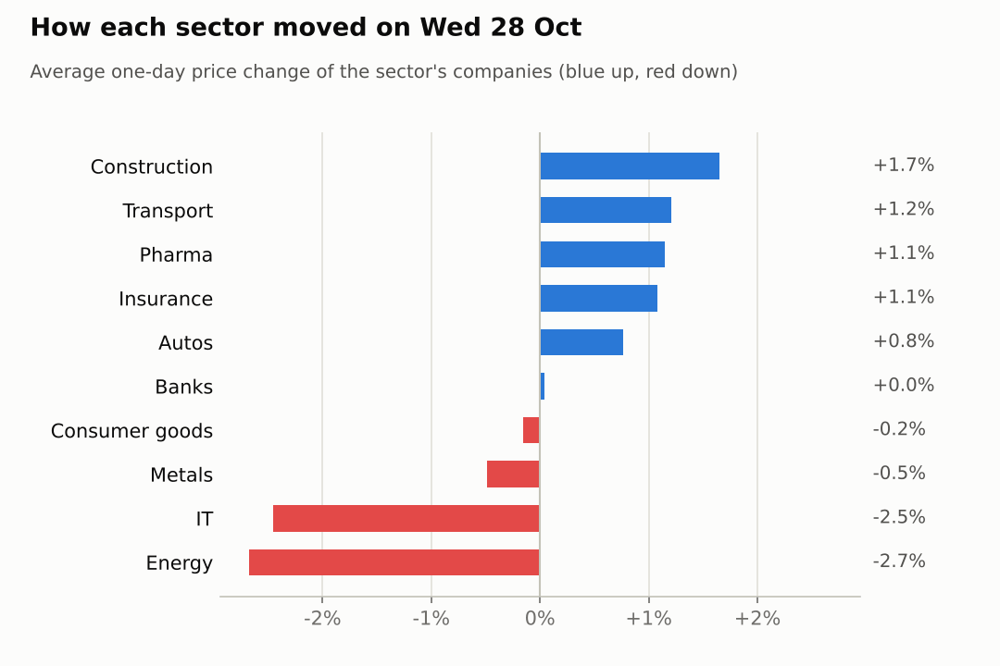
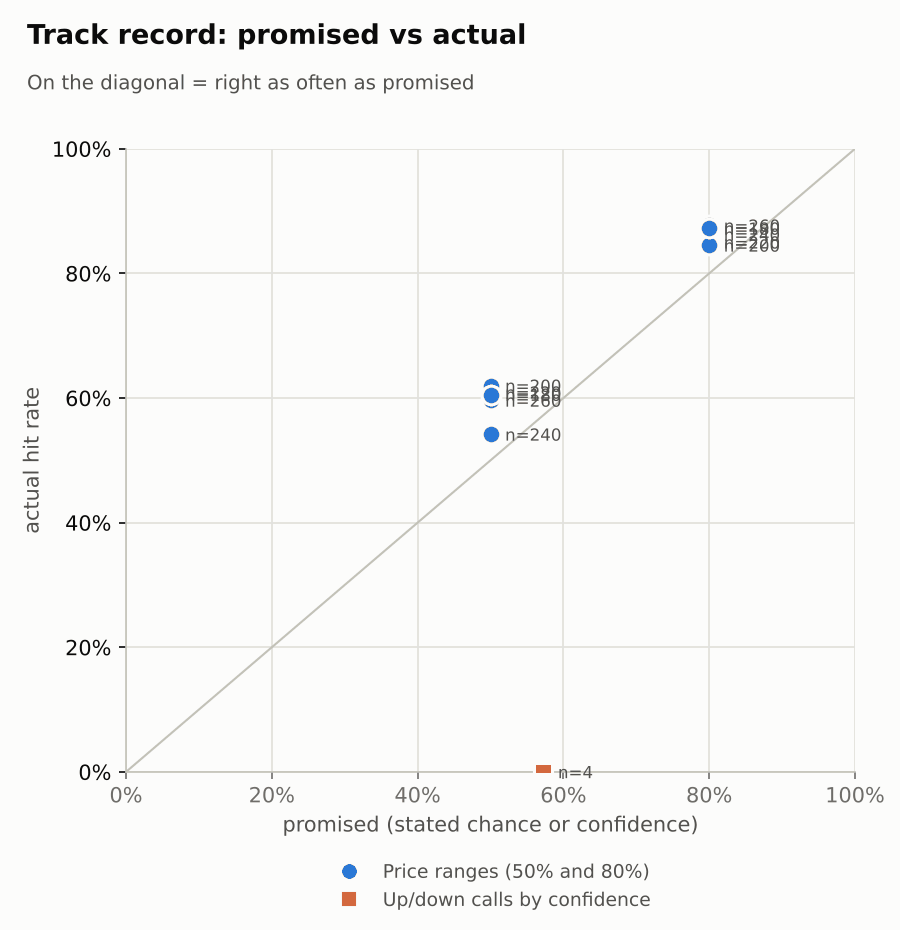

# Market brief: India (NSE), 2026-10-29

_Research log, not investment advice. Generated by a scheduled Claude Code routine._
<!-- report-data: as_of=2026-10-28 regime=EVENT_HEAVY outcome=70248abff9bf -->

Easy-to-read version with charts and filters: [2026-10-29.html](2026-10-29.html)

## Headline
No calls today: the collect gate blocked 16 of 20 companies again on duplicated stored news ids, and the other four had model scores near the base rate. The FOMC decision of the previous US evening keeps the regime EVENT_HEAVY.

## Top 3 today
- LT rose 3.72% on 2.85 times its average volume after its Q2 filing (nse-ann-106830479); its FY31 order-book target is corroborated (5fa9edd53e4fe3b6).
- RELIANCE fell 3.19% on the day Jio Platforms listed (nse-ann-106831152); its results are due Oct 30.
- Asia is weak this morning (KOSPI -2.8%, Taiwan -1.54%) while Brent fell 2.89% to 110.59.

## Yesterday
The Nifty 50 fell 0.22%. LT led the watchlist after its Q2 filing (nse-ann-106830479); INFY fell 3.43% and Nifty IT 1.98%. RELIANCE fell 3.19% as Jio Platforms listed (nse-ann-106831152).
Ranges: 19 of 20 1-day closes fell inside the 80% range; RELIANCE closed below it, a move the ranges did not expect on the listing day.

Market on 2026-10-28: Nifty 50 22,698.85 (-0.2%) · India VIX 16.25 (-1.0%) · watchlist 11 up / 9 down · best LT +3.7%, worst INFY -3.4%

### Ranges scored (target date 2026-10-28)

N+1 ranges: **80% hit 19/20** (naive 17/20) · 50% hit 12/20

| Ticker | 80% range | 50% range | Actual | 80% | 50% | Naive 80% |
|---|---|---|---|---|---|---|
| ADANIPORTS | ₹1,643.27–₹1,872.97 | ₹1,693.61–₹1,807.65 | ₹1,761.30 | ✅ | ✅ | ✅ |
| DRREDDY | ₹1,278.64–₹1,392.00 | ₹1,303.93–₹1,360.28 | ₹1,335.40 | ✅ | ✅ | ✅ |
| HDFCBANK | ₹665.48–₹705.68 | ₹674.54–₹694.54 | ₹685.30 | ✅ | ✅ | ✅ |
| HDFCLIFE | ₹500.46–₹539.14 | ₹509.13–₹528.36 | ₹514.10 | ✅ | ✅ | ✅ |
| HINDALCO | ₹856.47–₹917.17 | ₹870.10–₹900.29 | ₹893.75 | ✅ | ✅ | ✅ |
| HINDUNILVR | ₹1,737.88–₹1,905.27 | ₹1,775.13–₹1,858.32 | ₹1,815.80 | ✅ | ✅ | ✅ |
| ICICIBANK | ₹1,361.86–₹1,435.86 | ₹1,378.58–₹1,415.39 | ₹1,377.60 | ✅ | ❌ | ✅ |
| INDIGO | ₹4,472.26–₹4,766.08 | ₹4,538.37–₹4,684.50 | ₹4,690.00 | ✅ | ❌ | ✅ |
| INFY | ₹1,116.24–₹1,224.83 | ₹1,140.39–₹1,194.36 | ₹1,123.15 | ✅ | ❌ | ✅ |
| ITC | ₹251.08–₹270.60 | ₹255.45–₹265.15 | ₹259.50 | ✅ | ✅ | ✅ |
| LT | ₹3,541.15–₹3,834.95 | ₹3,606.84–₹3,752.91 | ₹3,801.30 | ✅ | ❌ | ❌ |
| M&M | ₹2,774.28–₹2,942.90 | ₹2,812.29–₹2,896.16 | ₹2,869.90 | ✅ | ✅ | ✅ |
| MARUTI | ₹10,705.04–₹11,781.49 | ₹10,944.22–₹11,479.16 | ₹11,579.00 | ✅ | ❌ | ❌ |
| ONGC | ₹223.46–₹233.44 | ₹225.73–₹230.69 | ₹224.89 | ✅ | ❌ | ✅ |
| RELIANCE | ₹1,167.34–₹1,239.55 | ₹1,183.61–₹1,219.53 | ₹1,158.00 | ❌ | ❌ | ❌ |
| SBILIFE | ₹1,575.30–₹1,717.34 | ₹1,606.98–₹1,677.58 | ₹1,666.70 | ✅ | ✅ | ✅ |
| SUNPHARMA | ₹1,703.87–₹1,778.22 | ₹1,720.74–₹1,757.73 | ₹1,757.50 | ✅ | ✅ | ✅ |
| TATASTEEL | ₹165.02–₹175.37 | ₹167.35–₹172.50 | ₹169.27 | ✅ | ✅ | ✅ |
| TCS | ₹2,418.89–₹2,659.85 | ₹2,472.45–₹2,592.19 | ₹2,460.00 | ✅ | ❌ | ✅ |
| ULTRACEMCO | ₹10,864.45–₹11,534.81 | ₹11,015.51–₹11,348.94 | ₹11,104.00 | ✅ | ✅ | ✅ |

N+2 ranges that matured on the same date: 80% hit 19/20, 50% hit 14/20. N+3 ranges that matured on the same date: 80% hit 19/20, 50% hit 15/20. N+4 ranges that matured on the same date: 80% hit 19/20, 50% hit 13/20. N+5 ranges that matured on the same date: 80% hit 19/20, 50% hit 14/20.

### Calls scored

| Ticker | H | Call | Conf. | Move | Hit |
|---|---|---|---|---|---|
| TCS | 5d · open→close | down | 57% | +17.25% | ❌ |

## Today (2026-10-29)

**Regime: EVENT_HEAVY** · India VIX 16.25 (-0.9%) · benchmark 5d -0.5% · benchmark 10d vol 12.5% · major events: FOMC rate decision (previous US evening)

| Ticker | Sector | Close | N+1 80% | N+1 50% | N+5 80% | Call | Cue | Notes |
|---|---|---|---|---|---|---|---|---|
| HDFCBANK | Banks | ₹685.30 | ₹669.48–₹708.25 | ₹678.14–₹697.49 | ₹653.93–₹722.92 | no call | +0.98% | cue +0.98% x0.5; index +0.10% expected from SPX, x beta 1.23 x0.5, own cue +0.98% net x0.5; major event x1.15; regime EVENT_HEAVY x1.1 |
| ICICIBANK | Banks | ₹1,377.60 | ₹1,337.66–₹1,407.69 | ₹1,353.34–₹1,388.29 | ₹1,309.46–₹1,434.10 | no call | -0.76% | cue -0.76% x0.5; index +0.10% expected from SPX, x beta 0.92 x0.5, own cue -0.76% net x0.5; major event x1.15; regime EVENT_HEAVY x1.1 |
| INFY | IT | ₹1,123.15 | ₹1,071.21–₹1,176.26 | ₹1,094.34–₹1,146.71 | ₹1,007.24–₹1,189.94 | no call | -0.08% | cue -0.08% x0.5; ex-dividend 25 (2.23%); index +0.10% expected from SPX, x beta 0.75 x0.5, own cue -0.08% net x0.5; major event x1.15; regime EVENT_HEAVY x1.1 |
| TCS | IT | ₹2,460.00 | ₹2,351.25–₹2,575.09 | ₹2,400.59–₹2,512.20 | ₹2,262.72–₹2,660.72 | no call | – | index +0.10% expected from SPX, x beta 0.83 x0.5; major event x1.15; regime EVENT_HEAVY x1.1 |
| SBILIFE | Insurance | ₹1,666.70 | ₹1,621.73–₹1,714.03 | ₹1,642.36–₹1,688.43 | ₹1,584.01–₹1,748.20 | no call | – | index +0.10% expected from SPX, x beta 0.85 x0.5; major event x1.15; regime EVENT_HEAVY x1.1 |
| HDFCLIFE | Insurance | ₹514.10 | ₹496.58–₹532.62 | ₹504.59–₹522.57 | ₹482.03–₹546.13 | no call | – | index +0.10% expected from SPX, x beta 0.97 x0.5; major event x1.15; regime EVENT_HEAVY x1.1 |
| ADANIPORTS | Transport | ₹1,761.30 | ₹1,695.57–₹1,831.50 | ₹1,725.69–₹1,793.49 | ₹1,640.77–₹1,882.43 | no call | – | index +0.10% expected from SPX, x beta 1.32 x0.5; major event x1.15; regime EVENT_HEAVY x1.1 |
| INDIGO | Transport | ₹4,690.00 | ₹4,466.11–₹4,932.10 | ₹4,568.48–₹4,800.78 | ₹4,370.00–₹5,011.52 | no call | – | earnings in horizon (x2.0 day); index +0.10% expected from SPX, x beta 1.77 x0.5; major event x1.15; regime EVENT_HEAVY x1.1 |
| RELIANCE | Energy | ₹1,158.00 | ₹1,100.14–₹1,219.62 | ₹1,126.35–₹1,185.90 | ₹1,076.03–₹1,240.58 | no call | – | earnings in horizon (x2.0 day); index +0.10% expected from SPX, x beta 0.95 x0.5; major event x1.15; regime EVENT_HEAVY x1.1 |
| ONGC | Energy | ₹224.89 | ₹219.67–₹230.20 | ₹222.03–₹227.29 | ₹213.34–₹236.29 | no call | – | earnings in horizon (x2.0 day); index +0.10% expected from SPX, x beta 0.01 x0.5; major event x1.15; regime EVENT_HEAVY x1.1 |
| SUNPHARMA | Pharma | ₹1,757.50 | ₹1,702.42–₹1,814.77 | ₹1,727.45–₹1,783.51 | ₹1,679.31–₹1,834.17 | no call | – | earnings in horizon (x2.0 day); index +0.10% expected from SPX, x beta 0.45 x0.5; major event x1.15; regime EVENT_HEAVY x1.1 |
| DRREDDY | Pharma | ₹1,335.40 | ₹1,300.43–₹1,410.81 | ₹1,324.85–₹1,379.90 | ₹1,256.94–₹1,453.30 | no call | +2.91% | cue +2.91% x0.5; index +0.10% expected from SPX, x beta 0.48 x0.5, own cue +2.91% net x0.5; major event x1.15; regime EVENT_HEAVY x1.1 |
| M&M | Autos | ₹2,869.90 | ₹2,793.59–₹2,951.82 | ₹2,828.96–₹2,907.93 | ₹2,697.30–₹3,041.88 | no call | – | earnings in horizon (x2.0 day); index +0.10% expected from SPX, x beta 1.39 x0.5; major event x1.15; regime EVENT_HEAVY x1.1 |
| MARUTI | Autos | ₹11,579.00 | ₹11,236.09–₹11,942.77 | ₹11,393.68–₹11,746.33 | ₹10,947.63–₹12,204.47 | no call | – | index +0.10% expected from SPX, x beta 1.09 x0.5; major event x1.15; regime EVENT_HEAVY x1.1 |
| HINDUNILVR | Consumer goods | ₹1,815.80 | ₹1,767.83–₹1,866.18 | ₹1,789.82–₹1,838.91 | ₹1,727.65–₹1,902.60 | no call | – | index +0.10% expected from SPX, x beta 0.79 x0.5; major event x1.15; regime EVENT_HEAVY x1.1 |
| ITC | Consumer goods | ₹259.50 | ₹250.67–₹268.77 | ₹254.69–₹263.72 | ₹239.91–₹279.34 | no call | – | earnings in horizon (x2.0 day); index +0.10% expected from SPX, x beta 0.73 x0.5; major event x1.15; regime EVENT_HEAVY x1.1 |
| LT | Construction | ₹3,801.30 | ₹3,690.83–₹3,919.73 | ₹3,741.89–₹3,856.12 | ₹3,596.75–₹4,003.79 | no call | – | index +0.10% expected from SPX, x beta 1.40 x0.5; major event x1.15; regime EVENT_HEAVY x1.1 |
| ULTRACEMCO | Construction | ₹11,104.00 | ₹10,803.48–₹11,425.06 | ₹10,942.37–₹11,252.59 | ₹10,547.42–₹11,652.91 | no call | – | index +0.10% expected from SPX, x beta 1.27 x0.5; major event x1.15; regime EVENT_HEAVY x1.1 |
| TATASTEEL | Metals | ₹169.27 | ₹164.44–₹174.39 | ₹166.66–₹171.63 | ₹160.37–₹178.06 | no call | – | index +0.10% expected from SPX, x beta 1.07 x0.5; major event x1.15; regime EVENT_HEAVY x1.1 |
| HINDALCO | Metals | ₹893.75 | ₹865.83–₹923.13 | ₹878.59–₹907.19 | ₹842.62–₹944.55 | no call | – | index +0.10% expected from SPX, x beta 0.83 x0.5; major event x1.15; regime EVENT_HEAVY x1.1 |

No calls. The forecaster abstained on all 20 companies.
- HDFCBANK, ICICIBANK, INFY, TCS, HDFCLIFE, INDIGO, RELIANCE, ONGC, SUNPHARMA, DRREDDY, M&M, MARUTI, ITC, ULTRACEMCO, TATASTEEL, HINDALCO: data failed validation (collect gate DUPLICATE_ID). INDIGO (results today), RELIANCE and SUNPHARMA (results Oct 30) were also inside the earnings window.
- SBILIFE, ADANIPORTS, HINDUNILVR, LT: the model's P(up) is near the base rate, and no verified news backs a lean; outlets disagree on the ADANIPORTS, HINDUNILVR and LT results figures.
- AI traders (paper only): the pattern-mood trader called HINDUNILVR up at N+1, N+3 and N+5. The Sonnet combined trader called SBILIFE, ADANIPORTS, HINDUNILVR and LT down on the model score alone. The news-results trader and the Opus combined trader abstained on all 20.

### Overnight cues and global factors

| Symbol | Name | Last | Change |
|---|---|---|---|
| BRENT | Brent crude | 110.59 | -2.89% |
| DXY | US dollar index | 102.11 | -0.20% |
| GOLD | Gold | 4,075.40 | +0.02% |
| HANGSENG | Hang Seng | 23,175.31 | +0.35% |
| INDIAVIX | India VIX | 16.25 | -0.95% |
| KOSPI | KOSPI | 5,843.99 | -2.80% |
| NASDAQ | Nasdaq Composite (previous US close) | 26,549.85 | +0.27% |
| NIFTY50 | Nifty 50 | 22,698.85 | -0.22% |
| NIKKEI | Nikkei 225 | 64,131.17 | +0.28% |
| SHANGHAI | Shanghai Composite | 3,661.59 | -0.54% |
| SPX | S&P 500 (previous US close) | 7,743.98 | +0.28% |
| STOXX50 | Euro Stoxx 50 | 6,167.81 | +0.05% |
| TAIWAN | Taiwan Weighted | 46,313.13 | -1.54% |
| US10Y | US 10-year yield | 5.04 | +1.04% |
| USDINR | USD/INR | 95.21 | +0.03% |
| USDJPY | USD/JPY | 157.68 | -0.20% |
| USVIX | US VIX | 16.91 | -3.48% |

### ADRs (US-listed shares, previous US session)

| Ticker | ADR | Last | Change |
|---|---|---|---|
| DRREDDY | RDY | 14.15 | +2.91% |
| HDFCBANK | HDB | 21.57 | +0.98% |
| ICICIBANK | IBN | 28.70 | -0.76% |
| INFY | INFY | 12.10 | -0.08% |

## Tomorrow and this week

| Date | Event | Type |
|---|---|---|
| 2026-10-28 | Adani Ports earnings | company |
| 2026-10-28 | Hindustan Unilever earnings | company |
| 2026-10-29 | FOMC rate decision (previous US evening) | major |
| 2026-10-29 | InterGlobe Aviation earnings | company |
| 2026-10-30 | Reliance Industries earnings | company |
| 2026-10-30 | Sun Pharma earnings | company |
| 2026-11-02 | ITC earnings | company |
| 2026-11-03 | Infosys ex-dividend (est. 25, last dividend) | company |
| 2026-11-03 | Nifty weekly options expiry (Tuesday) |  |
| 2026-11-05 | Mahindra & Mahindra earnings | company |
| 2026-11-05 | ONGC earnings | company |
| 2026-11-06 | Hindalco earnings | company |
| 2026-11-06 | US jobs report (usually first Friday, 08:30 ET; check for shifts) | major |
| 2026-11-07 | Tata Steel earnings | company |
| 2026-11-09 | Nifty weekly options expiry (Tuesday) |  |
| 2026-11-17 | Nifty weekly options expiry (Tuesday) |  |

INDIGO reports today; RELIANCE and SUNPHARMA on Oct 30, ITC on Nov 2. The Fed decision came after India's close, so this session is the first to trade it. Weak Asian cues and a 5.045 US 10-year yield weigh, while a lower Brent helps oil importers. Nifty weekly options expire on Nov 3.

## By sector

### Banks

HDFCBANK rose 0.75% and ICICIBANK fell 0.67%; Nifty Bank rose 0.54%. Bull: HDFCBANK's ADR is up 0.98% and its RSI of 39 is near oversold. Bear: HDFCBANK is down 4.69% over 20 days. Both stocks are blocked by the collect gate today.

### IT

INFY fell 3.43% and TCS 1.48% as Nifty IT fell 1.98%, so the sector moved together. Bull: TCS is still up 18.8% over 20 days. Bear: INFY's model news score is negative. Both stocks are blocked by the collect gate today.

### Insurance

SBILIFE rose 2.06% after Q2 profit rose about 10% (7c7a6c4d2a6e9a2e, corroborated), while HDFCLIFE rose only 0.1% and is down 4.73% over 5 days, so the two moved apart on company news. Bull: SBILIFE management expects a stronger second half. Bear: SBILIFE's EPS missed the consensus and the rise is already in the price.

### Transport

ADANIPORTS rose 0.39% after its Q2 results (nse-ann-106831802); INDIGO rose 2.03% ahead of its results today. Bull: ADANIPORTS raised its FY27 guidance, according to a single report. Bear: outlets disagree on ADANIPORTS' profit figure, and its beta is 1.32 into weak Asian cues.

### Energy

RELIANCE fell 3.19% as Jio Platforms listed (nse-ann-106831152) and ONGC fell 2.16%. Bull: Jio's listing values the stake highly. Bear: RELIANCE is down 4.22% over 5 days and reports on Oct 30; ONGC loses from a lower Brent.

### Pharma

DRREDDY rose 1.94% and SUNPHARMA 0.36%; Nifty Pharma rose 1.04%. Bull: DRREDDY's ADR is up 2.91% and its Srikakulam plant inspection closed (4a0922f1f01a4d46, single_source). Bear: DRREDDY's RSI of 73 is overbought; SUNPHARMA reports on Oct 30.

### Autos

MARUTI rose 1.13% despite a 26% fall in Q2 profit (a4ec50cd40a83545, corroborated); M&M rose 0.4%. Bull: MARUTI is up 3.38% over 5 days after the results. Bear: MARUTI's model P(up) is the lowest on the list; M&M is down 4.18% over 20 days.

### Consumer goods

HINDUNILVR fell 0.12% after its Q2 results and declared a dividend (nse-ann-106831491); ITC fell 0.19%. Bull: HINDUNILVR's RSI of 37 is near oversold. Bear: HINDUNILVR traded 2.04 times its average volume and is down 4.23% over 20 days; ITC reports on Nov 2.

### Construction

LT rose 3.72% on its Q2 filing (nse-ann-106830479) while ULTRACEMCO fell 0.41%, so they moved apart on company news. Bull: LT's FY31 order-book target is corroborated (5fa9edd53e4fe3b6). Bear: LT is up 4.55% over 5 days, so the quarter looks priced in.

### Metals

HINDALCO rose 0.29% and TATASTEEL fell 1.25%. Bull: TATASTEEL's RSI of 37 is near oversold. Bear: TATASTEEL is down 9.14% and HINDALCO 6.5% over 20 days; both report in early November.

## Track record

Ranges (targets 50% / 80%; width, score and centre error in % of price, lower is better; naive = last close ± recent typical move, no-change = last close as the centre):

| H | Window | n | 50% cover | 80% cover | Naive 80% | Width | Naive width | Score | Naive score | Centre err | No-change err |
|---|---|---|---|---|---|---|---|---|---|---|---|
| 1d | since start | 260 | 60% | 88% | 88% | 5.87 | 5.90 | 7.565 | 7.458 | 1.48 | 1.48 |
| 1d | last 30 days | 260 | 60% | 88% | 88% | 5.87 | 5.90 | 7.565 | 7.458 | 1.48 | 1.48 |
| 2d | since start | 240 | 54% | 86% | 87% | 7.30 | 7.24 | 10.028 | 9.839 | 1.92 | 1.94 |
| 2d | last 30 days | 240 | 54% | 86% | 87% | 7.30 | 7.24 | 10.028 | 9.839 | 1.92 | 1.94 |
| 3d | since start | 220 | 61% | 85% | 86% | 8.40 | 8.37 | 11.935 | 11.730 | 2.20 | 2.20 |
| 3d | last 30 days | 220 | 61% | 85% | 86% | 8.40 | 8.37 | 11.935 | 11.730 | 2.20 | 2.20 |
| 4d | since start | 200 | 62% | 85% | 85% | 9.54 | 9.36 | 14.049 | 13.640 | 2.53 | 2.57 |
| 4d | last 30 days | 200 | 62% | 85% | 85% | 9.54 | 9.36 | 14.049 | 13.640 | 2.53 | 2.57 |
| 5d | since start | 180 | 61% | 87% | 87% | 10.52 | 10.27 | 16.039 | 15.610 | 2.80 | 2.81 |
| 5d | last 30 days | 180 | 61% | 87% | 87% | 10.52 | 10.27 | 16.039 | 15.610 | 2.80 | 2.81 |

Ranges by regime (since start):

| H | Regime | n | 50% cover | 80% cover | Naive 80% |
|---|---|---|---|---|---|
| 1d | CALM | 160 | 60% | 84% | 86% |
| 1d | EVENT_HEAVY | 40 | 63% | 95% | 90% |
| 1d | TRENDING | 60 | 57% | 92% | 95% |
| 2d | CALM | 160 | 51% | 85% | 86% |
| 2d | EVENT_HEAVY | 20 | 70% | 95% | 90% |
| 2d | TRENDING | 60 | 57% | 87% | 88% |
| 3d | CALM | 160 | 61% | 85% | 86% |
| 3d | TRENDING | 60 | 60% | 85% | 87% |
| 4d | CALM | 140 | 59% | 84% | 86% |
| 4d | TRENDING | 60 | 70% | 85% | 82% |
| 5d | CALM | 120 | 58% | 86% | 87% |
| 5d | TRENDING | 60 | 67% | 90% | 88% |

Up/down calls vs the always-up baseline:

| H | Window | n | Hit rate | Always-up |
|---|---|---|---|---|
| 1d · open→close | since start | 1 | 0% | 100% |
| 1d · open→close | last 30 days | 1 | 0% | 100% |
| 5d · open→close | since start | 3 | 0% | 100% |
| 5d · open→close | last 30 days | 3 | 0% | 100% |

Calls by confidence band (a band should hit about as often as its confidence):

| Band | n | Avg confidence | Hit rate |
|---|---|---|---|
| 0.50-0.59 · open→close | 4 | 57% | 0% |

Weekly review 2026-W43: 0 proposed range changes for a human to decide · [review-2026-W43.md](review-2026-W43.md)

## Data quality

- Indicators: 20 OK, partial: none, blocked: none
- Regime notes: none

| H | Calibration | History n | Live n | q10 / q90 |
|---|---|---|---|---|
| 1d | pool | 8960 | 260 | -1.18 / 1.17 |
| 2d | pool | 8940 | 240 | -1.21 / 1.17 |
| 3d | pool | 8920 | 220 | -1.25 / 1.17 |
| 4d | pool | 8900 | 200 | -1.29 / 1.16 |
| 5d | pool | 8880 | 180 | -1.24 / 1.17 |

- validation collect DUPLICATE_ID (blocking, not fixable in the run): news has 20 or more duplicated stored ids (e.g. 00e1474cd8f04071, 01c46d25603b38c9, 0415c8916fa68bb4); old news items seen again were stored under their old ids, today's file included. Stored rows cannot be removed (append-only). The forecaster and the four AI traders abstained on the tickers those rows name: HDFCBANK, ICICIBANK, INFY, TCS, HDFCLIFE, INDIGO, RELIANCE, ONGC, SUNPHARMA, DRREDDY, M&M, MARUTI, ITC, ULTRACEMCO, TATASTEEL, HINDALCO. The rule strategies (lab.py predict) apply their own blocks and still predicted on these tickers.
- validation collect PRICE_BASIS (warning): BRENT, Yahoo's close differs from the stored close on 2026-10-26 and 2026-10-27; not recorded as a re-base.
- collect_relations_india: NSE's pledge endpoint returned no rows at all for 3 per-ticker calls.
- results digests: 3 due releases (ADANIPORTS, MARUTI, SBILIFE) stored without text; NSE PDF attachments are not parsed.
- news: the news analyst scored the watchlist items one by one and the background items in keyword groups with shared summaries.
- AI traders: abstention counts: abstained 63, earnings_window 12, across the four traders.
- head-to-head picks: 68 written, all without a candidate.
- validation features, context, news, forecast: passed with no failures or warnings.
- validation report UNMATCHED_NUMBER and REPORT_STATUS_UNCITED (fixed on the one retry): an issue number and two item counts had no source number and two status words had no id after them; those words were removed.
- Judge FAIL from 2026-10-26 (spotcheck, round 1): the 2026-10-22 report cited nse-ann-106821834 (an UltraTech vice-chairman resignation) as ULTRACEMCO's Q2 results instead of nse-ann-106821830, gave RELIANCE and ONGC an uncited cause and misstated a duplicate count; nothing was dropped.
