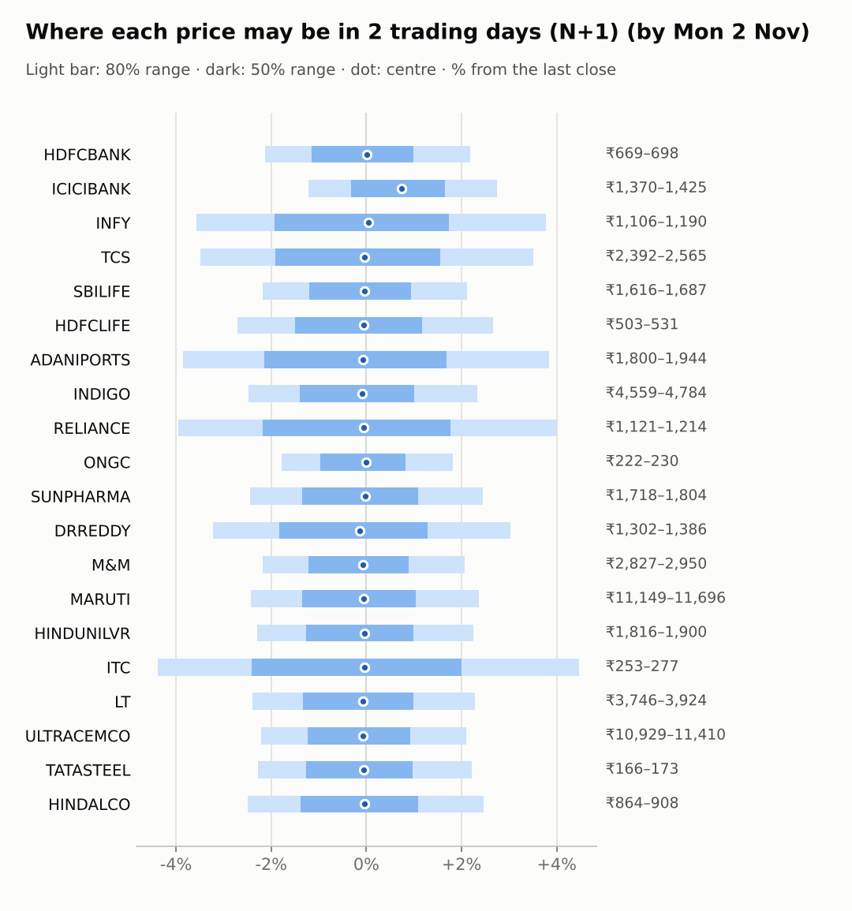
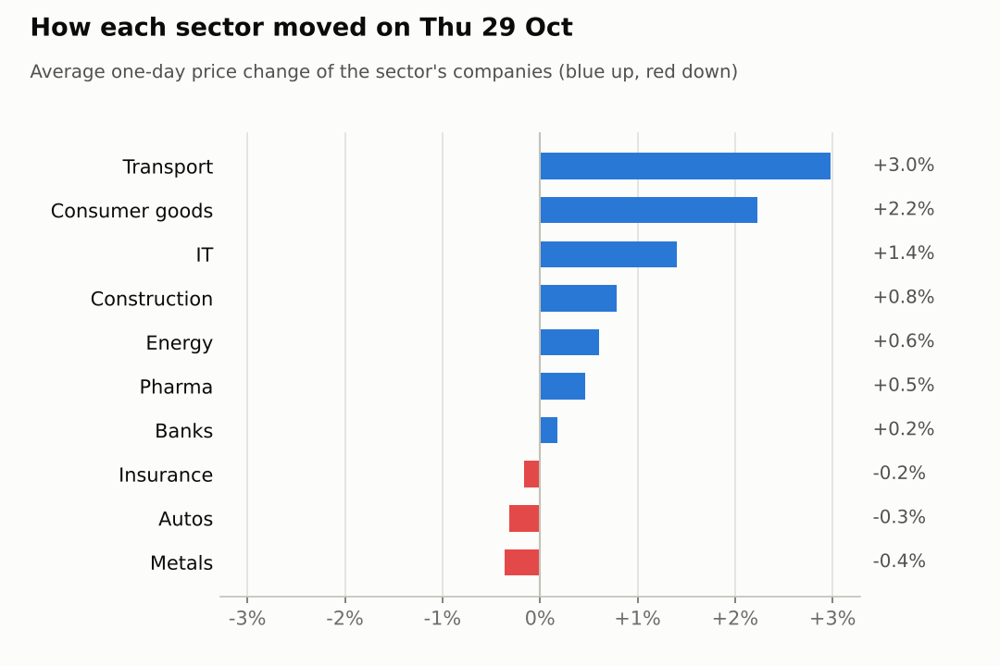
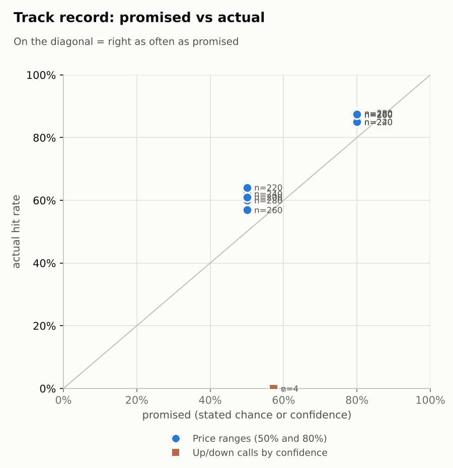

# Market brief: India (NSE), 2026-10-30

_Research log, not investment advice. Generated by a scheduled Claude Code routine._
<!-- report-data: as_of=2026-10-29 regime=CALM outcome=70248abff9bf -->

Easy-to-read version with charts and filters: [2026-10-30.html](2026-10-30.html)

## Headline
No calls today: the collect gate blocked most of the watchlist again on duplicated stored news ids, and the model's P(up) for ADANIPORTS, HINDUNILVR, LT and SBILIFE sat just below 0.5. Asia is sharply lower this morning (KOSPI -5.49%, Nikkei -2.77%), so expect a weak open after the Nifty 50 rose 1.05%.

## Top 3 today
- ADANIPORTS jumped 6.29% on 2.38 times its average volume after Q2 results (a496fde94dc9aee7, single_source); outlets disagree on the profit figure (00351e6c64920d04, contradicted).
- RELIANCE and SUNPHARMA report Q2 results today; INDIGO's Q2 loss narrowed to Rs 1,879 crore on revenue up 26% (b73899e2aeb8c7b8, corroborated).
- Overnight cues are weak: KOSPI -5.49%, Taiwan -2.99%, Nikkei -2.77% and Nasdaq -1.38%, while Brent fell 1.57% to 113.51.

## Yesterday
The Nifty 50 rose 1.05% and India VIX fell 6.97% to 15.12. ADANIPORTS led the watchlist after its Q2 results (a496fde94dc9aee7, single_source); HINDUNILVR rose 2.34% and ITC 2.12%, while MARUTI fell 1.32%.
Ranges: 18 of 20 1-day closes fell inside the 80% range; ADANIPORTS closed at 1872.0, just above its N+1 80% range top of 1870.8, on a results-day jump the ranges did not expect.

Market on 2026-10-29: Nifty 50 22,936.75 (+1.0%) · India VIX 15.12 (-6.9%) · watchlist 15 up / 5 down · best ADANIPORTS +6.3%, worst MARUTI -1.3%

### Ranges scored (target date 2026-10-29)

N+1 ranges: **80% hit 18/20** (naive 18/20) · 50% hit 13/20

| Ticker | 80% range | 50% range | Actual | 80% | 50% | Naive 80% |
|---|---|---|---|---|---|---|
| ADANIPORTS | ₹1,649.35–₹1,870.80 | ₹1,697.68–₹1,807.81 | ₹1,872.00 | ❌ | ❌ | ❌ |
| DRREDDY | ₹1,257.33–₹1,364.48 | ₹1,281.12–₹1,334.48 | ₹1,345.00 | ✅ | ❌ | ✅ |
| HDFCBANK | ₹656.21–₹695.18 | ₹664.95–₹684.36 | ₹683.30 | ✅ | ✅ | ✅ |
| HDFCLIFE | ₹495.77–₹533.04 | ₹504.08–₹522.64 | ₹517.00 | ✅ | ✅ | ✅ |
| HINDALCO | ₹862.83–₹921.92 | ₹876.03–₹905.47 | ₹886.30 | ✅ | ✅ | ✅ |
| HINDUNILVR | ₹1,740.46–₹1,901.60 | ₹1,776.16–₹1,856.37 | ₹1,858.20 | ✅ | ❌ | ✅ |
| ICICIBANK | ₹1,344.49–₹1,416.70 | ₹1,360.72–₹1,396.69 | ₹1,386.60 | ✅ | ✅ | ✅ |
| INDIGO | ₹4,386.51–₹4,833.12 | ₹4,485.11–₹4,707.38 | ₹4,675.00 | ✅ | ✅ | ✅ |
| INFY | ₹1,094.85–₹1,197.27 | ₹1,117.53–₹1,168.51 | ₹1,146.50 | ✅ | ✅ | ✅ |
| ITC | ₹250.96–₹269.72 | ₹255.14–₹264.49 | ₹265.00 | ✅ | ❌ | ✅ |
| LT | ₹3,581.97–₹3,760.79 | ₹3,622.20–₹3,711.31 | ₹3,837.10 | ❌ | ❌ | ❌ |
| M&M | ₹2,782.18–₹2,944.91 | ₹2,818.68–₹2,899.75 | ₹2,890.00 | ✅ | ✅ | ✅ |
| MARUTI | ₹11,112.34–₹11,822.85 | ₹11,271.37–₹11,625.30 | ₹11,426.00 | ✅ | ✅ | ✅ |
| ONGC | ₹225.00–₹234.78 | ₹227.20–₹232.08 | ₹225.79 | ✅ | ❌ | ✅ |
| RELIANCE | ₹1,163.07–₹1,232.51 | ₹1,178.64–₹1,213.23 | ₹1,167.40 | ✅ | ❌ | ✅ |
| SBILIFE | ₹1,591.59–₹1,678.22 | ₹1,611.05–₹1,654.21 | ₹1,652.00 | ✅ | ✅ | ✅ |
| SUNPHARMA | ₹1,715.82–₹1,788.78 | ₹1,732.28–₹1,768.64 | ₹1,761.00 | ✅ | ✅ | ✅ |
| TATASTEEL | ₹166.59–₹176.76 | ₹168.87–₹173.93 | ₹169.46 | ✅ | ✅ | ✅ |
| TCS | ₹2,385.46–₹2,617.30 | ₹2,436.73–₹2,552.12 | ₹2,478.00 | ✅ | ✅ | ✅ |
| ULTRACEMCO | ₹10,846.40–₹11,490.82 | ₹10,990.87–₹11,311.92 | ₹11,175.00 | ✅ | ✅ | ✅ |

N+2 ranges that matured on the same date: 80% hit 20/20, 50% hit 18/20. N+3 ranges that matured on the same date: 80% hit 17/20, 50% hit 15/20. N+4 ranges that matured on the same date: 80% hit 18/20, 50% hit 17/20. N+5 ranges that matured on the same date: 80% hit 18/20, 50% hit 13/20.

### Calls scored

| Ticker | H | Call | Conf. | Move | Hit |
|---|---|---|---|---|---|
| TCS | 5d · open→close | down | 57% | +17.25% | ❌ |

## Today (2026-10-30)

**Regime: CALM** · India VIX 15.12 (-7.0%) · benchmark 5d +1.1% · benchmark 10d vol 13.3%

| Ticker | Sector | Close | N+1 80% | N+1 50% | N+5 80% | Call | Cue | Notes |
|---|---|---|---|---|---|---|---|---|
| HDFCBANK | Banks | ₹683.30 | ₹668.74–₹698.21 | ₹675.40–₹690.08 | ₹652.93–₹713.29 | no call | +0.01% | cue +0.01% x0.5; index -0.11% expected from SPX, x beta 1.22 x0.5, own cue +0.01% net x0.5; major event x1.15 |
| ICICIBANK | Banks | ₹1,386.60 | ₹1,369.66–₹1,424.69 | ₹1,382.11–₹1,409.52 | ₹1,340.05–₹1,452.77 | no call | +1.50% | cue +1.50% x0.5; index -0.11% expected from SPX, x beta 0.93 x0.5, own cue +1.50% net x0.5; major event x1.15 |
| INFY | IT | ₹1,146.50 | ₹1,105.53–₹1,189.83 | ₹1,124.35–₹1,166.31 | ₹1,038.23–₹1,207.04 | no call | +0.08% | cue +0.08% x0.5; ex-dividend 25 (2.18%); index -0.11% expected from SPX, x beta 0.75 x0.5, own cue +0.08% net x0.5; major event x1.15 |
| TCS | IT | ₹2,478.00 | ₹2,391.76–₹2,564.72 | ₹2,430.42–₹2,516.53 | ₹2,301.95–₹2,656.20 | no call | – | index -0.11% expected from SPX, x beta 0.82 x0.5; major event x1.15 |
| SBILIFE | Insurance | ₹1,652.00 | ₹1,616.09–₹1,687.02 | ₹1,632.11–₹1,667.45 | ₹1,578.78–₹1,724.10 | no call | – | index -0.11% expected from SPX, x beta 0.84 x0.5; major event x1.15 |
| HDFCLIFE | Insurance | ₹517.00 | ₹502.99–₹530.79 | ₹509.24–₹523.08 | ₹488.46–₹545.41 | no call | – | index -0.11% expected from SPX, x beta 0.97 x0.5; major event x1.15 |
| ADANIPORTS | Transport | ₹1,872.00 | ₹1,799.89–₹1,943.84 | ₹1,831.98–₹1,903.62 | ₹1,725.98–₹2,020.88 | no call | – | index -0.11% expected from SPX, x beta 1.36 x0.5; major event x1.15 |
| INDIGO | Transport | ₹4,675.00 | ₹4,559.32–₹4,783.95 | ₹4,609.96–₹4,721.84 | ₹4,443.62–₹4,904.05 | no call | – | index -0.11% expected from SPX, x beta 1.76 x0.5; major event x1.15 |
| RELIANCE | Energy | ₹1,167.40 | ₹1,121.22–₹1,214.06 | ₹1,141.90–₹1,188.10 | ₹1,093.89–₹1,241.19 | no call | – | earnings in horizon (x2.0 day); index -0.11% expected from SPX, x beta 0.94 x0.5; major event x1.15 |
| ONGC | Energy | ₹225.79 | ₹221.76–₹229.88 | ₹223.60–₹227.64 | ₹215.53–₹235.90 | no call | – | earnings in horizon (x2.0 day); index -0.11% expected from SPX, x beta 0.02 x0.5; major event x1.15 |
| SUNPHARMA | Pharma | ₹1,761.00 | ₹1,717.92–₹1,804.12 | ₹1,737.35–₹1,780.28 | ₹1,691.90–₹1,828.69 | no call | – | earnings in horizon (x2.0 day); index -0.11% expected from SPX, x beta 0.45 x0.5; major event x1.15 |
| DRREDDY | Pharma | ₹1,345.00 | ₹1,301.64–₹1,385.73 | ₹1,320.49–₹1,362.36 | ₹1,257.23–₹1,429.37 | no call | -0.28% | cue -0.28% x0.5; index -0.11% expected from SPX, x beta 0.47 x0.5, own cue -0.28% net x0.5; major event x1.15 |
| M&M | Autos | ₹2,890.00 | ₹2,826.92–₹2,949.73 | ₹2,854.66–₹2,915.84 | ₹2,735.41–₹3,043.65 | no call | – | earnings in horizon (x2.0 day); index -0.11% expected from SPX, x beta 1.40 x0.5; major event x1.15 |
| MARUTI | Autos | ₹11,426.00 | ₹11,148.57–₹11,695.50 | ₹11,271.88–₹11,544.30 | ₹10,862.77–₹11,983.43 | no call | – | index -0.11% expected from SPX, x beta 1.08 x0.5; major event x1.15 |
| HINDUNILVR | Consumer goods | ₹1,858.20 | ₹1,815.58–₹1,900.00 | ₹1,834.63–₹1,876.68 | ₹1,771.17–₹1,944.12 | no call | – | index -0.11% expected from SPX, x beta 0.80 x0.5; major event x1.15 |
| ITC | Consumer goods | ₹265.00 | ₹253.40–₹276.86 | ₹258.61–₹270.28 | ₹246.50–₹283.70 | no call | – | earnings in horizon (x2.0 day); index -0.11% expected from SPX, x beta 0.74 x0.5; major event x1.15 |
| LT | Construction | ₹3,837.10 | ₹3,745.58–₹3,924.48 | ₹3,785.93–₹3,875.04 | ₹3,652.72–₹4,019.35 | no call | – | index -0.11% expected from SPX, x beta 1.40 x0.5; major event x1.15 |
| ULTRACEMCO | Construction | ₹11,175.00 | ₹10,928.67–₹11,410.09 | ₹11,037.41–₹11,277.23 | ₹10,677.93–₹11,664.54 | no call | – | index -0.11% expected from SPX, x beta 1.27 x0.5; major event x1.15 |
| TATASTEEL | Metals | ₹169.46 | ₹165.59–₹173.20 | ₹167.31–₹171.10 | ₹161.61–₹177.21 | no call | – | index -0.11% expected from SPX, x beta 1.07 x0.5; major event x1.15 |
| HINDALCO | Metals | ₹886.30 | ₹864.21–₹908.06 | ₹874.09–₹895.93 | ₹831.36–₹941.38 | no call | – | earnings in horizon (x2.0 day); index -0.11% expected from SPX, x beta 0.82 x0.5; major event x1.15 |

No calls. The forecaster abstained on every company and horizon.
- ADANIPORTS, HINDUNILVR, LT, SBILIFE: model P(up) between 0.46 and 0.49 at every horizon, too close to a coin flip. The results events of ADANIPORTS and HINDUNILVR are disputed between sources. The corroborated news on LT (5fa9edd53e4fe3b6) and SBILIFE (7c7a6c4d2a6e9a2e) is already in the price.
- HDFCBANK, ICICIBANK, INFY, TCS, HDFCLIFE, INDIGO, ONGC, DRREDDY, M&M, MARUTI, ITC, ULTRACEMCO, TATASTEEL, HINDALCO: data failed validation (collect gate DUPLICATE_ID).
- RELIANCE, SUNPHARMA: data failed validation (DUPLICATE_ID), and both report results today (earnings within 1 day, a hard block).
AI traders (paper only): pattern-mood called LT up at N+1, N+3 and N+5; the Sonnet combined trader called ADANIPORTS, HINDUNILVR, LT and SBILIFE down with low confidence, on the model score alone; news-results and the Opus combined trader abstained on all.

### Overnight cues and global factors

| Symbol | Name | Last | Change |
|---|---|---|---|
| BRENT | Brent crude | 113.51 | -1.57% |
| DXY | US dollar index | 101.74 | -0.44% |
| GOLD | Gold | 4,018.70 | -0.81% |
| HANGSENG | Hang Seng | 23,211.35 | +1.10% |
| INDIAVIX | India VIX | 15.12 | -6.97% |
| KOSPI | KOSPI | 5,611.46 | -5.49% |
| NASDAQ | Nasdaq Composite (previous US close) | 26,184.72 | -1.38% |
| NIFTY50 | Nifty 50 | 22,936.75 | +1.05% |
| NIKKEI | Nikkei 225 | 62,866.28 | -2.77% |
| SHANGHAI | Shanghai Composite | 3,615.36 | -0.99% |
| SPX | S&P 500 (previous US close) | 7,720.39 | -0.30% |
| STOXX50 | Euro Stoxx 50 | 6,207.07 | +0.64% |
| TAIWAN | Taiwan Weighted | 44,980.14 | -2.99% |
| US10Y | US 10-year yield | 4.99 | -1.11% |
| USDINR | USD/INR | 95.18 | -0.03% |
| USDJPY | USD/JPY | 157.51 | -0.20% |
| USVIX | US VIX | 17.20 | +1.71% |

### ADRs (US-listed shares, previous US session)

| Ticker | ADR | Last | Change |
|---|---|---|---|
| DRREDDY | RDY | 14.11 | -0.28% |
| HDFCBANK | HDB | 21.55 | +0.01% |
| ICICIBANK | IBN | 29.13 | +1.50% |
| INFY | INFY | 12.10 | +0.08% |

## Tomorrow and this week

| Date | Event | Type |
|---|---|---|
| 2026-10-29 | InterGlobe Aviation earnings | company |
| 2026-10-30 | Reliance Industries earnings | company |
| 2026-10-30 | Sun Pharma earnings | company |
| 2026-11-02 | ITC earnings | company |
| 2026-11-03 | Infosys ex-dividend (est. 25, last dividend) | company |
| 2026-11-03 | Nifty weekly options expiry (Tuesday) |  |
| 2026-11-05 | Mahindra & Mahindra earnings | company |
| 2026-11-05 | ONGC earnings | company |
| 2026-11-06 | Hindalco earnings | company |
| 2026-11-06 | US jobs report (usually first Friday, 08:30 ET; check for shifts) | major |
| 2026-11-07 | Tata Steel earnings | company |
| 2026-11-09 | Nifty weekly options expiry (Tuesday) |  |
| 2026-11-12 | Hindustan Unilever ex-dividend (est. 22, last dividend) | company |
| 2026-11-17 | Nifty weekly options expiry (Tuesday) |  |

Asia's sell-off (KOSPI -5.49%, Taiwan -2.99%) points to a weak open, though the regime is CALM with India VIX at 15.12. RELIANCE and SUNPHARMA report today, ITC on Nov 2, M&M and ONGC on Nov 5, HINDALCO on Nov 6 and TATASTEEL on Nov 7; the US jobs report is due Nov 6. FII/FPI sold a net 944 crore on Oct 29 while DIIs bought 1,924 crore.

## By sector

### Banks

HDFCBANK fell 0.29% and ICICIBANK rose 0.65%; Nifty Bank rose 1.18%. Bull: HDFCBANK's new CEO has taken charge (8b61f8478c376865, corroborated) and its RSI of 39 is near oversold. Bear: HDFCBANK is down 5.45% over 20 days. Both stocks are blocked by the collect gate today.

### IT

INFY rose 2.08% and TCS 0.73% as Nifty IT rose 0.99%, so the sector moved together. Bull: TCS is up 21.92% over 20 days. Bear: both are down over 5 days, and INFY goes ex-dividend on Nov 3. Both stocks are blocked by the collect gate today.

### Insurance

SBILIFE fell 0.88% and HDFCLIFE rose 0.56%. Bull: SBILIFE's Q2 profit rose about 10% (7c7a6c4d2a6e9a2e, corroborated) and its RSI of 43 leaves room to recover. Bear: SBILIFE's EPS missed the consensus and it is down 4.78% over 20 days; HDFCLIFE is blocked by the collect gate.

### Transport

ADANIPORTS jumped 6.29% after Q2 results (a496fde94dc9aee7, single_source) while INDIGO fell 0.32% after its own (b73899e2aeb8c7b8, corroborated), so they moved apart on company news. Bull: ADANIPORTS closed at its 20-day high on 2.38 times average volume. Bear: ADANIPORTS' profit figure is disputed between outlets (00351e6c64920d04, contradicted) and its delivery share was below average; INDIGO is blocked by the collect gate.

### Energy

RELIANCE rose 0.81% and ONGC 0.4%. Bull: RELIANCE traded 1.37 times its average volume ahead of its results today. Bear: RELIANCE is down 1.44% over 5 days, and Brent fell 1.57%. Both stocks are blocked by the collect gate.

### Pharma

DRREDDY rose 0.72% and SUNPHARMA 0.2%; Nifty Pharma rose 0.64%. Bull: DRREDDY is up 8.56% over 5 days and its Srikakulam plant got a VAI classification (4a0922f1f01a4d46, single_source). Bear: DRREDDY's RSI of 75 is overbought; SUNPHARMA reports today. Both stocks are blocked by the collect gate.

### Autos

MARUTI fell 1.32% after its Q2 profit fell 26% (a4ec50cd40a83545, corroborated); M&M rose 0.7%. Bull: MARUTI is still up 2.29% over 5 days. Bear: MARUTI is down 3.8% over 20 days; M&M reports on Nov 5. Both stocks are blocked by the collect gate.

### Consumer goods

HINDUNILVR rose 2.34% and ITC 2.12%, so the sector moved together. Bull: HINDUNILVR traded 1.58 times its average volume after its Q2 results and declared a dividend (nse-ann-106831491). Bear: brokers cut HINDUNILVR's targets (b16efd27a08767d9, single_source); ITC reports on Nov 2 and is blocked by the collect gate.

### Construction

LT rose 0.94% and ULTRACEMCO 0.64%. Bull: LT's FY31 order-book target is corroborated (5fa9edd53e4fe3b6) and it is up 5.46% over 5 days. Bear: LT's volume faded to 0.82 times average and its beta of 1.4 is a risk into weak Asian cues; ULTRACEMCO is blocked by the collect gate.

### Metals

HINDALCO fell 0.83% and TATASTEEL rose 0.11%. Bull: TATASTEEL's RSI of 37 is near oversold. Bear: TATASTEEL is down 9.86% and HINDALCO 7.21% over 20 days; both report in early November. Both stocks are blocked by the collect gate.

## Track record

Ranges (targets 50% / 80%; width, score and centre error in % of price, lower is better; naive = last close ± recent typical move, no-change = last close as the centre):

| H | Window | n | 50% cover | 80% cover | Naive 80% | Width | Naive width | Score | Naive score | Centre err | No-change err |
|---|---|---|---|---|---|---|---|---|---|---|---|
| 1d | since start | 280 | 60% | 88% | 89% | 5.95 | 5.89 | 7.593 | 7.522 | 1.48 | 1.49 |
| 1d | last 30 days | 280 | 60% | 88% | 89% | 5.95 | 5.89 | 7.593 | 7.522 | 1.48 | 1.49 |
| 2d | since start | 260 | 57% | 87% | 87% | 7.45 | 7.22 | 9.964 | 9.757 | 1.90 | 1.92 |
| 2d | last 30 days | 260 | 57% | 87% | 87% | 7.45 | 7.22 | 9.964 | 9.757 | 1.90 | 1.92 |
| 3d | since start | 240 | 62% | 85% | 86% | 8.58 | 8.36 | 12.178 | 11.943 | 2.23 | 2.22 |
| 3d | last 30 days | 240 | 62% | 85% | 86% | 8.58 | 8.36 | 12.178 | 11.943 | 2.23 | 2.22 |
| 4d | since start | 220 | 64% | 85% | 85% | 9.67 | 9.36 | 13.958 | 13.572 | 2.50 | 2.53 |
| 4d | last 30 days | 220 | 64% | 85% | 85% | 9.67 | 9.36 | 13.958 | 13.572 | 2.50 | 2.53 |
| 5d | since start | 200 | 61% | 88% | 87% | 10.67 | 10.26 | 15.777 | 15.338 | 2.75 | 2.76 |
| 5d | last 30 days | 200 | 61% | 88% | 87% | 10.67 | 10.26 | 15.777 | 15.338 | 2.75 | 2.76 |

Ranges by regime (since start):

| H | Regime | n | 50% cover | 80% cover | Naive 80% |
|---|---|---|---|---|---|
| 1d | CALM | 160 | 60% | 84% | 86% |
| 1d | EVENT_HEAVY | 60 | 63% | 93% | 90% |
| 1d | TRENDING | 60 | 57% | 92% | 95% |
| 2d | CALM | 160 | 51% | 85% | 86% |
| 2d | EVENT_HEAVY | 40 | 80% | 98% | 90% |
| 2d | TRENDING | 60 | 57% | 87% | 88% |
| 3d | CALM | 160 | 61% | 85% | 86% |
| 3d | EVENT_HEAVY | 20 | 75% | 85% | 85% |
| 3d | TRENDING | 60 | 60% | 85% | 87% |
| 4d | CALM | 160 | 62% | 85% | 86% |
| 4d | TRENDING | 60 | 70% | 85% | 82% |
| 5d | CALM | 140 | 59% | 86% | 86% |
| 5d | TRENDING | 60 | 67% | 90% | 88% |

Up/down calls vs the always-up baseline:

| H | Window | n | Hit rate | Always-up |
|---|---|---|---|---|
| 1d · open→close | since start | 1 | 0% | 100% |
| 1d · open→close | last 30 days | 1 | 0% | 100% |
| 5d · open→close | since start | 3 | 0% | 100% |
| 5d · open→close | last 30 days | 3 | 0% | 100% |

Calls by confidence band (a band should hit about as often as its confidence):

| Band | n | Avg confidence | Hit rate |
|---|---|---|---|
| 0.50-0.59 · open→close | 4 | 57% | 0% |

Weekly review 2026-W43: 0 proposed range changes for a human to decide · [review-2026-W43.md](review-2026-W43.md)

## Data quality

- Indicators: 20 OK, partial: none, blocked: none
- Regime notes: none

| H | Calibration | History n | Live n | q10 / q90 |
|---|---|---|---|---|
| 1d | pool | 8980 | 280 | -1.17 / 1.17 |
| 2d | pool | 8960 | 260 | -1.20 / 1.16 |
| 3d | pool | 8940 | 240 | -1.24 / 1.17 |
| 4d | pool | 8920 | 220 | -1.28 / 1.16 |
| 5d | pool | 8900 | 200 | -1.24 / 1.17 |

- validation collect DUPLICATE_ID (blocking, not fixable in the run): news has duplicated stored ids (e.g. 00e1474cd8f04071, 01c46d25603b38c9, 0415c8916fa68bb4); old news items seen again after the 9-day de-duplication window were stored again under their old ids. Stored rows cannot be removed (append-only). The forecaster and the four AI traders abstained on the tickers those rows name: HDFCBANK, ICICIBANK, INFY, TCS, HDFCLIFE, INDIGO, RELIANCE, ONGC, SUNPHARMA, DRREDDY, M&M, MARUTI, ITC, ULTRACEMCO, TATASTEEL, HINDALCO. The rule strategies (lab.py predict) apply their own blocks and still predicted on these tickers.
- validation collect PRICE_BASIS (warning): BRENT, Yahoo's close differs from the stored close on 2026-10-26 to 2026-10-28; not recorded as a re-base.
- collect_relations_india: NSE's pledge endpoint returned no rows at all for 3 per-ticker calls.
- results digests: 3 due releases (DRREDDY call transcript, INDIGO, HINDUNILVR) stored without text; NSE PDF attachments are not parsed.
- news: the news analyst scored every item with scripted rules on each headline and read no articles, so news sentiment, novelty and materiality (and the model's news term) are rough this run.
- inbox import: the company and paper-trade imports ran after the price and news collectors instead of before them; neither had anything to import.
- AI traders: news-results and the Opus combined trader abstained on every company; pattern-mood and the Sonnet combined trader abstained on the rest; RELIANCE and SUNPHARMA were stored as earnings_window abstentions for all four.
- head-to-head picks: 72 written, all without a candidate.
- validation features, context, news, forecast: passed with no failures or warnings.
- validation report REPORT_STATUS and UNMATCHED_NUMBER (fixed on the one retry): a status word was placed next to the wrong id, and trader confidence figures and an abstention count had no source number; those words were reworded or removed.
- Judge FAIL from 2026-10-26 (spotcheck, round 1): the 2026-10-22 report cited nse-ann-106821834 (an UltraTech vice-chairman resignation) as ULTRACEMCO's Q2 results instead of nse-ann-106821830, gave RELIANCE and ONGC an uncited cause and misstated a duplicate count; nothing was dropped.
