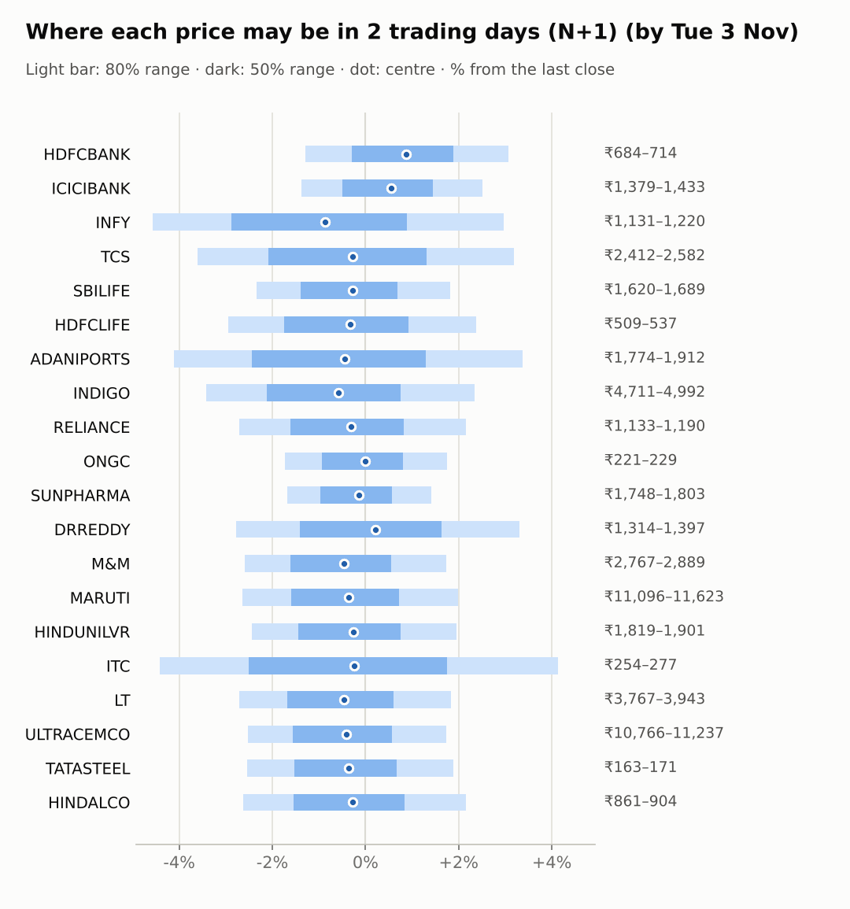
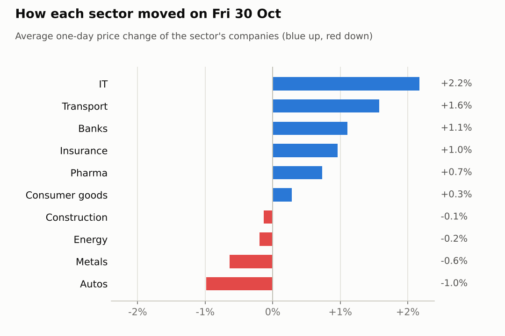
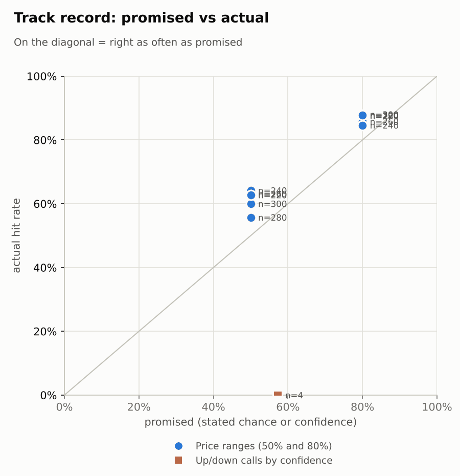

# Market brief: India (NSE), 2026-11-02

_Research log, not investment advice. Generated by a scheduled Claude Code routine._
<!-- report-data: as_of=2026-10-30 regime=TRENDING outcome=70248abff9bf -->

Easy-to-read version with charts and filters: [2026-11-02.html](2026-11-02.html)

## Headline
No AI calls today: data for 17 of the 20 companies failed the news duplicate check, and the model shows no edge on the other three. Watch ITC's results today and the US sell-off (S&P 500 -1.82%) against firmer Asian markets and Brent -5.70%.

## Top 3 today
- RELIANCE posted a record Q2 profit of ₹29,550 crore, up 33.8% (76883ca5fb43d8e9, corroborated); this is the first session to trade on it.
- ITC reports Q2 results today; a preview sees profit down nearly 30% on cigarette tax hikes (7da2e9f8f3fbf475, single_source).
- Overnight cues are mixed: S&P 500 -1.82% and Nasdaq -2.86%, but Hang Seng +0.72% and Brent -5.70%.

## Yesterday
On 2026-10-30 the Nifty 50 rose 0.5% and 12 of 20 watchlist stocks gained. INDIGO led (+4.3%) after its Q2 loss narrowed (b44e3ef471f28c71, single_source); M&M was the weakest (-1.7%).
N+1 80% ranges hit 18 of 20. ADANIPORTS closed above its range after its Q2 results (nse-ann-106831802), and INFY closed above its range on a 3.36% gain with Nifty IT up 2.32%.
The one call scored, a TCS 5-day down call, missed: TCS rose 17.25%.

Market on 2026-10-30: Nifty 50 23,053.10 (+0.5%) · India VIX 15.30 (+1.2%) · watchlist 12 up / 8 down · best INDIGO +4.3%, worst M&M -1.7%

### Ranges scored (target date 2026-10-30)

N+1 ranges: **80% hit 18/20** (naive 17/20) · 50% hit 12/20

| Ticker | 80% range | 50% range | Actual | 80% | 50% | Naive 80% |
|---|---|---|---|---|---|---|
| ADANIPORTS | ₹1,695.57–₹1,831.50 | ₹1,725.69–₹1,793.49 | ₹1,850.00 | ❌ | ❌ | ❌ |
| DRREDDY | ₹1,300.43–₹1,410.81 | ₹1,324.85–₹1,379.90 | ₹1,352.00 | ✅ | ✅ | ✅ |
| HDFCBANK | ₹669.48–₹708.25 | ₹678.14–₹697.49 | ₹692.80 | ✅ | ✅ | ✅ |
| HDFCLIFE | ₹496.58–₹532.62 | ₹504.59–₹522.57 | ₹524.90 | ✅ | ❌ | ✅ |
| HINDALCO | ₹865.83–₹923.13 | ₹878.59–₹907.19 | ₹884.70 | ✅ | ✅ | ✅ |
| HINDUNILVR | ₹1,767.83–₹1,866.18 | ₹1,789.82–₹1,838.91 | ₹1,864.60 | ✅ | ❌ | ✅ |
| ICICIBANK | ₹1,337.66–₹1,407.69 | ₹1,353.34–₹1,388.29 | ₹1,398.00 | ✅ | ❌ | ✅ |
| INDIGO | ₹4,466.11–₹4,932.10 | ₹4,568.48–₹4,800.78 | ₹4,877.60 | ✅ | ❌ | ❌ |
| INFY | ₹1,071.21–₹1,176.26 | ₹1,094.34–₹1,146.71 | ₹1,185.00 | ❌ | ❌ | ❌ |
| ITC | ₹250.67–₹268.77 | ₹254.69–₹263.72 | ₹265.60 | ✅ | ❌ | ✅ |
| LT | ₹3,690.83–₹3,919.73 | ₹3,741.89–₹3,856.12 | ₹3,871.70 | ✅ | ❌ | ✅ |
| M&M | ₹2,793.59–₹2,951.82 | ₹2,828.96–₹2,907.93 | ₹2,840.30 | ✅ | ✅ | ✅ |
| MARUTI | ₹11,236.09–₹11,942.77 | ₹11,393.68–₹11,746.33 | ₹11,397.00 | ✅ | ✅ | ✅ |
| ONGC | ₹219.67–₹230.20 | ₹222.03–₹227.29 | ₹225.39 | ✅ | ✅ | ✅ |
| RELIANCE | ₹1,100.14–₹1,219.62 | ₹1,126.35–₹1,185.90 | ₹1,164.90 | ✅ | ✅ | ✅ |
| SBILIFE | ₹1,621.73–₹1,714.03 | ₹1,642.36–₹1,688.43 | ₹1,658.60 | ✅ | ✅ | ✅ |
| SUNPHARMA | ₹1,702.42–₹1,814.77 | ₹1,727.45–₹1,783.51 | ₹1,777.70 | ✅ | ✅ | ✅ |
| TATASTEEL | ₹164.44–₹174.39 | ₹166.66–₹171.63 | ₹167.60 | ✅ | ✅ | ✅ |
| TCS | ₹2,351.25–₹2,575.09 | ₹2,400.59–₹2,512.20 | ₹2,502.60 | ✅ | ✅ | ✅ |
| ULTRACEMCO | ₹10,803.48–₹11,425.06 | ₹10,942.37–₹11,252.59 | ₹11,045.00 | ✅ | ✅ | ✅ |

N+2 ranges that matured on the same date: 80% hit 18/20, 50% hit 8/20. N+3 ranges that matured on the same date: 80% hit 19/20, 50% hit 15/20. N+4 ranges that matured on the same date: 80% hit 16/20, 50% hit 13/20. N+5 ranges that matured on the same date: 80% hit 18/20, 50% hit 16/20.

### Calls scored

| Ticker | H | Call | Conf. | Move | Hit |
|---|---|---|---|---|---|
| TCS | 5d · open→close | down | 57% | +17.25% | ❌ |

## Today (2026-11-02)

**Regime: TRENDING** · India VIX 15.30 (+1.2%) · benchmark 5d +2.0% · benchmark 10d vol 10.7%

| Ticker | Sector | Close | N+1 80% | N+1 50% | N+5 80% | Call | Cue | Notes |
|---|---|---|---|---|---|---|---|---|
| HDFCBANK | Banks | ₹692.80 | ₹683.90–₹714.10 | ₹690.76–₹705.84 | ₹667.83–₹729.61 | no call | +1.74% | cue +1.74% x0.5; index -0.66% expected from SPX, x beta 1.23 x0.5, own cue +1.74% net x0.5; major event x1.15 |
| ICICIBANK | Banks | ₹1,398.00 | ₹1,378.77–₹1,433.16 | ₹1,391.15–₹1,418.31 | ₹1,349.72–₹1,461.01 | no call | +1.10% | cue +1.10% x0.5; index -0.66% expected from SPX, x beta 0.93 x0.5, own cue +1.10% net x0.5; major event x1.15 |
| INFY | IT | ₹1,185.00 | ₹1,130.94–₹1,220.20 | ₹1,150.96–₹1,195.50 | ₹1,084.63–₹1,267.19 | no call | +2.54% | cue +2.54% x0.5; ex-dividend 25 (2.11%); index -0.66% expected from SPX, x beta 0.76 x0.5, own cue +2.54% net x0.5; major event x1.15 |
| TCS | IT | ₹2,502.60 | ₹2,412.41–₹2,582.26 | ₹2,450.61–₹2,535.39 | ₹2,330.13–₹2,678.48 | no call | – | index -0.66% expected from SPX, x beta 0.83 x0.5; major event x1.15 |
| SBILIFE | Insurance | ₹1,658.60 | ₹1,619.92–₹1,688.88 | ₹1,635.59–₹1,670.03 | ₹1,587.59–₹1,729.08 | no call | – | index -0.66% expected from SPX, x beta 0.84 x0.5; major event x1.15 |
| HDFCLIFE | Insurance | ₹524.90 | ₹509.42–₹537.41 | ₹515.75–₹529.73 | ₹496.25–₹553.69 | no call | – | index -0.66% expected from SPX, x beta 0.97 x0.5; major event x1.15 |
| ADANIPORTS | Transport | ₹1,850.00 | ₹1,773.99–₹1,912.28 | ₹1,805.01–₹1,874.02 | ₹1,709.84–₹1,993.96 | no call | – | index -0.66% expected from SPX, x beta 1.35 x0.5; major event x1.15 |
| INDIGO | Transport | ₹4,877.60 | ₹4,711.11–₹4,991.54 | ₹4,774.45–₹4,914.44 | ₹4,590.42–₹5,167.41 | no call | – | index -0.66% expected from SPX, x beta 1.77 x0.5; major event x1.15 |
| RELIANCE | Energy | ₹1,164.90 | ₹1,133.39–₹1,189.97 | ₹1,146.21–₹1,174.47 | ₹1,106.83–₹1,222.96 | no call | – | index -0.66% expected from SPX, x beta 0.93 x0.5; major event x1.15 |
| ONGC | Energy | ₹225.39 | ₹221.49–₹229.35 | ₹223.28–₹227.20 | ₹215.52–₹235.20 | no call | – | earnings in horizon (x2.0 day); index -0.66% expected from SPX, x beta 0.01 x0.5; major event x1.15 |
| SUNPHARMA | Pharma | ₹1,777.70 | ₹1,747.86–₹1,802.75 | ₹1,760.38–₹1,787.80 | ₹1,720.93–₹1,833.43 | no call | – | index -0.66% expected from SPX, x beta 0.45 x0.5; major event x1.15 |
| DRREDDY | Pharma | ₹1,352.00 | ₹1,314.42–₹1,396.71 | ₹1,332.99–₹1,374.06 | ₹1,271.22–₹1,439.54 | no call | +0.43% | cue +0.43% x0.5; index -0.66% expected from SPX, x beta 0.47 x0.5, own cue +0.43% net x0.5; major event x1.15 |
| M&M | Autos | ₹2,840.30 | ₹2,766.53–₹2,889.47 | ₹2,794.45–₹2,855.85 | ₹2,685.92–₹2,995.37 | no call | – | earnings in horizon (x2.0 day); index -0.66% expected from SPX, x beta 1.39 x0.5; major event x1.15 |
| MARUTI | Autos | ₹11,397.00 | ₹11,096.46–₹11,623.38 | ₹11,215.99–₹11,479.11 | ₹10,855.38–₹11,937.22 | no call | – | index -0.66% expected from SPX, x beta 1.07 x0.5; major event x1.15 |
| HINDUNILVR | Consumer goods | ₹1,864.60 | ₹1,819.20–₹1,901.16 | ₹1,837.81–₹1,878.74 | ₹1,780.33–₹1,948.45 | no call | – | index -0.66% expected from SPX, x beta 0.80 x0.5; major event x1.15 |
| ITC | Consumer goods | ₹265.60 | ₹253.85–₹276.57 | ₹258.93–₹270.26 | ₹247.72–₹283.80 | no call | – | earnings in horizon (x2.0 day); index -0.66% expected from SPX, x beta 0.74 x0.5; major event x1.15 |
| LT | Construction | ₹3,871.70 | ₹3,766.75–₹3,943.01 | ₹3,806.74–₹3,894.76 | ₹3,690.27–₹4,052.54 | no call | – | index -0.66% expected from SPX, x beta 1.40 x0.5; major event x1.15 |
| ULTRACEMCO | Construction | ₹11,045.00 | ₹10,766.46–₹11,237.00 | ₹10,873.35–₹11,108.34 | ₹10,560.11–₹11,526.86 | no call | – | index -0.66% expected from SPX, x beta 1.26 x0.5; major event x1.15 |
| TATASTEEL | Metals | ₹167.60 | ₹163.35–₹170.76 | ₹165.03–₹168.73 | ₹158.30–₹176.95 | no call | – | earnings in horizon (x2.0 day); index -0.66% expected from SPX, x beta 1.07 x0.5; major event x1.15 |
| HINDALCO | Metals | ₹884.70 | ₹861.45–₹903.74 | ₹871.03–₹892.15 | ₹831.85–₹938.08 | no call | – | earnings in horizon (x2.0 day); index -0.66% expected from SPX, x beta 0.82 x0.5; major event x1.15 |

No calls today. The forecaster and the four AI traders abstained on every company.
- ADANIPORTS, HINDUNILVR, SBILIFE: the signal model's chance of going up is close to its usual up-day rate, so there is no edge; the only fresh news for HINDUNILVR is a broker upgrade (b83518ef1534b40c, single_source), which cannot be the main evidence.
- DRREDDY, HDFCBANK, HDFCLIFE, HINDALCO, ICICIBANK, INDIGO, INFY, ITC, LT, M&M, MARUTI, ONGC, RELIANCE, SUNPHARMA, TATASTEEL, TCS, ULTRACEMCO: data failed validation (collect gate DUPLICATE_ID).
- ITC is also inside the earnings window (results today), a hard block.
- Paper only: the rule strategies made their own predictions, and the pattern-mood and combined Sonnet AI traders made paper calls on ADANIPORTS, HINDUNILVR or SBILIFE; none is advice.

### Overnight cues and global factors

| Symbol | Name | Last | Change |
|---|---|---|---|
| BRENT | Brent crude | 110.93 | -5.70% |
| DXY | US dollar index | 101.94 | +0.06% |
| GOLD | Gold | 3,921.50 | +0.58% |
| HANGSENG | Hang Seng | 23,461.10 | +0.72% |
| INDIAVIX | India VIX | 15.30 | +1.21% |
| KOSPI | KOSPI | 5,768.59 | +0.66% |
| NASDAQ | Nasdaq Composite (previous US close) | 25,437.00 | -2.86% |
| NIFTY50 | Nifty 50 | 23,053.10 | +0.51% |
| NIKKEI | Nikkei 225 | 63,030.73 | -0.41% |
| SHANGHAI | Shanghai Composite | 3,602.51 | +0.10% |
| SPX | S&P 500 (previous US close) | 7,580.07 | -1.82% |
| STOXX50 | Euro Stoxx 50 | 6,131.31 | -1.22% |
| TAIWAN | Taiwan Weighted | 44,718.16 | -1.09% |
| US10Y | US 10-year yield | 4.93 | -1.20% |
| USDINR | USD/INR | 94.94 | -0.28% |
| USDJPY | USD/JPY | 157.85 | +0.03% |
| USVIX | US VIX | 19.42 | +12.91% |

### ADRs (US-listed shares, previous US session)

| Ticker | ADR | Last | Change |
|---|---|---|---|
| DRREDDY | RDY | 14.17 | +0.43% |
| HDFCBANK | HDB | 22.18 | +1.74% |
| ICICIBANK | IBN | 29.45 | +1.10% |
| INFY | INFY | 12.51 | +2.54% |

## Tomorrow and this week

| Date | Event | Type |
|---|---|---|
| 2026-11-02 | ITC earnings | company |
| 2026-11-03 | Infosys ex-dividend (est. 25, last dividend) | company |
| 2026-11-03 | Nifty weekly options expiry (Tuesday) |  |
| 2026-11-05 | Mahindra & Mahindra earnings | company |
| 2026-11-05 | ONGC earnings | company |
| 2026-11-06 | Hindalco earnings | company |
| 2026-11-06 | US jobs report (usually first Friday, 08:30 ET; check for shifts) | major |
| 2026-11-07 | Tata Steel earnings | company |
| 2026-11-09 | Nifty weekly options expiry (Tuesday) |  |
| 2026-11-12 | Hindustan Unilever ex-dividend (est. 22, last dividend) | company |
| 2026-11-17 | Nifty weekly options expiry (Tuesday) |  |

Today: ITC results; tomorrow INFY goes ex-dividend (an estimated ₹25, a mechanical drop in its price). M&M and ONGC report on 2026-11-05, HINDALCO on 2026-11-06 and TATASTEEL on 2026-11-07, so their ranges are wider.
The US sell-off (US VIX +12.91%) points lower at the open, while Asia and a cheaper oil price point the other way. The regime is TRENDING with India VIX at 15.30.
The US jobs report on 2026-11-06 is the main global event this week.

## By sector

### Banks

HDFCBANK (+1.39%) and ICICIBANK (+0.82%) both rose while Nifty Bank fell 0.41%, so the moves were stock-specific. RBI approved ICICIBANK's CEO re-appointment (ebdd9e27bd7273de, unverified).
Bull: ADRs rose overnight, HDFCBANK +1.74% and ICICIBANK +1.10%. Bear: HDFCBANK is still down 2.24% over 20 days.

### IT

INFY (+3.36%) and TCS (+0.99%) rose with Nifty IT (+2.32%), a sector move.
Bull: INFY's ADR rose 2.54%; Nomura keeps a Buy on TCS (13e5f1c2b6ce955e, single_source). Bear: INFY is up 19.2% and TCS 22.04% over 20 days, and Cognizant cut its revenue guidance (c1e4ade2e67cc3f2, single_source); INFY goes ex-dividend tomorrow.

### Insurance

HDFCLIFE (+1.53%) and SBILIFE (+0.40%) both rose, with no company news.
Bull: SBILIFE's latest results showed profit up and the stock is not stretched. Bear: SBILIFE is down 2.23% over 20 days and has no fresh news.

### Transport

INDIGO jumped 4.33% as its Q2 loss narrowed (b44e3ef471f28c71, single_source), while ADANIPORTS fell 1.18% after a strong week; they moved apart on company news.
Bull: ADANIPORTS' Q2 results were strong (nse-ann-106831802) and lower oil helps INDIGO. Bear: ADANIPORTS is up 8.65% in 5 days and its Evos bid headline says the stock fell (5ac985d32291d320, unverified).

### Energy

RELIANCE (-0.21%) and ONGC (-0.18%) were flat before RELIANCE's record Q2 profit (6126f5813a4e444a, corroborated) and Jio's 14% profit rise (bb682a6cb56c709c, corroborated).
Bull: RELIANCE trades on its results for the first time today. Bear: Brent fell 5.70%, which can weigh on ONGC, and ONGC reports on 2026-11-05.

### Pharma

DRREDDY (+0.52%) and SUNPHARMA (+0.95%) rose with Nifty Pharma (+1.55%).
Bull: SUNPHARMA won US FDA approval of ILUMYA for psoriatic arthritis (fc34a4241b4ff789, corroborated). Bear: SUNPHARMA's Q2 profit fell 36% on a one-time hit (4a7450816abe3476, corroborated), and DRREDDY is up 9.96% in 5 days.

### Autos

MARUTI (-0.25%) and M&M (-1.72%) both fell before record October sales: MARUTI up 25% (2e6fc7d8c4caa241, corroborated) and M&M up 9% (08bc8460bc6e58fe, single_source).
Bull: record monthly sales at both. Bear: M&M's domestic tractor sales fell 13% (08bc8460bc6e58fe, single_source) and it reports on 2026-11-05.

### Consumer goods

HINDUNILVR (+0.34%) and ITC (+0.23%) were nearly flat.
Bull: PL Capital upgraded HINDUNILVR to Buy (b83518ef1534b40c, single_source). Bear: ITC reports today with profit seen down nearly 30% (7da2e9f8f3fbf475, single_source), which may weigh on the sector.

### Construction

LT rose 0.90% while ULTRACEMCO fell 1.16%, so they moved apart on company factors, with no fresh news.
Bull: LT is up 6.16% in 5 days. Bear: ULTRACEMCO is flat over 5 days and lags its construction peers.

### Metals

HINDALCO (-0.18%) and TATASTEEL (-1.10%) both slipped, with no fresh news.
Bull: both are oversold after 20-day falls (TATASTEEL -9.06%, HINDALCO -6.06%). Bear: both report this week (HINDALCO 2026-11-06, TATASTEEL 2026-11-07).

## Track record

Ranges (targets 50% / 80%; width, score and centre error in % of price, lower is better; naive = last close ± recent typical move, no-change = last close as the centre):

| H | Window | n | 50% cover | 80% cover | Naive 80% | Width | Naive width | Score | Naive score | Centre err | No-change err |
|---|---|---|---|---|---|---|---|---|---|---|---|
| 1d | since start | 300 | 60% | 88% | 88% | 6.01 | 5.89 | 7.604 | 7.531 | 1.50 | 1.51 |
| 1d | last 30 days | 300 | 60% | 88% | 88% | 6.01 | 5.89 | 7.604 | 7.531 | 1.50 | 1.51 |
| 2d | since start | 280 | 56% | 88% | 87% | 7.53 | 7.22 | 9.987 | 9.789 | 1.93 | 1.94 |
| 2d | last 30 days | 280 | 56% | 88% | 87% | 7.53 | 7.22 | 9.987 | 9.789 | 1.93 | 1.94 |
| 3d | since start | 260 | 63% | 86% | 86% | 8.73 | 8.34 | 12.068 | 11.800 | 2.21 | 2.21 |
| 3d | last 30 days | 260 | 63% | 86% | 86% | 8.73 | 8.34 | 12.068 | 11.800 | 2.21 | 2.21 |
| 4d | since start | 240 | 64% | 85% | 84% | 9.85 | 9.34 | 14.123 | 13.773 | 2.53 | 2.53 |
| 4d | last 30 days | 240 | 64% | 85% | 84% | 9.85 | 9.34 | 14.123 | 13.773 | 2.53 | 2.53 |
| 5d | since start | 220 | 63% | 88% | 87% | 10.79 | 10.25 | 15.646 | 15.214 | 2.71 | 2.72 |
| 5d | last 30 days | 220 | 63% | 88% | 87% | 10.79 | 10.25 | 15.646 | 15.214 | 2.71 | 2.72 |

Ranges by regime (since start):

| H | Regime | n | 50% cover | 80% cover | Naive 80% |
|---|---|---|---|---|---|
| 1d | CALM | 160 | 60% | 84% | 86% |
| 1d | EVENT_HEAVY | 80 | 63% | 93% | 89% |
| 1d | TRENDING | 60 | 57% | 92% | 95% |
| 2d | CALM | 160 | 51% | 85% | 86% |
| 2d | EVENT_HEAVY | 60 | 67% | 95% | 88% |
| 2d | TRENDING | 60 | 57% | 87% | 88% |
| 3d | CALM | 160 | 61% | 85% | 86% |
| 3d | EVENT_HEAVY | 40 | 75% | 90% | 85% |
| 3d | TRENDING | 60 | 60% | 85% | 87% |
| 4d | CALM | 160 | 62% | 85% | 86% |
| 4d | EVENT_HEAVY | 20 | 65% | 80% | 80% |
| 4d | TRENDING | 60 | 70% | 85% | 82% |
| 5d | CALM | 160 | 61% | 87% | 86% |
| 5d | TRENDING | 60 | 67% | 90% | 88% |

Up/down calls vs the always-up baseline:

| H | Window | n | Hit rate | Always-up |
|---|---|---|---|---|
| 1d · open→close | since start | 1 | 0% | 100% |
| 1d · open→close | last 30 days | 1 | 0% | 100% |
| 5d · open→close | since start | 3 | 0% | 100% |
| 5d · open→close | last 30 days | 3 | 0% | 100% |

Calls by confidence band (a band should hit about as often as its confidence):

| Band | n | Avg confidence | Hit rate |
|---|---|---|---|
| 0.50-0.59 · open→close | 4 | 57% | 0% |

Weekly review 2026-W44: 0 proposed range changes for a human to decide · [review-2026-W44.md](review-2026-W44.md)

## Data quality

- Indicators: 20 OK, partial: none, blocked: none
- Regime notes: none

| H | Calibration | History n | Live n | q10 / q90 |
|---|---|---|---|---|
| 1d | pool | 9000 | 300 | -1.17 / 1.17 |
| 2d | pool | 8980 | 280 | -1.20 / 1.16 |
| 3d | pool | 8960 | 260 | -1.23 / 1.17 |
| 4d | pool | 8940 | 240 | -1.26 / 1.16 |
| 5d | pool | 8920 | 220 | -1.23 / 1.17 |

- validation collect DUPLICATE_ID (blocking, not fixable in the run): news has duplicated stored ids (e.g. 00e1474cd8f04071, 017f10564e4fc3fc, 01c46d25603b38c9); old news items seen again after the 9-day de-duplication window were stored again under their old ids, today's file included (open GitHub issue on collect_news). Stored rows cannot be removed (append-only). The forecaster and the four AI traders abstained on the tickers those rows name: DRREDDY, HDFCBANK, HDFCLIFE, HINDALCO, ICICIBANK, INDIGO, INFY, ITC, LT, M&M, MARUTI, ONGC, RELIANCE, SUNPHARMA, TATASTEEL, TCS, ULTRACEMCO (LT is new today). The rule strategies (lab.py predict) apply their own blocks and still predicted on these tickers.
- validation collect PRICE_BASIS (warning): BRENT's Yahoo close differs from the stored close on 2026-10-26..2026-10-28; not one re-base, not recorded.
- validation features, context, news, forecast and report: passed.
- collect_prices: BRENT price-basis warning (as above); no NSE-filled bars, no adjustments, no held tickers.
- collect_relations_india: holdings nse_pledge per-ticker calls returned no rows at all; check the endpoint is still live.
- collect_news: ok; the window reached back to the previous pre-open run on 2026-10-30 (the weekend news-only runs stored no successful news run), so this run's news-analyst scored the whole weekend in one pass.
- collect_filings, collect_options, collect_macro, collect_shorts: skipped (not configured for India).
- collect_articles: no failures; unvetted domains skipped (e.g. scanx.trade, ad-hoc-news.de, kalkine.co.in), listed for review.
- results digests: RELIANCE and SUNPHARMA Q2 results and the RELIANCE concall stored as text_unavailable (NSE attachments are PDFs and no PDF parser is configured).
- news-analyst: the news gate passed, but the analyst scored the watchlist headlines with its own cluster and keyword rules and the background headlines in groups, not item by item, and fetched no article pages; treat today's sentiment and materiality scores as rough.
- process: to meet the AI traders' deadline (15 minutes before the open), the bull and bear researchers ran on the context pack in parallel with the news-analyst, before its brief; the forecaster had the brief.
- AI traders abstentions: ai.combined.opus.v1 abstained 19 and earnings_window 1; ai.combined.sonnet.v1 abstained 16 and earnings_window 1; ai.news_results.sonnet.v1 abstained 19 and earnings_window 1; ai.pattern_mood.sonnet.v1 abstained 19 and earnings_window 1.
- inbox imports (company and paper-trade commands): nothing to import.
- Judge FAIL 2026-10-26, spotcheck round 1: the 2026-10-22 report cited nse-ann-106821834 (UltraTech vice-chairman resignation) as ULTRACEMCO's Q2 results, which are nse-ann-106821830; it gave RELIANCE and ONGC an uncited 'firm oil' cause and misstated the duplicate news id count. Nothing dropped.
