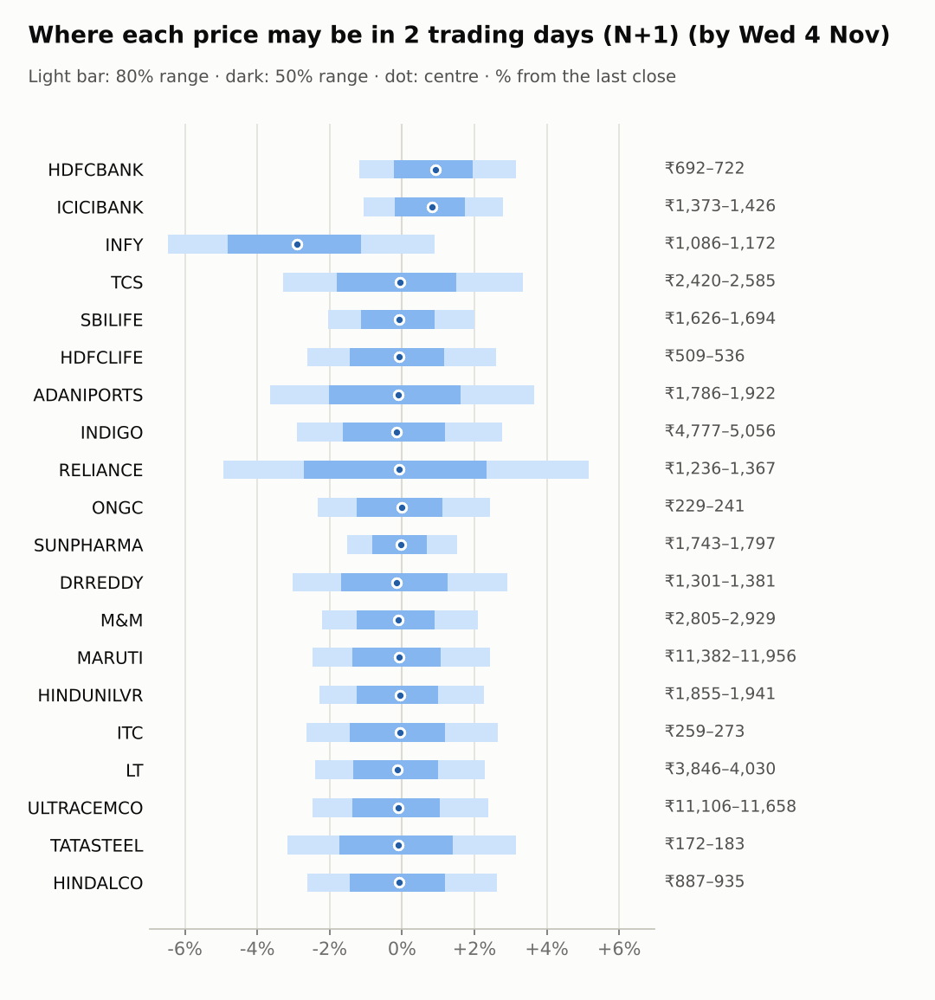
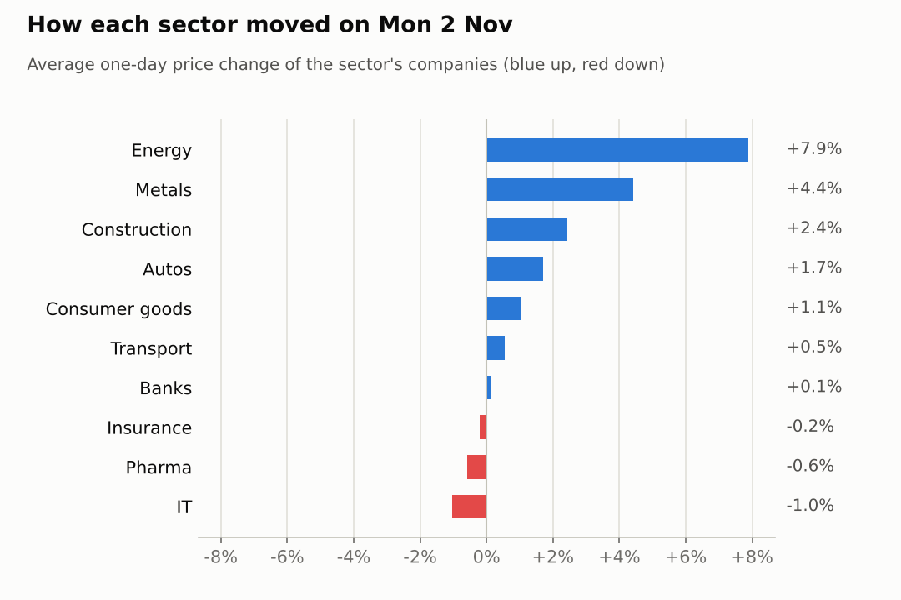
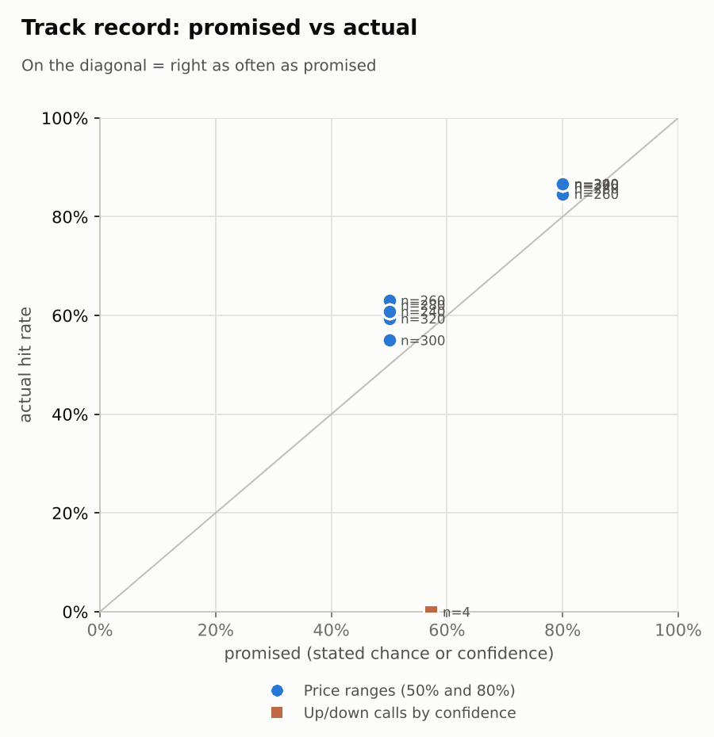

# Market brief: India (NSE), 2026-11-03

_Research log, not investment advice. Generated by a scheduled Claude Code routine._
<!-- report-data: as_of=2026-11-02 regime=TRENDING outcome=70248abff9bf -->

Easy-to-read version with charts and filters: [2026-11-03.html](2026-11-03.html)

## Headline
No calls today: the forecaster and all four AI traders made no new lean on 17 companies because the collect gate failed again on duplicated stored news ids, and found no edge on the other three. Watch ITC at the open: its Q2 profit fell 18.5% after Monday's close, confirmed by NSE filing (nse-ann-106840268), so Monday's +0.3% close does not include it.

## Top 3 today
- ITC opens on its Q2 results: profit fell 18.5% on higher cigarette taxes, filed after Monday's close, confirmed by NSE filing (nse-ann-106840268).
- RELIANCE jumped 11.6% on Monday on record Q2 results (167db47b0facc925, corroborated); after a move that size its ranges are wide.
- Mixed overnight cues: the S&P 500 fell 0.51% and US VIX rose 8.91%, while Brent fell 11.13% to 104.55, which helps an oil importer like India.

## Yesterday
The Nifty 50 rose 1.68% on Monday, led by RELIANCE (+11.6%) after its record Q2 results (167db47b0facc925, corroborated); FIIs bought a provisional net +3,115 cr. TATASTEEL (+5.83%) and ONGC (+4.19%) also rallied, while INFY fell 2.03%.
The N+1 80% ranges held 13 of 20 against 15 for the naive band. All seven misses closed above their range on the broad up day: RELIANCE, INDIGO, TATASTEEL, ONGC, HINDALCO, LT and HDFCBANK. RELIANCE's results-driven jump was far larger than its range allowed.
The one scored call, TCS 5-day down, missed: TCS rose 17.25% over the window.

Market on 2026-11-02: Nifty 50 23,440.80 (+1.7%) · India VIX 15.50 (+1.3%) · watchlist 14 up / 6 down · best RELIANCE +11.6%, worst INFY -2.0%

### Ranges scored (target date 2026-11-02)

N+1 ranges: **80% hit 13/20** (naive 15/20) · 50% hit 10/20

| Ticker | 80% range | 50% range | Actual | 80% | 50% | Naive 80% |
|---|---|---|---|---|---|---|
| ADANIPORTS | ₹1,799.89–₹1,943.84 | ₹1,831.98–₹1,903.62 | ₹1,854.00 | ✅ | ✅ | ✅ |
| DRREDDY | ₹1,301.64–₹1,385.73 | ₹1,320.49–₹1,362.36 | ₹1,342.00 | ✅ | ✅ | ✅ |
| HDFCBANK | ₹668.74–₹698.21 | ₹675.40–₹690.08 | ₹700.00 | ❌ | ❌ | ✅ |
| HDFCLIFE | ₹502.99–₹530.79 | ₹509.24–₹523.08 | ₹522.25 | ✅ | ✅ | ✅ |
| HINDALCO | ₹864.21–₹908.06 | ₹874.09–₹895.93 | ₹911.40 | ❌ | ❌ | ❌ |
| HINDUNILVR | ₹1,815.58–₹1,900.00 | ₹1,834.63–₹1,876.68 | ₹1,898.30 | ✅ | ❌ | ✅ |
| ICICIBANK | ₹1,369.66–₹1,424.69 | ₹1,382.11–₹1,409.52 | ₹1,387.40 | ✅ | ✅ | ✅ |
| INDIGO | ₹4,559.32–₹4,783.95 | ₹4,609.96–₹4,721.84 | ₹4,919.90 | ❌ | ❌ | ❌ |
| INFY | ₹1,105.53–₹1,189.83 | ₹1,124.35–₹1,166.31 | ₹1,161.00 | ✅ | ✅ | ✅ |
| ITC | ₹253.40–₹276.86 | ₹258.61–₹270.28 | ₹266.40 | ✅ | ✅ | ✅ |
| LT | ₹3,745.58–₹3,924.48 | ₹3,785.93–₹3,875.04 | ₹3,939.90 | ❌ | ❌ | ✅ |
| M&M | ₹2,826.92–₹2,949.73 | ₹2,854.66–₹2,915.84 | ₹2,868.80 | ✅ | ✅ | ✅ |
| MARUTI | ₹11,148.57–₹11,695.50 | ₹11,271.88–₹11,544.30 | ₹11,672.00 | ✅ | ❌ | ✅ |
| ONGC | ₹221.76–₹229.88 | ₹223.60–₹227.64 | ₹234.83 | ❌ | ❌ | ❌ |
| RELIANCE | ₹1,121.22–₹1,214.06 | ₹1,141.90–₹1,188.10 | ₹1,300.00 | ❌ | ❌ | ❌ |
| SBILIFE | ₹1,616.09–₹1,687.02 | ₹1,632.11–₹1,667.45 | ₹1,660.50 | ✅ | ✅ | ✅ |
| SUNPHARMA | ₹1,717.92–₹1,804.12 | ₹1,737.35–₹1,780.28 | ₹1,770.00 | ✅ | ✅ | ✅ |
| TATASTEEL | ₹165.59–₹173.20 | ₹167.31–₹171.10 | ₹177.37 | ❌ | ❌ | ❌ |
| TCS | ₹2,391.76–₹2,564.72 | ₹2,430.42–₹2,516.53 | ₹2,501.70 | ✅ | ✅ | ✅ |
| ULTRACEMCO | ₹10,928.67–₹11,410.09 | ₹11,037.41–₹11,277.23 | ₹11,387.00 | ✅ | ❌ | ✅ |

N+2 ranges that matured on the same date: 80% hit 15/20, 50% hit 9/20. N+3 ranges that matured on the same date: 80% hit 17/20, 50% hit 10/20. N+4 ranges that matured on the same date: 80% hit 17/20, 50% hit 10/20. N+5 ranges that matured on the same date: 80% hit 15/20, 50% hit 8/20.

### Calls scored

| Ticker | H | Call | Conf. | Move | Hit |
|---|---|---|---|---|---|
| TCS | 5d · open→close | down | 57% | +17.25% | ❌ |

## Today (2026-11-03)

**Regime: TRENDING** · India VIX 15.50 (+1.3%) · benchmark 5d +3.0% · benchmark 10d vol 13.3%

| Ticker | Sector | Close | N+1 80% | N+1 50% | N+5 80% | Call | Cue | Notes |
|---|---|---|---|---|---|---|---|---|
| HDFCBANK | Banks | ₹700.00 | ₹691.64–₹721.97 | ₹698.50–₹713.62 | ₹677.32–₹739.55 | no call | +2.34% | cue +2.34% x0.5; index -0.17% expected from SPX, x beta 1.22 x0.5, own cue +2.34% net x0.5; major event x1.15 |
| ICICIBANK | Banks | ₹1,387.40 | ₹1,372.65–₹1,426.10 | ₹1,384.75–₹1,411.41 | ₹1,347.24–₹1,456.87 | no call | +2.07% | cue +2.07% x0.5; index -0.17% expected from SPX, x beta 0.91 x0.5, own cue +2.07% net x0.5; major event x1.15 |
| INFY | IT | ₹1,161.00 | ₹1,085.99–₹1,171.57 | ₹1,105.08–₹1,147.73 | ₹1,042.06–₹1,217.20 | no call | -1.51% | cue -1.51% x0.5; ex-dividend 25 (2.15%); index -0.17% expected from SPX, x beta 0.73 x0.5, own cue -1.51% net x0.5; major event x1.15 |
| TCS | IT | ₹2,501.70 | ₹2,419.61–₹2,585.42 | ₹2,456.73–₹2,539.39 | ₹2,335.47–₹2,675.05 | no call | – | index -0.17% expected from SPX, x beta 0.81 x0.5; major event x1.15 |
| SBILIFE | Insurance | ₹1,660.50 | ₹1,626.43–₹1,693.87 | ₹1,641.68–₹1,675.32 | ₹1,591.98–₹1,730.10 | no call | – | index -0.17% expected from SPX, x beta 0.83 x0.5; major event x1.15 |
| HDFCLIFE | Insurance | ₹522.25 | ₹508.55–₹535.84 | ₹514.70–₹528.30 | ₹494.69–₹550.58 | no call | – | index -0.17% expected from SPX, x beta 0.96 x0.5; major event x1.15 |
| ADANIPORTS | Transport | ₹1,854.00 | ₹1,786.31–₹1,921.88 | ₹1,816.58–₹1,884.15 | ₹1,718.52–₹1,996.28 | no call | – | index -0.17% expected from SPX, x beta 1.33 x0.5; major event x1.15 |
| INDIGO | Transport | ₹4,919.90 | ₹4,777.03–₹5,056.03 | ₹4,839.72–₹4,978.84 | ₹4,638.56–₹5,210.43 | no call | – | index -0.17% expected from SPX, x beta 1.75 x0.5; major event x1.15 |
| RELIANCE | Energy | ₹1,300.00 | ₹1,235.78–₹1,367.13 | ₹1,264.79–₹1,330.21 | ₹1,170.67–₹1,439.75 | no call | – | index -0.17% expected from SPX, x beta 1.02 x0.5; major event x1.15 |
| ONGC | Energy | ₹234.83 | ₹229.38–₹240.55 | ₹231.90–₹237.47 | ₹221.06–₹249.07 | no call | – | earnings in horizon (x2.0 day); index -0.17% expected from SPX, x beta 0.05 x0.5; major event x1.15 |
| SUNPHARMA | Pharma | ₹1,770.00 | ₹1,743.08–₹1,796.76 | ₹1,755.27–₹1,782.05 | ₹1,715.18–₹1,825.10 | no call | – | index -0.17% expected from SPX, x beta 0.44 x0.5; major event x1.15 |
| DRREDDY | Pharma | ₹1,342.00 | ₹1,301.39–₹1,381.12 | ₹1,319.29–₹1,359.04 | ₹1,259.94–₹1,423.12 | no call | -0.28% | cue -0.28% x0.5; index -0.17% expected from SPX, x beta 0.46 x0.5, own cue -0.28% net x0.5; major event x1.15 |
| M&M | Autos | ₹2,868.80 | ₹2,805.17–₹2,928.79 | ₹2,833.09–₹2,894.76 | ₹2,715.84–₹3,026.12 | no call | – | earnings in horizon (x2.0 day); index -0.17% expected from SPX, x beta 1.38 x0.5; major event x1.15 |
| MARUTI | Autos | ₹11,672.00 | ₹11,382.01–₹11,955.68 | ₹11,511.30–₹11,797.40 | ₹11,091.54–₹12,266.79 | no call | – | index -0.17% expected from SPX, x beta 1.08 x0.5; major event x1.15 |
| HINDUNILVR | Consumer goods | ₹1,898.30 | ₹1,855.08–₹1,941.11 | ₹1,874.50–₹1,917.41 | ₹1,811.10–₹1,987.30 | no call | – | index -0.17% expected from SPX, x beta 0.80 x0.5; major event x1.15 |
| ITC | Consumer goods | ₹266.40 | ₹259.38–₹273.47 | ₹262.55–₹269.58 | ₹252.18–₹281.02 | no call | – | index -0.17% expected from SPX, x beta 0.73 x0.5; major event x1.15 |
| LT | Construction | ₹3,939.90 | ₹3,845.57–₹4,029.64 | ₹3,887.09–₹3,978.89 | ₹3,753.37–₹4,130.57 | no call | – | index -0.17% expected from SPX, x beta 1.39 x0.5; major event x1.15 |
| ULTRACEMCO | Construction | ₹11,387.00 | ₹11,106.06–₹11,657.79 | ₹11,230.44–₹11,505.60 | ₹10,828.45–₹11,958.94 | no call | – | index -0.17% expected from SPX, x beta 1.27 x0.5; major event x1.15 |
| TATASTEEL | Metals | ₹177.37 | ₹171.77–₹182.97 | ₹174.28–₹179.87 | ₹163.69–₹191.80 | no call | – | earnings in horizon (x2.0 day); index -0.17% expected from SPX, x beta 1.10 x0.5; major event x1.15 |
| HINDALCO | Metals | ₹911.40 | ₹887.46–₹935.36 | ₹898.24–₹922.13 | ₹852.52–₹972.68 | no call | – | earnings in horizon (x2.0 day); index -0.17% expected from SPX, x beta 0.83 x0.5; major event x1.15 |

No calls today.
- ADANIPORTS, HINDUNILVR, SBILIFE: abstain at both horizons. The model's chance of going up sat near its base rate (ADANIPORTS 0.4776 at N+1), with no verified fresh news behind a lean; past calls in the 0.50-0.59 band hit 0 of 4.
- DRREDDY, HDFCBANK, HDFCLIFE, HINDALCO, ICICIBANK, INDIGO, INFY, ITC, LT, M&M, MARUTI, ONGC, RELIANCE, SUNPHARMA, TATASTEEL, TCS, ULTRACEMCO: abstain, data failed validation (collect gate DUPLICATE_ID).
- AI traders (paper only): the news-results and Opus combined traders abstained on all 20; the pattern-mood trader leaned HINDUNILVR up at N+1, N+3 and N+5; the Sonnet combined trader leaned ADANIPORTS, HINDUNILVR and SBILIFE down with low confidence, matching the model.

### Overnight cues and global factors

| Symbol | Name | Last | Change |
|---|---|---|---|
| BRENT | Brent crude | 104.55 | -11.13% |
| DXY | US dollar index | 101.83 | -0.05% |
| GOLD | Gold | 3,958.10 | +1.52% |
| HANGSENG | Hang Seng | 23,488.62 | +0.83% |
| INDIAVIX | India VIX | 15.50 | +1.31% |
| KOSPI | KOSPI | 5,720.67 | -0.18% |
| NASDAQ | Nasdaq Composite (previous US close) | 25,164.36 | -1.07% |
| NIFTY50 | Nifty 50 | 23,440.80 | +1.68% |
| NIKKEI | Nikkei 225 | 63,081.86 | -0.33% |
| SHANGHAI | Shanghai Composite | 3,601.48 | +0.07% |
| SPX | S&P 500 (previous US close) | 7,541.40 | -0.51% |
| STOXX50 | Euro Stoxx 50 | 6,176.06 | +0.73% |
| TAIWAN | Taiwan Weighted | 44,411.10 | -1.77% |
| US10Y | US 10-year yield | 4.89 | -0.71% |
| USDINR | USD/INR | 94.89 | -0.28% |
| USDJPY | USD/JPY | 157.87 | +0.12% |
| USVIX | US VIX | 21.15 | +8.91% |

### ADRs (US-listed shares, previous US session)

| Ticker | ADR | Last | Change |
|---|---|---|---|
| DRREDDY | RDY | 14.13 | -0.28% |
| HDFCBANK | HDB | 22.70 | +2.34% |
| ICICIBANK | IBN | 30.06 | +2.07% |
| INFY | INFY | 12.36 | -1.51% |

## Tomorrow and this week

| Date | Event | Type |
|---|---|---|
| 2026-11-02 | ITC earnings | company |
| 2026-11-03 | Infosys ex-dividend (est. 25, last dividend) | company |
| 2026-11-03 | Nifty weekly options expiry (Tuesday) |  |
| 2026-11-05 | Mahindra & Mahindra earnings | company |
| 2026-11-05 | ONGC earnings | company |
| 2026-11-06 | Hindalco earnings | company |
| 2026-11-06 | US jobs report (usually first Friday, 08:30 ET; check for shifts) | major |
| 2026-11-07 | Tata Steel earnings | company |
| 2026-11-09 | Nifty weekly options expiry (Tuesday) |  |
| 2026-11-12 | Hindustan Unilever ex-dividend (est. 22, last dividend) | company |
| 2026-11-17 | Nifty weekly options expiry (Tuesday) |  |
| 2026-11-23 | NSE monthly F&O expiry (last Tuesday) | major |
| 2026-11-23 | Nifty weekly options expiry (Tuesday) |  |

Results this week: M&M and ONGC on Nov 5, HINDALCO on Nov 6 and TATASTEEL on Nov 7; their ranges are widened for earnings inside the horizon. INFY trades ex-dividend today, which shifts its range down. Today is also the Nifty weekly options expiry. Abroad, US VIX rose 8.91% to 21.15 and the US jobs report is due on Nov 6. The regime is TRENDING, with the benchmark up 3.02% over 5 days.

## By sector

### Banks

HDFCBANK rose 1.04% and ICICIBANK fell 0.76% on Monday, so the two moved apart; their ADRs rose overnight (HDFCBANK +2.34%, ICICIBANK +2.07%).
Bull: the ADR moves point to a firm open, and FIIs were net buyers.
Bear: HDFCBANK faces a shareholder vote on its CEO's term this week, with no verified news on it yet.

### IT

INFY fell 2.03% and TCS was flat (-0.04%) on Monday, while Nifty IT fell 0.5%. INFY goes ex-dividend today and its ADR fell 1.51% overnight.
Bull: both are up strongly over 20 days (TCS +20.56%, INFY +12.17%).
Bear: TCS's RSI of 67 is stretched after that run, and the Nasdaq fell 1.07% overnight.

### Insurance

SBILIFE rose 0.11% and HDFCLIFE fell 0.5% on Monday, both lagging the Nifty 50's 1.68% gain; neither had fresh news.
Bull: SBILIFE's Q2 profit rose (7c7a6c4d2a6e9a2e, corroborated) and its delivery was above average.
Bear: both are below their 20-day highs (SBILIFE -3.55%, HDFCLIFE -2.24% over 20 days), and the model sees no edge.

### Transport

ADANIPORTS rose 0.22% after its results run (+5.79% over 5 days), while INDIGO rose 0.87% and closed above its 80% range at 4,919.90.
Bull: ADANIPORTS' Q2 results lifted broker targets, confirmed by NSE filing (nse-ann-106831802).
Bear: the good news looks priced in, and INDIGO's CEO warned that fuel costs will stay high (6ed4666d4391dc9d, single_source), though Brent fell 11.13% overnight.

### Energy

RELIANCE jumped 11.6% on 4.72 times normal volume after record Q2 results (167db47b0facc925, corroborated); ONGC rose 4.19% ahead of its Nov 5 results. Both moved up together with the market, but for their own reasons.
Bull: RELIANCE's Q2 profit rose 33.8% to a record 29,550 cr (76883ca5fb43d8e9, corroborated).
Bear: after an 11.6% day, RELIANCE's volatility is high (EWMA 48.3%), and the 11.13% fall in Brent weighs on oil producers like ONGC.

### Pharma

SUNPHARMA (-0.43%) and DRREDDY (-0.74%) slipped on Monday, with Nifty Pharma down 0.07%. DRREDDY won a US FDA nod for a generic HIV prevention injection (1c278050daf4633e, corroborated).
Bull: DRREDDY's FDA approval, and Nifty Pharma is up 5.16% over 5 days.
Bear: SUNPHARMA's Q2 profit fell 36% (4a7450816abe3476, corroborated), and NSE sought clarification on a report about its Assam facility (nse-ann-106839459).

### Autos

MARUTI rose 2.41% after record October sales (2e6fc7d8c4caa241, corroborated); M&M rose 1.0% ahead of its Nov 5 results.
Bull: strong October sales for both; M&M's sales item is single_source (08bc8460bc6e58fe).
Bear: M&M reports in 2 days, so its range is wide, and MARUTI is near its 20-day high.

### Consumer goods

HINDUNILVR rose 1.81% on Monday, while ITC rose 0.3% before its results came out after the close, so the two moved apart.
Bull: HINDUNILVR is up 4.38% over 5 days, with a broker Buy note (a7311d822a37271b, unverified).
Bear: ITC's Q2 profit fell 18.5% on higher cigarette taxes, confirmed by NSE filing (nse-ann-106840268), and that is not yet in its price.

### Construction

ULTRACEMCO rose 3.1% and LT 1.76% on Monday; LT closed above its 80% range at 3,939.90 and is at its 20-day high.
Bull: LT is up 7.06% over 5 days and reported new orders (nse-ann-106839016).
Bear: LT's RSI of 66 is stretched after that run.

### Metals

TATASTEEL rose 5.83% and HINDALCO 3.02% on Monday, both closing above their 80% ranges ahead of results (HINDALCO Nov 6, TATASTEEL Nov 7). They moved up together, on sector momentum rather than company news.
Bull: momentum into results.
Bear: both are still down over 20 days (HINDALCO -3.23%), and results inside the horizon widen the ranges both ways.

## Track record

Ranges (targets 50% / 80%; width, score and centre error in % of price, lower is better; naive = last close ± recent typical move, no-change = last close as the centre):

| H | Window | n | 50% cover | 80% cover | Naive 80% | Width | Naive width | Score | Naive score | Centre err | No-change err |
|---|---|---|---|---|---|---|---|---|---|---|---|
| 1d | since start | 320 | 59% | 87% | 88% | 5.97 | 5.89 | 7.966 | 7.892 | 1.56 | 1.56 |
| 1d | last 30 days | 320 | 59% | 87% | 88% | 5.97 | 5.89 | 7.966 | 7.892 | 1.56 | 1.56 |
| 2d | since start | 300 | 55% | 87% | 86% | 7.60 | 7.21 | 10.248 | 10.140 | 2.00 | 2.01 |
| 2d | last 30 days | 300 | 55% | 87% | 86% | 7.60 | 7.21 | 10.248 | 10.140 | 2.00 | 2.01 |
| 3d | since start | 280 | 62% | 86% | 85% | 8.83 | 8.33 | 12.221 | 11.985 | 2.27 | 2.26 |
| 3d | last 30 days | 280 | 62% | 86% | 85% | 8.83 | 8.33 | 12.221 | 11.985 | 2.27 | 2.26 |
| 4d | since start | 260 | 63% | 85% | 84% | 10.00 | 9.33 | 14.120 | 13.781 | 2.56 | 2.57 |
| 4d | last 30 days | 260 | 63% | 85% | 84% | 10.00 | 9.33 | 14.120 | 13.781 | 2.56 | 2.57 |
| 5d | since start | 240 | 61% | 87% | 85% | 10.94 | 10.23 | 15.864 | 15.598 | 2.82 | 2.82 |
| 5d | last 30 days | 240 | 61% | 87% | 85% | 10.94 | 10.23 | 15.864 | 15.598 | 2.82 | 2.82 |

Ranges by regime (since start):

| H | Regime | n | 50% cover | 80% cover | Naive 80% |
|---|---|---|---|---|---|
| 1d | CALM | 180 | 59% | 82% | 84% |
| 1d | EVENT_HEAVY | 80 | 63% | 93% | 89% |
| 1d | TRENDING | 60 | 57% | 92% | 95% |
| 2d | CALM | 160 | 51% | 85% | 86% |
| 2d | EVENT_HEAVY | 80 | 61% | 90% | 83% |
| 2d | TRENDING | 60 | 57% | 87% | 88% |
| 3d | CALM | 160 | 61% | 85% | 86% |
| 3d | EVENT_HEAVY | 60 | 67% | 88% | 82% |
| 3d | TRENDING | 60 | 60% | 85% | 87% |
| 4d | CALM | 160 | 62% | 85% | 86% |
| 4d | EVENT_HEAVY | 40 | 58% | 83% | 80% |
| 4d | TRENDING | 60 | 70% | 85% | 82% |
| 5d | CALM | 160 | 61% | 87% | 86% |
| 5d | EVENT_HEAVY | 20 | 40% | 75% | 65% |
| 5d | TRENDING | 60 | 67% | 90% | 88% |

Up/down calls vs the always-up baseline:

| H | Window | n | Hit rate | Always-up |
|---|---|---|---|---|
| 1d · open→close | since start | 1 | 0% | 100% |
| 1d · open→close | last 30 days | 1 | 0% | 100% |
| 5d · open→close | since start | 3 | 0% | 100% |
| 5d · open→close | last 30 days | 3 | 0% | 100% |

Calls by confidence band (a band should hit about as often as its confidence):

| Band | n | Avg confidence | Hit rate |
|---|---|---|---|
| 0.50-0.59 · open→close | 4 | 57% | 0% |

Weekly review 2026-W44: 0 proposed range changes for a human to decide · [review-2026-W44.md](review-2026-W44.md)

## Data quality

- Indicators: 20 OK, partial: none, blocked: none
- Regime notes: none

| H | Calibration | History n | Live n | q10 / q90 |
|---|---|---|---|---|
| 1d | pool | 9020 | 320 | -1.16 / 1.19 |
| 2d | pool | 9000 | 300 | -1.19 / 1.18 |
| 3d | pool | 8980 | 280 | -1.23 / 1.18 |
| 4d | pool | 8960 | 260 | -1.25 / 1.18 |
| 5d | pool | 8940 | 240 | -1.22 / 1.19 |

- validation collect DUPLICATE_ID (blocking, not fixable in the run): news has duplicated stored ids (e.g. 00e1474cd8f04071, 017f10564e4fc3fc, 01c46d25603b38c9). Old news items seen again after the 9-day de-duplication window were stored again under their old ids, and today's file added 7 more (open GitHub issue on collect_news). Stored rows cannot be removed (append-only). The forecaster and the four AI traders abstained on the tickers those rows name: DRREDDY, HDFCBANK, HDFCLIFE, HINDALCO, ICICIBANK, INDIGO, INFY, ITC, LT, M&M, MARUTI, ONGC, RELIANCE, SUNPHARMA, TATASTEEL, TCS, ULTRACEMCO. The rule strategies (lab.py predict) apply their own blocks and still predicted on these tickers.
- validation collect COLLECTOR_FAILED (warning): collect_prices found Yahoo's bars stale (newest 2026-10-30) for NIFTY50, INDIAVIX, NIFTYBANK, NIFTYIT and NIFTYPHARMA; their 2026-11-02 bars were already stored by an earlier run, so the data is current.
- validation collect PRICE_BASIS (warning): BRENT's Yahoo close differs from the stored close on 2026-10-26..2026-10-28; not one re-base, not recorded.
- validation features, context, news and forecast: passed.
- collect_prices: no NSE-filled bars, no adjustments, no held tickers.
- collect_relations_india: holdings nse_pledge per-ticker calls returned no rows at all; check the endpoint is still live.
- collect_news: ok; the window reached back 26 hours to the previous successful news run.
- collect_filings, collect_options, collect_macro, collect_shorts: skipped (not configured for India).
- collect_articles: no failures; unvetted domains skipped and listed for review.
- results digests: the concall and results texts of 4 releases (incl. MARUTI and ADANIPORTS concalls) stored as text_unavailable (NSE attachments are PDFs and no PDF parser is configured).
- claim-checker: 34 claims passed the gate and were stored; 4 of the 15 selected events were skipped (no checkable figures).
- news-analyst: the news gate passed, but the analyst scored the watchlist headlines with keyword rules (summaries are trimmed headlines) and the background headlines in groups, fetched no article pages, and kept the first of one id listed twice in the pending file (79263f651e48708b); treat today's sentiment and materiality scores as rough.
- process: the bull and bear researchers started before the news brief file was written and used the context pack's news section instead; the forecaster had the brief.
- AI traders abstentions: ai.combined.opus.v1 abstained 20; ai.combined.sonnet.v1 abstained 17; ai.news_results.sonnet.v1 abstained 20; ai.pattern_mood.sonnet.v1 abstained 19.
- inbox imports (company and paper-trade commands): nothing to import.
