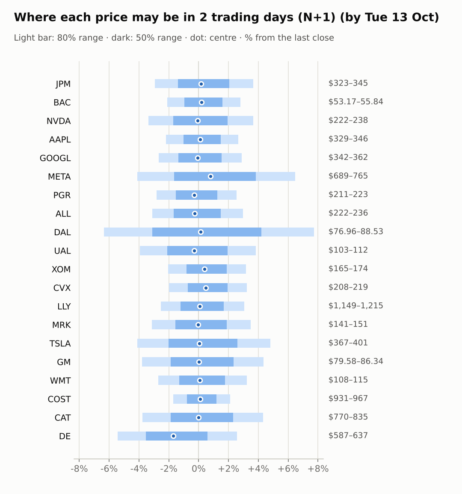
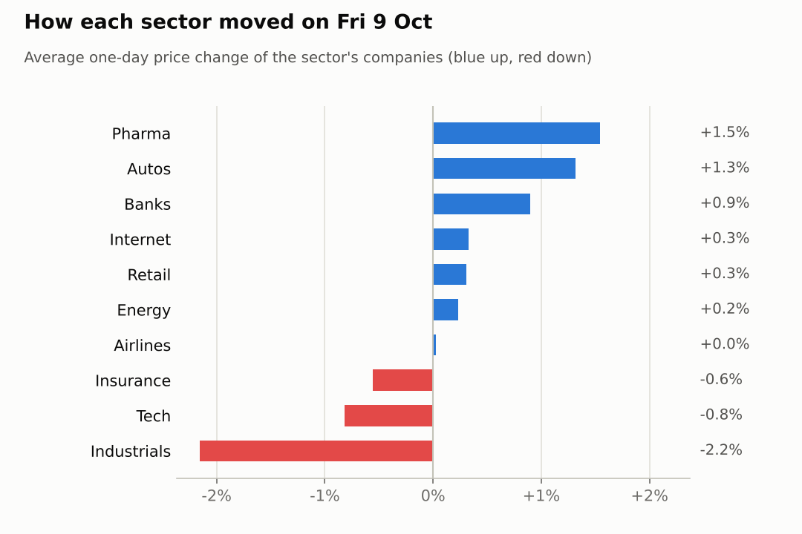
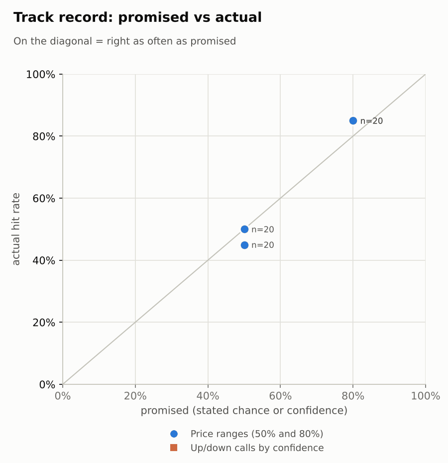

# Market brief: US (NYSE/Nasdaq), 2026-10-12

_Research log, not investment advice. Generated by a scheduled Claude Code routine._
<!-- report-data: as_of=2026-10-09 regime=EVENT_HEAVY outcome=695fa078534e -->

Easy-to-read version with charts and filters: [2026-10-12.html](2026-10-12.html)

## Headline
No calls today: the US session opens in an event-heavy week (JPM results on 2026-10-13, BAC, PGR and September CPI on 2026-10-14), and the signal model sits at its base rate for every company. Only one news event, the corroborated NVDA SpaceX chip-financing report (ab389b7d388dcec8), is strong enough to be a call's main evidence.

## Top 3 today
- Event-heavy week: JPM reports on 2026-10-13 (no call allowed), BAC and PGR report and September CPI is due on 2026-10-14; the VIX was 15.47 (+4.25%) pre-open.
- DE fell 4.85% on 2026-10-09 (-9.62% over 5 sessions) as a federal inquiry added to demand worries (78faf9b894855975, no verification status); its N+1 range was missed on the downside.
- Oil is firm (WTI 92.99, +1.24%): XOM (+0.8%) and CVX (+0.93%) were up pre-market, while UAL (-0.61%) was down.

## Yesterday
On 2026-10-09 the S&P 500 ETF rose 0.6% and the watchlist ended 13 up, 7 down. MRK led (+2.3%) on a mixed trial headline (ccf6950a861b9e20: the eye drug met its goal but with more eye complications). DE was worst (-4.8%) after a report of a federal inquiry (78faf9b894855975). DAL closed flat after its results and forecast cut (067dc7b8d2ebc587, promotional).
Ranges: 17 of 20 N+1 80% ranges held. The three misses: DE closed below its range on that drop, NVDA closed just below its low ($229.28 vs $229.38), and CVX closed just above its high ($211.98 vs $211.65) as energy stayed strong.

Market on 2026-10-09: S&P 500 ETF 778.57 (+0.6%) · VIX 14.84 (-3.7%) · watchlist 13 up / 7 down · best MRK +2.3%, worst DE -4.8%

### Ranges scored (target date 2026-10-09)

N+1 ranges: **80% hit 17/20** (naive 15/20) · 50% hit 10/20

| Ticker | 80% range | 50% range | Actual | 80% | 50% | Naive 80% |
|---|---|---|---|---|---|---|
| AAPL | $329.68–$344.72 | $333.21–$341.02 | $336.64 | ✅ | ✅ | ✅ |
| ALL | $218.22–$230.10 | $221.00–$227.16 | $229.43 | ✅ | ❌ | ✅ |
| BAC | $52.11–$54.55 | $52.69–$53.95 | $54.32 | ✅ | ❌ | ✅ |
| CAT | $779.77–$840.88 | $793.96–$825.65 | $800.47 | ✅ | ✅ | ✅ |
| COST | $927.92–$962.32 | $936.03–$953.87 | $946.92 | ✅ | ✅ | ✅ |
| CVX | $202.86–$211.65 | $204.92–$209.48 | $211.98 | ❌ | ❌ | ❌ |
| DAL | $77.29–$88.33 | $79.80–$85.52 | $82.17 | ✅ | ✅ | ✅ |
| DE | $633.12–$675.48 | $642.99–$664.96 | $620.93 | ❌ | ❌ | ❌ |
| GM | $77.61–$83.85 | $79.06–$82.30 | $82.73 | ✅ | ❌ | ✅ |
| GOOGL | $340.64–$358.99 | $344.94–$354.45 | $351.66 | ✅ | ✅ | ✅ |
| JPM | $322.58–$334.43 | $325.37–$331.52 | $332.99 | ✅ | ❌ | ✅ |
| LLY | $1,160.56–$1,221.96 | $1,174.94–$1,206.79 | $1,179.27 | ✅ | ✅ | ✅ |
| META | $685.84–$758.60 | $702.57–$740.29 | $718.67 | ✅ | ✅ | ✅ |
| MRK | $138.18–$146.85 | $140.20–$144.70 | $145.60 | ✅ | ❌ | ✅ |
| NVDA | $229.38–$244.18 | $232.83–$240.51 | $229.28 | ❌ | ❌ | ❌ |
| PGR | $210.28–$220.68 | $212.72–$218.11 | $217.43 | ✅ | ✅ | ✅ |
| TSLA | $361.33–$392.80 | $368.62–$384.93 | $382.70 | ✅ | ✅ | ✅ |
| UAL | $105.13–$112.99 | $106.96–$111.04 | $107.45 | ✅ | ✅ | ✅ |
| WMT | $105.56–$111.39 | $106.93–$109.95 | $111.35 | ✅ | ❌ | ❌ |
| XOM | $162.13–$169.51 | $163.86–$167.69 | $168.94 | ✅ | ❌ | ❌ |

### Calls scored

_none_

## Today (2026-10-12)

**Regime: EVENT_HEAVY** · VIX 15.47 (+4.2%) · benchmark 5d +1.2% · benchmark 10d vol 8.3% · major events: US CPI (September)

| Ticker | Sector | Close | N+1 80% | N+1 50% | N+5 80% | Call | Cue | Notes |
|---|---|---|---|---|---|---|---|---|
| JPM | Banks | $332.99 | $323.21–$345.20 | $328.42–$339.82 | $316.17–$355.67 | no call | +0.32% | cue +0.32% x0.5; earnings in horizon (x2.24 day, 7 past moves, median 2.0%); earnings in horizon (x3.0 day); major event x1.15; regime EVENT_HEAVY x1.1 |
| BAC | Banks | $54.32 | $53.17–$55.84 | $53.81–$55.19 | $50.80–$59.13 | no call | +0.39% | cue +0.39% x0.5; earnings in horizon (x3.0 day); major event x1.15; regime EVENT_HEAVY x1.1 |
| NVDA | Tech | $229.28 | $221.56–$237.65 | $225.36–$233.70 | $214.75–$247.62 | no call | -0.17% | cue -0.17% x0.5; major event x1.15; regime EVENT_HEAVY x1.1 |
| AAPL | Tech | $336.64 | $329.29–$345.60 | $333.18–$341.63 | $322.28–$355.54 | no call | +0.20% | cue +0.20% x0.5; major event x1.15; regime EVENT_HEAVY x1.1 |
| GOOGL | Internet | $351.66 | $342.29–$361.77 | $346.92–$357.02 | $333.96–$373.71 | no call | -0.12% | cue -0.12% x0.5; major event x1.15; regime EVENT_HEAVY x1.1 |
| META | Internet | $718.67 | $689.12–$765.08 | $706.84–$746.22 | $657.80–$813.47 | no call | +1.59% | cue +1.59% x0.5; major event x1.15; regime EVENT_HEAVY x1.1 |
| PGR | Insurance | $217.43 | $211.30–$222.96 | $214.07–$220.12 | $201.00–$237.43 | no call | -0.59% | cue -0.59% x0.5; earnings in horizon (x3.0 day); major event x1.15; regime EVENT_HEAVY x1.1 |
| ALL | Insurance | $229.43 | $222.28–$236.24 | $225.59–$232.83 | $216.34–$244.84 | no call | -0.52% | cue -0.52% x0.5; major event x1.15; regime EVENT_HEAVY x1.1 |
| DAL | Airlines | $82.17 | $76.96–$88.53 | $79.63–$85.62 | $77.82–$87.48 | no call | +0.27% | cue +0.27% x0.5; earnings in horizon (x3.29 day, 7 past moves, median 4.2%); ex-dividend 0.215 (0.26%); major event x1.15; regime EVENT_HEAVY x1.1 |
| UAL | Airlines | $107.45 | $103.22–$111.58 | $105.19–$109.53 | $99.70–$116.80 | no call | -0.61% | cue -0.61% x0.5; major event x1.15; regime EVENT_HEAVY x1.1 |
| XOM | Energy | $168.94 | $165.47–$174.28 | $167.57–$172.13 | $161.69–$179.66 | no call | +0.80% | cue +0.80% x0.5; major event x1.15; regime EVENT_HEAVY x1.1 |
| CVX | Energy | $211.98 | $207.79–$218.80 | $210.41–$216.12 | $203.07–$225.52 | no call | +0.93% | cue +0.93% x0.5; major event x1.15; regime EVENT_HEAVY x1.1 |
| LLY | Pharma | $1,179.27 | $1,149.29–$1,215.27 | $1,164.98–$1,199.19 | $1,121.11–$1,255.72 | no call | +0.18% | cue +0.18% x0.5; major event x1.15; regime EVENT_HEAVY x1.1 |
| MRK | Pharma | $145.60 | $141.02–$150.69 | $143.31–$148.33 | $136.92–$156.68 | no call | -0.06% | cue -0.06% x0.5; major event x1.15; regime EVENT_HEAVY x1.1 |
| TSLA | Autos | $382.70 | $366.98–$401.04 | $374.97–$392.63 | $352.78–$422.47 | no call | +0.08% | cue +0.08% x0.5; major event x1.15; regime EVENT_HEAVY x1.1 |
| GM | Autos | $82.73 | $79.58–$86.34 | $81.17–$84.67 | $76.75–$90.56 | no call | +0.01% | cue +0.01% x0.5; major event x1.15; regime EVENT_HEAVY x1.1 |
| WMT | Retail | $111.35 | $108.32–$114.94 | $109.89–$113.32 | $105.50–$119.01 | no call | +0.14% | cue +0.14% x0.5; major event x1.15; regime EVENT_HEAVY x1.1 |
| COST | Retail | $946.92 | $930.82–$966.99 | $939.48–$958.23 | $915.18–$988.85 | no call | +0.21% | cue +0.21% x0.5; major event x1.15; regime EVENT_HEAVY x1.1 |
| CAT | Industrials | $800.47 | $770.24–$834.98 | $785.48–$819.05 | $743.08–$875.46 | no call | +0.00% | cue +0.00% x0.5; major event x1.15; regime EVENT_HEAVY x1.1 |
| DE | Industrials | $620.93 | $587.29–$636.88 | $598.96–$624.68 | $562.46–$663.15 | no call | -4.72% | cue -4.72% x0.5; major event x1.15; regime EVENT_HEAVY x1.1 |

No calls. The forecaster abstained on every company and horizon:
- JPM: hard block, results on 2026-10-13 (earnings within 1 day).
- BAC, PGR: results on 2026-10-14 fall inside the windows, on CPI day; no news good enough to cite.
- NVDA: the corroborated SpaceX report (ab389b7d388dcec8) dates from 2026-10-06 and is likely priced; a director's $947M sale (03507886f964bced, promotional) offsets it, and two NVDA N+5 up calls are already open.
- AAPL: the iPhone 18 Pro order-cut reports (18c2400956e55af2, unverified) cannot support a call.
- DAL: the results miss is already in the price; its news is promotional.
- DE: price-driven bear case only; the inquiry headline is not verified, and an oversold bounce points the other way.
- Every other company: news is promotional, rumour or unverified and the model sits at its base rate.

### Overnight cues and global factors

| Symbol | Name | Last | Change |
|---|---|---|---|
| DAX | DAX | 25,265.59 | +0.71% |
| DXY | US dollar index | 102.42 | +0.21% |
| ES | S&P 500 futures | 7,864.00 | +0.05% |
| FTSE | FTSE 100 | 10,628.32 | +0.72% |
| GOLD | Gold | 4,195.80 | -0.49% |
| HANGSENG | Hang Seng | 24,271.20 | +0.25% |
| KOSPI | KOSPI | 6,384.24 | -3.65% |
| NIKKEI | Nikkei 225 | 69,039.20 | -0.00% |
| NQ | Nasdaq 100 futures | 31,058.75 | -0.16% |
| SPY | S&P 500 ETF | 778.99 | +0.05% |
| STOXX50 | Euro Stoxx 50 | 6,204.30 | +0.50% |
| US10Y | US 10-year yield | 5.24 | +0.25% |
| USDCNY | USD/CNY | 6.68 | -0.30% |
| USDJPY | USD/JPY | 158.56 | +0.32% |
| VIX | VIX | 15.47 | +4.25% |
| WTI | WTI crude | 92.99 | +1.24% |

## Tomorrow and this week

| Date | Event | Type |
|---|---|---|
| 2026-10-09 | Delta Air Lines earnings | company |
| 2026-10-13 | JPMorgan earnings | company |
| 2026-10-14 | Bank of America earnings | company |
| 2026-10-14 | Progressive earnings | company |
| 2026-10-14 | US CPI (September) | major |
| 2026-10-15 | Delta Air Lines ex-dividend | company |
| 2026-10-16 | US monthly options expiry |  |
| 2026-10-20 | General Motors earnings | company |
| 2026-10-20 | United Airlines earnings | company |
| 2026-10-21 | Tesla earnings | company |
| 2026-10-28 | Alphabet earnings | company |
| 2026-10-28 | FOMC rate decision | major |
| 2026-10-28 | Meta Platforms earnings | company |
| 2026-10-29 | Caterpillar earnings | company |
| 2026-10-29 | Eli Lilly earnings | company |
| 2026-10-29 | Merck earnings | company |
| 2026-10-30 | Chevron earnings | company |
| 2026-10-30 | ExxonMobil earnings | company |

Key risks: JPM results on 2026-10-13, then BAC, PGR and September CPI on 2026-10-14, with the US 10-year yield at 5.244. DAL goes ex-dividend on 2026-10-15 and monthly options expire on 2026-10-16. The regime is EVENT_HEAVY, so ranges are widened (major event x1.15, regime x1.1). Overnight cues were mixed: S&P 500 futures +0.05%, Nasdaq 100 futures -0.16%, KOSPI -3.65%, WTI +1.24%.

## By sector

### Banks

JPM and BAC both rose on 2026-10-09 (JPM +0.47%, BAC +1.32%) with XLF +0.92%, a sector move; both trade well below their 20-day highs (BAC RSI 32).
Bull: BAC is oversold ahead of its 2026-10-14 results and was +0.39% pre-market. Bear: BofA's economists see two more Fed hikes in 2026 (618ba67f60f09f58, unverified), and both report into CPI week.

### Tech

AAPL fell 1.11% and NVDA 0.52% on 2026-10-09, each on its own news.
Bull: NVDA has the only corroborated event, SpaceX seeking $40B to buy Nvidia chips (ab389b7d388dcec8). Bear: Firmus cancelled its IPO (512202850a540f20, promotional) and AAPL carries iPhone 18 Pro order-cut reports (18c2400956e55af2, unverified).

### Internet

GOOGL rose 0.97% and META fell 0.31% on 2026-10-09 while XLC fell 1.51%: company news, not a sector move.
Bull: META was +1.59% pre-market and banned TikTok ads across its apps (af5d2c97c4b17166, unverified); Alphabet's Cloud revenue grew 82% (bc0bd70781bc5451, promotional). Bear: Hunterbrook disclosed a META short (d5a56d3e8d517fa4, unverified) and Alphabet priced an upsized $84.75B capital raise (9b8598e4b7023cfe, unverified).

### Insurance

ALL (-0.52%) and PGR (-0.59%) both slipped with IAK (-0.65%) on 2026-10-09, a sector move.
Bull: Wells Fargo upgraded ALL on valuation (6a27bc30e47c5d7e, unverified). Bear: ALL is down 9.57% over 20 days, and PGR reports on 2026-10-14, the same day as CPI.

### Airlines

DAL (+0.04%) and UAL (+0.01%) were flat on 2026-10-09, while JETS is -2.45% over 5 sessions.
Bull: DAL's miss was absorbed on 1.43x volume. Bear: DAL's fuel bill climbed 62% (067dc7b8d2ebc587, promotional), oil is up again (WTI +1.24%), and UAL's vaccine-mandate suit can go to trial (28a261129973b76d, unverified); UAL was -0.61% pre-market.

### Energy

XOM (+0.26%) and CVX (+0.2%) moved together on 2026-10-09 and were up pre-market (XOM +0.8%, CVX +0.93%) with WTI at 92.99: a sector move.
Bull: firm oil and XLE +3.6% over 5 sessions. Bear: Wells Fargo cut XOM to Equal Weight (b572ca1e8cf2b6af, promotional) and Trump chided Chevron's CEO over gas prices (3e492fcde05d4695, unverified).

### Pharma

LLY (+0.83%) and MRK (+2.26%) rose with XLV (+1.58%) on 2026-10-09, a sector move.
Bull: the FDA approved a Lilly medicine for some blood-cancer patients (37cdf14b9f6b37ac, promotional). Bear: Lilly's biggest shareholder filed to sell $347 million of stock (00c8455607fa5bc2, promotional), and Merck's eye drug brought more eye complications (ccf6950a861b9e20).

### Autos

TSLA rose 2.05% and GM 0.58% on 2026-10-09 with XLY +1.02%.
Bull: Tesla's Shanghai deliveries rose for an 11th straight month (71dc21d068334b91, single_source). Bear: GM warned of 35,000 fewer trucks (756889a429ce1aab); GM reports on 2026-10-20 and TSLA on 2026-10-21.

### Retail

WMT (+0.71%) and COST (-0.11%) moved apart on 2026-10-09; both sit near their 20-day highs and XLP is +3.6% over 5 sessions.
Bull: Costco's September sales rose 13% (f0597cc6d49f6b88, unverified). Bear: Oppenheimer downgraded WMT ahead of earnings (98d55441a0b95cbe), and WMT is already up 6.8% over 5 sessions.

### Industrials

DE fell 4.85% while CAT rose 0.54% on 2026-10-09: company news, not a sector move (XLI +0.5%).
Bull: both are oversold after a sharp week (DE RSI 33, CAT -5.32% over 5 sessions). Bear: DE's federal-inquiry headline (78faf9b894855975) adds to demand worries, with heavy volume (1.45x) behind the drop.

## Track record

Ranges (targets 50% / 80%; width, score and centre error in % of price, lower is better; naive = last close ± recent typical move, no-change = last close as the centre):

| H | Window | n | 50% cover | 80% cover | Naive 80% | Width | Naive width | Score | Naive score | Centre err | No-change err |
|---|---|---|---|---|---|---|---|---|---|---|---|
| 1d | since start | 20 | 50% | 85% | 75% | 6.19 | 5.99 | 7.221 | 8.459 | 1.67 | 1.86 |
| 1d | last 30 days | 20 | 50% | 85% | 75% | 6.19 | 5.99 | 7.221 | 8.459 | 1.67 | 1.86 |
| 1d legacy_cc | since start | 20 | 45% | 85% | 85% | 4.09 | 4.18 | 7.414 | 7.632 | 1.45 | 1.39 |
| 1d legacy_cc | last 30 days | 20 | 45% | 85% | 85% | 4.09 | 4.18 | 7.414 | 7.632 | 1.45 | 1.39 |

Ranges by regime (since start):

| H | Regime | n | 50% cover | 80% cover | Naive 80% |
|---|---|---|---|---|---|
| 1d | TRENDING | 20 | 50% | 85% | 75% |
| 1d legacy_cc | TRENDING | 20 | 45% | 85% | 85% |

Up/down calls vs the always-up baseline:

_none_

Calls by confidence band (a band should hit about as often as its confidence):

_none_

Weekly review 2026-W41: 0 proposed range changes for a human to decide (low sample) · [review-2026-W41.md](review-2026-W41.md)

## Data quality

- Indicators: 20 OK, partial: none, blocked: none
- Regime notes: none

| H | Calibration | History n | Live n | q10 / q90 |
|---|---|---|---|---|
| 1d | pool | 8840 | 20 | -1.13 / 1.24 |
| 2d | pool | 8820 | 0 | -1.15 / 1.30 |
| 3d | pool | 8800 | 0 | -1.12 / 1.30 |
| 4d | pool | 8780 | 0 | -1.12 / 1.30 |
| 5d | pool | 8760 | 0 | -1.10 / 1.33 |

- Validation: all gates passed (collect, features, context, news, forecast); no failures or warnings.
- SEC acceptance times of four 13F filer CIKs (933478, 1167483, 1040273, 1029160) are unverified: no ACCEPTANCE-DATETIME in old filings; stored as served (maybe 4-5h late).
- News enrichment: 5561 items were pending after the weekend. The news analyst scored the watchlist items with a rule pass designed from reading the headlines, not one by one, and scored most background items in groups. The news gate passed.
- Unvetted outlets: material headlines came mostly from unvetted domains (e.g. ad-hoc-news.de, marketbeat.com, stocktwits.com, fool.com), so few articles were read.
- AI traders: the news-results and Opus combined traders abstained on every company, the pattern-mood trader on most; JPM was an earnings_window abstention for each trader.
- Head-to-head picks: written, none viable at the owner's cost.
- Results digests: none due. Lessons: no settled calls without a lesson.
