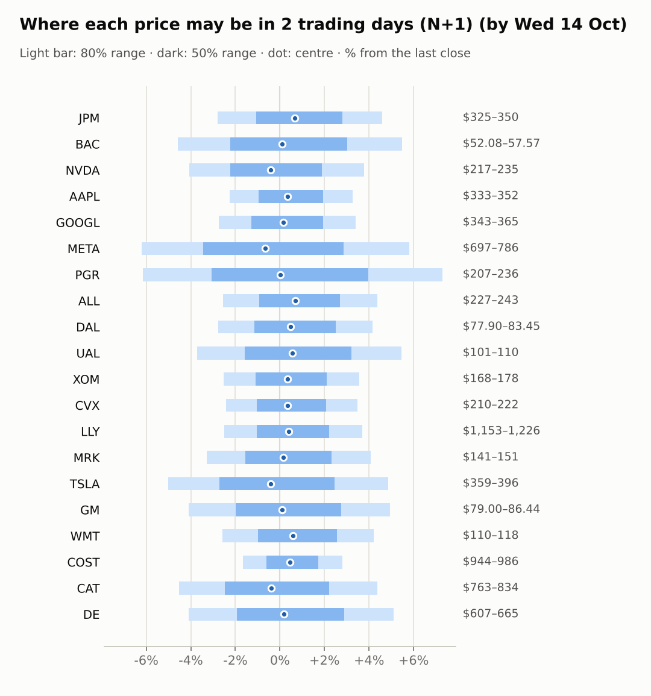
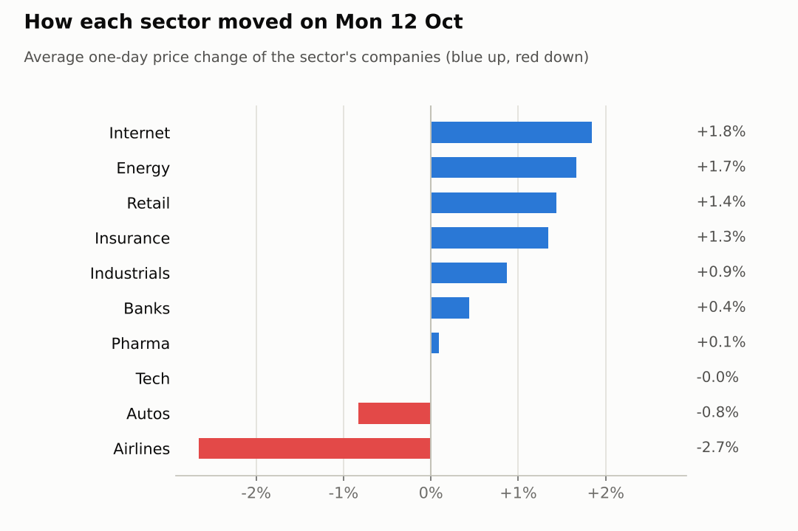
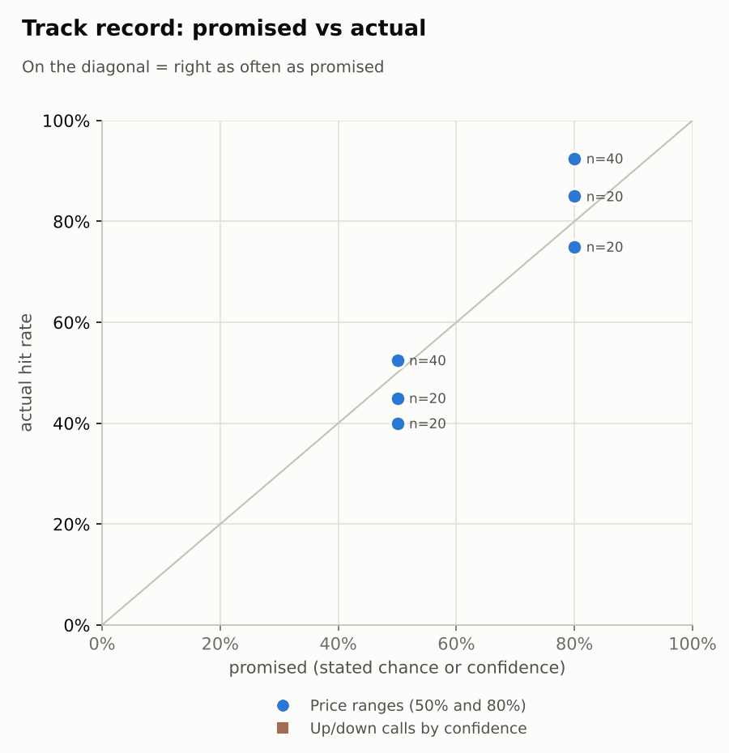

# Market brief: US (NYSE/Nasdaq), 2026-10-13

_Research log, not investment advice. Generated by a scheduled Claude Code routine._
<!-- report-data: as_of=2026-10-12 regime=EVENT_HEAVY outcome=6c9cd0c716b3 -->

Easy-to-read version with charts and filters: [2026-10-13.html](2026-10-13.html)

## Headline
No calls today: the signal model sits at its base rate for every company, and almost no fresh news is verified well enough to support a call. JPM reported its third quarter before the open (JPM +1.32% pre-market) and US CPI follows on 2026-10-14, so the regime is EVENT_HEAVY.

## Top 3 today
- JPM reported third-quarter results before the open; early reports speak of an earnings miss (6cd14baec9bf93ca, unverified), yet JPM was +1.32% pre-market. No call: earnings day and a news row that failed the collect gate.
- US CPI for September comes on 2026-10-14 with BAC and PGR results; the week-ahead piece (459a3dde80becee3) links it to oil swinging above $100, and Nasdaq 100 futures (NQ) were -0.7%.
- NVDA has the only corroborated story, SpaceX seeking chip financing (2401de35ebdcf08e, corroborated), but it is a week old; NVDA is down 5.27% over 5 sessions on China market-share reports (e2569af65fee1d73, single_source).

## Yesterday
Stocks were mixed on 2026-10-12: the S&P 500 ETF slipped 0.1% while 13 watchlist stocks rose and 7 fell. META led (+3.4%) on its Muse Wonder launch (e722046b4e67b54a, promotional); UAL was worst (-2.8%), with airlines weak after DAL's guidance cut (50dd317ffab73142, promotional).
The N+1 80% ranges held 20/20 (naive 19/20). The 50% ranges hit 11/20: COST, CVX, WMT, XOM, MRK and BAC closed above their 50% band as staples, energy and pharma kept rising, and NVDA, UAL and DE closed below it.

Market on 2026-10-12: S&P 500 ETF 778.10 (-0.1%) · VIX 15.21 (+2.5%) · watchlist 13 up / 7 down · best META +3.4%, worst UAL -2.8%

### Ranges scored (target date 2026-10-12)

N+1 ranges: **80% hit 20/20** (naive 19/20) · 50% hit 11/20

| Ticker | 80% range | 50% range | Actual | 80% | 50% | Naive 80% |
|---|---|---|---|---|---|---|
| AAPL | $330.21–$345.18 | $333.75–$341.50 | $340.97 | ✅ | ✅ | ✅ |
| ALL | $227.15–$240.47 | $230.29–$237.18 | $232.60 | ✅ | ✅ | ✅ |
| BAC | $52.54–$54.93 | $53.11–$54.35 | $54.58 | ✅ | ❌ | ✅ |
| CAT | $772.17–$832.80 | $786.36–$817.71 | $799.37 | ✅ | ✅ | ✅ |
| COST | $930.96–$964.85 | $939.01–$956.54 | $959.44 | ✅ | ❌ | ✅ |
| CVX | $206.17–$216.40 | $208.59–$213.88 | $215.00 | ✅ | ❌ | ✅ |
| DAL | $76.26–$86.97 | $78.71–$84.25 | $80.11 | ✅ | ✅ | ✅ |
| DE | $629.89–$670.99 | $639.55–$660.81 | $632.61 | ✅ | ❌ | ❌ |
| GM | $79.51–$85.81 | $80.98–$84.24 | $82.37 | ✅ | ✅ | ✅ |
| GOOGL | $341.25–$359.21 | $345.49–$354.78 | $352.72 | ✅ | ✅ | ✅ |
| JPM | $326.30–$338.05 | $329.09–$335.17 | $334.30 | ✅ | ✅ | ✅ |
| LLY | $1,139.36–$1,200.05 | $1,153.69–$1,185.08 | $1,182.62 | ✅ | ✅ | ✅ |
| META | $689.84–$760.92 | $706.33–$743.09 | $742.96 | ✅ | ✅ | ✅ |
| MRK | $138.40–$146.85 | $140.39–$144.76 | $145.45 | ✅ | ❌ | ✅ |
| NVDA | $225.13–$240.40 | $228.72–$236.62 | $226.32 | ✅ | ❌ | ✅ |
| PGR | $215.83–$226.92 | $218.45–$224.18 | $220.28 | ✅ | ✅ | ✅ |
| TSLA | $363.61–$394.46 | $370.81–$386.77 | $378.03 | ✅ | ✅ | ✅ |
| UAL | $103.31–$111.14 | $105.14–$109.19 | $104.44 | ✅ | ❌ | ✅ |
| WMT | $107.59–$113.71 | $109.03–$112.20 | $113.08 | ✅ | ❌ | ✅ |
| XOM | $164.15–$172.33 | $166.08–$170.31 | $172.15 | ✅ | ❌ | ✅ |

N+2 ranges that matured on the same date: 80% hit 15/20, 50% hit 8/20.

### Calls scored

_none_

## Today (2026-10-13)

**Regime: EVENT_HEAVY** · VIX 15.41 (+1.3%) · benchmark 5d +0.4% · benchmark 10d vol 7.0% · major events: US CPI (September)

| Ticker | Sector | Close | N+1 80% | N+1 50% | N+5 80% | Call | Cue | Notes |
|---|---|---|---|---|---|---|---|---|
| JPM | Banks | $334.30 | $324.98–$349.62 | $330.76–$343.66 | $319.39–$358.29 | no call | +1.32% | cue +1.32% x0.5; earnings in horizon (x2.24 day, 7 past moves, median 2.0%); earnings in horizon (x3.0 day); major event x1.15; regime EVENT_HEAVY x1.1 |
| BAC | Banks | $54.58 | $52.08–$57.57 | $53.36–$56.23 | $51.08–$59.23 | no call | +0.18% | cue +0.18% x0.5; earnings in horizon (x2.41 day, 7 past moves, median 1.9%); earnings in horizon (x3.0 day); major event x1.15; regime EVENT_HEAVY x1.1 |
| NVDA | Tech | $226.32 | $217.11–$234.87 | $221.27–$230.56 | $211.47–$243.37 | no call | -0.81% | cue -0.81% x0.5; major event x1.15; regime EVENT_HEAVY x1.1 |
| AAPL | Tech | $340.97 | $333.26–$352.10 | $337.71–$347.57 | $327.17–$360.97 | no call | +0.67% | cue +0.67% x0.5; major event x1.15; regime EVENT_HEAVY x1.1 |
| GOOGL | Internet | $352.72 | $343.09–$364.75 | $348.19–$359.53 | $336.12–$374.99 | no call | +0.29% | cue +0.29% x0.5; major event x1.15; regime EVENT_HEAVY x1.1 |
| META | Internet | $742.96 | $696.90–$786.15 | $717.45–$764.16 | $669.34–$830.17 | no call | -1.31% | cue -1.31% x0.5; major event x1.15; regime EVENT_HEAVY x1.1 |
| PGR | Insurance | $220.28 | $206.71–$236.37 | $213.50–$229.02 | $204.35–$241.24 | no call | +0.05% | cue +0.05% x0.5; earnings in horizon (x2.95 day, 7 past moves, median 2.2%); earnings in horizon (x3.0 day); major event x1.15; regime EVENT_HEAVY x1.1 |
| ALL | Insurance | $232.60 | $226.65–$242.79 | $230.44–$238.89 | $221.49–$250.46 | no call | +1.38% | cue +1.38% x0.5; major event x1.15; regime EVENT_HEAVY x1.1 |
| DAL | Airlines | $80.11 | $77.90–$83.45 | $79.20–$82.11 | $75.92–$85.86 | no call | +0.96% | cue +0.96% x0.5; ex-dividend 0.215 (0.27%); major event x1.15; regime EVENT_HEAVY x1.1 |
| UAL | Airlines | $104.44 | $100.56–$110.14 | $102.79–$107.80 | $93.82–$120.26 | no call | +1.10% | cue +1.10% x0.5; earnings in horizon (x3.0 day); major event x1.15; regime EVENT_HEAVY x1.1 |
| XOM | Energy | $172.15 | $167.82–$178.28 | $170.28–$175.76 | $164.45–$183.23 | no call | +0.67% | cue +0.67% x0.5; major event x1.15; regime EVENT_HEAVY x1.1 |
| CVX | Energy | $215.00 | $209.78–$222.50 | $212.78–$219.44 | $205.68–$228.50 | no call | +0.69% | cue +0.69% x0.5; major event x1.15; regime EVENT_HEAVY x1.1 |
| LLY | Pharma | $1,182.62 | $1,152.90–$1,226.31 | $1,170.19–$1,208.62 | $1,129.31–$1,261.02 | no call | +0.79% | cue +0.79% x0.5; major event x1.15; regime EVENT_HEAVY x1.1 |
| MRK | Pharma | $145.45 | $140.69–$151.39 | $143.20–$148.80 | $137.28–$156.49 | no call | +0.33% | cue +0.33% x0.5; major event x1.15; regime EVENT_HEAVY x1.1 |
| TSLA | Autos | $378.03 | $359.10–$396.41 | $367.76–$387.29 | $347.40–$414.54 | no call | -0.85% | cue -0.85% x0.5; major event x1.15; regime EVENT_HEAVY x1.1 |
| GM | Autos | $82.37 | $79.00–$86.44 | $80.73–$84.63 | $73.75–$94.31 | no call | +0.22% | cue +0.22% x0.5; earnings in horizon (x3.0 day); major event x1.15; regime EVENT_HEAVY x1.1 |
| WMT | Retail | $113.08 | $110.15–$117.84 | $111.96–$115.98 | $107.70–$121.48 | no call | +1.19% | cue +1.19% x0.5; major event x1.15; regime EVENT_HEAVY x1.1 |
| COST | Retail | $959.44 | $943.56–$986.24 | $953.68–$976.02 | $929.69–$1,006.16 | no call | +0.88% | cue +0.88% x0.5; major event x1.15; regime EVENT_HEAVY x1.1 |
| CAT | Industrials | $799.37 | $763.12–$834.29 | $779.70–$816.95 | $740.67–$868.61 | no call | -0.79% | cue -0.79% x0.5; major event x1.15; regime EVENT_HEAVY x1.1 |
| DE | Industrials | $632.61 | $606.76–$664.96 | $620.31–$650.77 | $588.43–$693.08 | no call | +0.38% | cue +0.38% x0.5; major event x1.15; regime EVENT_HEAVY x1.1 |

**Calls today: none.** The forecaster abstained on every company and horizon.
- JPM: abstain, data failed validation (one news row failed the collect gate) and results are out today (days_to_earnings 0).
- BAC, PGR: abstain, results on 2026-10-14 (days_to_earnings 1): no call allowed.
- NVDA: abstain; the only corroborated story (2401de35ebdcf08e, corroborated) is a week old and the fresher China-share news is mixed (e2569af65fee1d73, single_source).
- AAPL: abstain; the iPhone order-cut story is only a rumour (2bf2258148001271) and JPMorgan's rebuttal is unverified (f6f8bb827a21f21f, unverified).
- ALL, CAT, COST, CVX, DAL, DE, GM, GOOGL, LLY, META, MRK, TSLA, UAL, WMT, XOM: abstain; the model sits at its base rate and no news qualifies as main evidence.
Paper trades of the AI traders (simulated, never advice): the pattern-mood trader called DAL and DE up; the Sonnet combined trader followed the model on 17 companies; the news-results and Opus combined traders abstained on all.

### Overnight cues and global factors

| Symbol | Name | Last | Change |
|---|---|---|---|
| DAX | DAX | 25,338.28 | +0.24% |
| DXY | US dollar index | 102.28 | -0.29% |
| ES | S&P 500 futures | 7,851.75 | -0.08% |
| FTSE | FTSE 100 | 10,727.23 | +0.67% |
| GOLD | Gold | 4,209.80 | +0.46% |
| HANGSENG | Hang Seng | 24,345.22 | +0.30% |
| KOSPI | KOSPI | 6,035.35 | -5.46% |
| NIKKEI | Nikkei 225 | 67,821.90 | -1.75% |
| NQ | Nasdaq 100 futures | 30,681.75 | -0.70% |
| SPY | S&P 500 ETF | 777.85 | -0.03% |
| STOXX50 | Euro Stoxx 50 | 6,196.72 | -0.07% |
| US10Y | US 10-year yield | 5.24 | -0.08% |
| USDCNY | USD/CNY | 6.68 | -0.32% |
| USDJPY | USD/JPY | 158.11 | +0.03% |
| VIX | VIX | 15.41 | +1.31% |
| WTI | WTI crude | 92.09 | -1.76% |

## Tomorrow and this week

| Date | Event | Type |
|---|---|---|
| 2026-10-13 | JPMorgan earnings | company |
| 2026-10-14 | Bank of America earnings | company |
| 2026-10-14 | Progressive earnings | company |
| 2026-10-14 | US CPI (September) | major |
| 2026-10-15 | Delta Air Lines ex-dividend | company |
| 2026-10-16 | US monthly options expiry |  |
| 2026-10-20 | General Motors earnings | company |
| 2026-10-20 | United Airlines earnings | company |
| 2026-10-21 | Meta Platforms earnings | company |
| 2026-10-21 | Tesla earnings | company |
| 2026-10-28 | Alphabet earnings | company |
| 2026-10-28 | FOMC rate decision | major |
| 2026-10-29 | Caterpillar earnings | company |
| 2026-10-29 | Eli Lilly earnings | company |
| 2026-10-29 | Merck earnings | company |
| 2026-10-30 | Chevron earnings | company |
| 2026-10-30 | ExxonMobil earnings | company |
| 2026-11-02 | Apple earnings | company |

The key risk this week is US CPI on 2026-10-14, the same day BAC and PGR report; the regime stays EVENT_HEAVY until it passes. Overnight cues lean soft for tech: Nasdaq 100 futures (NQ) -0.7% and KOSPI -5.46%, while the FTSE was +0.67%. WTI crude fell 1.76% to 92.09, which matters for XOM, CVX and the airlines. The US 10-year yield was 5.24; BlackRock moved US stocks to neutral on high yields (5971ffd78a9bd30c). Monthly options expire on 2026-10-16, and GM and UAL report on 2026-10-20.

## By sector

### Banks

JPM reported before today's open; early headlines speak of an earnings miss (6cd14baec9bf93ca, unverified), yet JPM was +1.32% pre-market. BAC reports on 2026-10-14.
Bull: higher trading profits could offset the miss. Bear: BAC is down 8.22% over 20 sessions with RSI 34. No calls: both are inside their earnings windows.

### Tech

Apart: AAPL rose 1.29% while NVDA fell 1.29% on 2026-10-12, company news rather than a sector move.
Bull: AAPL is 7.69 points ahead of its peer over 5 days; NVDA's SpaceX financing story is corroborated (ab389b7d388dcec8, corroborated). Bear: NVDA is down 5.27% over 5 sessions on China share reports (e2569af65fee1d73, single_source); AAPL's order-cut story is only a rumour (2bf2258148001271).

### Internet

Apart: META rose 3.38% on its Muse Wonder launch (e722046b4e67b54a, promotional) while GOOGL edged up 0.3%.
Bull: META's 20-day gain is 11.62%. Bear: META was -1.31% pre-market and reports on 2026-10-21; GOOGL faces privacy scrutiny (d1a8c51a212427d0).

### Insurance

Together: ALL rose 1.38% and PGR 1.31%, in line with IAK (+1.06%).
Bull: ALL got a Wells Fargo upgrade (85292f6e9cb5cd10, unverified). Bear: ALL is still down 10.01% over 20 sessions. PGR reports on 2026-10-14 (no call).

### Airlines

Together: UAL fell 2.81% and DAL 2.51%, with JETS -1.57%, after DAL's guidance cut (50dd317ffab73142, promotional).
Bull: both are oversold (UAL RSI 38) and were up pre-market (UAL +1.1%). Bear: fuel costs; DAL goes ex-dividend on 2026-10-15 and UAL reports on 2026-10-20.

### Energy

Together: XOM rose 1.9% and CVX 1.42%, with XLE +4.03% over 5 sessions.
Bull: XOM sits at its 20-day high. Bear: XOM's RSI is 69 and WTI fell 1.76% overnight.

### Pharma

Mostly together: MRK is up 4.24% and LLY 3.46% over 5 sessions, with XLV +2.76%.
Bull: RBC expects LLY to raise its revenue outlook (043c510ad7063119, single_source). Bear: Jefferies cut its MRK eye-drug sales forecast (4c94aff2d1e1438b, promotional).

### Autos

Apart: GM is up 2.67% over 5 sessions while TSLA is down 0.18%.
Bull: Jefferies raised its TSLA target (05786a1661564da5, promotional). Bear: TSLA faces its biggest China recall (8666eb63ef2762c4, unverified); GM reports on 2026-10-20 and TSLA on 2026-10-21.

### Retail

Together: WMT is up 7.62% and COST 3.89% over 5 sessions, with XLP +4.16%.
Bull: COST reported September sales growth (998435a234ef1b53, unverified). Bear: both sit at their 20-day highs, and WMT drew an FDA warning (3bb06a291b51e168, promotional).

### Industrials

Mostly together: DE is down 7.27% and CAT 5.75% over 5 sessions; DE bounced 1.88% on 2026-10-12.
Bull: DE is oversold with RSI 38. Bear: Citi cut its CAT target (dfbdb831832d4265, promotional) and DE holds only a Hold rating (46e0eb87c75d9fd9, unverified).

## Track record

Ranges (targets 50% / 80%; width, score and centre error in % of price, lower is better; naive = last close ± recent typical move, no-change = last close as the centre):

| H | Window | n | 50% cover | 80% cover | Naive 80% | Width | Naive width | Score | Naive score | Centre err | No-change err |
|---|---|---|---|---|---|---|---|---|---|---|---|
| 1d | since start | 40 | 53% | 93% | 85% | 6.22 | 6.05 | 6.734 | 7.308 | 1.55 | 1.70 |
| 1d | last 30 days | 40 | 53% | 93% | 85% | 6.22 | 6.05 | 6.734 | 7.308 | 1.55 | 1.70 |
| 1d legacy_cc | since start | 20 | 45% | 85% | 85% | 4.09 | 4.18 | 7.414 | 7.632 | 1.45 | 1.39 |
| 1d legacy_cc | last 30 days | 20 | 45% | 85% | 85% | 4.09 | 4.18 | 7.414 | 7.632 | 1.45 | 1.39 |
| 2d | since start | 20 | 40% | 75% | 65% | 7.65 | 7.34 | 9.340 | 11.008 | 2.53 | 2.71 |
| 2d | last 30 days | 20 | 40% | 75% | 65% | 7.65 | 7.34 | 9.340 | 11.008 | 2.53 | 2.71 |

Ranges by regime (since start):

| H | Regime | n | 50% cover | 80% cover | Naive 80% |
|---|---|---|---|---|---|
| 1d | CALM | 20 | 55% | 100% | 95% |
| 1d | TRENDING | 20 | 50% | 85% | 75% |
| 1d legacy_cc | TRENDING | 20 | 45% | 85% | 85% |
| 2d | TRENDING | 20 | 40% | 75% | 65% |

Up/down calls vs the always-up baseline:

_none_

Calls by confidence band (a band should hit about as often as its confidence):

_none_

Weekly review 2026-W41: 0 proposed range changes for a human to decide (low sample) · [review-2026-W41.md](review-2026-W41.md)

## Data quality

- Indicators: 20 OK, partial: none, blocked: none
- Regime notes: none

| H | Calibration | History n | Live n | q10 / q90 |
|---|---|---|---|---|
| 1d | pool | 8860 | 40 | -1.12 / 1.23 |
| 2d | pool | 8840 | 20 | -1.14 / 1.31 |
| 3d | pool | 8820 | 0 | -1.12 / 1.30 |
| 4d | pool | 8800 | 0 | -1.12 / 1.30 |
| 5d | pool | 8780 | 0 | -1.10 / 1.33 |

- validation: collect, NEWS_SOURCE (blocking): 1 news row from a non-https link (f23aed932fed48d3, JPM Business Wire results release, scheme http); the row is never cited and JPM was abstained with "data failed validation" (one retry not possible: data is append-only).
- validation: features, context, news, forecast gates passed with no warnings.
- collect_events, collect_filings, collect_insiders, collect_stakes, collect_fundamentals warnings: SEC acceptance times of CIK 19617 not checked, stored as served (maybe 4-5h late): mixed file.
- collect_holdings warnings: SEC acceptance times of 13F filer CIKs 933478, 1167483, 1040273 and 1029160 not checked (no ACCEPTANCE-DATETIME in their oldest filing), stored as served.
- collect_flows_india: skipped (no india_flows section for the US). collect_articles: many material headlines came from unvetted outlets (listed in its summary), skipped and never requested.
- results digests: none due. Lessons: no settled calls without a lesson.
- news-analyst: the pending backlog was scored; watchlist items one by one, background items in themed groups.
- AI traders: news-results abstained 17 + earnings_window 3; pattern-mood abstained 15 + earnings_window 3 (6 predictions); Sonnet combined abstained 1 + earnings_window 3 (calls on 17 companies); Opus combined abstained 17 + earnings_window 3. lab pick: no head-to-head pick is cost-viable at the owner's cost.
- Judge FAIL from the previous run: 2026-10-12, spotcheck, round 1: reports of 2026-10-07 and 2026-10-08 called TSLA item cced5d4b933d5106 a rumour while its stored status was unverified, and two other status labels in 2026-10-07 were wrong; nothing dropped (already published).
- validation: report, REPORT_STATUS_UNCITED (warning): the two status words in the Judge FAIL line above quote the spot-check and carry no id after them.
- validation: report, UNMATCHED_NUMBER (first pass): run-summary counts in this section and in the daily summary had no source number the gate can see; removed, and the gate passed on the second pass.
