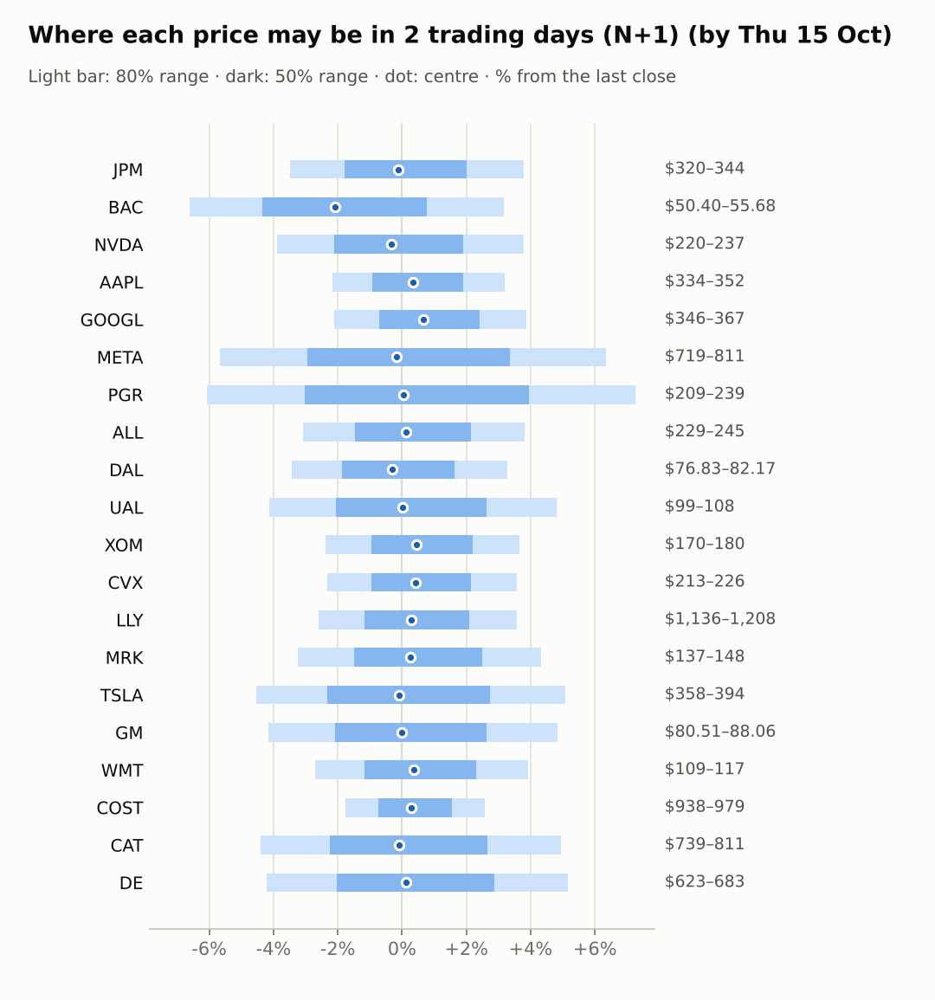
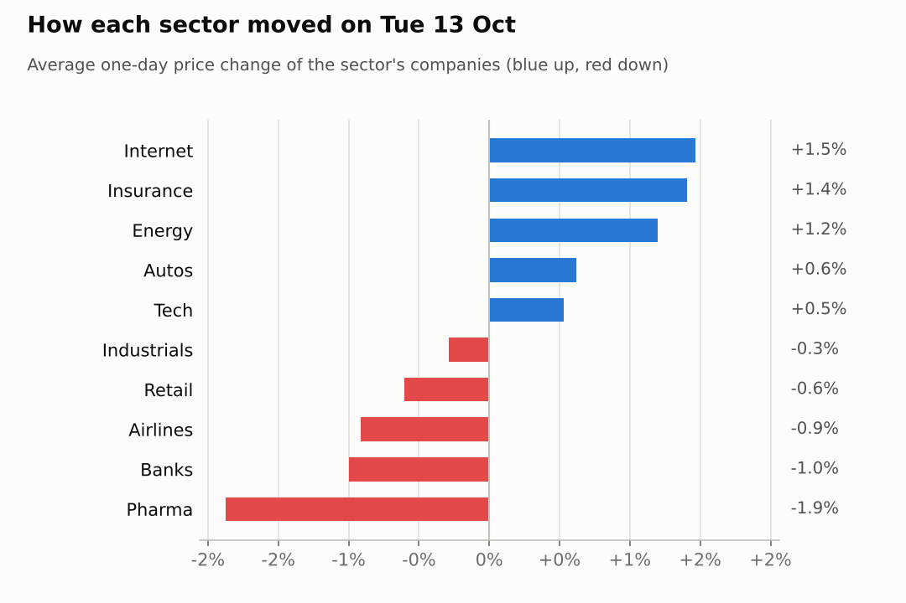
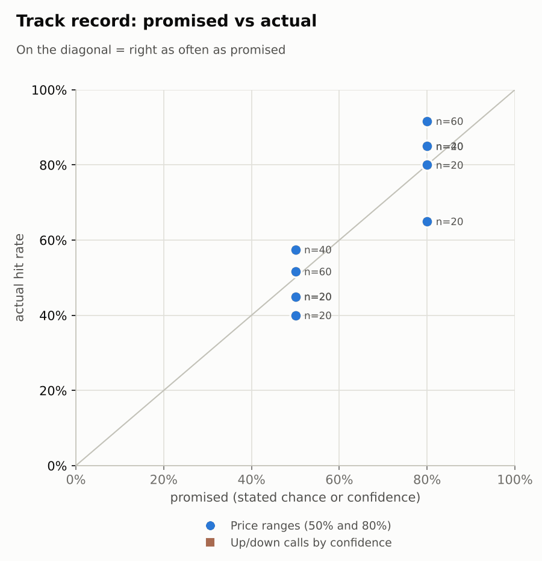

# Market brief: US (NYSE/Nasdaq), 2026-10-14

_Research log, not investment advice. Generated by a scheduled Claude Code routine._
<!-- report-data: as_of=2026-10-13 regime=EVENT_HEAVY outcome=695fa078534e -->

Easy-to-read version with charts and filters: [2026-10-14.html](2026-10-14.html)

## Headline
No calls today: September CPI comes out at 08:30 ET before the open, and the signal model sits at its base rate on every stock. BAC was -4.34% pre-market on its results day after a $1.2 billion fine (095cc8df62309ad2, corroborated).

## Top 3 today
- CPI day: the regime is EVENT_HEAVY and the US 10-year yield is 5.217, so ranges are widened and no call clears the evidence bar.
- BAC reports today and was -4.34% pre-market; the $1.2 billion money-laundering fine is corroborated (095cc8df62309ad2, 84b1170e7217b872).
- Oil keeps rising: WTI +1.89% to 95.92, with XOM and CVX at their 20-day highs and XLE up 5.41% over 5 sessions.

## Yesterday
The S&P 500 ETF was flat on 2026-10-13 and the watchlist split 10 up and 10 down. DE gained 2.75% and CAT fell 3.33%, after a 10.5% five-session drop; neither has verified news. Energy led (XLE +1.8%) and health care lagged (XLV -1.35%), with MRK -2.39%.
N+1 80% ranges hit 18 of 20. ALL closed above its range after a 1.63% rise and DE above its range after its bounce; both were company moves the ranges did not expect. The 5-day ranges were the weakest at 13 of 20.

Market on 2026-10-13: S&P 500 ETF 778.01 (-0.0%) · VIX 15.27 (+0.4%) · watchlist 10 up / 10 down · best DE +2.7%, worst CAT -3.3%

### Ranges scored (target date 2026-10-13)

N+1 ranges: **80% hit 18/20** (naive 16/20) · 50% hit 10/20

| Ticker | 80% range | 50% range | Actual | 80% | 50% | Naive 80% |
|---|---|---|---|---|---|---|
| AAPL | $329.29–$345.60 | $333.18–$341.63 | $341.27 | ✅ | ✅ | ✅ |
| ALL | $222.28–$236.24 | $225.59–$232.83 | $236.40 | ❌ | ❌ | ✅ |
| BAC | $53.17–$55.84 | $53.81–$55.19 | $53.96 | ✅ | ✅ | ✅ |
| CAT | $770.24–$834.98 | $785.48–$819.05 | $772.78 | ✅ | ❌ | ✅ |
| COST | $930.82–$966.99 | $939.48–$958.23 | $954.63 | ✅ | ✅ | ✅ |
| CVX | $207.79–$218.80 | $210.41–$216.12 | $217.73 | ✅ | ❌ | ✅ |
| DAL | $76.96–$88.53 | $79.63–$85.62 | $79.57 | ✅ | ❌ | ❌ |
| DE | $587.29–$636.88 | $598.96–$624.68 | $650.00 | ❌ | ❌ | ❌ |
| GM | $79.58–$86.34 | $81.17–$84.67 | $84.00 | ✅ | ✅ | ✅ |
| GOOGL | $342.29–$361.77 | $346.92–$357.02 | $353.78 | ✅ | ✅ | ✅ |
| JPM | $323.21–$345.20 | $328.42–$339.82 | $331.43 | ✅ | ✅ | ✅ |
| LLY | $1,149.29–$1,215.27 | $1,164.98–$1,199.19 | $1,166.51 | ✅ | ✅ | ✅ |
| META | $689.12–$765.08 | $706.84–$746.22 | $762.50 | ✅ | ❌ | ✅ |
| MRK | $141.02–$150.69 | $143.31–$148.33 | $141.98 | ✅ | ❌ | ✅ |
| NVDA | $221.56–$237.65 | $225.36–$233.70 | $228.52 | ✅ | ✅ | ✅ |
| PGR | $211.30–$222.96 | $214.07–$220.12 | $222.88 | ✅ | ❌ | ✅ |
| TSLA | $366.98–$401.04 | $374.97–$392.63 | $375.23 | ✅ | ✅ | ✅ |
| UAL | $103.22–$111.58 | $105.19–$109.53 | $103.23 | ✅ | ❌ | ❌ |
| WMT | $108.32–$114.94 | $109.89–$113.32 | $112.28 | ✅ | ✅ | ✅ |
| XOM | $165.47–$174.28 | $167.57–$172.13 | $174.08 | ✅ | ❌ | ❌ |

N+2 ranges that matured on the same date: 80% hit 19/20, 50% hit 15/20. N+3 ranges that matured on the same date: 80% hit 16/20, 50% hit 8/20. 5-day ranges that matured on the same date: 80% hit 13/20, 50% hit 9/20.

### Calls scored

_none_

## Today (2026-10-14)

**Regime: EVENT_HEAVY** · VIX 15.32 (+0.3%) · benchmark 5d -0.1% · benchmark 10d vol 6.8% · major events: US CPI (September)

Calls made before release: US CPI (September) at 08:30 ET.

| Ticker | Sector | Close | N+1 80% | N+1 50% | N+5 80% | Call | Cue | Notes |
|---|---|---|---|---|---|---|---|---|
| JPM | Banks | $331.43 | $319.89–$343.95 | $325.48–$338.10 | $320.03–$344.87 | no call | -0.22% | cue -0.22% x0.5; earnings in horizon (x2.24 day, 7 past moves, median 2.0%); major event x1.15; regime EVENT_HEAVY x1.1 |
| BAC | Banks | $53.96 | $50.40–$55.68 | $51.61–$54.38 | $49.37–$57.20 | no call | -4.34% | cue -4.34% x0.5; earnings in horizon (x2.41 day, 7 past moves, median 1.9%); earnings in horizon (x3.0 day); major event x1.15; regime EVENT_HEAVY x1.1 |
| NVDA | Tech | $228.52 | $219.62–$237.16 | $223.69–$232.89 | $213.99–$245.54 | no call | -0.67% | cue -0.67% x0.5; major event x1.15; regime EVENT_HEAVY x1.1 |
| AAPL | Tech | $341.27 | $333.87–$352.17 | $338.15–$347.75 | $327.91–$360.75 | no call | +0.67% | cue +0.67% x0.5; major event x1.15; regime EVENT_HEAVY x1.1 |
| GOOGL | Internet | $353.78 | $346.28–$367.49 | $351.23–$362.36 | $339.40–$377.49 | no call | +1.35% | cue +1.35% x0.5; major event x1.15; regime EVENT_HEAVY x1.1 |
| META | Internet | $762.50 | $719.23–$810.83 | $740.14–$788.17 | $656.17–$910.52 | no call | -0.33% | cue -0.33% x0.5; earnings in horizon (x3.0 day); major event x1.15; regime EVENT_HEAVY x1.1 |
| PGR | Insurance | $222.88 | $209.36–$239.09 | $216.11–$231.70 | $206.93–$243.92 | no call | +0.06% | cue +0.06% x0.5; earnings in horizon (x2.95 day, 7 past moves, median 2.2%); earnings in horizon (x3.0 day); major event x1.15; regime EVENT_HEAVY x1.1 |
| ALL | Insurance | $236.40 | $229.12–$245.42 | $232.91–$241.47 | $223.86–$253.16 | no call | +0.25% | cue +0.25% x0.5; major event x1.15; regime EVENT_HEAVY x1.1 |
| DAL | Airlines | $79.57 | $76.83–$82.17 | $78.08–$80.87 | $75.11–$84.70 | no call | -0.10% | cue -0.10% x0.5; ex-dividend 0.215 (0.27%); major event x1.15; regime EVENT_HEAVY x1.1 |
| UAL | Airlines | $103.23 | $98.98–$108.19 | $101.11–$105.94 | $92.46–$117.92 | no call | +0.02% | cue +0.02% x0.5; earnings in horizon (x3.0 day); major event x1.15; regime EVENT_HEAVY x1.1 |
| XOM | Energy | $174.08 | $169.96–$180.43 | $172.40–$177.90 | $166.56–$185.36 | no call | +0.87% | cue +0.87% x0.5; major event x1.15; regime EVENT_HEAVY x1.1 |
| CVX | Energy | $217.73 | $212.68–$225.51 | $215.68–$222.41 | $208.52–$231.55 | no call | +0.86% | cue +0.86% x0.5; major event x1.15; regime EVENT_HEAVY x1.1 |
| LLY | Pharma | $1,166.51 | $1,136.12–$1,208.20 | $1,152.95–$1,190.75 | $1,112.78–$1,242.21 | no call | +0.55% | cue +0.55% x0.5; major event x1.15; regime EVENT_HEAVY x1.1 |
| MRK | Pharma | $141.98 | $137.38–$148.12 | $139.87–$145.51 | $133.93–$153.25 | no call | +0.54% | cue +0.54% x0.5; major event x1.15; regime EVENT_HEAVY x1.1 |
| TSLA | Autos | $375.23 | $358.17–$394.33 | $366.50–$385.46 | $332.76–$432.77 | no call | -0.19% | cue -0.19% x0.5; earnings in horizon (x3.0 day); major event x1.15; regime EVENT_HEAVY x1.1 |
| GM | Autos | $84.00 | $80.51–$88.06 | $82.25–$86.21 | $75.17–$96.04 | no call | +0.00% | cue +0.00% x0.5; earnings in horizon (x3.0 day); major event x1.15; regime EVENT_HEAVY x1.1 |
| WMT | Retail | $112.28 | $109.24–$116.67 | $110.97–$114.87 | $106.84–$120.19 | no call | +0.75% | cue +0.75% x0.5; major event x1.15; regime EVENT_HEAVY x1.1 |
| COST | Retail | $954.63 | $937.87–$979.28 | $947.60–$969.32 | $924.29–$998.56 | no call | +0.55% | cue +0.55% x0.5; major event x1.15; regime EVENT_HEAVY x1.1 |
| CAT | Industrials | $772.78 | $738.78–$810.99 | $755.43–$793.30 | $715.89–$845.86 | no call | -0.17% | cue -0.17% x0.5; major event x1.15; regime EVENT_HEAVY x1.1 |
| DE | Industrials | $650.00 | $622.70–$683.48 | $636.71–$668.59 | $603.43–$712.82 | no call | +0.24% | cue +0.24% x0.5; major event x1.15; regime EVENT_HEAVY x1.1 |

**Calls:** none.

**Abstentions** (all horizons):
- BAC, PGR: hard block, results today (days_to_earnings 0).
- NVDA: the corroborated SpaceX chip-financing story (2401de35ebdcf08e, corroborated) dates from 2026-10-06, already backs the two open 5-day up calls and has not lifted the price; the model is below its base rate.
- MRK: the only confirmed event, a board appointment (0000310158-26-000237), says nothing about direction.
- AAPL: the model is only about 0.4 points above its base rate at N+5; the order-cut reports are not verified and cannot be cited.
- JPM: the results news is mixed (a miss, a higher interest-income outlook, smaller buybacks) and not verified yet.
- META, TSLA, GM, UAL: results on 2026-10-20 or 2026-10-21 fall inside the N+5 window, with no verified catalyst.
- DAL: no edge, and the ex-dividend date of 2026-10-15 falls in the window.
- XOM, CVX: the oil move is macro, not company news, and both sit at their 20-day highs.
- CAT, DE, ALL, COST, GOOGL, LLY, WMT: the model is at its base rate and there is no verified news.

AI traders (paper only): the pattern-mood trader made up calls on XOM, CVX, GOOGL, AAPL, WMT, COST and CAT at N+1, N+3 and N+5; the Sonnet combined trader followed the model with up calls on every company except BAC and PGR; the news-results and Opus combined traders abstained on all.

### Overnight cues and global factors

| Symbol | Name | Last | Change |
|---|---|---|---|
| DAX | DAX | 25,422.71 | +0.64% |
| DXY | US dollar index | 102.23 | +0.05% |
| ES | S&P 500 futures | 7,869.50 | +0.18% |
| FTSE | FTSE 100 | 10,683.69 | +0.31% |
| GOLD | Gold | 4,162.50 | -0.35% |
| HANGSENG | Hang Seng | 24,314.17 | -0.13% |
| KOSPI | KOSPI | 6,008.81 | -0.44% |
| NIKKEI | Nikkei 225 | 67,862.92 | +0.13% |
| NQ | Nasdaq 100 futures | 30,761.50 | -0.10% |
| SPY | S&P 500 ETF | 779.22 | +0.16% |
| STOXX50 | Euro Stoxx 50 | 6,202.93 | +0.58% |
| US10Y | US 10-year yield | 5.22 | -0.44% |
| USDCNY | USD/CNY | 6.68 | -0.15% |
| USDJPY | USD/JPY | 158.45 | -0.05% |
| VIX | VIX | 15.32 | +0.33% |
| WTI | WTI crude | 95.92 | +1.89% |

## Tomorrow and this week

| Date | Event | Type |
|---|---|---|
| 2026-10-13 | JPMorgan earnings | company |
| 2026-10-14 | Bank of America earnings | company |
| 2026-10-14 | Progressive earnings | company |
| 2026-10-14 | US CPI (September) | major |
| 2026-10-15 | Delta Air Lines ex-dividend | company |
| 2026-10-16 | US monthly options expiry |  |
| 2026-10-20 | General Motors earnings | company |
| 2026-10-20 | United Airlines earnings | company |
| 2026-10-21 | Meta Platforms earnings | company |
| 2026-10-21 | Tesla earnings | company |
| 2026-10-28 | Alphabet earnings | company |
| 2026-10-28 | FOMC rate decision | major |
| 2026-10-29 | Caterpillar earnings | company |
| 2026-10-29 | Eli Lilly earnings | company |
| 2026-10-29 | Merck earnings | company |
| 2026-10-30 | Chevron earnings | company |
| 2026-10-30 | ExxonMobil earnings | company |
| 2026-11-02 | Apple earnings | company |

The main risk is today's CPI print: a hot number would push the US 10-year yield (US10Y 5.217) higher, and Fed speakers already lean towards one more hike. Bank results continue (BAC and PGR today), monthly options expire on 2026-10-16, and GM, UAL, META and TSLA report on 2026-10-20 and 2026-10-21. Oil (WTI 95.92) is a tailwind for XOM and CVX and a headwind for DAL and UAL. The FOMC decision is on 2026-10-28.

## By sector

### Banks

BAC reports today and was -4.34% pre-market. The $1.2 billion fine is corroborated (095cc8df62309ad2). JPM was -0.22% pre-market after its third-quarter miss (4ab1e3f768900753, unverified), so the two moved apart on company news.
Bull: BAC is oversold (RSI 31, -9.34% over 20 sessions) and JPM raised its interest-income outlook (b91a0811904766db, promotional).
Bear: the fine and BAC's results miss hit sentiment, and JPM cut buybacks (e644d26440c3d3c6, promotional).

### Tech

AAPL was +0.67% pre-market and NVDA -0.67%, so they moved apart. AAPL is 6.77 points ahead of its sector over 5 sessions; NVDA is down 4.48%.
Bull: AAPL's model P(up) at N+5 is the highest on the board, and NVDA's SpaceX financing story is corroborated (ab389b7d388dcec8).
Bear: AAPL faces iPhone order-cut reports, and NVDA's China share-loss reports are not verified.

### Internet

GOOGL was +1.35% pre-market and META -0.33%. META rose 2.63% on 2026-10-13 and is up 13.77% over 20 sessions.
Bull: META's target raise to $1,000 (36f4ad9bae39153b, promotional) and GOOGL's positive pre-market.
Bear: META reports on 2026-10-21, inside the N+5 window, with RSI 66 after a big run.

### Insurance

PGR reports today; ALL rose 1.63% on 2026-10-13 and closed above its 80% range. IAK is up 2.83% over 5 sessions, so both moved with the sector.
Bull: ALL bounced 5.41% over 5 sessions and PGR sits at its 20-day high.
Bear: ALL is still down 8.09% over 20 sessions; PGR's results today are a coin flip.

### Airlines

DAL fell 0.67% and UAL 1.16% on 2026-10-13, both with the sector: JETS is down 4.63% over 5 sessions as oil rises.
Bull: UAL is oversold (RSI 36, -7.72% over 5 sessions).
Bear: oil (WTI 95.92) is rising, DAL goes ex-dividend on 2026-10-15, and UAL reports on 2026-10-20.

### Energy

XOM rose 1.12% and CVX 1.27% on 2026-10-13, together with oil: XLE is up 5.41% over 5 sessions and WTI rose 1.89% to 95.92 overnight.
Bull: XOM was +0.87% and CVX +0.86% pre-market, with momentum behind them.
Bear: XOM's RSI is 72 and both sit at their 20-day highs; a fall in oil would reverse the move quickly.

### Pharma

LLY fell 1.36% and MRK 2.39% on 2026-10-13 with the sector (XLV -1.35%); both were about +0.55% pre-market.
Bull: MRK's board appointment is confirmed (0000310158-26-000237) and both bounced pre-market.
Bear: the EU approved Novo's oral Wegovy, a competitor to LLY (e5801dae33fcdcd4, unverified).

### Autos

GM rose 1.98% on 2026-10-13 and TSLA fell 0.74%, so they moved apart on company news.
Bull: Wedbush puts the odds of a Tesla-SpaceX merger above 80% (fa3204003dbfe68b, unverified).
Bear: GM reports on 2026-10-20 and TSLA on 2026-10-21; options price a 5.4% move for GM's results day (241faab14147a387, unverified).

### Retail

WMT was +0.75% and COST +0.55% pre-market. XLP is up 2.92% over 5 sessions, so both moved with the sector.
Bull: WMT is up 4.74% over 5 sessions and COST has RSI 64 with low volatility.
Bear: both runs look stretched on thin volume (COST 0.62x average).

### Industrials

CAT fell 3.33% on 2026-10-13 and is down 10.5% over 5 sessions, while DE bounced 2.75%. They moved apart; neither has verified news.
Bull: CAT is oversold (RSI 38) and DE closed above its 80% range.
Bear: higher yields hurt machinery demand, and CAT's target was cut (41d60600e8f35aa4, promotional).

## Track record

Ranges (targets 50% / 80%; width, score and centre error in % of price, lower is better; naive = last close ± recent typical move, no-change = last close as the centre):

| H | Window | n | 50% cover | 80% cover | Naive 80% | Width | Naive width | Score | Naive score | Centre err | No-change err |
|---|---|---|---|---|---|---|---|---|---|---|---|
| 1d | since start | 60 | 52% | 92% | 83% | 6.45 | 6.07 | 7.159 | 7.234 | 1.79 | 1.88 |
| 1d | last 30 days | 60 | 52% | 92% | 83% | 6.45 | 6.07 | 7.159 | 7.234 | 1.79 | 1.88 |
| 1d legacy_cc | since start | 20 | 45% | 85% | 85% | 4.09 | 4.18 | 7.414 | 7.632 | 1.45 | 1.39 |
| 1d legacy_cc | last 30 days | 20 | 45% | 85% | 85% | 4.09 | 4.18 | 7.414 | 7.632 | 1.45 | 1.39 |
| 2d | since start | 40 | 58% | 85% | 83% | 7.77 | 7.40 | 8.698 | 9.238 | 2.10 | 2.23 |
| 2d | last 30 days | 40 | 58% | 85% | 83% | 7.77 | 7.40 | 8.698 | 9.238 | 2.10 | 2.23 |
| 3d | since start | 20 | 40% | 80% | 65% | 8.88 | 8.48 | 11.448 | 12.667 | 2.92 | 3.18 |
| 3d | last 30 days | 20 | 40% | 80% | 65% | 8.88 | 8.48 | 11.448 | 12.667 | 2.92 | 3.18 |
| 5d legacy_cc | since start | 20 | 45% | 65% | 50% | 9.91 | 9.35 | 17.346 | 16.489 | 3.60 | 3.63 |
| 5d legacy_cc | last 30 days | 20 | 45% | 65% | 50% | 9.91 | 9.35 | 17.346 | 16.489 | 3.60 | 3.63 |

Ranges by regime (since start):

| H | Regime | n | 50% cover | 80% cover | Naive 80% |
|---|---|---|---|---|---|
| 1d | CALM | 20 | 55% | 100% | 95% |
| 1d | EVENT_HEAVY | 20 | 50% | 90% | 80% |
| 1d | TRENDING | 20 | 50% | 85% | 75% |
| 1d legacy_cc | TRENDING | 20 | 45% | 85% | 85% |
| 2d | CALM | 20 | 75% | 95% | 100% |
| 2d | TRENDING | 20 | 40% | 75% | 65% |
| 3d | TRENDING | 20 | 40% | 80% | 65% |
| 5d legacy_cc | TRENDING | 20 | 45% | 65% | 50% |

Up/down calls vs the always-up baseline:

_none_

Calls by confidence band (a band should hit about as often as its confidence):

_none_

Weekly review 2026-W41: 0 proposed range changes for a human to decide (low sample) · [review-2026-W41.md](review-2026-W41.md)

## Data quality

- Indicators: 20 OK, partial: none, blocked: none
- Regime notes: none

| H | Calibration | History n | Live n | q10 / q90 |
|---|---|---|---|---|
| 1d | pool | 8880 | 60 | -1.12 / 1.24 |
| 2d | pool | 8860 | 40 | -1.14 / 1.30 |
| 3d | pool | 8840 | 20 | -1.12 / 1.31 |
| 4d | pool | 8820 | 0 | -1.13 / 1.31 |
| 5d | pool | 8800 | 0 | -1.10 / 1.33 |

- Collectors: all ran. SEC acceptance times could not be checked (stored as served, maybe 4-5h late) for company CIKs 19617 and 70858 (filings, insiders, stakes, fundamentals, events) and 13F filer CIKs 933478, 2012383, 93751, 1167483, 1040273 and 1029160 (holdings).
- Cboe put/call and FINRA short-sale files for 2026-10-14 are not published yet (HTTP 403 before the close); a note, not a failure.
- Results digests: none detected in the last 10 days (detected 0).
- Articles: 17 unvetted domains skipped (e.g. marketbeat.com 9, ad-hoc-news.de 8), never requested.
- Claims: 32 claim records stored for 11 of 15 selected events; one number removed on the first validate (gate exit 1, passed on retry).
- validation: collect, features, context and forecast gates passed with no failures or warnings.
- validation: news stage warning ENRICH_TEMPLATED: most watchlist records share a summary with another record (same-event headlines); nothing dropped.
- AI traders: ai.news_results.sonnet.v1 abstained 18, earnings_window 2; ai.pattern_mood.sonnet.v1 abstained 11, earnings_window 2; ai.combined.sonnet.v1 earnings_window 2; ai.combined.opus.v1 abstained 18, earnings_window 2. No gate errors or timeouts.
- Lab: 72 head-to-head picks, none cost-viable at the owner's cost.
- Judge FAIL, 2026-10-12, spotcheck round 1: report 2026-10-07 (and 2026-10-08) used a wrong news status word for TSLA item cced5d4b933d5106, and two other status labels in the 2026-10-07 report were also wrong; nothing dropped.
