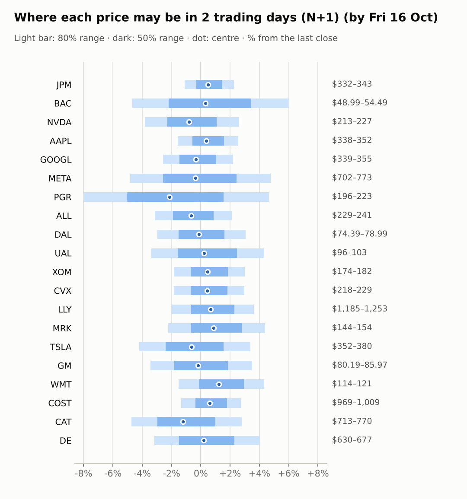
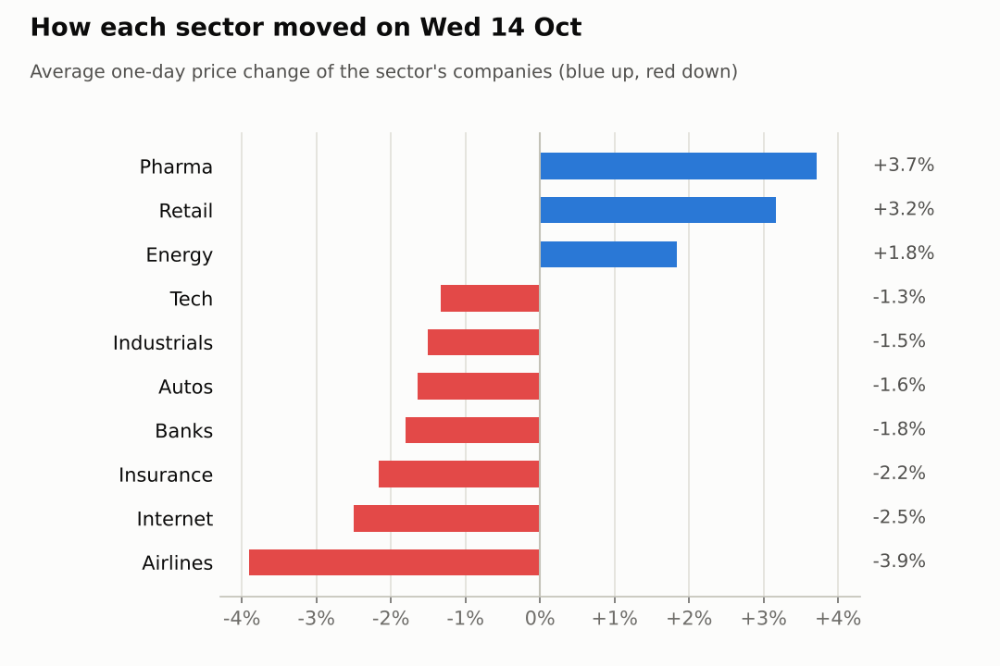
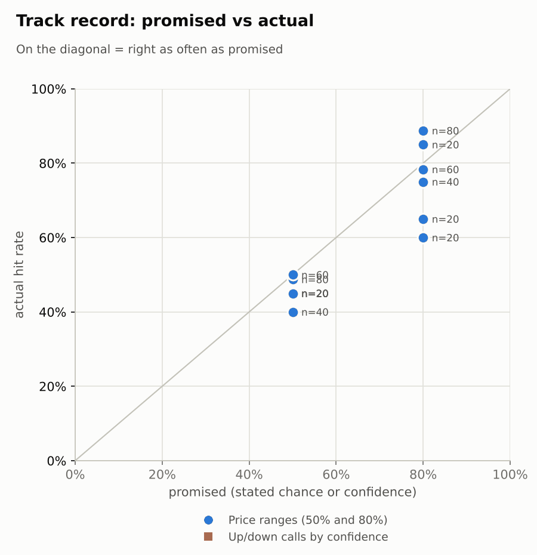

# Market brief: US (NYSE/Nasdaq), 2026-10-15

_Research log, not investment advice. Generated by a scheduled Claude Code routine._
<!-- report-data: as_of=2026-10-14 regime=CALM outcome=695fa078534e -->

Easy-to-read version with charts and filters: [2026-10-15.html](2026-10-15.html)

## Headline
Asia sold off overnight (KOSPI -7.57%, Nikkei -4.81%) and Nasdaq 100 futures are -1.01%, after a hot CPI day that hit tech and lifted defensives. No call clears the evidence bar today: every stock is no call, with ranges published for all 20.

## Top 3 today
- Risk-off open: KOSPI -7.57%, Nikkei -4.81%, Nasdaq 100 futures -1.01% and the VIX at 17.42; tech (XLK -2.98% yesterday) is the weak spot, with NVDA -1.59% pre-market.
- BAC fell 4.76% on 2.76x volume after results and its $1.2 billion money-laundering fine, which is corroborated (095cc8df62309ad2, 84b1170e7217b872); RSI is 23 and the stock was +0.6% pre-market.
- Defensives keep the bid: WMT is +3.03% pre-market after +3.46% yesterday, and COST is at its 20-day high (RSI 72) with its $1.47 dividend confirmed_primary (4c74af6c88ea4228).

## Yesterday
The S&P 500 ETF fell 1.1% on 2026-10-14 and the VIX rose 10.5% on a hot September CPI print. The watchlist split 9 up / 11 down. Money rotated from tech into defensives: XLV rose 2.53% and XLP 2.22%, while XLK fell 2.98%.
- Up: MRK (+3.8%), LLY (+3.62%), WMT (+3.46%) and COST (+2.87%).
- Down: BAC fell most, -4.76%, on results and its fine (095cc8df62309ad2). PGR fell 4.23% after results. UAL fell 4.14% and DAL 3.67%.

N+1 80% ranges hit 16 of 20. The four misses were all below the range: BAC, CAT, DAL and UAL, the day's big sellers. On the upside, COST, CVX and WMT closed near or above the top of their 50% ranges, so the ranges lagged the rotation.

Market on 2026-10-14: S&P 500 ETF 769.60 (-1.1%) · VIX 16.87 (+10.5%) · watchlist 9 up / 11 down · best MRK +3.8%, worst BAC -4.8%

### Ranges scored (target date 2026-10-14)

N+1 ranges: **80% hit 16/20** (naive 12/20) · 50% hit 8/20

| Ticker | 80% range | 50% range | Actual | 80% | 50% | Naive 80% |
|---|---|---|---|---|---|---|
| AAPL | $333.26–$352.10 | $337.71–$347.57 | $342.96 | ✅ | ✅ | ✅ |
| ALL | $226.65–$242.79 | $230.44–$238.89 | $236.17 | ✅ | ✅ | ✅ |
| BAC | $52.08–$57.57 | $53.36–$56.23 | $51.39 | ❌ | ❌ | ❌ |
| CAT | $763.12–$834.29 | $779.70–$816.95 | $748.98 | ❌ | ❌ | ❌ |
| COST | $943.56–$986.24 | $953.68–$976.02 | $982.00 | ✅ | ❌ | ❌ |
| CVX | $209.78–$222.50 | $212.78–$219.44 | $222.04 | ✅ | ❌ | ❌ |
| DAL | $77.90–$83.45 | $79.20–$82.11 | $76.65 | ❌ | ❌ | ❌ |
| DE | $606.76–$664.96 | $620.31–$650.77 | $650.38 | ✅ | ✅ | ✅ |
| GM | $79.00–$86.44 | $80.73–$84.63 | $83.05 | ✅ | ✅ | ✅ |
| GOOGL | $343.09–$364.75 | $348.19–$359.53 | $347.64 | ✅ | ❌ | ✅ |
| JPM | $324.98–$349.62 | $330.76–$343.66 | $335.28 | ✅ | ✅ | ✅ |
| LLY | $1,152.90–$1,226.31 | $1,170.19–$1,208.62 | $1,208.74 | ✅ | ❌ | ✅ |
| META | $696.90–$786.15 | $717.45–$764.16 | $737.54 | ✅ | ✅ | ✅ |
| MRK | $140.69–$151.39 | $143.20–$148.80 | $147.37 | ✅ | ✅ | ✅ |
| NVDA | $217.11–$234.87 | $221.27–$230.56 | $221.30 | ✅ | ✅ | ✅ |
| PGR | $206.71–$236.37 | $213.50–$229.02 | $213.46 | ✅ | ❌ | ❌ |
| TSLA | $359.10–$396.41 | $367.76–$387.29 | $367.16 | ✅ | ❌ | ✅ |
| UAL | $100.56–$110.14 | $102.79–$107.80 | $98.96 | ❌ | ❌ | ❌ |
| WMT | $110.15–$117.84 | $111.96–$115.98 | $116.16 | ✅ | ❌ | ❌ |
| XOM | $167.82–$178.28 | $170.28–$175.76 | $177.01 | ✅ | ❌ | ✅ |

N+2 ranges that matured on the same date: 80% hit 13/20, 50% hit 7/20. N+3 ranges that matured on the same date: 80% hit 14/20, 50% hit 8/20. N+4 ranges that matured on the same date: 80% hit 12/20, 50% hit 9/20.

### Calls scored

_none_

## Today (2026-10-15)

**Regime: CALM** · VIX 17.42 (+3.3%) · benchmark 5d -1.0% · benchmark 10d vol 9.2%

| Ticker | Sector | Close | N+1 80% | N+1 50% | N+5 80% | Call | Cue | Notes |
|---|---|---|---|---|---|---|---|---|
| JPM | Banks | $335.28 | $331.57–$342.87 | $334.28–$340.20 | $327.87–$348.13 | no call | +0.98% | cue +0.98% x0.5 |
| BAC | Banks | $51.39 | $48.99–$54.49 | $50.27–$53.15 | $49.19–$54.53 | no call | +0.60% | cue +0.60% x0.5; earnings in horizon (x2.41 day, 7 past moves, median 1.9%) |
| NVDA | Tech | $221.30 | $212.84–$227.07 | $216.21–$223.68 | $208.28–$233.84 | no call | -1.59% | cue -1.59% x0.5 |
| AAPL | Tech | $342.96 | $337.56–$351.77 | $340.96–$348.41 | $332.93–$358.42 | no call | +0.77% | cue +0.77% x0.5 |
| GOOGL | Internet | $347.64 | $338.65–$355.28 | $342.61–$351.33 | $333.26–$363.10 | no call | -0.65% | cue -0.65% x0.5 |
| META | Internet | $737.54 | $701.88–$772.72 | $718.44–$755.60 | $652.15–$848.17 | no call | -0.71% | cue -0.71% x0.5; earnings in horizon (x3.0 day) |
| PGR | Insurance | $213.46 | $196.45–$223.39 | $202.67–$216.80 | $199.28–$221.18 | no call | -4.23% | cue -4.23% x0.5; earnings in horizon (x2.95 day, 7 past moves, median 2.2%) |
| ALL | Insurance | $236.17 | $228.76–$241.18 | $231.71–$238.23 | $224.74–$247.05 | no call | -1.31% | cue -1.31% x0.5 |
| DAL | Airlines | $76.65 | $74.39–$78.99 | $75.48–$77.89 | $72.91–$81.17 | no call | +0.31% | cue +0.31% x0.5; ex-dividend 0.215 (0.28%) |
| UAL | Airlines | $98.96 | $95.61–$103.23 | $97.40–$101.40 | $90.16–$111.20 | no call | +0.44% | cue +0.44% x0.5; earnings in horizon (x3.0 day) |
| XOM | Energy | $177.01 | $173.77–$182.31 | $175.81–$180.28 | $171.00–$186.33 | no call | +0.90% | cue +0.90% x0.5 |
| CVX | Energy | $222.04 | $217.95–$228.63 | $220.50–$226.09 | $214.49–$233.65 | no call | +0.86% | cue +0.86% x0.5 |
| LLY | Pharma | $1,208.74 | $1,184.83–$1,252.53 | $1,200.91–$1,236.42 | $1,162.97–$1,284.54 | no call | +1.33% | cue +1.33% x0.5 |
| MRK | Pharma | $147.37 | $144.08–$153.83 | $146.39–$151.50 | $140.95–$158.48 | no call | +1.76% | cue +1.76% x0.5 |
| TSLA | Autos | $367.16 | $351.78–$379.58 | $358.33–$372.91 | $331.91–$408.62 | no call | -1.28% | cue -1.28% x0.5; earnings in horizon (x3.0 day) |
| GM | Autos | $83.05 | $80.19–$85.97 | $81.55–$84.58 | $76.03–$91.96 | no call | -0.36% | cue -0.36% x0.5; earnings in horizon (x3.0 day) |
| WMT | Retail | $116.16 | $114.38–$121.18 | $116.00–$119.56 | $112.50–$124.74 | no call | +3.03% | cue +3.03% x0.5 |
| COST | Retail | $982.00 | $968.90–$1,008.95 | $978.47–$999.47 | $955.83–$1,027.68 | no call | +1.19% | cue +1.19% x0.5 |
| CAT | Industrials | $748.98 | $713.47–$769.94 | $726.78–$756.40 | $693.98–$795.30 | no call | -2.40% | cue -2.40% x0.5; ex-dividend 1.63 (0.22%) |
| DE | Industrials | $650.38 | $629.75–$676.51 | $640.79–$665.31 | $614.81–$698.88 | no call | +0.40% | cue +0.40% x0.5 |

No calls today. The forecaster abstained on every ticker and horizon:
- AAPL, ALL, CVX, DE, GOOGL, JPM, LLY, MRK, NVDA and XOM: the signal model's P(up) sits at its base rate, and none of their news events is verified well enough to be main evidence.
- BAC: the fine is corroborated (095cc8df62309ad2), but it is already in the price (RSI 23, -4.76% yesterday). P(up) at N+1 is 0.4766, close to a coin flip.
- COST: the only confirmed_primary event is a routine $1.47 dividend (4c74af6c88ea4228), which carries no direction.
- GM and UAL report on 2026-10-20, and META and TSLA on 2026-10-21. Both dates fall inside the N+5 window.
- CAT, DAL, PGR and WMT: no verified news explains their moves, and the moves are already in the close.

AI traders (paper only):
- The pattern-mood trader made 6 up calls at N+3 and N+5 on oversold BAC, DAL and UAL.
- The Sonnet combined trader followed the model with 54 calls, BAC down.
- The news-results and Opus combined traders abstained on all.

### Overnight cues and global factors

| Symbol | Name | Last | Change |
|---|---|---|---|
| DAX | DAX | 25,193.92 | -0.41% |
| DXY | US dollar index | 102.04 | -0.50% |
| ES | S&P 500 futures | 7,754.75 | -0.20% |
| FTSE | FTSE 100 | 10,804.12 | +0.74% |
| GOLD | Gold | 4,177.60 | +1.70% |
| HANGSENG | Hang Seng | 24,062.72 | -1.03% |
| KOSPI | KOSPI | 5,554.22 | -7.57% |
| NIKKEI | Nikkei 225 | 64,485.02 | -4.81% |
| NQ | Nasdaq 100 futures | 29,876.75 | -1.01% |
| SPY | S&P 500 ETF | 768.11 | -0.19% |
| STOXX50 | Euro Stoxx 50 | 6,143.95 | -0.75% |
| US10Y | US 10-year yield | 5.19 | -0.52% |
| USDCNY | USD/CNY | 6.68 | -0.16% |
| USDJPY | USD/JPY | 157.93 | -0.25% |
| VIX | VIX | 17.42 | +3.26% |
| WTI | WTI crude | 93.93 | -1.22% |

## Tomorrow and this week

| Date | Event | Type |
|---|---|---|
| 2026-10-14 | Bank of America earnings | company |
| 2026-10-14 | Progressive earnings | company |
| 2026-10-15 | Delta Air Lines ex-dividend | company |
| 2026-10-16 | US monthly options expiry |  |
| 2026-10-19 | Caterpillar ex-dividend (est. 1.63, last dividend) | company |
| 2026-10-20 | General Motors earnings | company |
| 2026-10-20 | United Airlines earnings | company |
| 2026-10-21 | Meta Platforms earnings | company |
| 2026-10-21 | Tesla earnings | company |
| 2026-10-28 | Alphabet earnings | company |
| 2026-10-28 | FOMC rate decision | major |
| 2026-10-29 | Caterpillar earnings | company |
| 2026-10-29 | Eli Lilly earnings | company |
| 2026-10-29 | Merck earnings | company |
| 2026-10-30 | Chevron earnings | company |
| 2026-10-30 | ExxonMobil earnings | company |
| 2026-11-02 | Apple earnings | company |
| 2026-11-04 | Allstate earnings | company |

Key risks this week:
- The overnight Asian sell-off and weak Nasdaq futures point to a soft open for tech.
- Monthly options expiry on 2026-10-16 can add noise.
- Earnings begin to land on the watchlist: GM and UAL on 2026-10-20, META and TSLA on 2026-10-21.
- The FOMC decision on 2026-10-28 follows a hot CPI, with the US 10-year yield at 5.19.
- Oil (WTI 93.93, -1.22%) is a swing factor for XOM and CVX.

The regime is CALM, but the VIX is rising (17.42, +3.26%).

## By sector

### Banks

BAC fell 4.76% and JPM rose 1.16%: they moved apart on company news.
- BAC: results plus its $1.2 billion fine, which is corroborated (095cc8df62309ad2). Bull: RSI 23 and +0.6% pre-market point to a bounce. Bear: the fine and 2.76x volume can mean the selling is not over.
- JPM: bounced and is +0.98% pre-market. Bull: the bounce held. Bear: its results headlines are not verified.

### Tech

Both names fell with the sector (XLK -2.98%), a sector move.
- NVDA: fell 3.16% and is -1.59% pre-market. Bull: RSI 44 after -6.81% in 5 days. Bear: Nasdaq futures are -1.01%, and NVDA's beta of 1.89 amplifies market moves.
- AAPL: held up better (+0.5%, +0.77% pre-market). Bull: it leads its peer by 8.68 points over 5 days. Bear: the iPhone order-cut story has rumour status (27ebfefafa61b060).

### Internet

META fell 3.27% and GOOGL 1.74% as XLC fell 1.3%: a sector move.
- META: Bull: up 9.54% over 20 sessions. Bear: earnings on 2026-10-21 and a downgrade headline.
- GOOGL: Bull: RSI 51, a neutral setup. Bear: -0.65% pre-market, with earnings on 2026-10-28.

### Insurance

They moved apart on company news: PGR fell 4.23% after a third-quarter miss, while ALL slipped only 0.1%.
- PGR: Bull: the miss is in the close. Bear: volume ran 2.1x normal.
- ALL: Bull: up 5.46% over 5 sessions. Bear: down 7.33% over 20 sessions.

### Airlines

Both fell with the sector: JETS fell 3.58%, UAL 4.14% and DAL 3.67%.
- Bull: both are oversold (UAL RSI 31, DAL RSI 33) and slightly up pre-market.
- Bear: Delta's guidance cut weighs on the group, and UAL reports on 2026-10-20.
- DAL goes ex-dividend today.

### Energy

They moved together with the sector (XLE +6.74% over 5 sessions), and both sit at their 20-day highs.
- XOM: RSI 75.
- CVX: RSI 71.
- Bull: XOM is +0.9% and CVX +0.86% pre-market, and their negative beta hedges a sell-off.
- Bear: WTI is -1.22% overnight, and both are overbought.

### Pharma

They moved together on the defensive rotation (XLV +2.53%): MRK rose 3.8% and LLY 3.62%.
- Bull: both are higher pre-market (MRK +1.76%, LLY +1.33%).
- Bear: the move is a rotation trade with no verified company news, so it can reverse.
- Both report on 2026-10-29.

### Autos

TSLA fell 2.15% and GM 1.13%: a mild sector move.
- Both report next week: GM on 2026-10-20, TSLA on 2026-10-21.
- Bull: GM is up 2.54% over 5 sessions.
- Bear: TSLA has a beta of 2.22 and is -1.28% pre-market.

### Retail

They moved together on the defensive rotation (XLP +2.22%): WMT rose 3.46% and COST 2.87%.
- WMT: Bull: +3.03% pre-market. Bear: the gap is already big (RSI 69).
- COST: Bull: its dividend is confirmed_primary (4c74af6c88ea4228). Bear: overbought at RSI 72.

### Industrials

They moved apart on company news: CAT fell 3.08% while DE was flat (+0.06%).
- CAT: Bull: RSI 34, nearly oversold. Bear: down 7.97% over 5 sessions and -2.4% pre-market, and it goes ex-dividend on 2026-10-19.
- DE: Bull: +0.4% pre-market. Bear: down 2.85% over 20 sessions.

## Track record

Ranges (targets 50% / 80%; width, score and centre error in % of price, lower is better; naive = last close ± recent typical move, no-change = last close as the centre):

| H | Window | n | 50% cover | 80% cover | Naive 80% | Width | Naive width | Score | Naive score | Centre err | No-change err |
|---|---|---|---|---|---|---|---|---|---|---|---|
| 1d | since start | 80 | 49% | 89% | 78% | 6.83 | 6.05 | 8.126 | 8.285 | 1.95 | 2.07 |
| 1d | last 30 days | 80 | 49% | 89% | 78% | 6.83 | 6.05 | 8.126 | 8.285 | 1.95 | 2.07 |
| 1d legacy_cc | since start | 20 | 45% | 85% | 85% | 4.09 | 4.18 | 7.414 | 7.632 | 1.45 | 1.39 |
| 1d legacy_cc | last 30 days | 20 | 45% | 85% | 85% | 4.09 | 4.18 | 7.414 | 7.632 | 1.45 | 1.39 |
| 2d | since start | 60 | 50% | 78% | 72% | 8.57 | 7.44 | 10.608 | 11.286 | 2.60 | 2.68 |
| 2d | last 30 days | 60 | 50% | 78% | 72% | 8.57 | 7.44 | 10.608 | 11.286 | 2.60 | 2.68 |
| 3d | since start | 40 | 40% | 75% | 60% | 9.86 | 8.55 | 12.457 | 13.130 | 3.17 | 3.26 |
| 3d | last 30 days | 40 | 40% | 75% | 60% | 9.86 | 8.55 | 12.457 | 13.130 | 3.17 | 3.26 |
| 4d | since start | 20 | 45% | 60% | 55% | 11.88 | 9.48 | 18.100 | 22.147 | 4.14 | 4.40 |
| 4d | last 30 days | 20 | 45% | 60% | 55% | 11.88 | 9.48 | 18.100 | 22.147 | 4.14 | 4.40 |
| 5d legacy_cc | since start | 20 | 45% | 65% | 50% | 9.91 | 9.35 | 17.346 | 16.489 | 3.60 | 3.63 |
| 5d legacy_cc | last 30 days | 20 | 45% | 65% | 50% | 9.91 | 9.35 | 17.346 | 16.489 | 3.60 | 3.63 |

Ranges by regime (since start):

| H | Regime | n | 50% cover | 80% cover | Naive 80% |
|---|---|---|---|---|---|
| 1d | CALM | 20 | 55% | 100% | 95% |
| 1d | EVENT_HEAVY | 40 | 45% | 85% | 70% |
| 1d | TRENDING | 20 | 50% | 85% | 75% |
| 1d legacy_cc | TRENDING | 20 | 45% | 85% | 85% |
| 2d | CALM | 20 | 75% | 95% | 100% |
| 2d | EVENT_HEAVY | 20 | 35% | 65% | 50% |
| 2d | TRENDING | 20 | 40% | 75% | 65% |
| 3d | CALM | 20 | 40% | 70% | 55% |
| 3d | TRENDING | 20 | 40% | 80% | 65% |
| 4d | TRENDING | 20 | 45% | 60% | 55% |
| 5d legacy_cc | TRENDING | 20 | 45% | 65% | 50% |

Up/down calls vs the always-up baseline:

_none_

Calls by confidence band (a band should hit about as often as its confidence):

_none_

Weekly review 2026-W41: 0 proposed range changes for a human to decide (low sample) · [review-2026-W41.md](review-2026-W41.md)

## Data quality

- Indicators: 20 OK, partial: none, blocked: none
- Regime notes: none

| H | Calibration | History n | Live n | q10 / q90 |
|---|---|---|---|---|
| 1d | pool | 8900 | 80 | -1.13 / 1.23 |
| 2d | pool | 8880 | 60 | -1.14 / 1.32 |
| 3d | pool | 8860 | 40 | -1.12 / 1.32 |
| 4d | pool | 8840 | 20 | -1.14 / 1.32 |
| 5d | pool | 8820 | 0 | -1.11 / 1.33 |

- validation: collect, features, context, news and forecast gates passed with no failures or warnings.
- Collectors: all ran. SEC acceptance times could not be checked (stored as served, maybe 4-5h late) for 3 company CIKs (filings, insiders, stakes, fundamentals, events) and 4 13F filer CIKs (holdings); the CIK numbers are in the collector summaries.
- Results digests: none detected in the last 10 days.
- Articles: 16 unvetted domains skipped (e.g. marketbeat.com), never requested.
- Claims: the claim-checker's records for the selected events all passed the gate and were stored; some events had nothing checkable. News status flags one primary filing without a stated value.
- News enrichment: 2512 items scored. Watchlist items were scored one by one. Most background items were scored in themed groups, and part of them got sentiment from a headline keyword rule rather than a full read: lower quality for background news.
- AI traders: the news-results and Opus combined traders abstained on every company; the pattern-mood and Sonnet combined traders abstained on the rest of their lines (all code `abstained`). No gate errors or timeouts.
- Lab: rule-strategy predictions and head-to-head picks stored; no pick is cost-viable at the owner's cost.
- Judge FAIL, 2026-10-12, spotcheck round 1: the 2026-10-07 report (and the 2026-10-08 report) used a wrong news status word for TSLA item cced5d4b933d5106, and two other status labels in the 2026-10-07 report were also wrong; nothing dropped.
