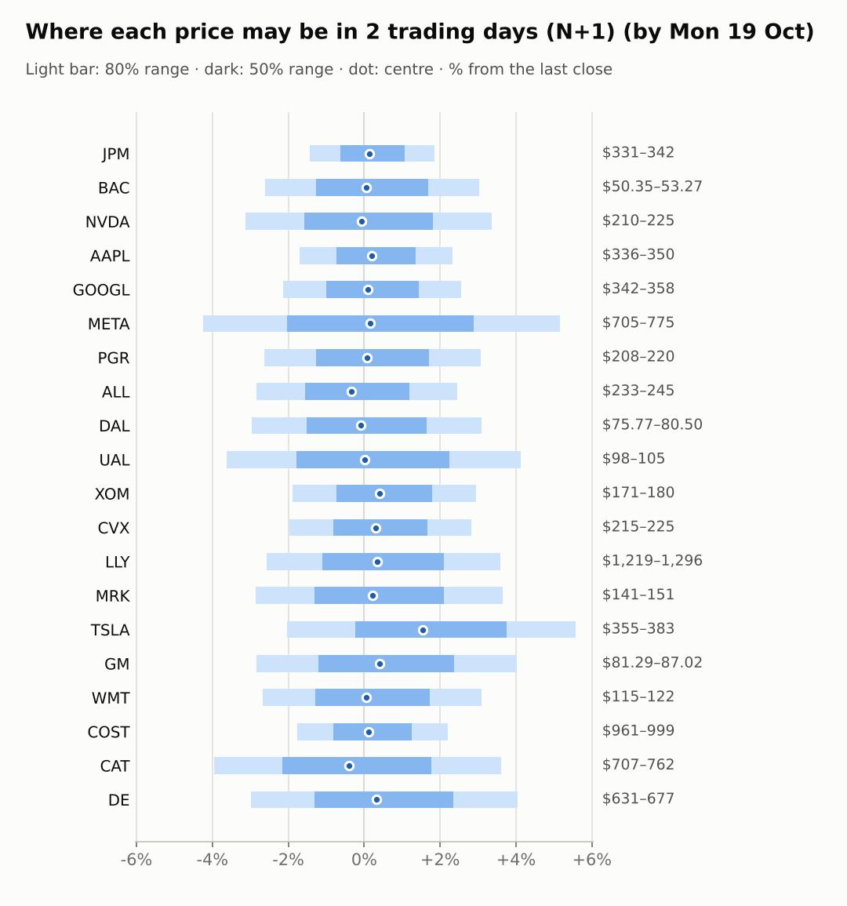
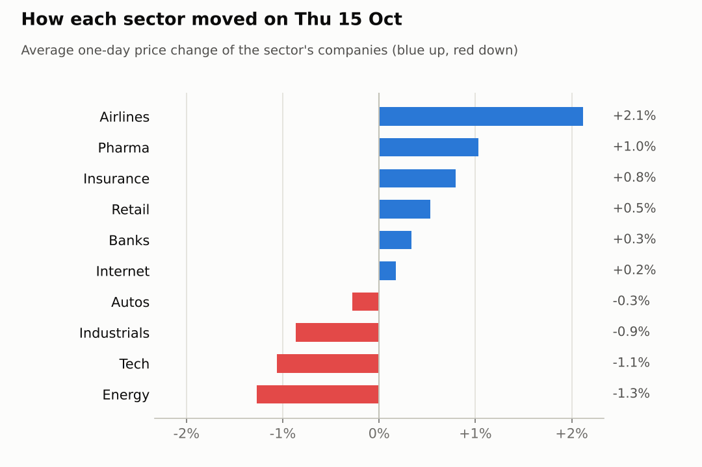
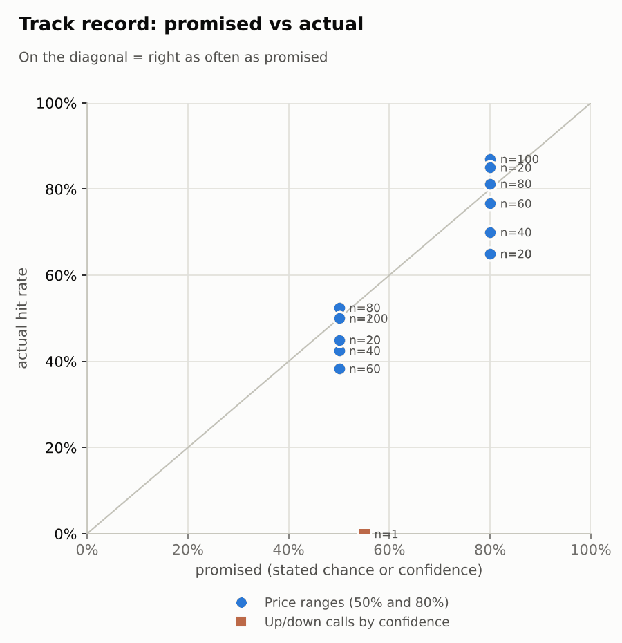

# Market brief: US (NYSE/Nasdaq), 2026-10-16

_Research log, not investment advice. Generated by a scheduled Claude Code routine._
<!-- report-data: as_of=2026-10-15 regime=CALM outcome=70248abff9bf -->

Easy-to-read version with charts and filters: [2026-10-16.html](2026-10-16.html)

## Headline
No calls today: the signal model sits near the base rate for every name but BAC and the few verified news events have already traded. Today is the monthly options expiry, with TSLA +3.11% premarket on a Roadster debut and a merger story that no verified source confirms.

## Top 3 today
- BAC: the $1.2 billion money-laundering fine is corroborated (095cc8df62309ad2), but BAC has already fallen to an RSI of 25, -11.14% over 20 days; the forecaster abstained.
- TSLA is +3.11% premarket after the Roadster debut; no verified source confirms the merger part of the story, and earnings on 10-21 fall inside the N+5 window.
- Energy: the Chevron CEO warns oil buffers are drained (556b6deb043995ca, corroborated), while WTI crude is -1.85% overnight at 96.16.

## Yesterday
The S&P 500 ETF rose 0.3%, with 11 watchlist names up and 9 down. LLY led at +3.5% and WMT gained 1.47%; both closed above their N+1 80% ranges. NVDA was worst at -1.84% and CAT fell 1.78%; both closed below their ranges, as tech (XLK -0.65%) and energy (XLE -1.58%) lagged health care (XLV +1.86%).
N+1 80% ranges hit 16/20 against 12/20 for the naive range. The 4 misses were all big one-day moves: two up (LLY, WMT) and two down (NVDA, CAT). The one settled call (NVDA 5-day up) missed with -7.53%.

Market on 2026-10-15: S&P 500 ETF 771.79 (+0.3%) · VIX 16.46 (-2.4%) · watchlist 11 up / 9 down · best LLY +3.5%, worst NVDA -1.8%

### Ranges scored (target date 2026-10-15)

N+1 ranges: **80% hit 16/20** (naive 12/20) · 50% hit 11/20

| Ticker | 80% range | 50% range | Actual | 80% | 50% | Naive 80% |
|---|---|---|---|---|---|---|
| AAPL | $333.87–$352.17 | $338.15–$347.75 | $342.00 | ✅ | ✅ | ✅ |
| ALL | $229.12–$245.42 | $232.91–$241.47 | $239.60 | ✅ | ✅ | ✅ |
| BAC | $50.40–$55.68 | $51.61–$54.38 | $51.70 | ✅ | ✅ | ❌ |
| CAT | $738.78–$810.99 | $755.43–$793.30 | $735.64 | ❌ | ❌ | ❌ |
| COST | $937.87–$979.28 | $947.60–$969.32 | $978.01 | ✅ | ❌ | ❌ |
| CVX | $212.68–$225.51 | $215.68–$222.41 | $219.32 | ✅ | ✅ | ✅ |
| DAL | $76.83–$82.17 | $78.08–$80.87 | $78.08 | ✅ | ✅ | ✅ |
| DE | $622.70–$683.48 | $636.71–$668.59 | $650.67 | ✅ | ✅ | ✅ |
| GM | $80.51–$88.06 | $82.25–$86.21 | $83.66 | ✅ | ✅ | ✅ |
| GOOGL | $346.28–$367.49 | $351.23–$362.36 | $349.22 | ✅ | ❌ | ✅ |
| JPM | $319.89–$343.95 | $325.48–$338.10 | $335.53 | ✅ | ✅ | ✅ |
| LLY | $1,136.12–$1,208.20 | $1,152.95–$1,190.75 | $1,251.61 | ❌ | ❌ | ❌ |
| META | $719.23–$810.83 | $740.14–$788.17 | $736.72 | ✅ | ❌ | ✅ |
| MRK | $137.38–$148.12 | $139.87–$145.51 | $145.19 | ✅ | ✅ | ✅ |
| NVDA | $219.62–$237.16 | $223.69–$232.89 | $217.23 | ❌ | ❌ | ❌ |
| PGR | $209.36–$239.09 | $216.11–$231.70 | $213.75 | ✅ | ❌ | ❌ |
| TSLA | $358.17–$394.33 | $366.50–$385.46 | $362.44 | ✅ | ❌ | ❌ |
| UAL | $98.98–$108.19 | $101.11–$105.94 | $101.31 | ✅ | ✅ | ✅ |
| WMT | $109.24–$116.67 | $110.97–$114.87 | $117.87 | ❌ | ❌ | ❌ |
| XOM | $169.96–$180.43 | $172.40–$177.90 | $174.68 | ✅ | ✅ | ✅ |

N+2 ranges that matured on the same date: 80% hit 18/20, 50% hit 12/20. N+3 ranges that matured on the same date: 80% hit 16/20, 50% hit 7/20. N+4 ranges that matured on the same date: 80% hit 16/20, 50% hit 8/20. N+5 ranges that matured on the same date: 80% hit 13/20, 50% hit 10/20.

### Calls scored

| Ticker | H | Call | Conf. | Move | Hit |
|---|---|---|---|---|---|
| NVDA | 5d · open→close | up | 55% | -7.53% | ❌ |

## Today (2026-10-16)

**Regime: CALM** · VIX 16.13 (-2.0%) · benchmark 5d -0.3% · benchmark 10d vol 9.2%

| Ticker | Sector | Close | N+1 80% | N+1 50% | N+5 80% | Call | Cue | Notes |
|---|---|---|---|---|---|---|---|---|
| JPM | Banks | $335.53 | $330.75–$341.73 | $333.40–$339.13 | $327.17–$346.94 | no call | +0.27% | cue +0.27% x0.5 |
| BAC | Banks | $51.70 | $50.35–$53.27 | $51.05–$52.57 | $49.41–$54.68 | no call | +0.12% | cue +0.12% x0.5 |
| NVDA | Tech | $217.23 | $210.43–$224.54 | $213.80–$221.16 | $205.93–$231.40 | no call | -0.13% | cue -0.13% x0.5 |
| AAPL | Tech | $342.00 | $336.14–$349.95 | $339.47–$346.67 | $331.67–$356.54 | no call | +0.41% | cue +0.41% x0.5 |
| GOOGL | Internet | $349.22 | $341.77–$358.16 | $345.70–$354.25 | $336.47–$366.02 | no call | +0.18% | cue +0.18% x0.5 |
| META | Internet | $736.72 | $705.47–$774.78 | $721.82–$757.96 | $656.85–$849.49 | no call | +0.33% | cue +0.33% x0.5; earnings in horizon (x3.0 day) |
| PGR | Insurance | $213.75 | $208.14–$220.31 | $211.05–$217.40 | $204.24–$226.18 | no call | +0.14% | cue +0.14% x0.5 |
| ALL | Insurance | $239.60 | $232.82–$245.47 | $235.85–$242.45 | $228.76–$251.56 | no call | -0.66% | cue -0.66% x0.5 |
| DAL | Airlines | $78.08 | $75.77–$80.50 | $76.90–$79.37 | $74.26–$82.78 | no call | -0.19% | cue -0.19% x0.5 |
| UAL | Airlines | $101.31 | $97.64–$105.48 | $99.50–$103.59 | $92.06–$113.80 | no call | +0.04% | cue +0.04% x0.5; earnings in horizon (x3.0 day) |
| XOM | Energy | $174.68 | $171.39–$179.82 | $173.42–$177.81 | $168.67–$183.87 | no call | +0.81% | cue +0.81% x0.5 |
| CVX | Energy | $219.32 | $215.00–$225.50 | $217.52–$222.99 | $211.61–$230.54 | no call | +0.60% | cue +0.60% x0.5 |
| LLY | Pharma | $1,251.61 | $1,219.39–$1,296.47 | $1,237.80–$1,278.00 | $1,194.75–$1,333.83 | no call | +0.67% | cue +0.67% x0.5 |
| MRK | Pharma | $145.19 | $141.03–$150.50 | $143.29–$148.23 | $138.01–$155.10 | no call | +0.43% | cue +0.43% x0.5 |
| TSLA | Autos | $362.44 | $355.04–$382.66 | $361.60–$376.01 | $335.34–$411.88 | no call | +3.11% | cue +3.11% x0.5; earnings in horizon (x3.0 day) |
| GM | Autos | $83.66 | $81.29–$87.02 | $82.66–$85.65 | $77.18–$93.04 | no call | +0.80% | cue +0.80% x0.5; earnings in horizon (x3.0 day) |
| WMT | Retail | $117.87 | $114.73–$121.52 | $116.35–$119.90 | $112.55–$124.81 | no call | +0.12% | cue +0.12% x0.5 |
| COST | Retail | $978.01 | $960.66–$999.49 | $970.01–$990.26 | $948.06–$1,018.01 | no call | +0.22% | cue +0.22% x0.5 |
| CAT | Industrials | $735.64 | $706.55–$762.11 | $719.75–$748.72 | $688.96–$789.32 | no call | -0.36% | cue -0.36% x0.5; ex-dividend 1.63 (0.22%) |
| DE | Industrials | $650.67 | $631.32–$676.97 | $642.19–$665.99 | $616.81–$699.23 | no call | +0.67% | cue +0.67% x0.5 |

No calls today. The forecaster abstained on all 20 tickers:
- BAC: the only real model lean (down) comes from the untrained news prior; the corroborated fine (095cc8df62309ad2) has traded for several sessions and RSI is 25.
- CVX: the corroborated CEO warning (556b6deb043995ca) traded yesterday, when CVX fell 1.23%; crude is down overnight.
- TSLA: the only corroborated event is a retrospective piece (17e7595710d7a1b2); no verified source confirms the merger story; earnings 10-21 fall inside N+5.
- NVDA: no verified news event, and the 10-07 lesson (a stale headline up call lost 7.53%) applies.
- GM, UAL, META: earnings on 10-20 / 10-20 / 10-21 fall inside the N+5 window.
- LLY, MRK, WMT, ALL, DAL, PGR: their headlines are not verified events and have already traded.
- AAPL, CAT, COST, DE, GOOGL, JPM, XOM: no verified catalyst; the model is at the base rate.
None was a hard block: no ticker is BLOCKED and none has earnings within 1 day.

### Overnight cues and global factors

| Symbol | Name | Last | Change |
|---|---|---|---|
| DAX | DAX | 25,599.47 | +0.85% |
| DXY | US dollar index | 101.68 | -0.32% |
| ES | S&P 500 futures | 7,795.50 | +0.06% |
| FTSE | FTSE 100 | 10,832.59 | -0.07% |
| GOLD | Gold | 4,198.60 | +0.68% |
| HANGSENG | Hang Seng | 24,186.83 | +0.52% |
| KOSPI | KOSPI | 5,668.05 | +2.05% |
| NIKKEI | Nikkei 225 | 65,349.89 | +1.43% |
| NQ | Nasdaq 100 futures | 30,069.75 | -0.25% |
| SPY | S&P 500 ETF | 772.59 | +0.10% |
| STOXX50 | Euro Stoxx 50 | 6,203.28 | +0.57% |
| US10Y | US 10-year yield | 5.09 | -1.95% |
| USDCNY | USD/CNY | 6.68 | -0.26% |
| USDJPY | USD/JPY | 158.04 | +0.05% |
| VIX | VIX | 16.13 | -2.00% |
| WTI | WTI crude | 96.16 | -1.85% |

## Tomorrow and this week

| Date | Event | Type |
|---|---|---|
| 2026-10-15 | Delta Air Lines ex-dividend | company |
| 2026-10-16 | US monthly options expiry |  |
| 2026-10-19 | Caterpillar ex-dividend (est. 1.63, last dividend) | company |
| 2026-10-20 | General Motors earnings | company |
| 2026-10-20 | United Airlines earnings | company |
| 2026-10-21 | Meta Platforms earnings | company |
| 2026-10-21 | Tesla earnings | company |
| 2026-10-28 | Alphabet earnings | company |
| 2026-10-28 | FOMC rate decision | major |
| 2026-10-29 | Caterpillar earnings | company |
| 2026-10-29 | Eli Lilly earnings | company |
| 2026-10-29 | Merck earnings | company |
| 2026-10-30 | Chevron earnings | company |
| 2026-10-30 | Costco ex-dividend (est. 1.47, last dividend) | company |
| 2026-10-30 | ExxonMobil earnings | company |
| 2026-11-02 | Apple earnings | company |
| 2026-11-04 | Allstate earnings | company |

Today is the US monthly options expiry. Next week brings earnings from GM and UAL (10-20) and META and TSLA (10-21), whose N+5 ranges are widened for the event. CAT goes ex-dividend on 10-19, and the FOMC decides on 10-28. Overnight cues are mixed: Asia and Europe rose (Nikkei +1.43%, DAX +0.85%), Nasdaq 100 futures are -0.25%, and the US 10-year yield is 5.09. The regime is CALM with VIX at 16.13.

## By sector

### Banks

BAC rose 0.6% and JPM 0.07% while XLF gained 1.38%, so both lagged their sector. BAC still carries the corroborated $1.2 billion fine (095cc8df62309ad2).
Bull: BAC is deeply oversold (RSI 25). Bear: the fine and the earnings miss weigh on it, and the model leans down.

### Tech

NVDA fell 1.84% and AAPL 0.28%, as XLK fell 0.65% and is -4.34% over 5 days.
Bull: NVDA is near oversold (RSI 40) after -5.75% in 5 days. Bear: yields above 5 and the AI-debt worries weigh on chips. AAPL outperformed its peer by 6.21 points over 5 days.

### Internet

GOOGL rose 0.45% and META fell 0.11%, while XLC gained 1.46%. Both lagged on stock-specific news.
Bull: META is +7.97% over 20 days. Bear: META's earnings on 10-21 fall inside the N+5 window.

### Insurance

ALL rose 1.45% and PGR 0.14%, in line with IAK +1.01%.
Bull: ALL is +3.89% over 5 days. Bear: PGR is -2.28% over 5 days after its results; its headlines are not verified events.

### Airlines

UAL rose 2.37% and DAL 1.87%, with JETS +2.79%: a sector bounce after a weak week (JETS -3.35% over 5 days).
Bull: both are near oversold (RSI 36 and 39). Bear: Delta cut its 2026 outlook (13bacfc4c7e7e11c, promotional), and UAL reports on 10-20.

### Energy

CVX fell 1.23% and XOM 1.32%, together with XLE -1.58%: a sector move as crude fell.
Bull: the Chevron CEO warns buffers are drained (556b6deb043995ca, corroborated). Bear: WTI is -1.85% overnight; CVX has an RSI of 65 and XOM 68, near overbought.

### Pharma

LLY rose 3.55% and MRK fell 1.48%, as XLV gained 1.86%: they moved apart on company news.
Bull: LLY is +7.01% over 5 days. Bear: LLY is stretched (RSI 68) after closing above its N+1 80% range.

### Autos

GM rose 0.73% and TSLA fell 1.29%, while XLY gained 1.71%. TSLA is +3.11% premarket.
Bull: TSLA has the Roadster debut. Bear: no verified source confirms the merger story, and both report inside the N+5 window (GM 10-20, TSLA 10-21).

### Retail

WMT rose 1.47% and COST fell 0.41%, while XLP gained 0.72%.
Bull: WMT is +10.38% over 20 days. Bear: WMT is overbought at RSI 72, and COST is at RSI 70.

### Industrials

CAT fell 1.78% and DE rose 0.04%, while XLI gained 0.51%: CAT moved on its own.
Bull: CAT is near oversold (RSI 31). Bear: CAT is -7.6% over 5 days and closed below its N+1 80% range; it goes ex-dividend on 10-19.

## Track record

Ranges (targets 50% / 80%; width, score and centre error in % of price, lower is better; naive = last close ± recent typical move, no-change = last close as the centre):

| H | Window | n | 50% cover | 80% cover | Naive 80% | Width | Naive width | Score | Naive score | Centre err | No-change err |
|---|---|---|---|---|---|---|---|---|---|---|---|
| 1d | since start | 100 | 50% | 87% | 74% | 7.04 | 6.04 | 8.703 | 9.345 | 2.03 | 2.17 |
| 1d | last 30 days | 100 | 50% | 87% | 74% | 7.04 | 6.04 | 8.703 | 9.345 | 2.03 | 2.17 |
| 1d legacy_cc | since start | 20 | 45% | 85% | 85% | 4.09 | 4.18 | 7.414 | 7.632 | 1.45 | 1.39 |
| 1d legacy_cc | last 30 days | 20 | 45% | 85% | 85% | 4.09 | 4.18 | 7.414 | 7.632 | 1.45 | 1.39 |
| 2d | since start | 80 | 53% | 81% | 71% | 8.96 | 7.41 | 10.936 | 11.721 | 2.59 | 2.70 |
| 2d | last 30 days | 80 | 53% | 81% | 71% | 8.96 | 7.41 | 10.936 | 11.721 | 2.59 | 2.70 |
| 3d | since start | 60 | 38% | 77% | 58% | 10.38 | 8.59 | 12.769 | 13.674 | 3.35 | 3.41 |
| 3d | last 30 days | 60 | 38% | 77% | 58% | 10.38 | 8.59 | 12.769 | 13.674 | 3.35 | 3.41 |
| 4d | since start | 40 | 43% | 70% | 63% | 11.92 | 9.56 | 16.467 | 18.087 | 3.83 | 3.93 |
| 4d | last 30 days | 40 | 43% | 70% | 63% | 11.92 | 9.56 | 16.467 | 18.087 | 3.83 | 3.93 |
| 5d | since start | 20 | 50% | 65% | 50% | 12.89 | 10.39 | 17.996 | 21.465 | 4.24 | 4.50 |
| 5d | last 30 days | 20 | 50% | 65% | 50% | 12.89 | 10.39 | 17.996 | 21.465 | 4.24 | 4.50 |
| 5d legacy_cc | since start | 20 | 45% | 65% | 50% | 9.91 | 9.35 | 17.346 | 16.489 | 3.60 | 3.63 |
| 5d legacy_cc | last 30 days | 20 | 45% | 65% | 50% | 9.91 | 9.35 | 17.346 | 16.489 | 3.60 | 3.63 |

Ranges by regime (since start):

| H | Regime | n | 50% cover | 80% cover | Naive 80% |
|---|---|---|---|---|---|
| 1d | CALM | 20 | 55% | 100% | 95% |
| 1d | EVENT_HEAVY | 60 | 48% | 83% | 67% |
| 1d | TRENDING | 20 | 50% | 85% | 75% |
| 1d legacy_cc | TRENDING | 20 | 45% | 85% | 85% |
| 2d | CALM | 20 | 75% | 95% | 100% |
| 2d | EVENT_HEAVY | 40 | 48% | 78% | 60% |
| 2d | TRENDING | 20 | 40% | 75% | 65% |
| 3d | CALM | 20 | 40% | 70% | 55% |
| 3d | EVENT_HEAVY | 20 | 35% | 80% | 55% |
| 3d | TRENDING | 20 | 40% | 80% | 65% |
| 4d | CALM | 20 | 40% | 80% | 70% |
| 4d | TRENDING | 20 | 45% | 60% | 55% |
| 5d | TRENDING | 20 | 50% | 65% | 50% |
| 5d legacy_cc | TRENDING | 20 | 45% | 65% | 50% |

Up/down calls vs the always-up baseline:

| H | Window | n | Hit rate | Always-up |
|---|---|---|---|---|
| 5d · open→close | since start | 1 | 0% | 0% |
| 5d · open→close | last 30 days | 1 | 0% | 0% |

Calls by confidence band (a band should hit about as often as its confidence):

| Band | n | Avg confidence | Hit rate |
|---|---|---|---|
| 0.50-0.59 · open→close | 1 | 55% | 0% |

Weekly review 2026-W41: 0 proposed range changes for a human to decide (low sample) · [review-2026-W41.md](review-2026-W41.md)

## Data quality

- Indicators: 20 OK, partial: none, blocked: none
- Regime notes: none

| H | Calibration | History n | Live n | q10 / q90 |
|---|---|---|---|---|
| 1d | pool | 8920 | 100 | -1.14 / 1.24 |
| 2d | pool | 8900 | 80 | -1.14 / 1.31 |
| 3d | pool | 8880 | 60 | -1.13 / 1.32 |
| 4d | pool | 8860 | 40 | -1.14 / 1.32 |
| 5d | pool | 8840 | 20 | -1.12 / 1.35 |

- validation: collect gate FAILED once, DUPLICATE_ID on news id 4e066830ffe2bf6a (a market-wide headline with no tickers). It was first stored on 2026-10-05 and stored again by today's collect_news after the de-dup window (GitHub issue open). The fix, dropping this run's duplicate line, was refused by the session's permissions, so the line stays. The id was never cited, and no ticker had to abstain because of it.
- validation: the features, context, news and forecast gates passed with no warnings.
- validation: the report gate gave one warning, REPORT_STATUS_UNCITED. It concerns the status words in the copied judge-FAIL line below, which the gate does not check.
- SEC: acceptance times could not be checked (stored as served, maybe 4-5h late) for the mixed files of the CIKs for JPM and BAC (filings, insiders, stakes, fundamentals, events). Four 13F filer CIKs lack header times on very old filings.
- claims: 26 claim records were added. The orchestrator gave one Susquehanna DAL target (a separate, older action) its own fact key so that two different rating actions are not read as a contradiction.
- results digests: no quarterly results releases were due.
- AI traders: news trader 20 abstained; pattern trader 16 abstained; combined Sonnet 5 abstained; combined Opus 20 abstained.
- head-to-head picks: none is viable at the owner's cost.
- previous run judge FAIL: 2026-10-12 spotcheck. Report 2026-10-07 (and 2026-10-08) called TSLA item cced5d4b933d5106 a rumour, but its stored status is unverified; two other status labels in 2026-10-07 were also wrong. Nothing was dropped.
