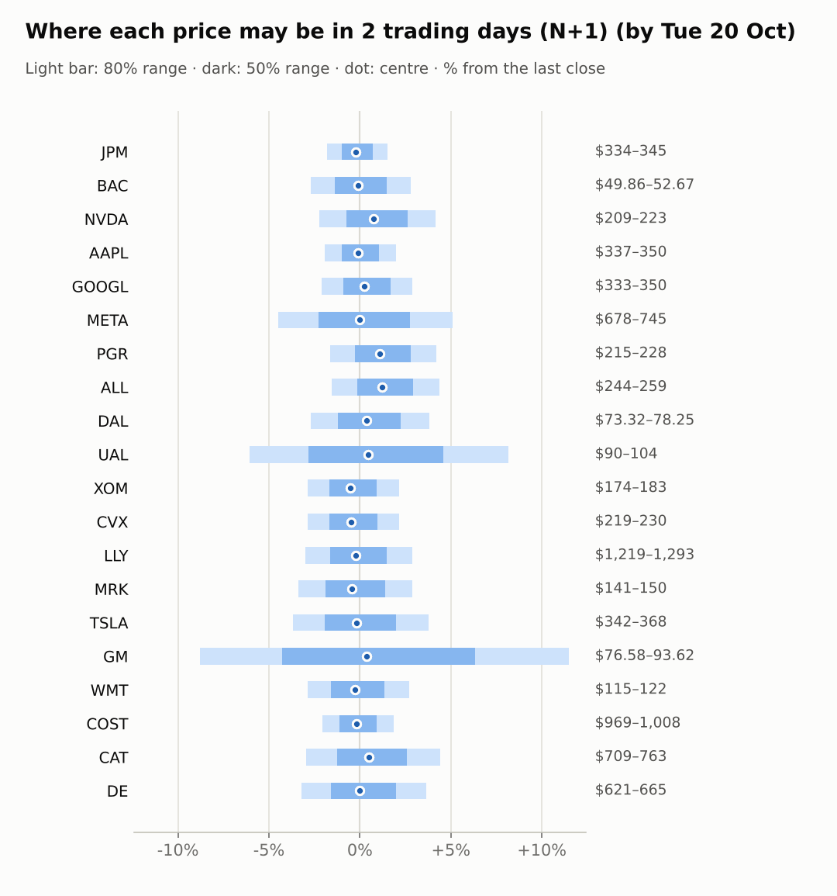
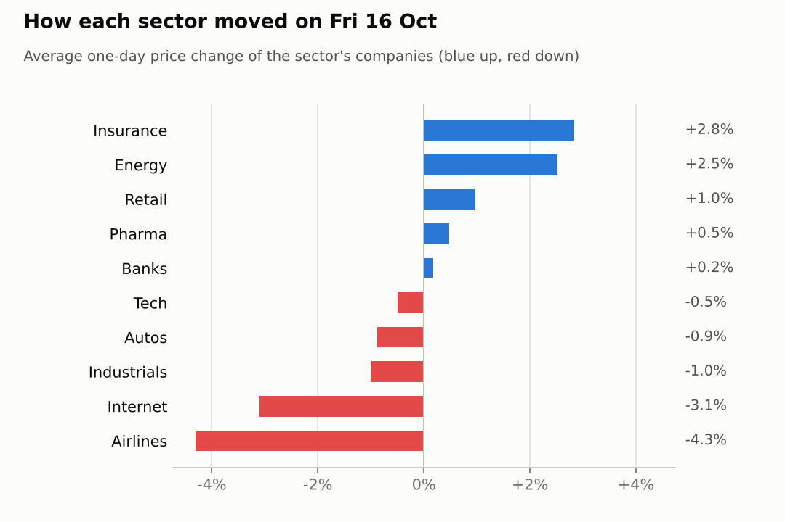
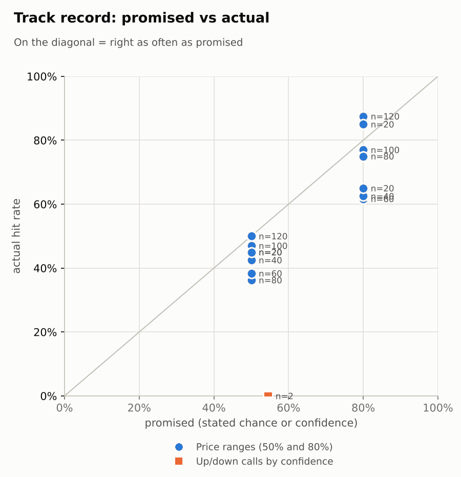

# Market brief: US (NYSE/Nasdaq), 2026-10-19

_Research log, not investment advice. Generated by a scheduled Claude Code routine._
<!-- report-data: as_of=2026-10-16 regime=CALM outcome=70248abff9bf -->

Easy-to-read version with charts and filters: [2026-10-19.html](2026-10-19.html)

## Headline
No calls today: after Friday's tech sell-off the signal model sits at its base rate for every stock and only one news event, BAC's week-old fine, is verified. Nasdaq 100 futures are +0.97% and WTI crude -3.2% before the open; GM and UAL report tomorrow.

## Top 3 today
- Tech fell hard on Friday (XLK -3.02%, -7.7% over 5 days) on worries about the AI trade and high oil prices (350ddf0181fc97f9); Nasdaq 100 futures are +0.97% this morning.
- Oil is falling: WTI crude is -3.2% to 98.16 after touching $110 (9e1292bd99b55457), and XOM (-1.01%) and CVX (-1.00%) are lower before the open.
- Earnings week: GM and UAL report on 2026-10-20 (no calls allowed), META and TSLA on 2026-10-21, and the FOMC decides on 2026-10-28.

## Yesterday
The S&P 500 ETF fell 1.1% on 2026-10-16 and the VIX rose 21.4% to 19.99, as worries about the AI trade and high oil prices hit tech (350ddf0181fc97f9). XLK fell 3.02% while XLE rose 2.52%.
ALL was best at +3.5% and closed above its N+1 80% range; LLY also closed above its range. UAL was worst at -5.1%.
N+1 80% ranges hit 18/20 against 17/20 for the naive range; the two misses were both upside surprises. The one settled call, NVDA up over 5 days, missed: NVDA moved -8.44%.

Market on 2026-10-16: S&P 500 ETF 763.25 (-1.1%) · VIX 19.99 (+21.4%) · watchlist 11 up / 9 down · best ALL +3.5%, worst UAL -5.1%

### Ranges scored (target date 2026-10-16)

N+1 ranges: **80% hit 18/20** (naive 17/20) · 50% hit 10/20

| Ticker | 80% range | 50% range | Actual | 80% | 50% | Naive 80% |
|---|---|---|---|---|---|---|
| AAPL | $337.56–$351.77 | $340.96–$348.41 | $343.46 | ✅ | ✅ | ✅ |
| ALL | $228.76–$241.18 | $231.71–$238.23 | $247.88 | ❌ | ❌ | ❌ |
| BAC | $48.99–$54.49 | $50.27–$53.15 | $51.23 | ✅ | ✅ | ✅ |
| CAT | $713.47–$769.94 | $726.78–$756.40 | $730.76 | ✅ | ✅ | ✅ |
| COST | $968.90–$1,008.95 | $978.47–$999.47 | $989.11 | ✅ | ✅ | ✅ |
| CVX | $217.95–$228.63 | $220.50–$226.09 | $224.99 | ✅ | ✅ | ✅ |
| DAL | $74.39–$78.99 | $75.48–$77.89 | $75.37 | ✅ | ❌ | ✅ |
| DE | $629.75–$676.51 | $640.79–$665.31 | $641.86 | ✅ | ✅ | ✅ |
| GM | $80.19–$85.97 | $81.55–$84.58 | $83.96 | ✅ | ✅ | ✅ |
| GOOGL | $338.65–$355.28 | $342.61–$351.33 | $340.59 | ✅ | ❌ | ✅ |
| JPM | $331.57–$342.87 | $334.28–$340.20 | $339.72 | ✅ | ✅ | ✅ |
| LLY | $1,184.83–$1,252.53 | $1,200.91–$1,236.42 | $1,257.03 | ❌ | ❌ | ❌ |
| META | $701.88–$772.72 | $718.44–$755.60 | $709.33 | ✅ | ❌ | ✅ |
| MRK | $144.08–$153.83 | $146.39–$151.50 | $145.95 | ✅ | ❌ | ✅ |
| NVDA | $212.84–$227.07 | $216.21–$223.68 | $214.13 | ✅ | ❌ | ❌ |
| PGR | $196.45–$223.39 | $202.67–$216.80 | $218.49 | ✅ | ❌ | ✅ |
| TSLA | $351.78–$379.58 | $358.33–$372.91 | $354.72 | ✅ | ❌ | ✅ |
| UAL | $95.61–$103.23 | $97.40–$101.40 | $96.10 | ✅ | ❌ | ✅ |
| WMT | $114.38–$121.18 | $116.00–$119.56 | $118.81 | ✅ | ✅ | ✅ |
| XOM | $173.77–$182.31 | $175.81–$180.28 | $178.98 | ✅ | ✅ | ✅ |

N+2 ranges that matured on the same date: 80% hit 12/20, 50% hit 5/20. N+3 ranges that matured on the same date: 80% hit 14/20, 50% hit 6/20. N+4 ranges that matured on the same date: 80% hit 9/20, 50% hit 6/20. N+5 ranges that matured on the same date: 80% hit 12/20, 50% hit 7/20.

### Calls scored

| Ticker | H | Call | Conf. | Move | Hit |
|---|---|---|---|---|---|
| NVDA | 5d · open→close | up | 54% | -8.44% | ❌ |

## Today (2026-10-19)

**Regime: CALM** · VIX 18.87 (-5.6%) · benchmark 5d -2.0% · benchmark 10d vol 10.3%

| Ticker | Sector | Close | N+1 80% | N+1 50% | N+5 80% | Call | Cue | Notes |
|---|---|---|---|---|---|---|---|---|
| JPM | Banks | $339.72 | $333.65–$344.88 | $336.31–$342.19 | $329.82–$350.37 | no call | -0.44% | cue -0.44% x0.5 |
| BAC | Banks | $51.23 | $49.86–$52.67 | $50.52–$51.99 | $48.91–$54.07 | no call | -0.20% | cue -0.20% x0.5 |
| NVDA | Tech | $214.13 | $209.31–$223.07 | $212.52–$219.73 | $204.71–$229.95 | no call | +1.53% | cue +1.53% x0.5 |
| AAPL | Tech | $343.46 | $336.85–$350.23 | $340.00–$347.02 | $332.30–$356.81 | no call | -0.17% | cue -0.17% x0.5 |
| GOOGL | Internet | $340.59 | $333.45–$350.41 | $337.43–$346.32 | $327.73–$358.81 | no call | +0.50% | cue +0.50% x0.5 |
| META | Internet | $709.33 | $677.55–$745.49 | $693.22–$728.83 | $628.62–$820.65 | no call | -0.05% | cue -0.05% x0.5; earnings in horizon (x3.0 day) |
| PGR | Insurance | $218.49 | $214.91–$227.66 | $217.89–$224.58 | $210.63–$234.01 | no call | +2.22% | cue +2.22% x0.5 |
| ALL | Insurance | $247.88 | $244.08–$258.69 | $247.50–$255.15 | $240.07–$266.95 | no call | +3.25% | cue +3.25% x0.5 |
| DAL | Airlines | $75.37 | $73.32–$78.25 | $74.47–$77.06 | $71.68–$80.72 | no call | +0.70% | cue +0.70% x0.5 |
| UAL | Airlines | $96.10 | $90.27–$103.93 | $93.37–$100.52 | $86.61–$110.13 | no call | +0.94% | cue +0.94% x0.5; earnings in horizon (x2.09 day, 7 past moves, median 2.9%); earnings in horizon (x3.0 day) |
| XOM | Energy | $178.98 | $173.84–$182.83 | $175.95–$180.66 | $170.81–$187.28 | no call | -1.01% | cue -1.01% x0.5 |
| CVX | Energy | $224.99 | $218.53–$229.86 | $221.19–$227.13 | $214.72–$235.47 | no call | -1.00% | cue -1.00% x0.5 |
| LLY | Pharma | $1,257.03 | $1,219.08–$1,293.44 | $1,236.47–$1,275.46 | $1,194.16–$1,330.53 | no call | -0.48% | cue -0.48% x0.5 |
| MRK | Pharma | $145.95 | $141.03–$150.17 | $143.16–$147.96 | $137.97–$154.74 | no call | -0.86% | cue -0.86% x0.5 |
| TSLA | Autos | $354.72 | $341.74–$368.12 | $347.87–$361.70 | $322.37–$396.69 | no call | -0.36% | cue -0.36% x0.5; earnings in horizon (x3.0 day) |
| GM | Autos | $83.96 | $76.58–$93.62 | $80.35–$89.27 | $77.58–$93.19 | no call | +0.78% | cue +0.78% x0.5; earnings in horizon (x3.0 day); earnings in horizon (x4.2 day, 7 past moves, median 8.4%) |
| WMT | Retail | $118.81 | $115.38–$122.01 | $116.93–$120.41 | $113.16–$125.31 | no call | -0.52% | cue -0.52% x0.5 |
| COST | Retail | $989.11 | $968.71–$1,007.55 | $977.86–$998.23 | $955.52–$1,026.64 | no call | -0.42% | cue -0.42% x0.5 |
| CAT | Industrials | $730.76 | $709.02–$762.87 | $721.55–$749.77 | $691.15–$790.00 | no call | +1.40% | cue +1.40% x0.5; ex-dividend 1.63 (0.22%) |
| DE | Industrials | $641.86 | $621.30–$665.18 | $631.52–$654.53 | $606.68–$687.21 | no call | +0.00% | cue +0.00% x0.5 |

No calls today. The forecaster abstained on all 20 companies and every horizon:
- GM and UAL: hard block, earnings on 2026-10-20 (within 1 day).
- META and TSLA: earnings on 2026-10-21 fall inside the window; the Tesla-SpaceX merger talk is only a rumour (54407f16251243ad).
- BAC: the only corroborated event, its $1.2 billion money-laundering fine (095cc8df62309ad2), is a week old and already traded.
- NVDA: the only supporting item, the Germany AI deal, is promotional (270db1a3d0057510).
- XOM: the preliminary third-quarter refining gain is single_source (9f1fce9b9b2b7886) and already traded.
- All others: the model's P(up) is within about a point of the base rate and no verified news gives a direction.

### Overnight cues and global factors

| Symbol | Name | Last | Change |
|---|---|---|---|
| DAX | DAX | 25,276.29 | -1.35% |
| DXY | US dollar index | 101.82 | -0.02% |
| ES | S&P 500 futures | 7,736.00 | +0.41% |
| FTSE | FTSE 100 | 10,765.44 | -1.07% |
| GOLD | Gold | 4,189.00 | +0.19% |
| HANGSENG | Hang Seng | 24,186.83 | +0.52% |
| KOSPI | KOSPI | 5,768.01 | +1.76% |
| NIKKEI | Nikkei 225 | 64,948.04 | -0.58% |
| NQ | Nasdaq 100 futures | 29,676.00 | +0.97% |
| SPY | S&P 500 ETF | 766.93 | +0.48% |
| STOXX50 | Euro Stoxx 50 | 6,128.02 | -1.23% |
| US10Y | US 10-year yield | 5.10 | +0.18% |
| USDCNY | USD/CNY | 6.67 | -0.33% |
| USDJPY | USD/JPY | 158.18 | +0.02% |
| VIX | VIX | 18.87 | -5.60% |
| WTI | WTI crude | 98.16 | -3.20% |

## Tomorrow and this week

| Date | Event | Type |
|---|---|---|
| 2026-10-19 | Caterpillar ex-dividend (est. 1.63, last dividend) | company |
| 2026-10-20 | General Motors earnings | company |
| 2026-10-20 | United Airlines earnings | company |
| 2026-10-21 | Meta Platforms earnings | company |
| 2026-10-21 | Tesla earnings | company |
| 2026-10-28 | Alphabet earnings | company |
| 2026-10-28 | FOMC rate decision | major |
| 2026-10-29 | Caterpillar earnings | company |
| 2026-10-29 | Eli Lilly earnings | company |
| 2026-10-29 | Merck earnings | company |
| 2026-10-30 | Chevron earnings | company |
| 2026-10-30 | Costco ex-dividend (est. 1.47, last dividend) | company |
| 2026-10-30 | ExxonMobil earnings | company |
| 2026-11-02 | Apple earnings | company |
| 2026-11-04 | Allstate earnings | company |
| 2026-11-06 | US jobs report (usually first Friday; check for shifts) | major |

Risks this week: GM and UAL report on 2026-10-20, META and TSLA on 2026-10-21, and the FOMC decides on 2026-10-28 with the US 10-year yield at 5.10. The regime is CALM but the VIX is still 18.87 after Friday's jump. Europe is weak this morning (DAX -1.35%, FTSE -1.07%) while Nasdaq 100 futures are +0.97%. A further oil drop (WTI -3.20%) would weigh on XOM and CVX and help DAL and UAL.

## By sector

### Banks

BAC is oversold (RSI 24, -11.26% over 20 days) after its money-laundering fine (095cc8df62309ad2) and a third-quarter miss; JPM held up better (+2.02% over 5 days). They moved apart, so company news drove them.
Bull: BAC's Baird upgrade is promotional (4e026ab82fba81de) and JPM's Buy upgrade is promotional (d2d3e6b23d8a142b). Bear: both are slightly lower before the open (BAC -0.20%, JPM -0.44%).

### Tech

NVDA fell 6.61% over 5 days with XLK; AAPL held near its 20-day high (+2.03% over 5 days). They moved apart.
Bull: NVDA is +1.53% before the open with Nasdaq futures up. Bear: a report that Nvidia paused cloud revenue-share deals is unverified (1da2a33421d7e3f9), and both NVDA 5-day up calls so far missed.

### Internet

GOOGL fell 2.47% and META 3.72% on Friday with XLC (-1.89%), a sector move.
Bull: GOOGL is +0.50% before the open; a possible Anthropic computing deal for META is unverified (7fa1a296ff6c25f7). Bear: META reports on 2026-10-21 and GOOGL on 2026-10-28, both inside the 5-day window.

### Insurance

ALL rose 3.46% on Friday (+8.04% over 5 days) and PGR 2.22%, with IAK up 3.9% over 5 days: a sector move.
Bull: momentum and IAK strength. Bear: KBW cut its ALL target, a promotional item (9f27fd7a69393422), and ALL closed above its 80% range.

### Airlines

UAL fell 5.14% and DAL 3.47% on Friday with JETS (-2.67%), a sector move on fuel costs and a weaker industry outlook.
Bull: both are oversold (RSI 30 and 33) and higher before the open as oil falls. Bear: Delta's outlook cut is promotional (b908a4865a5cf51e), and UAL reports on 2026-10-20.

### Energy

XOM rose 2.46% and CVX 2.59% on Friday with XLE (+2.52%), as oil touched $110 (9e1292bd99b55457).
Bull: XOM's preliminary refining gain is single_source (9f1fce9b9b2b7886). Bear: XOM (RSI 73) and CVX (RSI 71) are overbought at their 20-day highs and about 1% lower before the open with WTI -3.20%.

### Pharma

LLY is up 6.59% over 5 days and MRK flat (+0.24%), so they moved apart on company news.
Bull: an EU panel recommended LLY's Foundayo pill, a promotional item (9e3b121b68a69278). Bear: LLY closed above its 80% range and is -0.48% before the open; MRK is -0.86%.

### Autos

TSLA fell 7.31% over 5 days while GM rose 1.49%: they moved apart.
Bull: GM is +0.78% before the open. Bear: GM reports on 2026-10-20 and TSLA on 2026-10-21; the Tesla-SpaceX merger talk is only a rumour (54407f16251243ad).

### Retail

WMT (+6.7% over 5 days) and COST (+4.46%) rose with staples (XLP +5.02%): a sector rotation into defensives.
Bull: steady momentum. Bear: both are overbought (RSI 73 and 72) and slightly lower before the open (WMT -0.52%, COST -0.42%).

### Industrials

CAT fell 8.71% over 5 days while DE rose 3.37%: company moves, not the sector (XLI -0.88%).
Bull: CAT is oversold (RSI 31) and +1.40% before the open. Bear: CAT goes ex-dividend today (1.63) and reports on 2026-10-29.

## Track record

Ranges (targets 50% / 80%; width, score and centre error in % of price, lower is better; naive = last close ± recent typical move, no-change = last close as the centre):

| H | Window | n | 50% cover | 80% cover | Naive 80% | Width | Naive width | Score | Naive score | Centre err | No-change err |
|---|---|---|---|---|---|---|---|---|---|---|---|
| 1d | since start | 120 | 50% | 88% | 76% | 6.97 | 6.09 | 8.617 | 9.111 | 2.01 | 2.15 |
| 1d | last 30 days | 120 | 50% | 88% | 76% | 6.97 | 6.09 | 8.617 | 9.111 | 2.01 | 2.15 |
| 1d legacy_cc | since start | 20 | 45% | 85% | 85% | 4.09 | 4.18 | 7.414 | 7.632 | 1.45 | 1.39 |
| 1d legacy_cc | last 30 days | 20 | 45% | 85% | 85% | 4.09 | 4.18 | 7.414 | 7.632 | 1.45 | 1.39 |
| 2d | since start | 100 | 47% | 77% | 64% | 9.12 | 7.40 | 11.676 | 13.117 | 2.85 | 2.99 |
| 2d | last 30 days | 100 | 47% | 77% | 64% | 9.12 | 7.40 | 11.676 | 13.117 | 2.85 | 2.99 |
| 3d | since start | 80 | 36% | 75% | 54% | 10.62 | 8.56 | 13.400 | 15.119 | 3.51 | 3.61 |
| 3d | last 30 days | 80 | 36% | 75% | 54% | 10.62 | 8.56 | 13.400 | 15.119 | 3.51 | 3.61 |
| 4d | since start | 60 | 38% | 62% | 55% | 12.15 | 9.61 | 17.588 | 20.186 | 4.24 | 4.27 |
| 4d | last 30 days | 60 | 38% | 62% | 55% | 12.15 | 9.61 | 17.588 | 20.186 | 4.24 | 4.27 |
| 5d | since start | 40 | 43% | 63% | 50% | 12.93 | 10.48 | 18.759 | 21.628 | 4.58 | 4.67 |
| 5d | last 30 days | 40 | 43% | 63% | 50% | 12.93 | 10.48 | 18.759 | 21.628 | 4.58 | 4.67 |
| 5d legacy_cc | since start | 20 | 45% | 65% | 50% | 9.91 | 9.35 | 17.346 | 16.489 | 3.60 | 3.63 |
| 5d legacy_cc | last 30 days | 20 | 45% | 65% | 50% | 9.91 | 9.35 | 17.346 | 16.489 | 3.60 | 3.63 |

Ranges by regime (since start):

| H | Regime | n | 50% cover | 80% cover | Naive 80% |
|---|---|---|---|---|---|
| 1d | CALM | 40 | 53% | 95% | 90% |
| 1d | EVENT_HEAVY | 60 | 48% | 83% | 67% |
| 1d | TRENDING | 20 | 50% | 85% | 75% |
| 1d legacy_cc | TRENDING | 20 | 45% | 85% | 85% |
| 2d | CALM | 20 | 75% | 95% | 100% |
| 2d | EVENT_HEAVY | 60 | 40% | 72% | 52% |
| 2d | TRENDING | 20 | 40% | 75% | 65% |
| 3d | CALM | 20 | 40% | 70% | 55% |
| 3d | EVENT_HEAVY | 40 | 33% | 75% | 48% |
| 3d | TRENDING | 20 | 40% | 80% | 65% |
| 4d | CALM | 20 | 40% | 80% | 70% |
| 4d | EVENT_HEAVY | 20 | 30% | 45% | 40% |
| 4d | TRENDING | 20 | 45% | 60% | 55% |
| 5d | CALM | 20 | 35% | 60% | 50% |
| 5d | TRENDING | 20 | 50% | 65% | 50% |
| 5d legacy_cc | TRENDING | 20 | 45% | 65% | 50% |

Up/down calls vs the always-up baseline:

| H | Window | n | Hit rate | Always-up |
|---|---|---|---|---|
| 5d · open→close | since start | 2 | 0% | 0% |
| 5d · open→close | last 30 days | 2 | 0% | 0% |

Calls by confidence band (a band should hit about as often as its confidence):

| Band | n | Avg confidence | Hit rate |
|---|---|---|---|
| 0.50-0.59 · open→close | 2 | 55% | 0% |

Weekly review 2026-W42: 0 proposed range changes for a human to decide · [review-2026-W42.md](review-2026-W42.md)

## Data quality

- Indicators: 20 OK, partial: none, blocked: none
- Regime notes: none

| H | Calibration | History n | Live n | q10 / q90 |
|---|---|---|---|---|
| 1d | pool | 8940 | 120 | -1.13 / 1.24 |
| 2d | pool | 8920 | 100 | -1.16 / 1.33 |
| 3d | pool | 8900 | 80 | -1.14 / 1.33 |
| 4d | pool | 8880 | 60 | -1.16 / 1.35 |
| 5d | pool | 8860 | 40 | -1.13 / 1.37 |

- validation collect DUPLICATE_ID (blocking): news, 2 duplicated ids (37b9d3600e34aacb, 4e066830ffe2bf6a). They are old market-wide headlines stored again after the 9-day de-dup window (open GitHub issue on news de-duplication). No ticker is named by the new copies and neither id is cited or in the context pack; no ticker abstained for it, and the data cannot be edited.
- validation news ENRICH_MISSING (warning): 1 pending id without enrichment (37b9d3600e34aacb, the duplicate id above, left out on purpose).
- validation features, context, forecast: passed (forecast: no predictions, all abstained).
- results digests: none detected. SEC results-filing earnings days have not been stored since the backfill of 2026-10-07, so the JPM, BAC, PGR and DAL third-quarter releases were missed (new GitHub issue).
- SEC acceptance times not checkable (stored as served, maybe 4-5h late) for company CIKs 19617 and 70858, and for 13F filer CIKs 933478, 1167483, 1040273 and 1029160; check_sec_times corrected 1 wrong row on read.
- news: no weekend news scoring was stored, so the whole backlog since Friday's run was scored today; watchlist items by keyword rules with manual overrides for the material ones, background items in themed groups.
- inbox imports: no MotherDuck inbox commands or paper trades to import.
- AI traders: news-results and Opus combined abstained on all 20; pattern-mood made calls on DAL, CAT, NVDA, BAC, XOM and CVX; Sonnet combined followed the model; all stored on the first attempt.
- head-to-head picks: written, none viable at the owner's cost.
- judge FAIL (2026-10-12, spotcheck, round 1): reports of 2026-10-07 and 2026-10-08 gave TSLA item cced5d4b933d5106 a status word that differed from its stored status; two other status labels in 2026-10-07 were also wrong. Nothing dropped.
