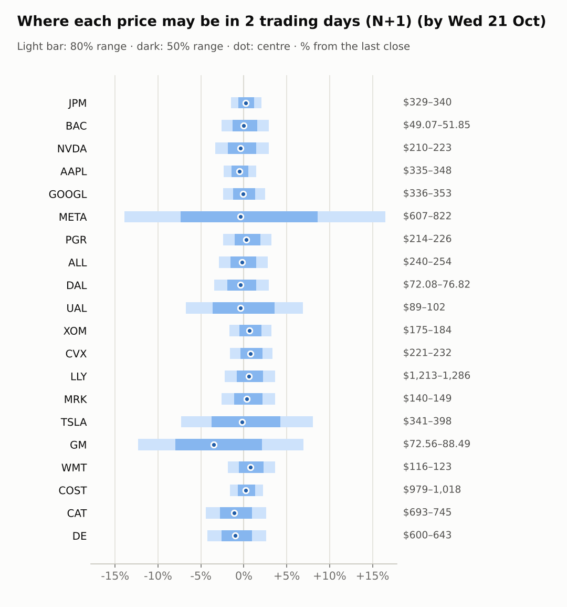
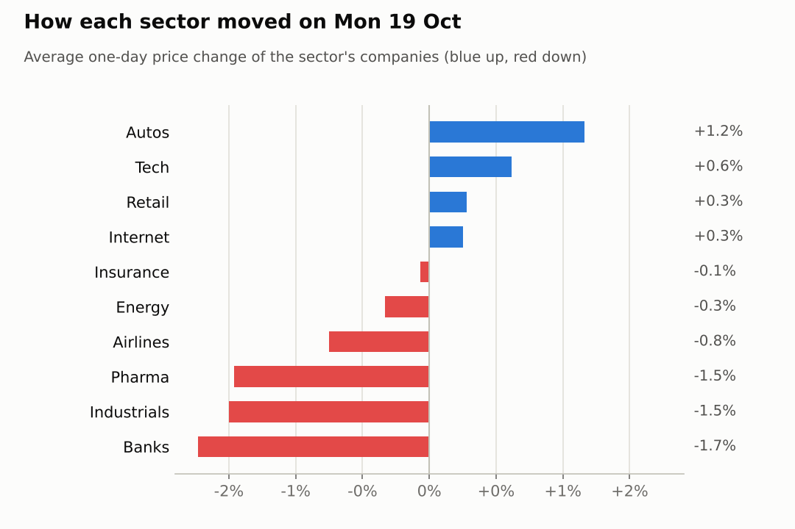
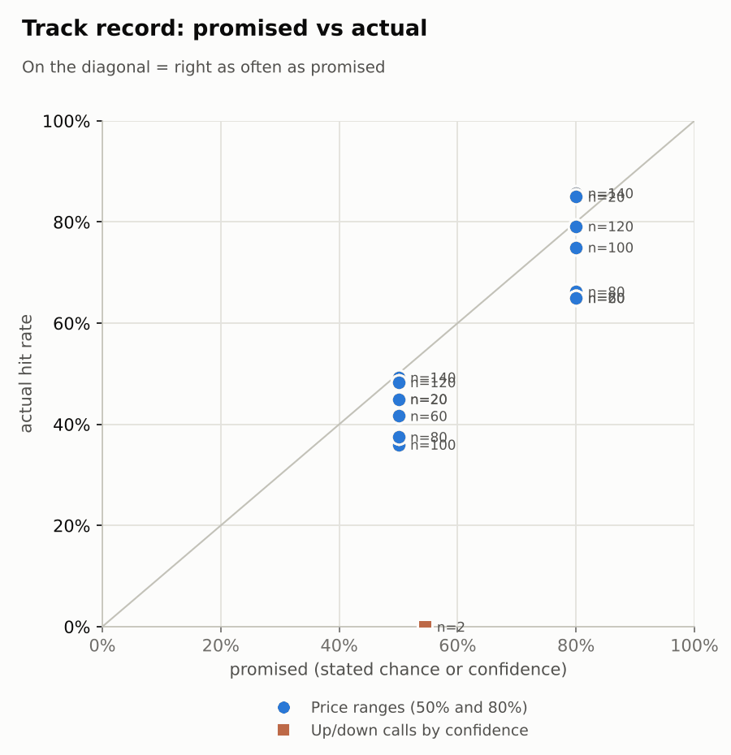

# Market brief: US (NYSE/Nasdaq), 2026-10-20

_Research log, not investment advice. Generated by a scheduled Claude Code routine._
<!-- report-data: as_of=2026-10-19 regime=CALM outcome=70248abff9bf -->

Easy-to-read version with charts and filters: [2026-10-20.html](2026-10-20.html)

## Headline
No calls today: the signal model sits at its base rate for every stock and the one fresh verified event, GM's results, is in an earnings window where no call is allowed. Futures are lower (Nasdaq 100 futures -0.6%) after Asian stocks fell on AI scepticism (0cb07f041e5123ee), and GM is -6.91% before the open despite beating (0982c6a43fc0bb47).

## Top 3 today
- GM beat its third-quarter estimates, tightened its outlook and announced a $20 billion buyback (0982c6a43fc0bb47, confirmed_primary), yet GM is -6.91% before the open; UAL also reports today, so no call on either.
- Risk-off morning: KOSPI -3.73% as Asian stocks fell on AI scepticism (0cb07f041e5123ee), Nasdaq 100 futures -0.6%, and the US 10-year yield is 5.136.
- Earnings week continues: META and TSLA report on 2026-10-21 (no calls allowed), and the FOMC decides on 2026-10-28, the same day Alphabet reports.

## Yesterday
The S&P 500 ETF rose 0.4% on 2026-10-19 and the VIX fell 7.8% to 18.44. Tech bounced (XLK +1.36%) and TSLA was best at +3.8% on merger talk (0d91ddf527d0c8f2); banks fell (XLF -0.83%, JPM -1.82%) and DE was worst at -2.3%.
N+1 80% ranges hit 15/20 against 17/20 for the naive range. The misses were ALL, DAL, DE, META and UAL: several closed below their N+1 range on a day when 15 of 20 stocks fell. No call settled.

Market on 2026-10-19: S&P 500 ETF 766.48 (+0.4%) · VIX 18.44 (-7.8%) · watchlist 5 up / 15 down · best TSLA +3.8%, worst DE -2.3%

### Ranges scored (target date 2026-10-19)

N+1 ranges: **80% hit 15/20** (naive 17/20) · 50% hit 9/20

| Ticker | 80% range | 50% range | Actual | 80% | 50% | Naive 80% |
|---|---|---|---|---|---|---|
| AAPL | $336.14–$349.95 | $339.47–$346.67 | $342.94 | ✅ | ✅ | ✅ |
| ALL | $232.82–$245.47 | $235.85–$242.45 | $246.85 | ❌ | ❌ | ✅ |
| BAC | $50.35–$53.27 | $51.05–$52.57 | $50.39 | ✅ | ❌ | ✅ |
| CAT | $706.55–$762.11 | $719.75–$748.72 | $725.79 | ✅ | ✅ | ✅ |
| COST | $960.66–$999.49 | $970.01–$990.26 | $995.53 | ✅ | ❌ | ✅ |
| CVX | $215.00–$225.50 | $217.52–$222.99 | $224.37 | ✅ | ❌ | ✅ |
| DAL | $75.77–$80.50 | $76.90–$79.37 | $74.63 | ❌ | ❌ | ❌ |
| DE | $631.32–$676.97 | $642.19–$665.99 | $627.00 | ❌ | ❌ | ❌ |
| GM | $81.29–$87.02 | $82.66–$85.65 | $82.75 | ✅ | ✅ | ✅ |
| GOOGL | $341.77–$358.16 | $345.70–$354.25 | $344.18 | ✅ | ❌ | ✅ |
| JPM | $330.75–$341.73 | $333.40–$339.13 | $333.53 | ✅ | ✅ | ✅ |
| LLY | $1,219.39–$1,296.47 | $1,237.80–$1,278.00 | $1,240.34 | ✅ | ✅ | ✅ |
| META | $705.47–$774.78 | $721.82–$757.96 | $705.44 | ❌ | ❌ | ✅ |
| MRK | $141.03–$150.50 | $143.29–$148.23 | $143.63 | ✅ | ✅ | ✅ |
| NVDA | $210.43–$224.54 | $213.80–$221.16 | $217.09 | ✅ | ✅ | ✅ |
| PGR | $208.14–$220.31 | $211.05–$217.40 | $219.11 | ✅ | ❌ | ✅ |
| TSLA | $355.04–$382.66 | $361.60–$376.01 | $368.06 | ✅ | ✅ | ✅ |
| UAL | $97.64–$105.48 | $99.50–$103.59 | $95.60 | ❌ | ❌ | ❌ |
| WMT | $114.73–$121.52 | $116.35–$119.90 | $118.70 | ✅ | ✅ | ✅ |
| XOM | $171.39–$179.82 | $173.42–$177.81 | $178.28 | ✅ | ❌ | ✅ |

N+2 ranges that matured on the same date: 80% hit 18/20, 50% hit 11/20. N+3 ranges that matured on the same date: 80% hit 15/20, 50% hit 7/20. N+4 ranges that matured on the same date: 80% hit 16/20, 50% hit 7/20. N+5 ranges that matured on the same date: 80% hit 14/20, 50% hit 8/20.

### Calls scored

| Ticker | H | Call | Conf. | Move | Hit |
|---|---|---|---|---|---|
| NVDA | 5d · open→close | up | 54% | -8.44% | ❌ |

## Today (2026-10-20)

**Regime: CALM** · VIX 18.74 (+1.6%) · benchmark 5d -1.5% · benchmark 10d vol 9.8%

| Ticker | Sector | Close | N+1 80% | N+1 50% | N+5 80% | Call | Cue | Notes |
|---|---|---|---|---|---|---|---|---|
| JPM | Banks | $333.53 | $328.52–$340.40 | $331.37–$337.60 | $324.45–$346.29 | no call | +0.40% | cue +0.40% x0.5 |
| BAC | Banks | $50.39 | $49.07–$51.85 | $49.73–$51.19 | $48.13–$53.24 | no call | +0.00% | cue +0.00% x0.5 |
| NVDA | Tech | $217.09 | $209.80–$223.42 | $213.04–$220.17 | $205.22–$230.30 | no call | -0.77% | cue -0.77% x0.5 |
| AAPL | Tech | $342.94 | $334.92–$347.86 | $338.03–$344.80 | $330.50–$354.27 | no call | -1.08% | cue -1.08% x0.5 |
| GOOGL | Internet | $344.18 | $335.85–$352.71 | $339.87–$348.71 | $330.12–$361.14 | no call | -0.19% | cue -0.19% x0.5 |
| META | Internet | $705.44 | $607.19–$821.98 | $653.63–$766.01 | $624.20–$809.81 | no call | -0.83% | cue -0.83% x0.5; earnings in horizon (x3.0 day); earnings in horizon (x4.5 day, 7 past moves, median 8.9%) |
| PGR | Insurance | $219.11 | $213.89–$226.23 | $216.83–$223.29 | $209.72–$232.43 | no call | +0.58% | cue +0.58% x0.5 |
| ALL | Insurance | $246.85 | $239.72–$253.67 | $243.04–$250.35 | $235.01–$260.69 | no call | -0.42% | cue -0.42% x0.5 |
| DAL | Airlines | $74.63 | $72.08–$76.82 | $73.20–$75.69 | $70.48–$79.22 | no call | -0.82% | cue -0.82% x0.5 |
| UAL | Airlines | $95.60 | $89.12–$102.22 | $92.15–$99.00 | $85.58–$108.22 | no call | -0.83% | cue -0.83% x0.5; earnings in horizon (x2.09 day, 7 past moves, median 2.9%); earnings in horizon (x3.0 day) |
| XOM | Energy | $178.28 | $175.25–$184.07 | $177.36–$181.98 | $172.26–$188.48 | no call | +1.31% | cue +1.31% x0.5 |
| CVX | Energy | $224.37 | $220.78–$231.90 | $223.43–$229.26 | $217.00–$237.46 | no call | +1.52% | cue +1.52% x0.5 |
| LLY | Pharma | $1,240.34 | $1,212.71–$1,285.87 | $1,230.12–$1,268.45 | $1,188.04–$1,322.72 | no call | +1.14% | cue +1.14% x0.5 |
| MRK | Pharma | $143.63 | $139.87–$148.88 | $142.01–$146.73 | $136.84–$153.44 | no call | +0.71% | cue +0.71% x0.5 |
| TSLA | Autos | $368.06 | $341.18–$397.69 | $354.14–$383.75 | $332.47–$414.05 | no call | -0.41% | cue -0.41% x0.5; earnings in horizon (x2.58 day, 7 past moves, median 3.6%); earnings in horizon (x3.0 day) |
| GM | Autos | $82.75 | $72.56–$88.49 | $76.15–$84.50 | $73.51–$88.18 | no call | -6.91% | cue -6.91% x0.5; earnings in horizon (x3.0 day); earnings in horizon (x4.2 day, 7 past moves, median 8.4%) |
| WMT | Retail | $118.70 | $116.50–$123.00 | $118.05–$121.46 | $114.30–$126.27 | no call | +1.50% | cue +1.50% x0.5 |
| COST | Retail | $995.53 | $979.35–$1,017.86 | $988.58–$1,008.76 | $966.18–$1,036.97 | no call | +0.44% | cue +0.44% x0.5 |
| CAT | Industrials | $725.79 | $693.49–$744.78 | $705.64–$732.51 | $676.35–$770.86 | no call | -2.21% | cue -2.21% x0.5 |
| DE | Industrials | $627.00 | $600.46–$643.38 | $610.63–$633.12 | $586.08–$665.17 | no call | -1.98% | cue -1.98% x0.5 |

No calls today. The forecaster abstained on all 20 stocks at every horizon.
- GM and UAL (earnings today) and META and TSLA (earnings on 2026-10-21): hard block, earnings within 1 day.
- The other 16 stocks: the signal model's P(up) is within about one point of its base rate for each, and no company has a fresh verified event the model does not already see. The 0.50-0.59 confidence band has hit 0 of 2 so far.
- MRK: the deal with Silence Therapeutics is by Germany's Merck KGaA, not Merck & Co (21b1e3acf916b638), so it is no evidence for MRK.

### Overnight cues and global factors

| Symbol | Name | Last | Change |
|---|---|---|---|
| DAX | DAX | 25,143.48 | -0.70% |
| DXY | US dollar index | 101.89 | -0.09% |
| ES | S&P 500 futures | 7,720.75 | -0.18% |
| FTSE | FTSE 100 | 10,705.19 | -0.55% |
| GOLD | Gold | 4,143.50 | -0.40% |
| HANGSENG | Hang Seng | 23,867.74 | -1.32% |
| KOSPI | KOSPI | 5,552.74 | -3.73% |
| NIKKEI | Nikkei 225 | 64,037.26 | -1.35% |
| NQ | Nasdaq 100 futures | 29,543.00 | -0.60% |
| SPY | S&P 500 ETF | 765.28 | -0.16% |
| STOXX50 | Euro Stoxx 50 | 6,087.16 | -0.94% |
| US10Y | US 10-year yield | 5.14 | +0.75% |
| USDCNY | USD/CNY | 6.67 | -0.37% |
| USDJPY | USD/JPY | 158.19 | +0.24% |
| VIX | VIX | 18.74 | +1.63% |
| WTI | WTI crude | 101.11 | -2.46% |

## Tomorrow and this week

| Date | Event | Type |
|---|---|---|
| 2026-10-19 | Caterpillar ex-dividend (est. 1.63, last dividend) | company |
| 2026-10-20 | General Motors earnings | company |
| 2026-10-20 | United Airlines earnings | company |
| 2026-10-21 | Meta Platforms earnings | company |
| 2026-10-21 | Tesla earnings | company |
| 2026-10-28 | Alphabet earnings | company |
| 2026-10-28 | FOMC rate decision | major |
| 2026-10-29 | Caterpillar earnings | company |
| 2026-10-29 | Eli Lilly earnings | company |
| 2026-10-29 | Merck earnings | company |
| 2026-10-30 | Chevron earnings | company |
| 2026-10-30 | Costco ex-dividend (est. 1.47, last dividend) | company |
| 2026-10-30 | ExxonMobil earnings | company |
| 2026-11-02 | Apple earnings | company |
| 2026-11-04 | Allstate earnings | company |
| 2026-11-06 | US jobs report (usually first Friday; check for shifts) | major |

Key risks: GM's and UAL's results reactions today, then META and TSLA after tomorrow's results. Rates are the macro risk: the US 10-year yield is 5.136 and Fed minutes point to another hike this year (320d6ab44fdc5553). Oil stays volatile (WTI 101.11, -2.46% this morning). The regime is CALM (VIX 18.74), but tech is -5.3% over 5 days (XLK).

## By sector

### Banks

BAC is oversold (RSI 22, -13.06% over 20 days) after its money-laundering fine (095cc8df62309ad2, corroborated), which is a week old. JPM fell 1.82% yesterday but is only -0.23% over 5 days. Both fell with XLF, but BAC fell much further, so company news drove BAC.
Bull: BAC's RSI of 22 is a bounce setup, and JPM is +0.4% before the open. Bear: TD Cowen cut its BAC target from 60 to 56 (8117cb7a7c5f0441, promotional).

### Tech

NVDA rose 1.38% yesterday but is -4.08% over 5 days; AAPL is near its 20-day high and +0.58% over 5 days. They moved apart.
Bull: a report of over US$35 billion of Chinese chip orders for NVDA (68e1c7a7b4b2f4bc, promotional). Bear: NVDA fell despite that report (94bb28d3a1690947, promotional); AAPL is -1.08% before the open after a downgrade to hold on weak iPhone sales (55a76353dfd7fe92, unverified).

### Internet

META fell 0.55% yesterday and is -5.05% over 5 days ahead of its results on 2026-10-21; GOOGL rose 1.05%. They moved apart.
Bull: Citigroup lifted its META target from 800 to 895 (821b6e1a49b06187, promotional). Bear: law-firm notices of a securities-fraud suit against Alphabet (218896a3cadbf066), and KeyCorp cut its GOOGL target from 435 to 410 (1f2d424724c61bfb, promotional).

### Insurance

ALL is +6.13% over 5 days, near its 20-day high; PGR is -0.53% over 5 days. They moved apart, so company factors drove them.
Bull: ALL's trend is up (RSI 62). Bear: ALL closed below its N+1 80% range yesterday, and neither stock has verified news.

### Airlines

DAL (-6.84% over 5 days) and UAL (-8.46%) fell together with JETS (-5.33%), so the sector drove them; both closed below their N+1 80% ranges yesterday.
Bull: both are oversold (RSI 32 and 30). Bear: UAL reports today, a read-through for DAL, and both are -0.8% before the open.

### Energy

CVX (+4.36% over 5 days) and XOM (+3.56%) rose together with XLE (+2.71%) on oil. Both are overbought (RSI 70 and 71).
Bull: oil breached $110 after a reported US strike on an Iranian naval base (2612bc5dc4a0771d), and CVX is +1.52% before the open. Bear: WTI is -2.46% this morning, and the stretched RSI leaves room to unwind.

### Pharma

LLY is +4.88% over 5 days but fell 1.33% yesterday; MRK is -1.25% over 5 days. They moved apart.
Bull: MRK committed $2.9 billion to Pennsylvania drug research and manufacturing (9a0ed75a603547b9); LLY reported positive phase 3 SHINE-2 results (a5f14609aa2268d1, promotional). Bear: Pennsylvania sued LLY over insulin prices (c07c05f1707098bb, promotional).

### Autos

TSLA rose 3.76% yesterday on SpaceX merger talk (0d91ddf527d0c8f2); GM fell 1.44% before its results. GM is -6.91% before the open today.
Bull: GM beat estimates and announced a $20 billion buyback (0982c6a43fc0bb47, confirmed_primary). Bear: Wall Street is sceptical of the buyback (9ad76a1ec5ce5d37, confirmed_primary), and TSLA reports on 2026-10-21.

### Retail

COST (+3.76% over 5 days) and WMT (+4.97%) rose together with XLP (+3.32%), so the defensive trade drove both. Both are overbought (RSI 74 and 73).
Bull: Deutsche Bank raised its WMT target from 113 to 136 (95a0484f5b5cebe8, promotional), and WMT is +1.5% before the open. Bear: the stretched RSI; COST's dividend goes ex on 2026-10-30.

### Industrials

CAT is -9.2% over 5 days and DE is -0.89%; DE fell 2.32% yesterday. Both fell with XLI (-1.46% over 5 days), but CAT much more.
Bull: CAT is oversold (RSI 30). Bear: CAT is -2.21% and DE -1.98% before the open, and neither has verified news.

## Track record

Ranges (targets 50% / 80%; width, score and centre error in % of price, lower is better; naive = last close ± recent typical move, no-change = last close as the centre):

| H | Window | n | 50% cover | 80% cover | Naive 80% | Width | Naive width | Score | Naive score | Centre err | No-change err |
|---|---|---|---|---|---|---|---|---|---|---|---|
| 1d | since start | 140 | 49% | 86% | 77% | 6.82 | 6.12 | 8.577 | 8.904 | 2.01 | 2.14 |
| 1d | last 30 days | 140 | 49% | 86% | 77% | 6.82 | 6.12 | 8.577 | 8.904 | 2.01 | 2.14 |
| 1d legacy_cc | since start | 20 | 45% | 85% | 85% | 4.09 | 4.18 | 7.414 | 7.632 | 1.45 | 1.39 |
| 1d legacy_cc | last 30 days | 20 | 45% | 85% | 85% | 4.09 | 4.18 | 7.414 | 7.632 | 1.45 | 1.39 |
| 2d | since start | 120 | 48% | 79% | 69% | 8.87 | 7.45 | 11.144 | 12.260 | 2.70 | 2.83 |
| 2d | last 30 days | 120 | 48% | 79% | 69% | 8.87 | 7.45 | 11.144 | 12.260 | 2.70 | 2.83 |
| 3d | since start | 100 | 36% | 75% | 55% | 10.71 | 8.54 | 13.406 | 15.478 | 3.54 | 3.68 |
| 3d | last 30 days | 100 | 36% | 75% | 55% | 10.71 | 8.54 | 13.406 | 15.478 | 3.54 | 3.68 |
| 4d | since start | 80 | 38% | 66% | 55% | 12.26 | 9.57 | 17.339 | 19.587 | 4.12 | 4.18 |
| 4d | last 30 days | 80 | 38% | 66% | 55% | 12.26 | 9.57 | 17.339 | 19.587 | 4.12 | 4.18 |
| 5d | since start | 60 | 42% | 65% | 48% | 13.21 | 10.52 | 19.123 | 21.771 | 4.61 | 4.63 |
| 5d | last 30 days | 60 | 42% | 65% | 48% | 13.21 | 10.52 | 19.123 | 21.771 | 4.61 | 4.63 |
| 5d legacy_cc | since start | 20 | 45% | 65% | 50% | 9.91 | 9.35 | 17.346 | 16.489 | 3.60 | 3.63 |
| 5d legacy_cc | last 30 days | 20 | 45% | 65% | 50% | 9.91 | 9.35 | 17.346 | 16.489 | 3.60 | 3.63 |

Ranges by regime (since start):

| H | Regime | n | 50% cover | 80% cover | Naive 80% |
|---|---|---|---|---|---|
| 1d | CALM | 60 | 50% | 88% | 88% |
| 1d | EVENT_HEAVY | 60 | 48% | 83% | 67% |
| 1d | TRENDING | 20 | 50% | 85% | 75% |
| 1d legacy_cc | TRENDING | 20 | 45% | 85% | 85% |
| 2d | CALM | 40 | 65% | 93% | 98% |
| 2d | EVENT_HEAVY | 60 | 40% | 72% | 52% |
| 2d | TRENDING | 20 | 40% | 75% | 65% |
| 3d | CALM | 20 | 40% | 70% | 55% |
| 3d | EVENT_HEAVY | 60 | 33% | 75% | 52% |
| 3d | TRENDING | 20 | 40% | 80% | 65% |
| 4d | CALM | 20 | 40% | 80% | 70% |
| 4d | EVENT_HEAVY | 40 | 33% | 63% | 48% |
| 4d | TRENDING | 20 | 45% | 60% | 55% |
| 5d | CALM | 20 | 35% | 60% | 50% |
| 5d | EVENT_HEAVY | 20 | 40% | 70% | 45% |
| 5d | TRENDING | 20 | 50% | 65% | 50% |
| 5d legacy_cc | TRENDING | 20 | 45% | 65% | 50% |

Up/down calls vs the always-up baseline:

| H | Window | n | Hit rate | Always-up |
|---|---|---|---|---|
| 5d · open→close | since start | 2 | 0% | 0% |
| 5d · open→close | last 30 days | 2 | 0% | 0% |

Calls by confidence band (a band should hit about as often as its confidence):

| Band | n | Avg confidence | Hit rate |
|---|---|---|---|
| 0.50-0.59 · open→close | 2 | 55% | 0% |

Weekly review 2026-W42: 0 proposed range changes for a human to decide · [review-2026-W42.md](review-2026-W42.md)

## Data quality

- Indicators: 20 OK, partial: none, blocked: none
- Regime notes: none

| H | Calibration | History n | Live n | q10 / q90 |
|---|---|---|---|---|
| 1d | pool | 8960 | 140 | -1.14 / 1.23 |
| 2d | pool | 8940 | 120 | -1.15 / 1.33 |
| 3d | pool | 8920 | 100 | -1.15 / 1.33 |
| 4d | pool | 8900 | 80 | -1.18 / 1.35 |
| 5d | pool | 8880 | 60 | -1.14 / 1.37 |

- validation collect DUPLICATE_ID (blocking): news, 13 duplicated ids (37b9d3600e34aacb, 4e066830ffe2bf6a, 32508ada91cf3af5, 4f24a033421b804e, 47dbd349e39a9936, 6ef83bb406d0a8e6, 49588ef303832bc0, e82afe4d6217feac, b53138157a5f5d83, 80eb4ba019e75fbd, 7503245fd9590811, b1ba1316c1b08042, fb58d0365db8ec1c). These are old headlines stored again after the 9-day de-dup window (open GitHub issue on news de-duplication); 11 came in today. None was cited by any agent and the data cannot be edited, so no ticker abstained for it.
- validation news, features, context, forecast: passed (forecast: no predictions, all abstained). The news gate saw 1903 records for 1914 ids in its window and raised no warning.
- validation report: the first attempt failed (UNMATCHED_NUMBER on an HTTP status code and a strategy count, REPORT_STATUS on a TSLA id called rumour in the daily summary, stored unverified, and an uncited buyback figure in the Slack draft); each was corrected and the gate passed on the retry.
- results digests: none detected (0 releases), although GM's third-quarter results 8-K (0001467858-26-000056) was filed today; same gap as reported on 2026-10-19.
- SEC acceptance times not checkable (stored as served, maybe 4-5h late) for company CIKs 19617, 70858 and 104169, and for 13F filer CIKs 933478, 1167483, 1040273 and 1029160.
- collectors: no failed collector; Yahoo's crumb fetch was rate-limited once and quotes continued without it.
- inbox imports: no MotherDuck inbox commands or paper trades to import.
- AI traders: news-results and Opus combined abstained on all 20; pattern-mood called BAC and JPM up at N+1, N+3 and N+5; Sonnet combined called 16 stocks up at the model's probability (4 earnings-window abstentions); all stored on the first attempt.
- head-to-head picks: 64 written, none viable at the owner's cost.
- judge FAIL (2026-10-19, spotcheck, round 1): report 2026-10-14 cited 41d60600e8f35aa4 for a CAT target cut its headline does not state, and said claims were stored for 11 of 15 events when the data shows 13 of 15; the lesson and both claims checked out. Nothing dropped.
