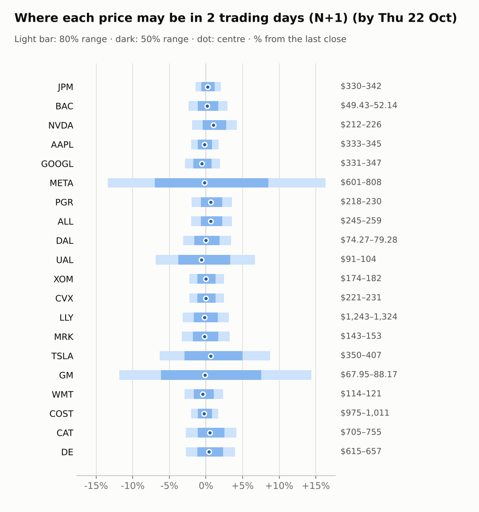
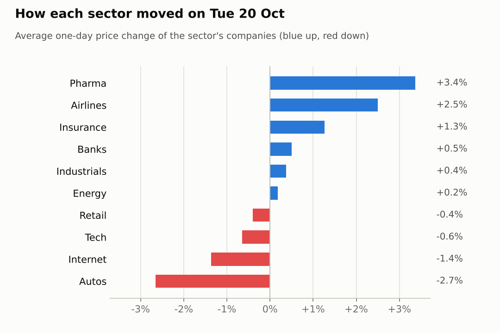
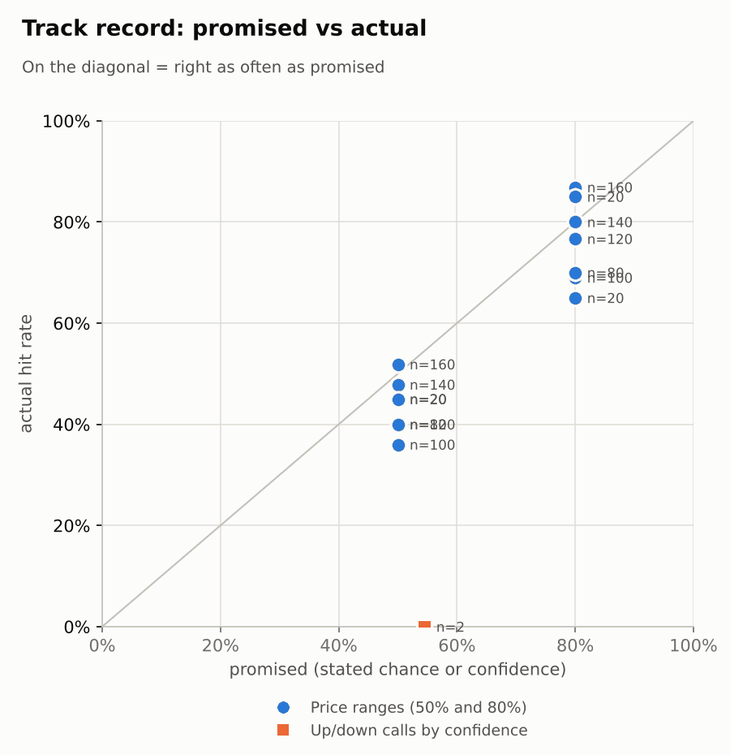

# Market brief: US (NYSE/Nasdaq), 2026-10-21

_Research log, not investment advice. Generated by a scheduled Claude Code routine._
<!-- report-data: as_of=2026-10-20 regime=CALM outcome=70248abff9bf -->

Easy-to-read version with charts and filters: [2026-10-21.html](2026-10-21.html)

## Headline
No calls today: the collect gate blocked 9 tickers on re-stored news ids, META and TSLA report results today, and the signal model sits at the base rate for the rest. The ranges carry the day: GM, UAL, META and TSLA have the widest bands.

## Top 3 today
- META and TSLA report results today; their N+1 ranges are widened for earnings, and the Tesla-SpaceX merger committee story is corroborated (3b0ad2b807ad292d) but gives no direction.
- GM fell 6.84% after a confirmed Q3 beat and a $20 billion buyback (0982c6a43fc0bb47) with narrowed EBIT guidance; premarket it is -0.3%.
- WTI crude is -3.07% to 98.67 overnight, a relief for airlines after UAL's 8-K (0000100517-26-000184) showed record revenue and a fuel bill up 62%.

## Yesterday
The S&P 500 ETF rose 0.3% on 2026-10-20 while defensives led: LLY +3.49% and MRK +3.25% (XLV +2.37%), and airlines bounced (JETS +2.38%) ahead of UAL's results. GM was the worst at -6.84% on 3.17x volume after its results (1b8bb9a96575458c, confirmed_primary).
N+1 80% ranges hit 19/20; the only miss was TSLA, which closed above its band on merger news. The 50% misses (AAPL, GM, JPM, LLY, MRK, TSLA) mostly came from moves of 3% or more.

Market on 2026-10-20: S&P 500 ETF 769.05 (+0.3%) · VIX 17.31 (-6.1%) · watchlist 11 up / 9 down · best LLY +3.5%, worst GM -6.8%

### Ranges scored (target date 2026-10-20)

N+1 ranges: **80% hit 19/20** (naive 18/20) · 50% hit 14/20

| Ticker | 80% range | 50% range | Actual | 80% | 50% | Naive 80% |
|---|---|---|---|---|---|---|
| AAPL | $336.85–$350.23 | $340.00–$347.02 | $339.50 | ✅ | ❌ | ✅ |
| ALL | $244.08–$258.69 | $247.50–$255.15 | $249.91 | ✅ | ✅ | ✅ |
| BAC | $49.86–$52.67 | $50.52–$51.99 | $50.64 | ✅ | ✅ | ✅ |
| CAT | $709.02–$762.87 | $721.55–$749.77 | $725.24 | ✅ | ✅ | ✅ |
| COST | $968.71–$1,007.55 | $977.86–$998.23 | $994.61 | ✅ | ✅ | ✅ |
| CVX | $218.53–$229.86 | $221.19–$227.13 | $225.71 | ✅ | ✅ | ✅ |
| DAL | $73.32–$78.25 | $74.47–$77.06 | $76.66 | ✅ | ✅ | ✅ |
| DE | $621.30–$665.18 | $631.52–$654.53 | $632.20 | ✅ | ✅ | ✅ |
| GM | $76.58–$93.62 | $80.35–$89.27 | $77.09 | ✅ | ❌ | ❌ |
| GOOGL | $333.45–$350.41 | $337.43–$346.32 | $340.27 | ✅ | ✅ | ✅ |
| JPM | $333.65–$344.88 | $336.31–$342.19 | $335.26 | ✅ | ❌ | ✅ |
| LLY | $1,219.08–$1,293.44 | $1,236.47–$1,275.46 | $1,283.66 | ✅ | ❌ | ✅ |
| META | $677.55–$745.49 | $693.22–$728.83 | $694.25 | ✅ | ✅ | ✅ |
| MRK | $141.03–$150.17 | $143.16–$147.96 | $148.30 | ✅ | ❌ | ✅ |
| NVDA | $209.31–$223.07 | $212.52–$219.73 | $216.47 | ✅ | ✅ | ✅ |
| PGR | $214.91–$227.66 | $217.89–$224.58 | $221.93 | ✅ | ✅ | ✅ |
| TSLA | $341.74–$368.12 | $347.87–$361.70 | $373.71 | ❌ | ❌ | ❌ |
| UAL | $90.27–$103.93 | $93.37–$100.52 | $97.77 | ✅ | ✅ | ✅ |
| WMT | $115.38–$122.01 | $116.93–$120.41 | $117.85 | ✅ | ✅ | ✅ |
| XOM | $173.84–$182.83 | $175.95–$180.66 | $177.86 | ✅ | ✅ | ✅ |

N+2 ranges that matured on the same date: 80% hit 17/20, 50% hit 9/20. N+3 ranges that matured on the same date: 80% hit 17/20, 50% hit 12/20. N+4 ranges that matured on the same date: 80% hit 16/20, 50% hit 6/20. N+5 ranges that matured on the same date: 80% hit 17/20, 50% hit 7/20.

### Calls scored

| Ticker | H | Call | Conf. | Move | Hit |
|---|---|---|---|---|---|
| NVDA | 5d · open→close | up | 54% | -8.44% | ❌ |

## Today (2026-10-21)

**Regime: CALM** · VIX 17.28 (-0.2%) · benchmark 5d -1.2% · benchmark 10d vol 9.5%

| Ticker | Sector | Close | N+1 80% | N+1 50% | N+5 80% | Call | Cue | Notes |
|---|---|---|---|---|---|---|---|---|
| JPM | Banks | $335.26 | $330.47–$342.07 | $333.22–$339.30 | $324.95–$349.67 | no call | +0.43% | cue +0.43% x0.5; major event x1.15 |
| BAC | Banks | $50.64 | $49.43–$52.14 | $50.07–$51.49 | $48.17–$53.93 | no call | +0.28% | cue +0.28% x0.5; major event x1.15 |
| NVDA | Tech | $216.47 | $212.34–$225.62 | $215.46–$222.42 | $206.15–$234.51 | no call | +1.98% | cue +1.98% x0.5; major event x1.15 |
| AAPL | Tech | $339.50 | $332.71–$345.41 | $335.72–$342.37 | $326.69–$353.74 | no call | -0.45% | cue -0.45% x0.5; major event x1.15 |
| GOOGL | Internet | $340.27 | $330.54–$346.84 | $334.39–$342.93 | $315.04–$368.29 | no call | -1.19% | cue -1.19% x0.5; earnings in horizon (x3.0 day); major event x1.15 |
| META | Internet | $694.25 | $601.37–$807.77 | $645.60–$753.53 | $605.92–$812.91 | no call | -0.47% | cue -0.47% x0.5; earnings in horizon (x3.0 day); earnings in horizon (x4.5 day, 7 past moves, median 8.9%); major event x1.15 |
| PGR | Insurance | $221.93 | $217.54–$229.86 | $220.44–$226.89 | $211.78–$238.05 | no call | +1.29% | cue +1.29% x0.5; major event x1.15 |
| ALL | Insurance | $249.91 | $244.87–$258.83 | $248.15–$255.47 | $238.33–$268.13 | no call | +1.24% | cue +1.24% x0.5; major event x1.15 |
| DAL | Airlines | $76.66 | $74.27–$79.28 | $75.45–$78.07 | $71.95–$82.64 | no call | -0.08% | cue -0.08% x0.5; major event x1.15 |
| UAL | Airlines | $97.77 | $91.08–$104.29 | $94.10–$101.02 | $89.71–$106.96 | no call | -1.20% | cue -1.20% x0.5; earnings in horizon (x2.09 day, 7 past moves, median 2.9%); major event x1.15 |
| XOM | Energy | $177.86 | $173.79–$182.22 | $175.79–$180.20 | $169.83–$187.80 | no call | -0.09% | cue -0.09% x0.5; major event x1.15 |
| CVX | Energy | $225.71 | $220.53–$231.29 | $223.07–$228.71 | $215.47–$238.41 | no call | -0.08% | cue -0.08% x0.5; major event x1.15 |
| LLY | Pharma | $1,283.66 | $1,243.15–$1,324.05 | $1,262.14–$1,304.53 | $1,205.50–$1,378.24 | no call | -0.38% | cue -0.38% x0.5; major event x1.15 |
| MRK | Pharma | $148.30 | $143.40–$153.12 | $145.68–$150.78 | $138.88–$159.65 | no call | -0.44% | cue -0.44% x0.5; major event x1.15 |
| TSLA | Autos | $373.71 | $350.00–$406.54 | $362.84–$392.45 | $335.82–$430.52 | no call | +1.24% | cue +1.24% x0.5; earnings in horizon (x2.58 day, 7 past moves, median 3.6%); earnings in horizon (x3.0 day); major event x1.15 |
| GM | Autos | $77.09 | $67.95–$88.17 | $72.34–$82.92 | $70.88–$84.96 | no call | -0.30% | cue -0.30% x0.5; earnings in horizon (x4.2 day, 7 past moves, median 8.4%); major event x1.15 |
| WMT | Retail | $117.85 | $114.42–$120.61 | $115.88–$119.12 | $111.51–$124.72 | no call | -0.87% | cue -0.87% x0.5; major event x1.15 |
| COST | Retail | $994.61 | $974.54–$1,011.46 | $983.29–$1,002.64 | $957.02–$1,035.68 | no call | -0.52% | cue -0.52% x0.5; major event x1.15 |
| CAT | Industrials | $725.24 | $705.25–$755.48 | $717.02–$743.33 | $681.98–$789.28 | no call | +1.00% | cue +1.00% x0.5; major event x1.15 |
| DE | Industrials | $632.20 | $614.80–$657.35 | $624.78–$647.07 | $595.06–$685.94 | no call | +0.83% | cue +0.83% x0.5; major event x1.15 |

No calls. The forecaster abstained on all 20 tickers:
- AAPL, ALL, BAC, CVX, GOOGL, JPM, LLY, NVDA, XOM: data failed validation (collect gate DUPLICATE_ID on stored news rows that name them).
- META, TSLA: results today (days_to_earnings 0).
- CAT, COST, DAL, DE, GM, MRK, PGR, UAL, WMT: model P(up) at the base rate and no verified, unpriced company news (GM's results are confirmed but already in its 6.84% drop; the Silence Therapeutics deal (21b1e3acf916b638, corroborated) is Merck KGaA's, not MRK's).

### Overnight cues and global factors

| Symbol | Name | Last | Change |
|---|---|---|---|
| DAX | DAX | 25,499.01 | +0.77% |
| DXY | US dollar index | 101.68 | -0.05% |
| ES | S&P 500 futures | 7,773.00 | +0.23% |
| FTSE | FTSE 100 | 10,740.28 | +0.07% |
| GOLD | Gold | 4,150.20 | +0.18% |
| HANGSENG | Hang Seng | 23,651.87 | -0.90% |
| KOSPI | KOSPI | 5,735.66 | +3.29% |
| NIKKEI | Nikkei 225 | 64,676.93 | +0.94% |
| NQ | Nasdaq 100 futures | 29,856.75 | +0.61% |
| SPY | S&P 500 ETF | 770.55 | +0.19% |
| STOXX50 | Euro Stoxx 50 | 6,175.62 | +0.88% |
| US10Y | US 10-year yield | 5.12 | -0.37% |
| USDCNY | USD/CNY | 6.66 | -0.40% |
| USDJPY | USD/JPY | 157.96 | -0.36% |
| VIX | VIX | 17.28 | -0.17% |
| WTI | WTI crude | 98.67 | -3.07% |

## Tomorrow and this week

| Date | Event | Type |
|---|---|---|
| 2026-10-20 | General Motors earnings | company |
| 2026-10-20 | United Airlines earnings | company |
| 2026-10-21 | Meta Platforms earnings | company |
| 2026-10-21 | Tesla earnings | company |
| 2026-10-28 | Alphabet earnings | company |
| 2026-10-28 | FOMC rate decision | major |
| 2026-10-29 | Caterpillar earnings | company |
| 2026-10-29 | Eli Lilly earnings | company |
| 2026-10-29 | Merck earnings | company |
| 2026-10-30 | Chevron earnings | company |
| 2026-10-30 | Costco ex-dividend (est. 1.47, last dividend) | company |
| 2026-10-30 | ExxonMobil earnings | company |
| 2026-11-02 | Apple earnings | company |
| 2026-11-04 | Allstate earnings | company |
| 2026-11-06 | US jobs report (usually first Friday; check for shifts) | major |
| 2026-11-10 | US CPI (October; provisional date) |  |

Key risks: META and TSLA results after today's close (META's N+1 80% range is $601.37–$807.77), the FOMC decision on 2026-10-28 together with Alphabet's results, and CAT, LLY and MRK results on 2026-10-29. Overnight cues are mildly positive (ES +0.23%, NQ +0.61%) in a CALM regime with VIX at 17.28; falling crude (WTI -3.07%) helps airlines and weighs on XOM and CVX.

## By sector

### Banks

BAC +0.5% and JPM +0.52% moved together with XLF (+1.2%). Bull: BAC is oversold (RSI 24, -6.15% over 5 days). Bear: BAC's $1.2 billion fine (095cc8df62309ad2, corroborated) is a week old and already priced. No calls (collect gate).

### Tech

AAPL -1.0% and NVDA -0.29%; XLK is -5.52% over 5 days. Bull: NVDA is +1.98% premarket. Bear: the NVDA Firmus Grid report is only a rumour (508e71581489504e), and the last two NVDA up calls missed. No calls (collect gate).

### Internet

GOOGL -1.13% and META -1.59%, moving together into results. Bull: META is -8.95% over 5 days into its print. Bear: META's last EPS missed, and GOOGL is -1.19% premarket. META reports today, GOOGL on 2026-10-28; no calls.

### Insurance

ALL +1.24% and PGR +1.29% moved with IAK (+1.29%), a sector move. Bull: PGR's last EPS beat. Bear: ALL is +5.71% over 5 days with RSI 64. No calls (ALL: collect gate; PGR: model at the base rate).

### Airlines

DAL +2.72% and UAL +2.27% rose together (JETS +2.38%). Bull: WTI crude is -3.07% overnight and both are oversold over 20 days (UAL -15.14%). Bear: UAL's 8-K (0000100517-26-000184) shows fuel up 62%, and UAL is -1.2% premarket; DAL's outlook-cut item is promotional (59ed42f8b936e32a). No calls.

### Energy

CVX +0.6% and XOM -0.24%, both near 20-day highs (RSI 71 and 70). Bull: +11.51% and +12.07% over 20 days. Bear: WTI crude is -3.07% to 98.67 overnight. No calls (collect gate).

### Pharma

LLY +3.49% and MRK +3.25% rose together with XLV (+2.37%), a sector rotation. Bull: LLY is at a record high, +10.04% over 5 days. Bear: RSI 70 for LLY after a fast run; the corroborated Silence deal (21b1e3acf916b638) is Merck KGaA's, not MRK's. No calls.

### Autos

GM -6.84% and TSLA +1.54% moved apart on company news. Bull: GM's results beat with a $20 billion buyback (0982c6a43fc0bb47, confirmed_primary); TSLA's merger committee story is corroborated (3b0ad2b807ad292d). Bear: GM narrowed its EBIT guidance and fell on 3.17x volume; TSLA reports today. No calls.

### Retail

COST -0.09% and WMT -0.72% after strong runs (XLP +4.23% over 5 days). Bull: both are up over 20 days (COST +10.58%, WMT +7.02%). Bear: RSI 73 and 69; WMT's bond-sale item is only a rumour (56adeea5489f3b61). No calls (model at the base rate).

### Industrials

CAT -0.08% and DE +0.83%, both down about 10% over 20 days. Bull: CAT is oversold (RSI 30) and +1.0% premarket. Bear: XLI is -1.11% over 5 days and no CAT news is verified; CAT reports on 2026-10-29. No calls (model at the base rate).

## Track record

Ranges (targets 50% / 80%; width, score and centre error in % of price, lower is better; naive = last close ± recent typical move, no-change = last close as the centre):

| H | Window | n | 50% cover | 80% cover | Naive 80% | Width | Naive width | Score | Naive score | Centre err | No-change err |
|---|---|---|---|---|---|---|---|---|---|---|---|
| 1d | since start | 160 | 52% | 87% | 79% | 6.84 | 6.16 | 8.477 | 8.980 | 1.97 | 2.09 |
| 1d | last 30 days | 160 | 52% | 87% | 79% | 6.84 | 6.16 | 8.477 | 8.980 | 1.97 | 2.09 |
| 1d legacy_cc | since start | 20 | 45% | 85% | 85% | 4.09 | 4.18 | 7.414 | 7.632 | 1.45 | 1.39 |
| 1d legacy_cc | last 30 days | 20 | 45% | 85% | 85% | 4.09 | 4.18 | 7.414 | 7.632 | 1.45 | 1.39 |
| 2d | since start | 140 | 48% | 80% | 71% | 8.81 | 7.49 | 10.925 | 11.818 | 2.67 | 2.79 |
| 2d | last 30 days | 140 | 48% | 80% | 71% | 8.81 | 7.49 | 10.925 | 11.818 | 2.67 | 2.79 |
| 3d | since start | 120 | 40% | 77% | 60% | 10.53 | 8.61 | 13.128 | 14.751 | 3.36 | 3.48 |
| 3d | last 30 days | 120 | 40% | 77% | 60% | 10.53 | 8.61 | 13.128 | 14.751 | 3.36 | 3.48 |
| 4d | since start | 100 | 36% | 69% | 55% | 12.44 | 9.55 | 16.956 | 19.058 | 4.13 | 4.22 |
| 4d | last 30 days | 100 | 36% | 69% | 55% | 12.44 | 9.55 | 16.956 | 19.058 | 4.13 | 4.22 |
| 5d | since start | 80 | 40% | 70% | 53% | 13.55 | 10.48 | 18.566 | 20.642 | 4.47 | 4.53 |
| 5d | last 30 days | 80 | 40% | 70% | 53% | 13.55 | 10.48 | 18.566 | 20.642 | 4.47 | 4.53 |
| 5d legacy_cc | since start | 20 | 45% | 65% | 50% | 9.91 | 9.35 | 17.346 | 16.489 | 3.60 | 3.63 |
| 5d legacy_cc | last 30 days | 20 | 45% | 65% | 50% | 9.91 | 9.35 | 17.346 | 16.489 | 3.60 | 3.63 |

Ranges by regime (since start):

| H | Regime | n | 50% cover | 80% cover | Naive 80% |
|---|---|---|---|---|---|
| 1d | CALM | 80 | 55% | 90% | 89% |
| 1d | EVENT_HEAVY | 60 | 48% | 83% | 67% |
| 1d | TRENDING | 20 | 50% | 85% | 75% |
| 1d legacy_cc | TRENDING | 20 | 45% | 85% | 85% |
| 2d | CALM | 60 | 58% | 90% | 93% |
| 2d | EVENT_HEAVY | 60 | 40% | 72% | 52% |
| 2d | TRENDING | 20 | 40% | 75% | 65% |
| 3d | CALM | 40 | 50% | 78% | 70% |
| 3d | EVENT_HEAVY | 60 | 33% | 75% | 52% |
| 3d | TRENDING | 20 | 40% | 80% | 65% |
| 4d | CALM | 20 | 40% | 80% | 70% |
| 4d | EVENT_HEAVY | 60 | 32% | 68% | 50% |
| 4d | TRENDING | 20 | 45% | 60% | 55% |
| 5d | CALM | 20 | 35% | 60% | 50% |
| 5d | EVENT_HEAVY | 40 | 38% | 78% | 55% |
| 5d | TRENDING | 20 | 50% | 65% | 50% |
| 5d legacy_cc | TRENDING | 20 | 45% | 65% | 50% |

Up/down calls vs the always-up baseline:

| H | Window | n | Hit rate | Always-up |
|---|---|---|---|---|
| 5d · open→close | since start | 2 | 0% | 0% |
| 5d · open→close | last 30 days | 2 | 0% | 0% |

Calls by confidence band (a band should hit about as often as its confidence):

| Band | n | Avg confidence | Hit rate |
|---|---|---|---|
| 0.50-0.59 · open→close | 2 | 55% | 0% |

Weekly review 2026-W42: 0 proposed range changes for a human to decide · [review-2026-W42.md](review-2026-W42.md)

## Data quality

- Indicators: 20 OK, partial: none, blocked: none
- Regime notes: none

| H | Calibration | History n | Live n | q10 / q90 |
|---|---|---|---|---|
| 1d | pool | 8980 | 160 | -1.13 / 1.23 |
| 2d | pool | 8960 | 140 | -1.15 / 1.32 |
| 3d | pool | 8940 | 120 | -1.14 / 1.33 |
| 4d | pool | 8920 | 100 | -1.18 / 1.35 |
| 5d | pool | 8900 | 80 | -1.14 / 1.37 |

- validation collect DUPLICATE_ID (blocking): news, 20 duplicated ids (e.g. 32508ada91cf3af5, 37b9d3600e34aacb, 3f8fae3abae9655c, 3fddc7de272551bb, 401190c0146ad658). 18 old headlines first stored 2026-10-05 to 2026-10-08 were stored again by today's collection under their old ids (known open de-dup issue). The forecaster and the AI traders abstained on the tickers they name: AAPL, ALL, BAC, CVX, GOOGL, JPM, LLY, NVDA, XOM. None of the ids is cited.
- collect_filings, collect_insiders, collect_stakes, collect_fundamentals, collect_events warnings: SEC acceptance times of CIK 19617 and 70858 unverified, stored as served (maybe 4-5h late): mixed file.
- collect_holdings warnings: SEC acceptance times unverified (no ACCEPTANCE-DATETIME in old filings) for 13F filer CIKs 933478, 1167483, 1040273, 1029160.
- collect_articles: 41 unvetted outlet domains skipped (e.g. ad-hoc-news.de, marketbeat.com, tradingview.com, gurufocus.com).
- news-analyst: today's 2018 pending items were scored by keyword rules under time pressure (summaries close to the headline wording; sentiment and materiality rough). The news gate passed.
- results digests: none due (0 releases detected in the last 10 days).
- inbox import: no company commands or paper trades pending.
- Judge FAIL from a previous run: 2026-10-19 spotcheck round 1: FAIL: report 2026-10-14 cites 41d60600e8f35aa4 for a CAT target cut its headline does not state; says claims stored for 11 of 15 events, data shows 13 of 15. Lesson and both claims check out.
