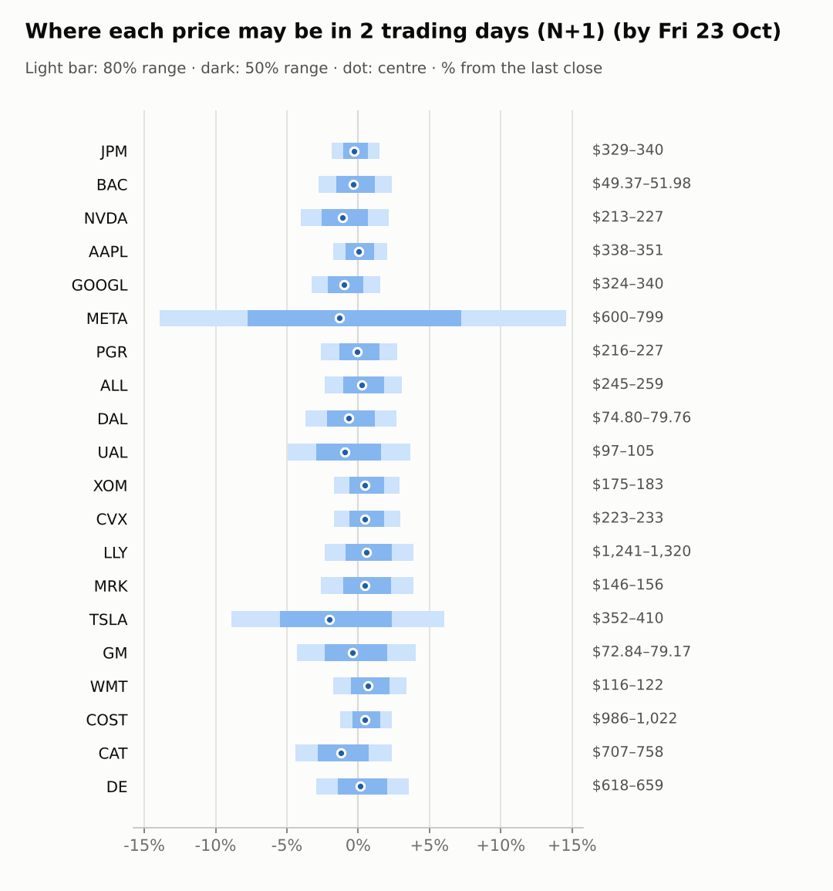
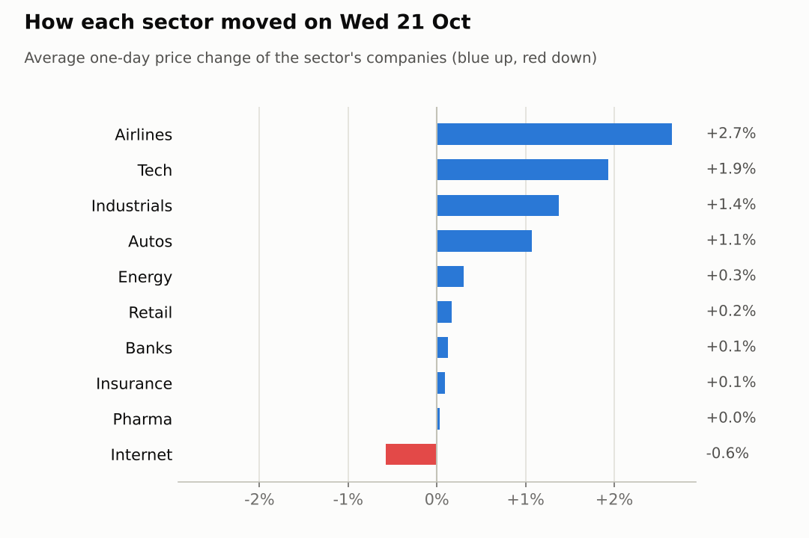
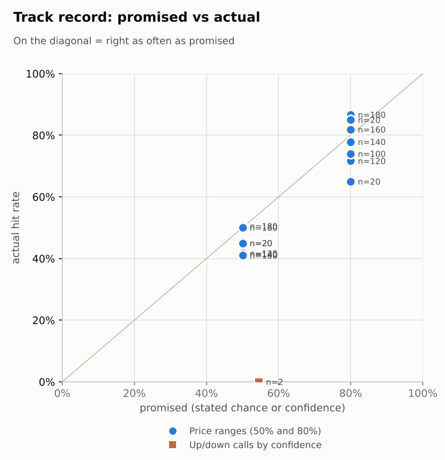

# Market brief: US (NYSE/Nasdaq), 2026-10-22

_Research log, not investment advice. Generated by a scheduled Claude Code routine._
<!-- report-data: as_of=2026-10-21 regime=CALM outcome=70248abff9bf -->

Easy-to-read version with charts and filters: [2026-10-22.html](2026-10-22.html)

## Headline
No calls today: the collect gate blocked 10 tickers on re-stored news ids again, and the signal model sits at the base rate for the rest. The overnight tape is risk-off after META and TSLA results: S&P 500 futures -0.99% and Nasdaq 100 futures -1.66%.

## Top 3 today
- META's results are out (0001628280-26-066700): EPS 3.83 against a 5.46 consensus after a legal charge (d52d32ea690cb848); premarket META is -2.57%.
- TSLA is -4.06% premarket after its results, as the after-hours gain reversed on its capex plan (0001628280-26-066738, 9a5ddfe088a21cf0).
- Risk-off cues: Nasdaq 100 futures -1.66%, KOSPI -3.52%, VIX 18.26 (+9.47%), WTI +2.13% to 99.22 (05365556f9ed8e1c).

## Yesterday
The S&P 500 ETF rose 0.5% on 2026-10-21 with 14 of 20 watchlist stocks up. UAL was the best at +4.0% on 2.17x its usual volume after its results (0000100517-26-000184); GOOGL was the worst at -1.6%.
N+1 80% ranges hit 17/20 (naive 14/20). DAL and MRK closed above their ranges and GOOGL below; the bands were too narrow for those moves, with no stock-specific news to explain them.
The last settled call (NVDA, N+5 up) missed: NVDA fell 8.44% over the window.

Market on 2026-10-21: S&P 500 ETF 773.09 (+0.5%) · VIX 16.68 (-3.6%) · watchlist 14 up / 6 down · best UAL +4.0%, worst GOOGL -1.6%

### Ranges scored (target date 2026-10-21)

N+1 ranges: **80% hit 17/20** (naive 14/20) · 50% hit 8/20

| Ticker | 80% range | 50% range | Actual | 80% | 50% | Naive 80% |
|---|---|---|---|---|---|---|
| AAPL | $334.92–$347.86 | $338.03–$344.80 | $343.99 | ✅ | ✅ | ✅ |
| ALL | $239.72–$253.67 | $243.04–$250.35 | $251.04 | ✅ | ❌ | ✅ |
| BAC | $49.07–$51.85 | $49.73–$51.19 | $50.78 | ✅ | ✅ | ✅ |
| CAT | $693.49–$744.78 | $705.64–$732.51 | $740.21 | ✅ | ❌ | ✅ |
| COST | $979.35–$1,017.86 | $988.58–$1,008.76 | $998.31 | ✅ | ✅ | ✅ |
| CVX | $220.78–$231.90 | $223.43–$229.26 | $226.78 | ✅ | ✅ | ✅ |
| DAL | $72.08–$76.82 | $73.20–$75.69 | $77.67 | ❌ | ❌ | ❌ |
| DE | $600.46–$643.38 | $610.63–$633.12 | $636.54 | ✅ | ❌ | ✅ |
| GM | $72.56–$88.49 | $76.15–$84.50 | $76.11 | ✅ | ❌ | ❌ |
| GOOGL | $335.85–$352.71 | $339.87–$348.71 | $334.76 | ❌ | ❌ | ❌ |
| JPM | $328.52–$340.40 | $331.37–$337.60 | $335.19 | ✅ | ✅ | ✅ |
| LLY | $1,212.71–$1,285.87 | $1,230.12–$1,268.45 | $1,270.75 | ✅ | ❌ | ✅ |
| META | $607.19–$821.98 | $653.63–$766.01 | $697.52 | ✅ | ✅ | ✅ |
| MRK | $139.87–$148.88 | $142.01–$146.73 | $149.88 | ❌ | ❌ | ❌ |
| NVDA | $209.80–$223.42 | $213.04–$220.17 | $221.97 | ✅ | ❌ | ✅ |
| PGR | $213.89–$226.23 | $216.83–$223.29 | $221.35 | ✅ | ✅ | ✅ |
| TSLA | $341.18–$397.69 | $354.14–$383.75 | $386.47 | ✅ | ❌ | ❌ |
| UAL | $89.12–$102.22 | $92.15–$99.00 | $101.67 | ✅ | ❌ | ❌ |
| WMT | $116.50–$123.00 | $118.05–$121.46 | $117.80 | ✅ | ❌ | ✅ |
| XOM | $175.25–$184.07 | $177.36–$181.98 | $178.09 | ✅ | ✅ | ✅ |

N+2 ranges that matured on the same date: 80% hit 19/20, 50% hit 13/20. N+3 ranges that matured on the same date: 80% hit 17/20, 50% hit 10/20. N+4 ranges that matured on the same date: 80% hit 17/20, 50% hit 14/20. N+5 ranges that matured on the same date: 80% hit 18/20, 50% hit 9/20.

### Calls scored

| Ticker | H | Call | Conf. | Move | Hit |
|---|---|---|---|---|---|
| NVDA | 5d · open→close | up | 54% | -8.44% | ❌ |

## Today (2026-10-22)

**Regime: CALM** · VIX 18.26 (+9.5%) · benchmark 5d +0.5% · benchmark 10d vol 10.0%

| Ticker | Sector | Close | N+1 80% | N+1 50% | N+5 80% | Call | Cue | Notes |
|---|---|---|---|---|---|---|---|---|
| JPM | Banks | $335.19 | $328.95–$340.13 | $331.61–$337.49 | $323.61–$347.43 | no call | -0.56% | cue -0.56% x0.5; major event x1.15 |
| BAC | Banks | $50.78 | $49.37–$51.98 | $49.99–$51.36 | $48.14–$53.71 | no call | -0.69% | cue -0.69% x0.5; major event x1.15 |
| NVDA | Tech | $221.97 | $213.02–$226.71 | $216.25–$223.44 | $206.64–$235.84 | no call | -2.25% | cue -2.25% x0.5; major event x1.15 |
| AAPL | Tech | $343.99 | $337.90–$350.93 | $341.00–$347.85 | $331.71–$359.46 | no call | +0.05% | cue +0.05% x0.5; major event x1.15 |
| GOOGL | Internet | $334.76 | $323.76–$339.85 | $327.58–$336.03 | $308.45–$361.00 | no call | -2.02% | cue -2.02% x0.5; earnings in horizon (x3.0 day); major event x1.15 |
| META | Internet | $697.52 | $600.44–$799.38 | $643.41–$747.74 | $632.43–$762.11 | no call | -2.57% | cue -2.57% x0.5; earnings in horizon (x4.5 day, 7 past moves, median 8.9%); major event x1.15 |
| PGR | Insurance | $221.35 | $215.61–$227.43 | $218.41–$224.62 | $210.06–$235.27 | no call | -0.15% | cue -0.15% x0.5; major event x1.15 |
| ALL | Insurance | $251.04 | $245.21–$258.78 | $248.42–$255.55 | $238.84–$267.78 | no call | +0.45% | cue +0.45% x0.5; major event x1.15 |
| DAL | Airlines | $77.67 | $74.80–$79.76 | $75.97–$78.57 | $72.49–$83.07 | no call | -1.38% | cue -1.38% x0.5; major event x1.15 |
| UAL | Airlines | $101.67 | $96.65–$105.37 | $98.69–$103.27 | $92.66–$111.31 | no call | -1.84% | cue -1.84% x0.5; major event x1.15 |
| XOM | Energy | $178.09 | $175.06–$183.28 | $177.01–$181.33 | $171.17–$188.70 | no call | +0.96% | cue +0.96% x0.5; major event x1.15 |
| CVX | Energy | $226.78 | $222.90–$233.46 | $225.40–$230.95 | $217.91–$240.42 | no call | +0.98% | cue +0.98% x0.5; major event x1.15 |
| LLY | Pharma | $1,270.75 | $1,240.74–$1,319.63 | $1,259.35–$1,300.78 | $1,166.64–$1,424.85 | no call | +1.12% | cue +1.12% x0.5; earnings in horizon (x3.0 day); major event x1.15 |
| MRK | Pharma | $149.88 | $145.99–$155.67 | $148.27–$153.36 | $136.93–$168.61 | no call | +0.89% | cue +0.89% x0.5; earnings in horizon (x3.0 day); major event x1.15 |
| TSLA | Autos | $386.47 | $352.03–$409.76 | $365.19–$395.50 | $350.68–$414.80 | no call | -4.06% | cue -4.06% x0.5; earnings in horizon (x2.52 day, 8 past moves, median 4.1%); major event x1.15 |
| GM | Autos | $76.11 | $72.84–$79.17 | $74.32–$77.65 | $69.94–$83.47 | no call | -0.80% | cue -0.80% x0.5; major event x1.15 |
| WMT | Retail | $117.80 | $115.74–$121.80 | $117.18–$120.36 | $112.89–$125.81 | no call | +1.36% | cue +1.36% x0.5; major event x1.15 |
| COST | Retail | $998.31 | $985.80–$1,022.10 | $994.45–$1,013.51 | $968.52–$1,045.82 | no call | +0.94% | cue +0.94% x0.5; major event x1.15 |
| CAT | Industrials | $740.21 | $707.43–$757.74 | $719.27–$745.69 | $660.50–$825.39 | no call | -2.46% | cue -2.46% x0.5; earnings in horizon (x3.0 day); major event x1.15 |
| DE | Industrials | $636.54 | $617.74–$659.28 | $627.53–$649.34 | $598.40–$687.07 | no call | +0.23% | cue +0.23% x0.5; major event x1.15 |

No calls today; the forecaster abstained on all 20 tickers at both horizons.
- AAPL, ALL, BAC, CVX, GOOGL, JPM, LLY, NVDA, TSLA, XOM: data failed validation (collect gate DUPLICATE_ID on stored news rows that name them, known de-dup issue).
- CAT, COST, DAL, DE, PGR, WMT: model P(up) at the base rate and no verified, unpriced company news.
- GM, UAL: their results are confirmed (0001467858-26-000056, 0000100517-26-000184) but two sessions old and already traded.
- META: results confirmed (0001628280-26-066700) but mixed (EPS 3.83 against 5.46 expected); buying at the open already prices the -2.57% gap.
- MRK: no verified ticker news; Merck's own notice dates its results on 2026-10-29, the N+5 exit day.

### Overnight cues and global factors

| Symbol | Name | Last | Change |
|---|---|---|---|
| DAX | DAX | 25,435.48 | -0.82% |
| DXY | US dollar index | 101.81 | +0.03% |
| ES | S&P 500 futures | 7,723.00 | -0.99% |
| FTSE | FTSE 100 | 10,718.41 | -0.32% |
| GOLD | Gold | 4,078.80 | -1.72% |
| HANGSENG | Hang Seng | 22,934.68 | -3.03% |
| KOSPI | KOSPI | 5,533.77 | -3.52% |
| NIKKEI | Nikkei 225 | 62,907.84 | -2.65% |
| NQ | Nasdaq 100 futures | 29,508.00 | -1.66% |
| SPY | S&P 500 ETF | 765.96 | -0.92% |
| STOXX50 | Euro Stoxx 50 | 6,117.18 | -1.46% |
| US10Y | US 10-year yield | 5.15 | +0.57% |
| USDCNY | USD/CNY | 6.66 | -0.21% |
| USDJPY | USD/JPY | 157.07 | -0.76% |
| VIX | VIX | 18.26 | +9.47% |
| WTI | WTI crude | 99.22 | +2.13% |

## Tomorrow and this week

| Date | Event | Type |
|---|---|---|
| 2026-10-21 | Meta Platforms earnings | company |
| 2026-10-21 | Tesla earnings | company |
| 2026-10-28 | Alphabet earnings | company |
| 2026-10-28 | FOMC rate decision | major |
| 2026-10-29 | Caterpillar earnings | company |
| 2026-10-29 | Eli Lilly earnings | company |
| 2026-10-29 | Merck earnings | company |
| 2026-10-30 | Chevron earnings | company |
| 2026-10-30 | Costco ex-dividend (est. 1.47, last dividend) | company |
| 2026-10-30 | ExxonMobil earnings | company |
| 2026-11-02 | Apple earnings | company |
| 2026-11-04 | Allstate earnings | company |
| 2026-11-06 | US jobs report (usually first Friday; check for shifts) | major |
| 2026-11-10 | US CPI (October; provisional date) |  |

Key risks: the FOMC decision and Alphabet's results on 2026-10-28, then CAT, LLY and MRK results on 2026-10-29 and CVX and XOM on 2026-10-30. Overnight cues are risk-off (ES -0.99%, NQ -1.66%, Hang Seng -3.03%) with VIX up 9.47% to 18.26 in a CALM regime; WTI +2.13% to 99.22 helps XOM and CVX and weighs on DAL and UAL (05365556f9ed8e1c, background: Brent above $111 after attacks on Saudi Arabia).

## By sector

### Banks

JPM -0.02% and BAC +0.28% moved together and quietly. Bull: BAC is oversold (RSI 25). Bear: BAC's $1.2B AML penalty story is corroborated (63af49e570964980) and both are lower premarket (BAC -0.69%, JPM -0.56%). Both blocked today; no calls.

### Tech

NVDA +2.54% and AAPL +1.32% rose together with XLK +1.67%. Bull: AAPL sits at 0.988 of its 20-day high. Bear: NVDA is -2.25% premarket as Nasdaq futures fall on AI worries (88cba723bc74b9a0); AAPL faces a Loop Capital downgrade (011a9f2159350107, promotional). Both blocked today; no calls.

### Internet

GOOGL -1.62% and META +0.47% moved apart. Bull: META's revenue grew 26% (0001628280-26-066700). Bear: META's EPS missed and it faces a $25 billion penalty (937da16dee1b1e48, promotional); GOOGL is -2.02% premarket and reports on 2026-10-28. GOOGL blocked; no calls.

### Insurance

ALL +0.45% and PGR -0.26% moved apart on no company news. Bull: both are up over 20 days (ALL +11.25%, PGR +8.97%) and have negative betas in a risk-off tape. Bear: both are extended near their 20-day highs. ALL blocked; no calls.

### Airlines

UAL +3.99% and DAL +1.32% rose together on UAL's results (0000100517-26-000184). Bull: both are down over 20 days (UAL -8.17%, DAL -4.99%). Bear: WTI is +2.13% and UAL's fuel bill jumped 62%; premarket UAL -1.84%, DAL -1.38%. No calls.

### Energy

CVX +0.47% and XOM +0.13% moved together with oil. Bull: WTI +2.13% and both are higher premarket (CVX +0.98%, XOM +0.96%). Bear: both are stretched (RSI 72 and 70) with results on 2026-10-30. Both blocked; no calls.

### Pharma

MRK +1.07% and LLY -1.01% moved apart. Bull: MRK won EU approval for Keytruda plus Padcev (b77b3f4cfd499f54, unverified) and is +0.89% premarket. Bear: LLY and MRK both report on 2026-10-29; the Silence deal (21b1e3acf916b638, corroborated) is Merck KGaA's, not MRK's. LLY blocked; no calls.

### Autos

TSLA +3.41% and GM -1.27% moved apart on company news. Bull: GM's results came with a $20 billion buyback (0982c6a43fc0bb47, confirmed_primary) and it is -8.36% over 5 days. Bear: TSLA is -4.06% premarket after its results (9a5ddfe088a21cf0, unverified). TSLA blocked; no calls.

### Retail

WMT -0.04% and COST +0.37% were flat. Bull: both are higher premarket (WMT +1.36%, COST +0.94%); COST goes ex-dividend on 2026-10-30. Bear: both are overbought (RSI 69 and 74). No calls.

### Industrials

CAT +2.06% and DE +0.69% rose together with XLI +0.91%. Bull: both are well off their 20-day highs (CAT -8.84%, DE -10.28% over 20 days). Bear: CAT is -2.46% premarket and reports on 2026-10-29. No calls.

## Track record

Ranges (targets 50% / 80%; width, score and centre error in % of price, lower is better; naive = last close ± recent typical move, no-change = last close as the centre):

| H | Window | n | 50% cover | 80% cover | Naive 80% | Width | Naive width | Score | Naive score | Centre err | No-change err |
|---|---|---|---|---|---|---|---|---|---|---|---|
| 1d | since start | 180 | 51% | 87% | 78% | 7.00 | 6.15 | 8.575 | 9.210 | 2.00 | 2.11 |
| 1d | last 30 days | 180 | 51% | 87% | 78% | 7.00 | 6.15 | 8.575 | 9.210 | 2.00 | 2.11 |
| 1d legacy_cc | since start | 20 | 45% | 85% | 85% | 4.09 | 4.18 | 7.414 | 7.632 | 1.45 | 1.39 |
| 1d legacy_cc | last 30 days | 20 | 45% | 85% | 85% | 4.09 | 4.18 | 7.414 | 7.632 | 1.45 | 1.39 |
| 2d | since start | 160 | 50% | 82% | 73% | 8.92 | 7.54 | 10.923 | 11.914 | 2.62 | 2.74 |
| 2d | last 30 days | 160 | 50% | 82% | 73% | 8.92 | 7.54 | 10.923 | 11.914 | 2.62 | 2.74 |
| 3d | since start | 140 | 41% | 78% | 64% | 10.52 | 8.66 | 13.013 | 14.306 | 3.25 | 3.37 |
| 3d | last 30 days | 140 | 41% | 78% | 64% | 10.52 | 8.66 | 13.013 | 14.306 | 3.25 | 3.37 |
| 4d | since start | 120 | 42% | 72% | 60% | 12.29 | 9.62 | 16.269 | 17.814 | 3.89 | 3.97 |
| 4d | last 30 days | 120 | 42% | 72% | 60% | 12.29 | 9.62 | 16.269 | 17.814 | 3.89 | 3.97 |
| 5d | since start | 100 | 41% | 74% | 54% | 13.90 | 10.46 | 18.290 | 19.903 | 4.38 | 4.47 |
| 5d | last 30 days | 100 | 41% | 74% | 54% | 13.90 | 10.46 | 18.290 | 19.903 | 4.38 | 4.47 |
| 5d legacy_cc | since start | 20 | 45% | 65% | 50% | 9.91 | 9.35 | 17.346 | 16.489 | 3.60 | 3.63 |
| 5d legacy_cc | last 30 days | 20 | 45% | 65% | 50% | 9.91 | 9.35 | 17.346 | 16.489 | 3.60 | 3.63 |

Ranges by regime (since start):

| H | Regime | n | 50% cover | 80% cover | Naive 80% |
|---|---|---|---|---|---|
| 1d | CALM | 100 | 52% | 89% | 85% |
| 1d | EVENT_HEAVY | 60 | 48% | 83% | 67% |
| 1d | TRENDING | 20 | 50% | 85% | 75% |
| 1d legacy_cc | TRENDING | 20 | 45% | 85% | 85% |
| 2d | CALM | 80 | 60% | 91% | 91% |
| 2d | EVENT_HEAVY | 60 | 40% | 72% | 52% |
| 2d | TRENDING | 20 | 40% | 75% | 65% |
| 3d | CALM | 60 | 50% | 80% | 75% |
| 3d | EVENT_HEAVY | 60 | 33% | 75% | 52% |
| 3d | TRENDING | 20 | 40% | 80% | 65% |
| 4d | CALM | 40 | 55% | 83% | 78% |
| 4d | EVENT_HEAVY | 60 | 32% | 68% | 50% |
| 4d | TRENDING | 20 | 45% | 60% | 55% |
| 5d | CALM | 20 | 35% | 60% | 50% |
| 5d | EVENT_HEAVY | 60 | 40% | 82% | 57% |
| 5d | TRENDING | 20 | 50% | 65% | 50% |
| 5d legacy_cc | TRENDING | 20 | 45% | 65% | 50% |

Up/down calls vs the always-up baseline:

| H | Window | n | Hit rate | Always-up |
|---|---|---|---|---|
| 5d · open→close | since start | 2 | 0% | 0% |
| 5d · open→close | last 30 days | 2 | 0% | 0% |

Calls by confidence band (a band should hit about as often as its confidence):

| Band | n | Avg confidence | Hit rate |
|---|---|---|---|
| 0.50-0.59 · open→close | 2 | 55% | 0% |

Weekly review 2026-W42: 0 proposed range changes for a human to decide · [review-2026-W42.md](review-2026-W42.md)

## Data quality

- Indicators: 20 OK, partial: none, blocked: none
- Regime notes: none

| H | Calibration | History n | Live n | q10 / q90 |
|---|---|---|---|---|
| 1d | pool | 9000 | 180 | -1.13 / 1.23 |
| 2d | pool | 8980 | 160 | -1.14 / 1.31 |
| 3d | pool | 8960 | 140 | -1.14 / 1.33 |
| 4d | pool | 8940 | 120 | -1.17 / 1.35 |
| 5d | pool | 8920 | 100 | -1.14 / 1.37 |

- validation collect DUPLICATE_ID (blocking): news, 20 duplicated ids (e.g. 034e890a6034e8a5, 118d8ff1ee5faf5a, 20f781c6c9d1a2b6, 2ba874bb1785ca15, 2debc2a68fc96377). Old headlines first stored 2026-10-05 to 2026-10-09 were stored again under their old ids (known open de-dup issue). The forecaster and the AI traders abstained on the tickers they name: AAPL, ALL, BAC, CVX, GOOGL, JPM, LLY, NVDA, TSLA, XOM. None of the ids is cited.
- validation collect COLLECTOR_FAILED (warning): events, the Yahoo calendar was empty for all 20 tickers (Yahoo "Invalid Crumb" error); stored upcoming dates were kept (META's next date of 2026-10-28 is stale: it reported on 2026-10-21).
- validation collect COLLECTOR_FAILED (warning): options, no option expiries for all 20 tickers (same Yahoo error); no implied vol in today's ranges.
- SEC acceptance times not checked (stored as served, maybe 4-5h late) for CIKs 19617, 70858, 1326801 (META) and 1318605 (TSLA) in the filings, insiders, stakes, fundamentals and events collectors; for holdings, CIKs 933478, 1167483, 1040273 and 1029160 (no acceptance header in old filings).
- results digests: none due (0 releases detected), although META, TSLA, UAL, GM, JPM and BAC filed results 8-Ks in the window. No SEC results-release event has been stored since 2026-10-02; a new issue was opened.
- claims: 20 claims for 11 of 15 selected clusters, all valid; 4 clusters had no checkable fact. Articles: 29 pages deferred to the next run.
- AI traders: abstention codes ai.combined.opus.v1 abstained 20, ai.combined.sonnet.v1 abstained 13, ai.news_results.sonnet.v1 abstained 20, ai.pattern_mood.sonnet.v1 abstained 20; no gate failures or timeouts.
- MRK: a promotional headline (54d35d34ba647700) says results "on Thursday"; Merck's own notice and the stored event say 2026-10-29.
- validation: news, features, context, forecast gates passed with no warnings.
- 2026-10-19 spotcheck FAIL (round 1): report 2026-10-14 cites 41d60600e8f35aa4 for a CAT target cut its headline does not state; says claims stored for 11 of 15 events, data shows 13 of 15. Nothing dropped.
