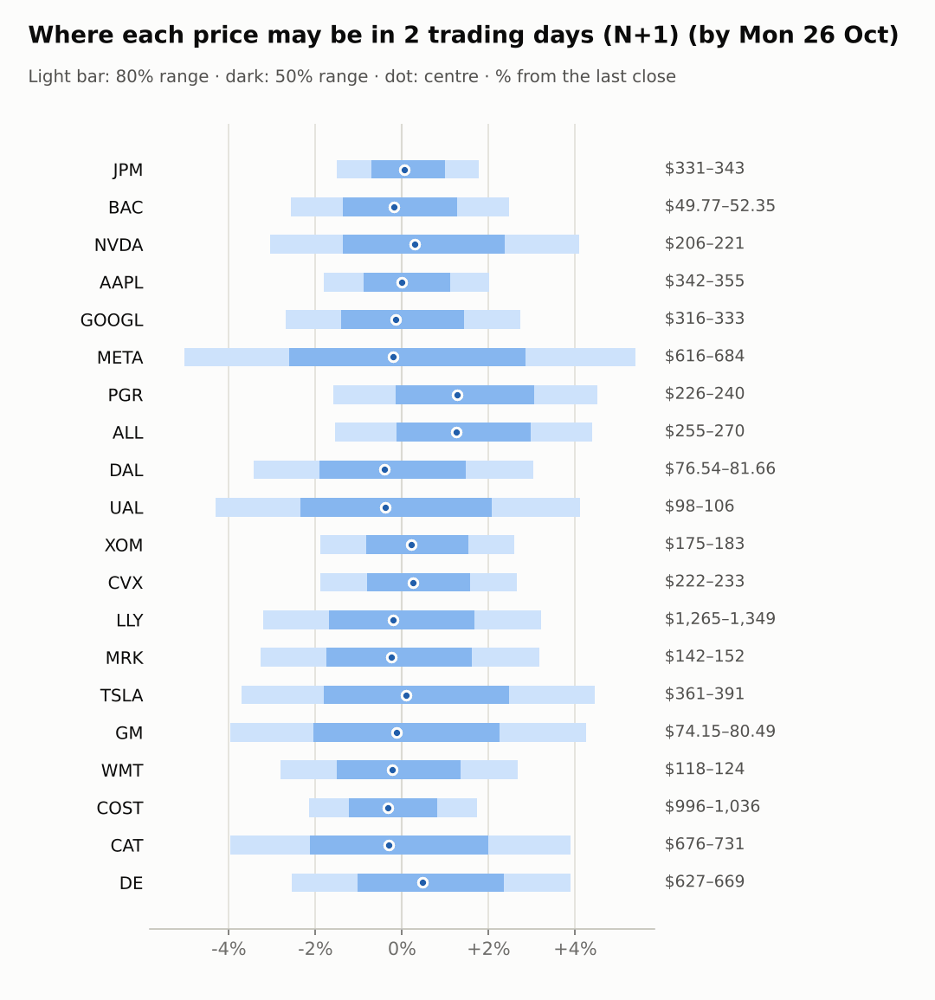
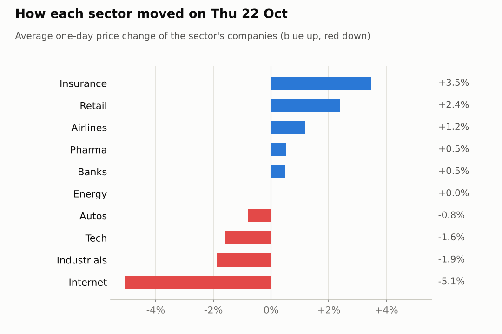
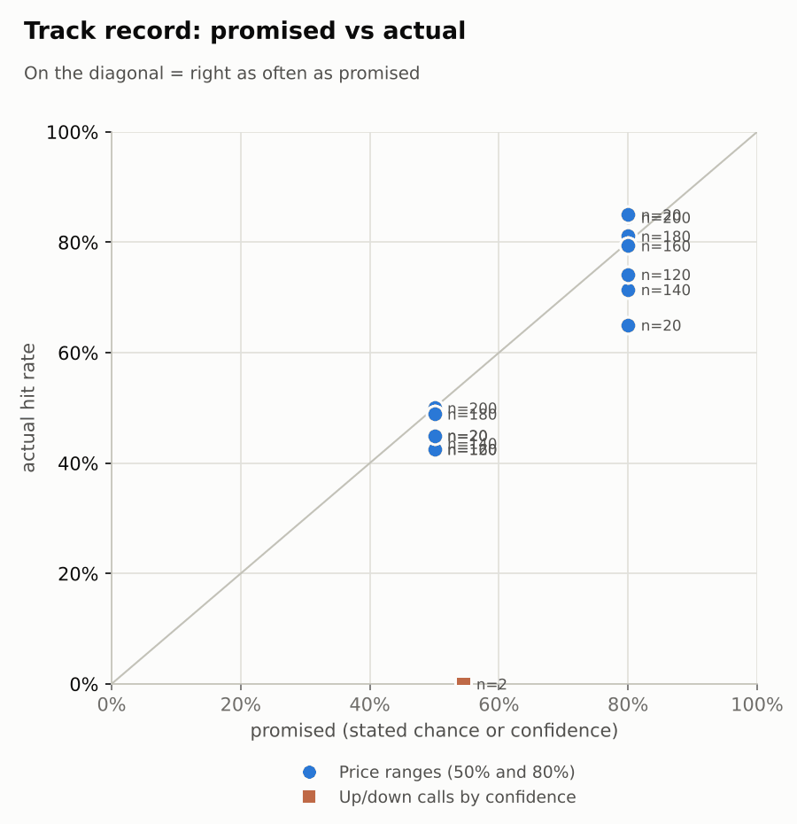

# Market brief: US (NYSE/Nasdaq), 2026-10-23

_Research log, not investment advice. Generated by a scheduled Claude Code routine._
<!-- report-data: as_of=2026-10-22 regime=CALM outcome=70248abff9bf -->

Easy-to-read version with charts and filters: [2026-10-23.html](2026-10-23.html)

## Headline
No calls today: the collect gate blocked 10 tickers again on re-stored news ids (the open de-dup issue), and for the other 10 the signal model sits at its base rate. Cues are mildly risk-off before the open: S&P 500 futures -0.31% and Nasdaq 100 futures -0.17%, with VIX at 19.68.

## Top 3 today
- META fell 7.0% on 2.07x its usual volume after its results (0001628280-26-066700); premarket META is -0.4%.
- Oil keeps pressing airlines: WTI is +1.52% to 100.98, and DAL (-0.82%) and UAL (-0.78%) are lower premarket (9d9838158a7a02fa).
- The FOMC decision and Alphabet's results on 2026-10-28 are the week's main risks; until then the model gives no edge, so no calls.

## Yesterday
The S&P 500 ETF fell 1.2% on 2026-10-22, led by tech and internet: XLK -3.29% and XLC -1.42%. META was the worst at -7.0% after its results (0001628280-26-066700), and NVDA fell 4.4%. Staples and insurance rose: XLP +3.31%, PGR +3.7%, WMT +2.82%.
The N+1 ranges held 13/20 at 80%, the same as the naive band. The misses were the big one-day moves: AAPL, ALL, COST and WMT closed above their bands, while CAT (-4.89%), GOOGL and NVDA closed below theirs. The one settled call, NVDA 5d up at 54%, missed (-8.44%).

Market on 2026-10-22: S&P 500 ETF 763.96 (-1.2%) · VIX 19.03 (+14.1%) · watchlist 13 up / 7 down · best PGR +3.7%, worst META -7.0%

### Ranges scored (target date 2026-10-22)

N+1 ranges: **80% hit 13/20** (naive 13/20) · 50% hit 9/20

| Ticker | 80% range | 50% range | Actual | 80% | 50% | Naive 80% |
|---|---|---|---|---|---|---|
| AAPL | $332.71–$345.41 | $335.72–$342.37 | $348.22 | ❌ | ❌ | ❌ |
| ALL | $244.87–$258.83 | $248.15–$255.47 | $259.10 | ❌ | ❌ | ❌ |
| BAC | $49.43–$52.14 | $50.07–$51.49 | $51.08 | ✅ | ✅ | ✅ |
| CAT | $705.25–$755.48 | $717.02–$743.33 | $704.05 | ❌ | ❌ | ✅ |
| COST | $974.54–$1,011.46 | $983.29–$1,002.64 | $1,018.21 | ❌ | ❌ | ❌ |
| CVX | $220.53–$231.29 | $223.07–$228.71 | $226.68 | ✅ | ✅ | ✅ |
| DAL | $74.27–$79.28 | $75.45–$78.07 | $79.26 | ✅ | ❌ | ✅ |
| DE | $614.80–$657.35 | $624.78–$647.07 | $643.62 | ✅ | ✅ | ✅ |
| GM | $67.95–$88.17 | $72.34–$82.92 | $77.21 | ✅ | ✅ | ✅ |
| GOOGL | $330.54–$346.84 | $334.39–$342.93 | $324.22 | ❌ | ❌ | ❌ |
| JPM | $330.47–$342.07 | $333.22–$339.30 | $336.54 | ✅ | ✅ | ✅ |
| LLY | $1,243.15–$1,324.05 | $1,262.14–$1,304.53 | $1,306.69 | ✅ | ❌ | ✅ |
| META | $601.37–$807.77 | $645.60–$753.53 | $648.85 | ✅ | ✅ | ❌ |
| MRK | $143.40–$153.12 | $145.68–$150.78 | $147.24 | ✅ | ✅ | ✅ |
| NVDA | $212.34–$225.62 | $215.46–$222.42 | $212.21 | ❌ | ❌ | ✅ |
| PGR | $217.54–$229.86 | $220.44–$226.89 | $229.62 | ✅ | ❌ | ❌ |
| TSLA | $350.00–$406.54 | $362.84–$392.45 | $374.58 | ✅ | ✅ | ✅ |
| UAL | $91.08–$104.29 | $94.10–$101.02 | $102.00 | ✅ | ❌ | ❌ |
| WMT | $114.42–$120.61 | $115.88–$119.12 | $121.12 | ❌ | ❌ | ✅ |
| XOM | $173.79–$182.22 | $175.79–$180.20 | $178.23 | ✅ | ✅ | ✅ |

N+2 ranges that matured on the same date: 80% hit 15/20, 50% hit 8/20. N+3 ranges that matured on the same date: 80% hit 18/20, 50% hit 10/20. N+4 ranges that matured on the same date: 80% hit 14/20, 50% hit 11/20. N+5 ranges that matured on the same date: 80% hit 15/20, 50% hit 10/20.

### Calls scored

| Ticker | H | Call | Conf. | Move | Hit |
|---|---|---|---|---|---|
| NVDA | 5d · open→close | up | 54% | -8.44% | ❌ |

## Today (2026-10-23)

**Regime: CALM** · VIX 19.68 (+3.4%) · benchmark 5d -1.0% · benchmark 10d vol 11.4%

| Ticker | Sector | Close | N+1 80% | N+1 50% | N+5 80% | Call | Cue | Notes |
|---|---|---|---|---|---|---|---|---|
| JPM | Banks | $336.54 | $331.49–$342.54 | $334.13–$339.91 | $326.25–$349.68 | no call | +0.10% | cue +0.10% x0.5; major event x1.15 |
| BAC | Banks | $51.08 | $49.77–$52.35 | $50.38–$51.73 | $48.56–$54.04 | no call | -0.39% | cue -0.39% x0.5; major event x1.15 |
| NVDA | Tech | $212.21 | $205.74–$220.89 | $209.30–$217.24 | $198.75–$231.00 | no call | +0.57% | cue +0.57% x0.5; major event x1.15 |
| AAPL | Tech | $348.22 | $341.93–$355.26 | $345.11–$352.08 | $335.63–$363.92 | no call | -0.00% | cue -0.00% x0.5; major event x1.15 |
| GOOGL | Internet | $324.22 | $315.52–$333.07 | $319.68–$328.86 | $299.00–$356.16 | no call | -0.28% | cue -0.28% x0.5; earnings in horizon (x3.0 day); major event x1.15 |
| META | Internet | $648.85 | $616.19–$683.88 | $631.92–$667.35 | $585.74–$730.31 | no call | -0.40% | cue -0.40% x0.5; major event x1.15 |
| PGR | Insurance | $229.62 | $225.99–$239.99 | $229.30–$236.63 | $220.90–$250.88 | no call | +3.91% | cue +3.91% x0.5; major event x1.15 |
| ALL | Insurance | $259.10 | $255.11–$270.50 | $258.75–$266.80 | $248.75–$281.58 | no call | +3.17% | cue +3.17% x0.5; major event x1.15 |
| DAL | Airlines | $79.26 | $76.54–$81.66 | $77.75–$80.42 | $74.17–$85.06 | no call | -0.82% | cue -0.82% x0.5; major event x1.15 |
| UAL | Airlines | $102.00 | $97.60–$106.19 | $99.61–$104.10 | $93.68–$111.98 | no call | -0.78% | cue -0.78% x0.5; major event x1.15 |
| XOM | Energy | $178.23 | $174.85–$182.86 | $176.75–$180.95 | $167.24–$193.29 | no call | +0.44% | cue +0.44% x0.5; earnings in horizon (x3.0 day); major event x1.15 |
| CVX | Energy | $226.68 | $222.42–$232.70 | $224.87–$230.25 | $212.66–$246.09 | no call | +0.51% | cue +0.51% x0.5; earnings in horizon (x3.0 day); major event x1.15 |
| LLY | Pharma | $1,306.69 | $1,264.75–$1,348.78 | $1,284.58–$1,328.57 | $1,186.41–$1,460.67 | no call | -0.40% | cue -0.40% x0.5; earnings in horizon (x3.0 day); major event x1.15 |
| MRK | Pharma | $147.24 | $142.44–$151.90 | $144.67–$149.62 | $133.63–$164.49 | no call | -0.50% | cue -0.50% x0.5; earnings in horizon (x3.0 day); major event x1.15 |
| TSLA | Autos | $374.58 | $360.68–$391.22 | $367.84–$383.83 | $346.70–$411.78 | no call | +0.18% | cue +0.18% x0.5; major event x1.15 |
| GM | Autos | $77.21 | $74.15–$80.49 | $75.64–$78.96 | $71.25–$84.76 | no call | -0.27% | cue -0.27% x0.5; major event x1.15 |
| WMT | Retail | $121.12 | $117.73–$124.36 | $119.30–$122.77 | $114.64–$128.72 | no call | -0.46% | cue -0.46% x0.5; major event x1.15 |
| COST | Retail | $1,018.21 | $996.34–$1,035.77 | $1,005.74–$1,026.38 | $976.31–$1,059.88 | no call | -0.64% | cue -0.64% x0.5; ex-dividend 1.47 (0.14%); major event x1.15 |
| CAT | Industrials | $704.05 | $676.10–$731.40 | $689.08–$718.03 | $625.29–$806.22 | no call | -0.15% | cue -0.15% x0.5; earnings in horizon (x3.0 day); ex-dividend 1.63 (0.23%); major event x1.15 |
| DE | Industrials | $643.62 | $627.18–$668.71 | $636.98–$658.72 | $607.94–$696.27 | no call | +0.94% | cue +0.94% x0.5; major event x1.15 |

No calls. Abstentions, both horizons:
- AAPL, ALL, BAC, CVX, GOOGL, JPM, LLY, NVDA, TSLA, XOM: data failed validation (collect gate DUPLICATE_ID on stored news rows that name them; known open de-dup issue).
- CAT: the model's best is N+5 at 0.549, barely above its base rate; results on 2026-10-29 and the ex-dividend date on 2026-10-26 fall inside N+5.
- COST, WMT: the model is at its base rate; no verified news; both are overbought (RSI 79 and 74).
- DAL, UAL: the model is below its base rate; the fuel-cost headlines are promotional (cf7adc64dbd3ec9e, promotional) and UAL's results (0000100517-26-000184) have already traded.
- DE, PGR: no verified news; the model is at or below its base rate.
- GM, META: their results (0001467858-26-000056, 0001628280-26-066700) have already traded, and the model's news score already includes them.
- MRK: the vaccine headline (83b2894897f7289f) has no verified status yet, and results on 2026-10-29 fall inside N+5.

### Overnight cues and global factors

| Symbol | Name | Last | Change |
|---|---|---|---|
| DAX | DAX | 25,190.33 | -0.71% |
| DXY | US dollar index | 101.81 | +0.20% |
| ES | S&P 500 futures | 7,681.00 | -0.30% |
| FTSE | FTSE 100 | 10,671.78 | -0.50% |
| GOLD | Gold | 4,038.10 | -0.55% |
| HANGSENG | Hang Seng | 23,093.37 | +0.69% |
| KOSPI | KOSPI | 5,550.30 | +0.30% |
| NIKKEI | Nikkei 225 | 62,693.16 | -0.34% |
| NQ | Nasdaq 100 futures | 29,093.75 | -0.17% |
| SPY | S&P 500 ETF | 762.40 | -0.20% |
| STOXX50 | Euro Stoxx 50 | 6,053.36 | -0.55% |
| US10Y | US 10-year yield | 4.95 | -3.75% |
| USDCNY | USD/CNY | 6.66 | -0.27% |
| USDJPY | USD/JPY | 156.87 | -0.80% |
| VIX | VIX | 19.68 | +3.42% |
| WTI | WTI crude | 100.98 | +1.52% |

## Tomorrow and this week

| Date | Event | Type |
|---|---|---|
| 2026-10-26 | Caterpillar ex-dividend (est. 1.63, last dividend) | company |
| 2026-10-28 | Alphabet earnings | company |
| 2026-10-28 | FOMC rate decision | major |
| 2026-10-29 | Caterpillar earnings | company |
| 2026-10-29 | Eli Lilly earnings | company |
| 2026-10-29 | Merck earnings | company |
| 2026-10-30 | Chevron earnings | company |
| 2026-10-30 | Costco ex-dividend (est. 1.47, last dividend) | company |
| 2026-10-30 | ExxonMobil earnings | company |
| 2026-11-02 | Apple earnings | company |
| 2026-11-04 | Allstate earnings | company |
| 2026-11-06 | US jobs report (usually first Friday; check for shifts) | major |
| 2026-11-10 | US CPI (October; provisional date) |  |

Key risks: the FOMC decision and Alphabet's results on 2026-10-28, then CAT, LLY and MRK results on 2026-10-29 and CVX and XOM on 2026-10-30. Overnight cues are mildly risk-off (ES -0.31%, NQ -0.17%, DAX -0.72%), VIX is up 3.42% to 19.68 in a CALM regime, and WTI is +1.52% to 100.98, which helps XOM and CVX and weighs on DAL and UAL.

## By sector

### Banks

BAC +0.59% and JPM +0.4% moved together with XLF (+1.09%). Bull: BAC is oversold (RSI 28). Bear: BAC is -8.83% over 20 days. Both blocked; no calls.

### Tech

NVDA -4.4% and AAPL +1.23% moved apart on company news. Bull: AAPL is at its 20-day high. Bear: NVDA fell with XLK (-3.29%) and its CEO says capital for AI clouds is scarce (3b484180c7852f85, unverified). Both blocked; no calls.

### Internet

META -6.98% and GOOGL -3.15% fell together with XLC (-1.42%). Bull: META's revenue rose (0001628280-26-066700) and it is oversold (RSI 37) on 2.07x volume. Bear: higher AI spending and a legal charge (d52d32ea690cb848); premarket META is -0.4%. GOOGL blocked; no META call.

### Insurance

PGR +3.74% and ALL +3.21% rose together with IAK (+2.31%). Bull: both are at their 20-day highs. Bear: both are stretched (ALL RSI 72) with no verified news. ALL blocked; no PGR call.

### Airlines

DAL +2.05% and UAL +0.32% rose together with JETS (+1.36%). Bull: UAL's results showed record revenue (0000100517-26-000184). Bear: WTI is +1.52% and a peer's outlook cut on fuel costs (9d9838158a7a02fa, promotional); premarket DAL -0.82%, UAL -0.78%. No calls.

### Energy

CVX -0.04% and XOM +0.08% were flat together. Bull: WTI is +1.52% and both are higher premarket (CVX +0.51%, XOM +0.44%). Bear: both are stretched (RSI 71 and 70) with results on 2026-10-30. Both blocked; no calls.

### Pharma

LLY +2.83% and MRK -1.76% moved apart on company news. Bull: XLV rose 1.32%. Bear: MRK fell on 2.0x volume after its vaccine data (83b2894897f7289f); both report on 2026-10-29. LLY blocked; no MRK call.

### Autos

TSLA -3.08% and GM +1.45% moved apart on company news. Bull: GM is -7.71% over 5 days (RSI 39) after its results (0001467858-26-000056). Bear: TSLA fell after its capex cut (b8e035097d579e6b, corroborated), and GM is in arbitration over a magnet supply deal (c0e0fe960c337f08, unverified). TSLA blocked; no GM call.

### Retail

WMT +2.82% and COST +1.99% rose together with XLP (+3.31%). Bull: both are at their 20-day highs. Bear: both are overbought (RSI 74 and 79) and lower premarket (WMT -0.46%, COST -0.64%). No calls.

### Industrials

CAT -4.89% and DE +1.11% moved apart. Bull: CAT is oversold (RSI 29) after -12.57% over 20 days. Bear: XLI fell 0.94%, and CAT's results on 2026-10-29 fall inside the N+5 window. No calls.

## Track record

Ranges (targets 50% / 80%; width, score and centre error in % of price, lower is better; naive = last close ± recent typical move, no-change = last close as the centre):

| H | Window | n | 50% cover | 80% cover | Naive 80% | Width | Naive width | Score | Naive score | Centre err | No-change err |
|---|---|---|---|---|---|---|---|---|---|---|---|
| 1d | since start | 200 | 50% | 85% | 77% | 7.16 | 6.13 | 8.778 | 9.247 | 2.03 | 2.13 |
| 1d | last 30 days | 200 | 50% | 85% | 77% | 7.16 | 6.13 | 8.778 | 9.247 | 2.03 | 2.13 |
| 1d legacy_cc | since start | 20 | 45% | 85% | 85% | 4.09 | 4.18 | 7.414 | 7.632 | 1.45 | 1.39 |
| 1d legacy_cc | last 30 days | 20 | 45% | 85% | 85% | 4.09 | 4.18 | 7.414 | 7.632 | 1.45 | 1.39 |
| 2d | since start | 180 | 49% | 81% | 72% | 8.98 | 7.53 | 11.179 | 12.216 | 2.69 | 2.83 |
| 2d | last 30 days | 180 | 49% | 81% | 72% | 8.98 | 7.53 | 11.179 | 12.216 | 2.69 | 2.83 |
| 3d | since start | 160 | 43% | 79% | 65% | 10.54 | 8.71 | 12.889 | 13.978 | 3.26 | 3.36 |
| 3d | last 30 days | 160 | 43% | 79% | 65% | 10.54 | 8.71 | 12.889 | 13.978 | 3.26 | 3.36 |
| 4d | since start | 140 | 44% | 71% | 61% | 12.16 | 9.68 | 16.395 | 17.642 | 3.86 | 3.96 |
| 4d | last 30 days | 140 | 44% | 71% | 61% | 12.16 | 9.68 | 16.395 | 17.642 | 3.86 | 3.96 |
| 5d | since start | 120 | 43% | 74% | 57% | 13.63 | 10.54 | 18.453 | 19.575 | 4.33 | 4.43 |
| 5d | last 30 days | 120 | 43% | 74% | 57% | 13.63 | 10.54 | 18.453 | 19.575 | 4.33 | 4.43 |
| 5d legacy_cc | since start | 20 | 45% | 65% | 50% | 9.91 | 9.35 | 17.346 | 16.489 | 3.60 | 3.63 |
| 5d legacy_cc | last 30 days | 20 | 45% | 65% | 50% | 9.91 | 9.35 | 17.346 | 16.489 | 3.60 | 3.63 |

Ranges by regime (since start):

| H | Regime | n | 50% cover | 80% cover | Naive 80% |
|---|---|---|---|---|---|
| 1d | CALM | 120 | 51% | 85% | 82% |
| 1d | EVENT_HEAVY | 60 | 48% | 83% | 67% |
| 1d | TRENDING | 20 | 50% | 85% | 75% |
| 1d legacy_cc | TRENDING | 20 | 45% | 85% | 85% |
| 2d | CALM | 100 | 56% | 88% | 85% |
| 2d | EVENT_HEAVY | 60 | 40% | 72% | 52% |
| 2d | TRENDING | 20 | 40% | 75% | 65% |
| 3d | CALM | 80 | 50% | 83% | 75% |
| 3d | EVENT_HEAVY | 60 | 33% | 75% | 52% |
| 3d | TRENDING | 20 | 40% | 80% | 65% |
| 4d | CALM | 60 | 55% | 78% | 75% |
| 4d | EVENT_HEAVY | 60 | 32% | 68% | 50% |
| 4d | TRENDING | 20 | 45% | 60% | 55% |
| 5d | CALM | 40 | 43% | 68% | 60% |
| 5d | EVENT_HEAVY | 60 | 40% | 82% | 57% |
| 5d | TRENDING | 20 | 50% | 65% | 50% |
| 5d legacy_cc | TRENDING | 20 | 45% | 65% | 50% |

Up/down calls vs the always-up baseline:

| H | Window | n | Hit rate | Always-up |
|---|---|---|---|---|
| 5d · open→close | since start | 2 | 0% | 0% |
| 5d · open→close | last 30 days | 2 | 0% | 0% |

Calls by confidence band (a band should hit about as often as its confidence):

| Band | n | Avg confidence | Hit rate |
|---|---|---|---|
| 0.50-0.59 · open→close | 2 | 55% | 0% |

Weekly review 2026-W42: 0 proposed range changes for a human to decide · [review-2026-W42.md](review-2026-W42.md)

## Data quality

- Indicators: 20 OK, partial: none, blocked: none
- Regime notes: none

| H | Calibration | History n | Live n | q10 / q90 |
|---|---|---|---|---|
| 1d | pool | 9020 | 200 | -1.13 / 1.24 |
| 2d | pool | 9000 | 180 | -1.14 / 1.32 |
| 3d | pool | 8980 | 160 | -1.14 / 1.33 |
| 4d | pool | 8960 | 140 | -1.17 / 1.35 |
| 5d | pool | 8940 | 120 | -1.15 / 1.37 |

- validation collect DUPLICATE_ID (blocking): news, 20 duplicated ids shown (e.g. 034e890a6034e8a5, 118d8ff1ee5faf5a, 20f781c6c9d1a2b6, 2ba874bb1785ca15, 2debc2a68fc96377). Old headlines were stored again under their old ids after the 9-day de-dup window (an open issue). Stored data cannot be edited, so the one retry cannot clear it. The forecaster and the AI traders abstained on the tickers those rows name: AAPL, ALL, BAC, CVX, GOOGL, JPM, LLY, NVDA, TSLA, XOM. None of the ids is cited.
- validation: features, context, news and forecast gates passed with no warnings.
- validation report UNMATCHED_NUMBER (first pass): issue numbers, counts and a yield in the narrative had no source number; the sentences were corrected and the gate passed on re-run.
- SEC acceptance times not checked (stored as served, maybe 4-5h late): CIK 19617 (JPM) and CIK 70858 (BAC), mixed files; 13F filers CIK 933478, 1167483, 1040273 and 1029160, no ACCEPTANCE-DATETIME in old filings (collect_filings, collect_insiders, collect_stakes, collect_fundamentals, collect_events, collect_holdings warnings).
- collect_options: the Yahoo crumb fetch was rate-limited; the collector carried on without it.
- results digests: none due (0 releases detected), although META, TSLA, UAL, GM, JPM and BAC filed results 8-Ks in the window. No US digest has ever been stored; the open issue from 2026-10-22 still stands.
- news-analyst: 1975 pending items scored, gate passed. The analyst says it scored them with keyword rules from titles, not item by item, so treat today's news sentiment as approximate.
- articles: 242 of 245 candidates read, 3 deferred; unvetted outlets were skipped (largest: marketbeat.com, ad-hoc-news.de, fool.com).
- claims: 15 clusters selected, claims stored (gate passed).
- AI traders: abstention codes ai.combined.opus.v1 abstained 20, ai.combined.sonnet.v1 abstained 12, ai.news_results.sonnet.v1 abstained 20, ai.pattern_mood.sonnet.v1 abstained 18; no gate failures or timeouts. Paper predictions: ai.combined.sonnet.v1 28, ai.pattern_mood.sonnet.v1 8.
- lab: rule-strategy predictions and head-to-head picks stored; none viable at your cost.
- Judge FAIL from a previous run (2026-10-19, spotcheck, round 1): report 2026-10-14 cites 41d60600e8f35aa4 for a CAT target cut its headline does not state, and says claims were stored for 11 of 15 events where the data shows 13 of 15. Nothing was dropped.
