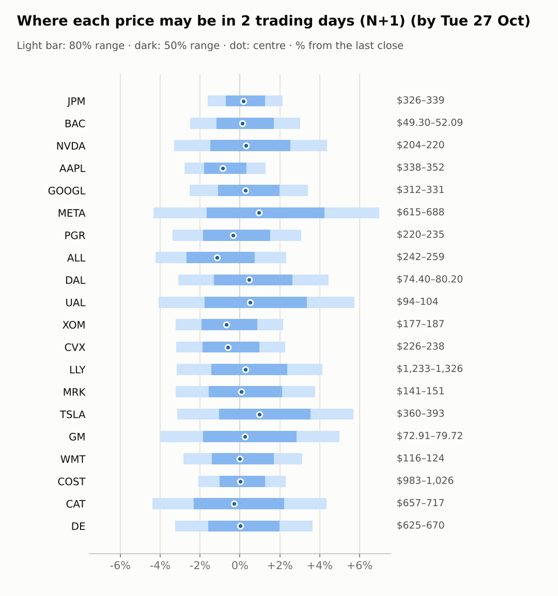
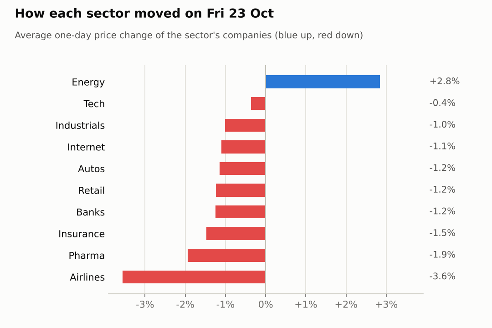
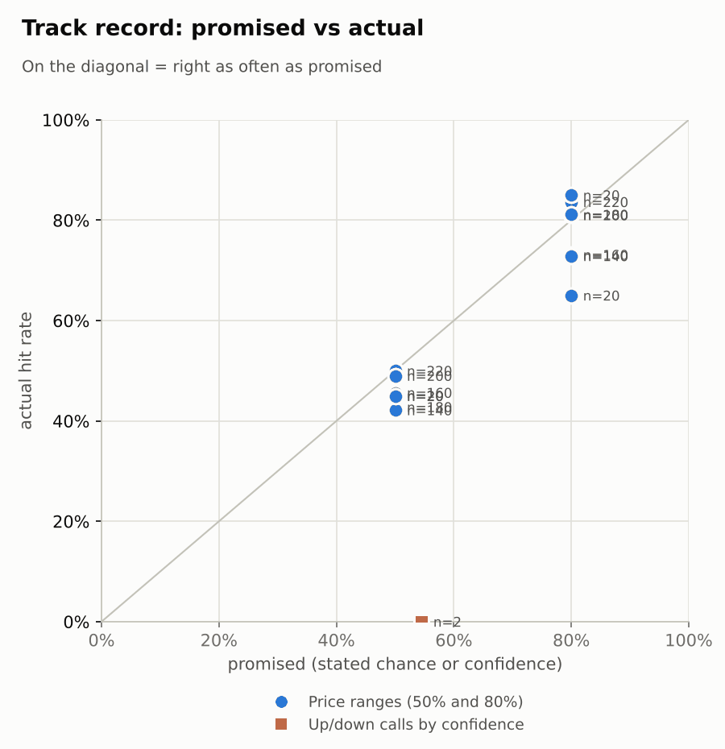

# Market brief: US (NYSE/Nasdaq), 2026-10-26

_Research log, not investment advice. Generated by a scheduled Claude Code routine._
<!-- report-data: as_of=2026-10-23 regime=EVENT_HEAVY outcome=70248abff9bf -->

Easy-to-read version with charts and filters: [2026-10-26.html](2026-10-26.html)

## Headline
No calls today: the FOMC decision on 2026-10-28 makes the regime EVENT_HEAVY, the signal model sits at its base rate, and 14 of 20 stocks are blocked by a known news-data fault. Futures are slightly up (ES +0.16%) with oil lower (WTI -1.96%).

## Top 3 today
- FOMC rate decision on 2026-10-28, with results from Alphabet (2026-10-28) and Caterpillar, Eli Lilly and Merck (2026-10-29): a busy event week.
- GM's $20 billion buyback is the only verified event today, corroborated (a326e1bcb0f57399), but it is a week old and GM is -9.58% over 5 days.
- Delta's 2026 outlook cut is promotional (e1de4e0e79d41dd7), so it cannot support a call; oil is lower overnight (WTI -1.96%).

## Yesterday
On 2026-10-23 energy led (XLE +2.6%; CVX +2.88%, XOM +2.79%) while most sectors fell: JETS -2.5% (UAL -3.99%, DAL -3.13%), IAK -2.2%, XLP -1.92%, XLI -1.27% (CAT -2.42%) and LLY -2.54%.
N+1 80% ranges held 15 of 20. The misses were CAT, GOOGL, MRK, NVDA and PGR; CAT closed below its range after a fourth down day (RSI 27).

Market on 2026-10-23: S&P 500 ETF 759.97 (-0.5%) · VIX 19.45 (+2.2%) · watchlist 3 up / 17 down · best CVX +2.9%, worst UAL -4.0%

### Ranges scored (target date 2026-10-23)

N+1 ranges: **80% hit 15/20** (naive 13/20) · 50% hit 10/20

| Ticker | 80% range | 50% range | Actual | 80% | 50% | Naive 80% |
|---|---|---|---|---|---|---|
| AAPL | $337.90–$350.93 | $341.00–$347.85 | $347.73 | ✅ | ✅ | ✅ |
| ALL | $245.21–$258.78 | $248.42–$255.55 | $253.19 | ✅ | ✅ | ✅ |
| BAC | $49.37–$51.98 | $49.99–$51.36 | $50.56 | ✅ | ✅ | ✅ |
| CAT | $707.43–$757.74 | $719.27–$745.69 | $687.00 | ❌ | ❌ | ❌ |
| COST | $985.80–$1,022.10 | $994.45–$1,013.51 | $1,003.32 | ✅ | ✅ | ✅ |
| CVX | $222.90–$233.46 | $225.40–$230.95 | $233.21 | ✅ | ❌ | ❌ |
| DAL | $74.80–$79.76 | $75.97–$78.57 | $76.78 | ✅ | ✅ | ✅ |
| DE | $617.74–$659.28 | $627.53–$649.34 | $646.15 | ✅ | ✅ | ✅ |
| GM | $72.84–$79.17 | $74.32–$77.65 | $75.92 | ✅ | ✅ | ✅ |
| GOOGL | $323.76–$339.85 | $327.58–$336.03 | $320.21 | ❌ | ❌ | ❌ |
| JPM | $328.95–$340.13 | $331.61–$337.49 | $331.58 | ✅ | ❌ | ✅ |
| LLY | $1,240.74–$1,319.63 | $1,259.35–$1,300.78 | $1,273.46 | ✅ | ✅ | ✅ |
| META | $600.44–$799.38 | $643.41–$747.74 | $642.62 | ✅ | ❌ | ❌ |
| MRK | $145.99–$155.67 | $148.27–$153.36 | $145.27 | ❌ | ❌ | ✅ |
| NVDA | $213.02–$226.71 | $216.25–$223.44 | $210.96 | ❌ | ❌ | ❌ |
| PGR | $215.61–$227.43 | $218.41–$224.62 | $228.07 | ❌ | ❌ | ❌ |
| TSLA | $352.03–$409.76 | $365.19–$395.50 | $372.22 | ✅ | ✅ | ✅ |
| UAL | $96.65–$105.37 | $98.69–$103.27 | $97.93 | ✅ | ❌ | ✅ |
| WMT | $115.74–$121.80 | $117.18–$120.36 | $119.89 | ✅ | ✅ | ✅ |
| XOM | $175.06–$183.28 | $177.01–$181.33 | $183.21 | ✅ | ❌ | ❌ |

N+2 ranges that matured on the same date: 80% hit 16/20, 50% hit 10/20. N+3 ranges that matured on the same date: 80% hit 19/20, 50% hit 9/20. N+4 ranges that matured on the same date: 80% hit 17/20, 50% hit 12/20. N+5 ranges that matured on the same date: 80% hit 13/20, 50% hit 8/20.

### Calls scored

| Ticker | H | Call | Conf. | Move | Hit |
|---|---|---|---|---|---|
| NVDA | 5d · open→close | up | 54% | -8.44% | ❌ |

## Today (2026-10-26)

**Regime: EVENT_HEAVY** · VIX 19.57 (+0.6%) · benchmark 5d -0.4% · benchmark 10d vol 10.8% · major events: FOMC rate decision

| Ticker | Sector | Close | N+1 80% | N+1 50% | N+5 80% | Call | Cue | Notes |
|---|---|---|---|---|---|---|---|---|
| JPM | Banks | $331.58 | $326.18–$338.69 | $329.21–$335.72 | $320.25–$346.83 | no call | +0.33% | cue +0.33% x0.5; major event x1.15; regime EVENT_HEAVY x1.1 |
| BAC | Banks | $50.56 | $49.30–$52.09 | $49.97–$51.42 | $48.00–$53.93 | no call | +0.24% | cue +0.24% x0.5; major event x1.15; regime EVENT_HEAVY x1.1 |
| NVDA | Tech | $210.96 | $203.99–$220.18 | $207.85–$216.28 | $196.53–$231.04 | no call | +0.61% | cue +0.61% x0.5; major event x1.15; regime EVENT_HEAVY x1.1 |
| AAPL | Tech | $347.73 | $338.03–$352.18 | $341.45–$348.82 | $324.28–$370.31 | no call | -1.82% | cue -1.82% x0.5; earnings in horizon (x3.0 day); major event x1.15; regime EVENT_HEAVY x1.1 |
| GOOGL | Internet | $320.21 | $312.11–$331.10 | $316.67–$326.57 | $294.23–$356.24 | no call | +0.55% | cue +0.55% x0.5; earnings in horizon (x3.0 day); major event x1.15; regime EVENT_HEAVY x1.1 |
| META | Internet | $642.62 | $614.68–$687.57 | $631.82–$669.81 | $581.97–$737.96 | no call | +1.88% | cue +1.88% x0.5; major event x1.15; regime EVENT_HEAVY x1.1 |
| PGR | Insurance | $228.07 | $220.34–$235.09 | $223.87–$231.56 | $213.49–$244.89 | no call | -0.68% | cue -0.68% x0.5; major event x1.15; regime EVENT_HEAVY x1.1 |
| ALL | Insurance | $253.19 | $242.46–$259.05 | $246.43–$255.08 | $234.75–$270.10 | no call | -2.28% | cue -2.28% x0.5; major event x1.15; regime EVENT_HEAVY x1.1 |
| DAL | Airlines | $76.78 | $74.40–$80.20 | $75.78–$78.81 | $71.72–$84.10 | no call | +0.91% | cue +0.91% x0.5; major event x1.15; regime EVENT_HEAVY x1.1 |
| UAL | Airlines | $97.93 | $93.92–$103.56 | $96.20–$101.22 | $89.56–$110.14 | no call | +1.02% | cue +1.02% x0.5; major event x1.15; regime EVENT_HEAVY x1.1 |
| XOM | Energy | $183.21 | $177.30–$187.16 | $179.67–$184.81 | $167.98–$200.13 | no call | -1.35% | cue -1.35% x0.5; earnings in horizon (x3.0 day); major event x1.15; regime EVENT_HEAVY x1.1 |
| CVX | Energy | $233.21 | $225.77–$238.49 | $228.83–$235.46 | $213.73–$255.26 | no call | -1.22% | cue -1.22% x0.5; earnings in horizon (x3.0 day); major event x1.15; regime EVENT_HEAVY x1.1 |
| LLY | Pharma | $1,273.46 | $1,233.05–$1,326.18 | $1,255.29–$1,303.82 | $1,146.60–$1,451.30 | no call | +0.54% | cue +0.54% x0.5; earnings in horizon (x3.0 day); major event x1.15; regime EVENT_HEAVY x1.1 |
| MRK | Pharma | $145.27 | $140.58–$150.77 | $143.01–$148.32 | $131.09–$164.41 | no call | +0.15% | cue +0.15% x0.5; earnings in horizon (x3.0 day); major event x1.15; regime EVENT_HEAVY x1.1 |
| TSLA | Autos | $372.22 | $360.47–$393.36 | $368.28–$385.41 | $345.43–$415.64 | no call | +1.98% | cue +1.98% x0.5; major event x1.15; regime EVENT_HEAVY x1.1 |
| GM | Autos | $75.92 | $72.91–$79.72 | $74.52–$78.07 | $69.80–$84.34 | no call | +0.47% | cue +0.47% x0.5; major event x1.15; regime EVENT_HEAVY x1.1 |
| WMT | Retail | $119.89 | $116.50–$123.63 | $118.21–$121.93 | $113.17–$128.36 | no call | -0.03% | cue -0.03% x0.5; major event x1.15; regime EVENT_HEAVY x1.1 |
| COST | Retail | $1,003.32 | $982.54–$1,026.42 | $993.13–$1,016.00 | $960.40–$1,053.58 | no call | +0.01% | cue +0.01% x0.5; ex-dividend 1.47 (0.15%); major event x1.15; regime EVENT_HEAVY x1.1 |
| CAT | Industrials | $687.00 | $656.93–$716.76 | $671.14–$702.31 | $602.18–$798.44 | no call | -0.11% | cue -0.11% x0.5; earnings in horizon (x3.0 day); ex-dividend 1.63 (0.24%); major event x1.15; regime EVENT_HEAVY x1.1 |
| DE | Industrials | $646.15 | $625.19–$669.72 | $635.84–$659.05 | $604.55–$699.44 | no call | +0.01% | cue +0.01% x0.5; major event x1.15; regime EVENT_HEAVY x1.1 |

No calls today. The forecaster abstained on every ticker and horizon.
- AAPL, ALL, BAC, CVX, GM, GOOGL, JPM, LLY, META, NVDA, TSLA, UAL, WMT, XOM: data failed validation (collect gate DUPLICATE_ID on stored news rows that name them; known de-dup issue).
- CAT: earnings on 2026-10-29 inside the N+3 and N+5 windows, no verified news (e.g. the UBS target cut, unverified (10b2e9e5bee2691e)), model at its base rate.
- COST: model at its base rate, no company news beyond holder filings.
- DAL: the outlook cut is promotional (e1de4e0e79d41dd7); model at its base rate.
- DE: clean chart but no news edge; model at its base rate.
- MRK: earnings on 2026-10-29; the vaccine-data reaction (83b2894897f7289f) is mixed and unconfirmed by a filing.
- PGR: only promotional analyst target notes (6854658538dc2ee8, promotional); model at its base rate.
Paper traders: ai.combined.sonnet.v1 stored 14 predictions at the model's probabilities and ai.pattern_mood.sonnet.v1 stored 3 (CAT N+1, DAL N+1 and N+3); the other two AI traders abstained on all 20. None of the 80 head-to-head picks is viable at the owner's cost.

### Overnight cues and global factors

| Symbol | Name | Last | Change |
|---|---|---|---|
| DAX | DAX | 25,406.95 | +0.89% |
| DXY | US dollar index | 101.89 | +0.08% |
| ES | S&P 500 futures | 7,672.00 | +0.16% |
| FTSE | FTSE 100 | 10,739.33 | +0.46% |
| GOLD | Gold | 4,026.70 | +0.47% |
| HANGSENG | Hang Seng | 23,211.81 | +0.51% |
| KOSPI | KOSPI | 5,469.47 | -1.46% |
| NIKKEI | Nikkei 225 | 62,189.65 | -0.80% |
| NQ | Nasdaq 100 futures | 29,183.75 | +0.23% |
| SPY | S&P 500 ETF | 761.57 | +0.21% |
| STOXX50 | Euro Stoxx 50 | 6,099.53 | +0.52% |
| US10Y | US 10-year yield | 4.99 | +0.71% |
| USDCNY | USD/CNY | 6.67 | -0.16% |
| USDJPY | USD/JPY | 157.34 | +0.54% |
| VIX | VIX | 19.57 | +0.62% |
| WTI | WTI crude | 101.25 | -1.96% |

## Tomorrow and this week

| Date | Event | Type |
|---|---|---|
| 2026-10-26 | Caterpillar ex-dividend (est. 1.63, last dividend) | company |
| 2026-10-28 | Alphabet earnings | company |
| 2026-10-28 | FOMC rate decision | major |
| 2026-10-29 | Caterpillar earnings | company |
| 2026-10-29 | Eli Lilly earnings | company |
| 2026-10-29 | Merck earnings | company |
| 2026-10-30 | Chevron earnings | company |
| 2026-10-30 | Costco ex-dividend (est. 1.47, last dividend) | company |
| 2026-10-30 | ExxonMobil earnings | company |
| 2026-11-02 | Apple earnings | company |
| 2026-11-04 | Allstate earnings | company |
| 2026-11-06 | US jobs report (usually first Friday; check for shifts) | major |
| 2026-11-10 | US CPI (October; provisional date) |  |

The FOMC decision on 2026-10-28 is the main risk; the regime stays EVENT_HEAVY and the ranges are widened for it. Results this week: Alphabet (2026-10-28), Caterpillar, Eli Lilly and Merck (2026-10-29), Chevron and ExxonMobil (2026-10-30). Overnight cues are mildly positive (ES +0.16%, NQ +0.23%, DAX +0.89%), Asia was weaker (KOSPI -1.46%, Nikkei -0.8%).

## By sector

### Banks

BAC (RSI 26) and JPM both fell on 2026-10-23 (BAC -1.02%, JPM -1.47%); news is holder filings only.
Bull: BAC is oversold. Bear: no catalyst and the sector is weak. Both moved together (sector move). No calls: blocked by the data gate.

### Tech

AAPL is -1.82% premarket after its record run (RSI 64); NVDA (RSI 38) is +0.61% premarket after the AI sell-off.
Bull: NVDA oversold. Bear: AAPL's headlines are unconfirmed. They moved apart (company news). No calls: blocked by the data gate.

### Internet

GOOGL reports on 2026-10-28 and is -5.98% over 5 days; META is +1.88% premarket after a -9.4% week.
Bull: both oversold (RSI 31 and 36). Bear: results and the FOMC the same week. No calls: blocked by the data gate.

### Insurance

ALL fell 2.28% and PGR 0.68% on 2026-10-23 with IAK -2.2%, after a strong 20 days (PGR +10.98%).
Bull: PGR momentum. Bear: the analyst notes are promotional (6854658538dc2ee8, promotional). They moved together (sector move). ALL is blocked; PGR got no call.

### Airlines

UAL fell 3.99% and DAL 3.13% on 2026-10-23 with JETS -2.5%; both are about +1% premarket as WTI eases 1.96%.
Bull: lower oil and an oversold sector. Bear: Delta's outlook cut, only promotional (e1de4e0e79d41dd7). Moved together (sector and oil). UAL is blocked; DAL got no call.

### Energy

CVX rose 2.88% and XOM 2.79% on 2026-10-23 (XLE +2.6%); both report on 2026-10-30.
Bull: strong trend. Bear: CVX (RSI 77) and XOM (RSI 76) are overbought into results, and WTI is -1.96% overnight. Moved together (oil). No calls: blocked by the data gate.

### Pharma

LLY fell 2.54% and MRK 1.34% on 2026-10-23; both report on 2026-10-29.
Bull: LLY's 20-day trend (+7.6%). Bear: MRK's vaccine-data reaction (83b2894897f7289f) and results risk. LLY is blocked; MRK got no call (earnings inside the window).

### Autos

GM is -9.58% over 5 days and TSLA +4.93%; TSLA is +1.98% premarket.
Bull: GM's buyback, corroborated (a326e1bcb0f57399). Bear: GM's slide continues into its next results. They moved apart (company news). No calls: blocked by the data gate.

### Retail

COST fell 1.46% and WMT 1.02% on 2026-10-23 with XLP -1.92%, after strong 20-day runs (COST +8.73%, WMT +11.03%).
Bull: staples leadership. Bear: overbought (RSI 69 and 70); COST goes ex-dividend on 2026-10-30. Moved together (sector move). WMT is blocked; COST got no call.

### Industrials

CAT fell 2.42% (-16.38% over 20 days, RSI 27) while DE rose 0.39% on 2026-10-23.
Bull: CAT oversold; DE relative strength. Bear: CAT results on 2026-10-29 and the UBS target cut (10b2e9e5bee2691e, unverified). They moved apart (company news). No calls.

## Track record

Ranges (targets 50% / 80%; width, score and centre error in % of price, lower is better; naive = last close ± recent typical move, no-change = last close as the centre):

| H | Window | n | 50% cover | 80% cover | Naive 80% | Width | Naive width | Score | Naive score | Centre err | No-change err |
|---|---|---|---|---|---|---|---|---|---|---|---|
| 1d | since start | 220 | 50% | 84% | 75% | 7.17 | 6.12 | 8.889 | 9.539 | 2.04 | 2.17 |
| 1d | last 30 days | 220 | 50% | 84% | 75% | 7.17 | 6.12 | 8.889 | 9.539 | 2.04 | 2.17 |
| 1d legacy_cc | since start | 20 | 45% | 85% | 85% | 4.09 | 4.18 | 7.414 | 7.632 | 1.45 | 1.39 |
| 1d legacy_cc | last 30 days | 20 | 45% | 85% | 85% | 4.09 | 4.18 | 7.414 | 7.632 | 1.45 | 1.39 |
| 2d | since start | 200 | 49% | 81% | 72% | 8.95 | 7.51 | 11.145 | 12.069 | 2.65 | 2.77 |
| 2d | last 30 days | 200 | 49% | 81% | 72% | 8.95 | 7.51 | 11.145 | 12.069 | 2.65 | 2.77 |
| 3d | since start | 180 | 43% | 81% | 66% | 10.54 | 8.69 | 12.827 | 13.933 | 3.21 | 3.34 |
| 3d | last 30 days | 180 | 43% | 81% | 66% | 10.54 | 8.69 | 12.827 | 13.933 | 3.21 | 3.34 |
| 4d | since start | 160 | 46% | 73% | 64% | 12.12 | 9.74 | 16.162 | 17.077 | 3.77 | 3.86 |
| 4d | last 30 days | 160 | 46% | 73% | 64% | 12.12 | 9.74 | 16.162 | 17.077 | 3.77 | 3.86 |
| 5d | since start | 140 | 42% | 73% | 58% | 13.44 | 10.60 | 18.370 | 19.257 | 4.29 | 4.39 |
| 5d | last 30 days | 140 | 42% | 73% | 58% | 13.44 | 10.60 | 18.370 | 19.257 | 4.29 | 4.39 |
| 5d legacy_cc | since start | 20 | 45% | 65% | 50% | 9.91 | 9.35 | 17.346 | 16.489 | 3.60 | 3.63 |
| 5d legacy_cc | last 30 days | 20 | 45% | 65% | 50% | 9.91 | 9.35 | 17.346 | 16.489 | 3.60 | 3.63 |

Ranges by regime (since start):

| H | Regime | n | 50% cover | 80% cover | Naive 80% |
|---|---|---|---|---|---|
| 1d | CALM | 140 | 51% | 84% | 79% |
| 1d | EVENT_HEAVY | 60 | 48% | 83% | 67% |
| 1d | TRENDING | 20 | 50% | 85% | 75% |
| 1d legacy_cc | TRENDING | 20 | 45% | 85% | 85% |
| 2d | CALM | 120 | 55% | 87% | 83% |
| 2d | EVENT_HEAVY | 60 | 40% | 72% | 52% |
| 2d | TRENDING | 20 | 40% | 75% | 65% |
| 3d | CALM | 100 | 49% | 85% | 75% |
| 3d | EVENT_HEAVY | 60 | 33% | 75% | 52% |
| 3d | TRENDING | 20 | 40% | 80% | 65% |
| 4d | CALM | 80 | 56% | 80% | 78% |
| 4d | EVENT_HEAVY | 60 | 32% | 68% | 50% |
| 4d | TRENDING | 20 | 45% | 60% | 55% |
| 5d | CALM | 60 | 42% | 67% | 62% |
| 5d | EVENT_HEAVY | 60 | 40% | 82% | 57% |
| 5d | TRENDING | 20 | 50% | 65% | 50% |
| 5d legacy_cc | TRENDING | 20 | 45% | 65% | 50% |

Up/down calls vs the always-up baseline:

| H | Window | n | Hit rate | Always-up |
|---|---|---|---|---|
| 5d · open→close | since start | 2 | 0% | 0% |
| 5d · open→close | last 30 days | 2 | 0% | 0% |

Calls by confidence band (a band should hit about as often as its confidence):

| Band | n | Avg confidence | Hit rate |
|---|---|---|---|
| 0.50-0.59 · open→close | 2 | 55% | 0% |

Weekly review 2026-W43: 0 proposed range changes for a human to decide · [review-2026-W43.md](review-2026-W43.md)

## Data quality

- Indicators: 20 OK, partial: none, blocked: none
- Regime notes: none

| H | Calibration | History n | Live n | q10 / q90 |
|---|---|---|---|---|
| 1d | pool | 9040 | 220 | -1.14 / 1.24 |
| 2d | pool | 9020 | 200 | -1.14 / 1.32 |
| 3d | pool | 9000 | 180 | -1.14 / 1.32 |
| 4d | pool | 8980 | 160 | -1.18 / 1.34 |
| 5d | pool | 8960 | 140 | -1.16 / 1.38 |

- validation collect DUPLICATE_ID (blocking): news, 20 duplicated ids shown (e.g. 034e890a6034e8a5, 0409934ffa713e05, 05ffb4896aee2cfc, 106786c80052a390, 118d8ff1ee5faf5a); 125 ids in all. Old headlines were stored again under their old ids after the 9-day de-dup window (open issue). Stored data cannot be edited, so the retry cannot clear it. The forecaster and the AI traders abstained on the tickers those rows name: AAPL, ALL, BAC, CVX, GM, GOOGL, JPM, LLY, META, NVDA, TSLA, UAL, WMT, XOM. None of the ids is cited.
- validation features, context, news, forecast: passed with no warnings.
- collect_holdings: SEC acceptance times could not be checked for CIKs 933478, 1167483, 1040273, 1029160 (old filings without an ACCEPTANCE-DATETIME header; stored as served).
- collect_macro: no Cboe file for 2026-10-26 yet; collect_shorts: no FINRA file for 2026-10-26 yet (published after the close; notes only).
- results digests: no results releases detected in the last 10 days (0 due).
- claims: 15 clusters checked (the per-run cap; the rest wait), 22 claims stored.
- AI traders: ai.pattern_mood.sonnet.v1 needed a second attempt (its first file missed CVX, NO_RECORD); every AI abstention has code abstained (none gate_failed, timeout or killed).
- lab.py predict also stored rule-strategy predictions for the 14 gate-blocked tickers (deterministic strategies; the gate block is not one of their inputs).
- Judge FAIL from a previous run: 2026-10-19 spotcheck round 1: report 2026-10-14 cites 41d60600e8f35aa4 for a CAT target cut its headline does not state, and says claims stored for 11 of 15 events where the data shows 13 of 15; nothing dropped.
