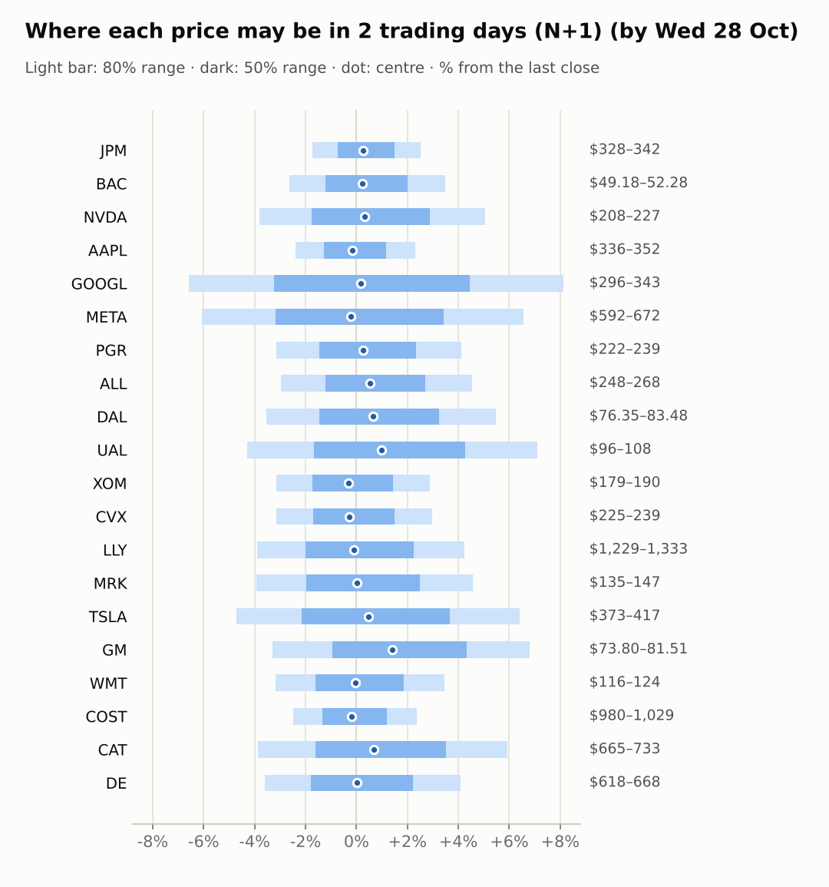
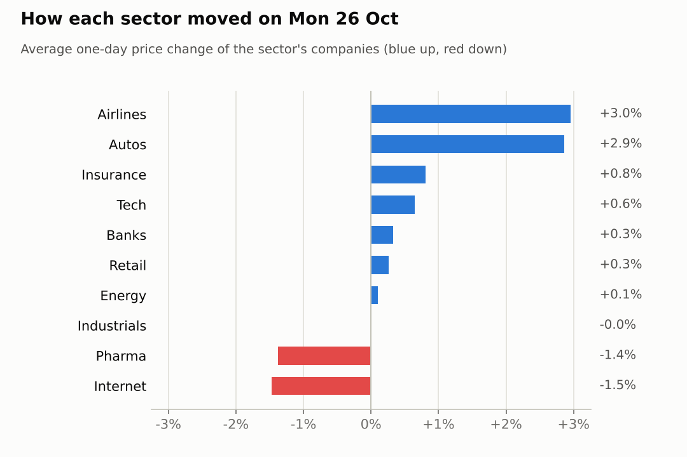
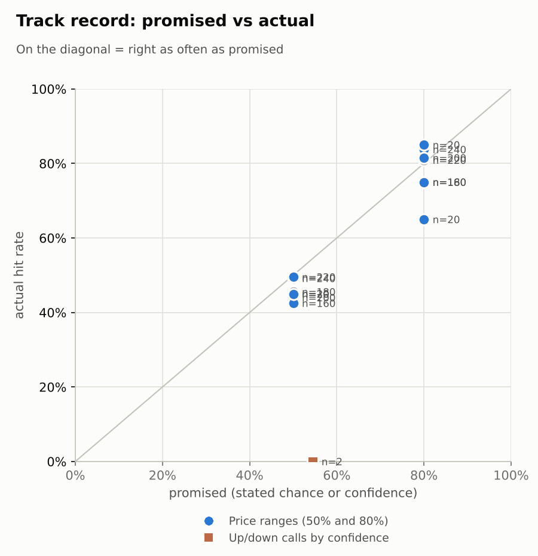

# Market brief: US (NYSE/Nasdaq), 2026-10-27

_Research log, not investment advice. Generated by a scheduled Claude Code routine._
<!-- report-data: as_of=2026-10-26 regime=EVENT_HEAVY outcome=70248abff9bf -->

Easy-to-read version with charts and filters: [2026-10-27.html](2026-10-27.html)

## Headline
No calls today: 15 of 20 companies are held back by a data check on stored news, and the other five (CAT, COST, DE, MRK, PGR) show no edge over the model's base rate. The Fed decision on 2026-10-28 makes this an event-heavy week.

## Top 3 today
- META's $95bn stock offering to fund AI spending is the one verified company story of the day (cca7bea097221e03, corroborated); META fell 10.61% over 5 days.
- The FOMC rate decision on 2026-10-28 and results from GOOGL (2026-10-28) and CAT, LLY and MRK (2026-10-29) widen this week's ranges.
- Futures point slightly higher before the open: ES +0.24% and NQ +0.35%, with VIX down to 17.85.

## Yesterday
Stocks rose on 2026-10-26: SPY +0.7%, with tech (XLK +1.69%) and industrials (XLI +1.42%) leading while communication services fell (XLC -1.57%). TSLA jumped 5.21% on an analyst upgrade that no independent outlet has verified yet, and MRK fell 3.21%.
The N+1 80% ranges held for 17 of 20 companies. The three misses were big single-stock moves: TSLA above its range, XOM above (RSI 77, at its 20-day high) and MRK below.

Market on 2026-10-26: S&P 500 ETF 765.37 (+0.7%) · VIX 18.39 (-5.4%) · watchlist 13 up / 7 down · best TSLA +5.2%, worst MRK -3.2%

### Ranges scored (target date 2026-10-26)

N+1 ranges: **80% hit 17/20** (naive 16/20) · 50% hit 8/20

| Ticker | 80% range | 50% range | Actual | 80% | 50% | Naive 80% |
|---|---|---|---|---|---|---|
| AAPL | $341.93–$355.26 | $345.11–$352.08 | $343.91 | ✅ | ❌ | ✅ |
| ALL | $255.11–$270.50 | $258.75–$266.80 | $255.95 | ✅ | ❌ | ✅ |
| BAC | $49.77–$52.35 | $50.38–$51.73 | $50.52 | ✅ | ✅ | ✅ |
| CAT | $676.10–$731.40 | $689.08–$718.03 | $692.13 | ✅ | ✅ | ✅ |
| COST | $996.34–$1,035.77 | $1,005.74–$1,026.38 | $1,005.16 | ✅ | ❌ | ✅ |
| CVX | $222.42–$232.70 | $224.87–$230.25 | $232.01 | ✅ | ❌ | ❌ |
| DAL | $76.54–$81.66 | $77.75–$80.42 | $79.16 | ✅ | ✅ | ✅ |
| DE | $627.18–$668.71 | $636.98–$658.72 | $641.25 | ✅ | ✅ | ✅ |
| GM | $74.15–$80.49 | $75.64–$78.96 | $76.31 | ✅ | ✅ | ✅ |
| GOOGL | $315.52–$333.07 | $319.68–$328.86 | $316.80 | ✅ | ❌ | ✅ |
| JPM | $331.49–$342.54 | $334.13–$339.91 | $334.04 | ✅ | ❌ | ✅ |
| LLY | $1,264.75–$1,348.78 | $1,284.58–$1,328.57 | $1,279.14 | ✅ | ❌ | ✅ |
| META | $616.19–$683.88 | $631.92–$667.35 | $630.56 | ✅ | ❌ | ✅ |
| MRK | $142.44–$151.90 | $144.67–$149.62 | $140.61 | ❌ | ❌ | ❌ |
| NVDA | $205.74–$220.89 | $209.30–$217.24 | $216.00 | ✅ | ✅ | ✅ |
| PGR | $225.99–$239.99 | $229.30–$236.63 | $229.25 | ✅ | ❌ | ✅ |
| TSLA | $360.68–$391.22 | $367.84–$383.83 | $391.62 | ❌ | ❌ | ❌ |
| UAL | $97.60–$106.19 | $99.61–$104.10 | $100.69 | ✅ | ✅ | ✅ |
| WMT | $117.73–$124.36 | $119.30–$122.77 | $120.29 | ✅ | ✅ | ✅ |
| XOM | $174.85–$182.86 | $176.75–$180.95 | $184.54 | ❌ | ❌ | ❌ |

N+2 ranges that matured on the same date: 80% hit 16/20, 50% hit 11/20. N+3 ranges that matured on the same date: 80% hit 17/20, 50% hit 11/20. N+4 ranges that matured on the same date: 80% hit 18/20, 50% hit 9/20. N+5 ranges that matured on the same date: 80% hit 18/20, 50% hit 9/20.

### Calls scored

| Ticker | H | Call | Conf. | Move | Hit |
|---|---|---|---|---|---|
| NVDA | 5d · open→close | up | 54% | -8.44% | ❌ |

## Today (2026-10-27)

**Regime: EVENT_HEAVY** · VIX 17.85 (-2.9%) · benchmark 5d -0.1% · benchmark 10d vol 11.8% · major events: FOMC rate decision

| Ticker | Sector | Close | N+1 80% | N+1 50% | N+5 80% | Call | Cue | Notes |
|---|---|---|---|---|---|---|---|---|
| JPM | Banks | $334.04 | $328.21–$342.47 | $331.59–$339.04 | $323.13–$349.50 | no call | +0.55% | cue +0.55% x0.5; major event x1.15; regime EVENT_HEAVY x1.1 |
| BAC | Banks | $50.52 | $49.18–$52.28 | $49.91–$51.53 | $48.09–$53.83 | no call | +0.48% | cue +0.48% x0.5; major event x1.15; regime EVENT_HEAVY x1.1 |
| NVDA | Tech | $216.00 | $207.75–$226.93 | $212.21–$222.24 | $201.12–$236.71 | no call | +0.66% | cue +0.66% x0.5; major event x1.15; regime EVENT_HEAVY x1.1 |
| AAPL | Tech | $343.91 | $335.69–$351.84 | $339.51–$347.95 | $323.11–$368.85 | no call | -0.35% | cue -0.35% x0.5; earnings in horizon (x3.0 day); major event x1.15; regime EVENT_HEAVY x1.1 |
| GOOGL | Internet | $316.80 | $295.91–$342.58 | $306.53–$330.92 | $291.23–$351.34 | no call | +0.36% | cue +0.36% x0.5; earnings in horizon (x2.94 day, 7 past moves, median 2.5%); earnings in horizon (x3.0 day); major event x1.15; regime EVENT_HEAVY x1.1 |
| META | Internet | $630.56 | $592.34–$671.94 | $610.60–$652.20 | $565.57–$713.66 | no call | -0.45% | cue -0.45% x0.5; major event x1.15; regime EVENT_HEAVY x1.1 |
| PGR | Insurance | $229.25 | $222.05–$238.66 | $225.94–$234.62 | $216.25–$247.03 | no call | +0.52% | cue +0.52% x0.5; major event x1.15; regime EVENT_HEAVY x1.1 |
| ALL | Insurance | $255.95 | $248.34–$267.53 | $252.84–$262.86 | $241.66–$277.21 | no call | +1.09% | cue +1.09% x0.5; major event x1.15; regime EVENT_HEAVY x1.1 |
| DAL | Airlines | $79.16 | $76.35–$83.48 | $78.01–$81.74 | $73.89–$87.12 | no call | +1.32% | cue +1.32% x0.5; major event x1.15; regime EVENT_HEAVY x1.1 |
| UAL | Airlines | $100.69 | $96.38–$107.83 | $99.02–$105.00 | $92.49–$113.77 | no call | +2.00% | cue +2.00% x0.5; major event x1.15; regime EVENT_HEAVY x1.1 |
| XOM | Energy | $184.54 | $178.71–$189.88 | $181.34–$187.18 | $170.13–$201.81 | no call | -0.62% | cue -0.62% x0.5; earnings in horizon (x3.0 day); major event x1.15; regime EVENT_HEAVY x1.1 |
| CVX | Energy | $232.01 | $224.71–$238.89 | $228.04–$235.45 | $213.81–$254.04 | no call | -0.54% | cue -0.54% x0.5; earnings in horizon (x3.0 day); major event x1.15; regime EVENT_HEAVY x1.1 |
| LLY | Pharma | $1,279.14 | $1,229.40–$1,333.18 | $1,253.63–$1,307.87 | $1,151.05–$1,446.31 | no call | -0.18% | cue -0.18% x0.5; earnings in horizon (x3.0 day); major event x1.15; regime EVENT_HEAVY x1.1 |
| MRK | Pharma | $140.61 | $135.06–$147.02 | $137.85–$144.10 | $126.07–$160.10 | no call | +0.06% | cue +0.06% x0.5; earnings in horizon (x3.0 day); major event x1.15; regime EVENT_HEAVY x1.1 |
| TSLA | Autos | $391.62 | $373.17–$416.77 | $383.23–$406.02 | $358.35–$439.35 | no call | +0.92% | cue +0.92% x0.5; major event x1.15; regime EVENT_HEAVY x1.1 |
| GM | Autos | $76.31 | $73.80–$81.51 | $75.58–$79.61 | $71.16–$85.47 | no call | +2.85% | cue +2.85% x0.5; major event x1.15; regime EVENT_HEAVY x1.1 |
| WMT | Retail | $120.29 | $116.48–$124.45 | $118.35–$122.51 | $113.69–$128.44 | no call | -0.11% | cue -0.11% x0.5; major event x1.15; regime EVENT_HEAVY x1.1 |
| COST | Retail | $1,005.16 | $980.20–$1,029.02 | $991.74–$1,017.26 | $961.48–$1,051.64 | no call | -0.38% | cue -0.38% x0.5; ex-dividend 1.47 (0.15%); major event x1.15; regime EVENT_HEAVY x1.1 |
| CAT | Industrials | $692.13 | $665.30–$733.19 | $681.05–$716.53 | $614.80–$808.39 | no call | +1.39% | cue +1.39% x0.5; earnings in horizon (x3.0 day); major event x1.15; regime EVENT_HEAVY x1.1 |
| DE | Industrials | $641.25 | $618.14–$667.53 | $629.69–$655.50 | $600.95–$692.50 | no call | +0.01% | cue +0.01% x0.5; major event x1.15; regime EVENT_HEAVY x1.1 |

No calls today. Abstentions:
- AAPL, ALL, BAC, CVX, DAL, GM, GOOGL, JPM, LLY, META, NVDA, TSLA, UAL, WMT, XOM: data failed validation (the collect gate's DUPLICATE_ID check on stored news rows that name them). GOOGL also reports within 1 day.
- CAT: the model is at its base rate, results on 2026-10-29 and the Fed decision fall inside the window, and none of its news can support a call.
- MRK: results on 2026-10-29 make a call an earnings coin flip; the model is at its base rate.
- COST: the model is at its base rate and nothing verified is new; ex-dividend on 2026-10-30.
- DE: the model is at its base rate and there is no verified news.
- PGR: the model is below its base rate; no news can support a call.

### Overnight cues and global factors

| Symbol | Name | Last | Change |
|---|---|---|---|
| DAX | DAX | 25,476.50 | +0.26% |
| DXY | US dollar index | 102.22 | +0.26% |
| ES | S&P 500 futures | 7,733.25 | +0.24% |
| FTSE | FTSE 100 | 10,688.68 | -0.73% |
| GOLD | Gold | 4,024.90 | -0.33% |
| HANGSENG | Hang Seng | 23,041.32 | -0.73% |
| KOSPI | KOSPI | 5,638.34 | +3.09% |
| NIKKEI | Nikkei 225 | 63,268.37 | +1.73% |
| NQ | Nasdaq 100 futures | 29,541.00 | +0.35% |
| SPY | S&P 500 ETF | 767.05 | +0.22% |
| STOXX50 | Euro Stoxx 50 | 6,134.29 | +0.30% |
| US10Y | US 10-year yield | 4.99 | -0.04% |
| USDCNY | USD/CNY | 6.66 | -0.33% |
| USDJPY | USD/JPY | 157.73 | +0.57% |
| VIX | VIX | 17.85 | -2.94% |
| WTI | WTI crude | 101.02 | -0.73% |

## Tomorrow and this week

| Date | Event | Type |
|---|---|---|
| 2026-10-26 | Caterpillar ex-dividend (est. 1.63, last dividend) | company |
| 2026-10-28 | Alphabet earnings | company |
| 2026-10-28 | FOMC rate decision | major |
| 2026-10-29 | Caterpillar earnings | company |
| 2026-10-29 | Eli Lilly earnings | company |
| 2026-10-29 | Merck earnings | company |
| 2026-10-30 | Chevron earnings | company |
| 2026-10-30 | Costco ex-dividend (est. 1.47, last dividend) | company |
| 2026-10-30 | ExxonMobil earnings | company |
| 2026-11-02 | Apple earnings | company |
| 2026-11-04 | Allstate earnings | company |
| 2026-11-06 | US jobs report (usually first Friday; check for shifts) | major |
| 2026-11-10 | US CPI (October; provisional date) |  |
| 2026-11-13 | Eli Lilly ex-dividend (est. 1.73, last dividend) | company |

The FOMC rate decision on 2026-10-28 is the main market risk this week, and the regime stays EVENT_HEAVY. Results cluster: GOOGL on 2026-10-28, CAT, LLY and MRK on 2026-10-29, CVX and XOM on 2026-10-30, AAPL on 2026-11-02; their ranges are widened for earnings. Overnight cues are mixed but mildly positive: KOSPI +3.09% and Nikkei +1.73%, FTSE -0.73%, WTI -0.73%.

## By sector

### Banks

JPM rose 0.74% and BAC slipped 0.08%; BAC remains oversold (RSI 26, -8.92% over 20 days).
Bull: BAC's oversold reading leaves room for a bounce. Bear: no verified news supports either name; both are held back today by the data check.

### Tech

NVDA rose 2.39% with the tech sector while AAPL fell 1.1%, so the two moved apart on company news.
Bull: NVDA rode the sector bid. Bear: AAPL reports on 2026-11-02, and both are held back today by the data check.

### Internet

Both fell with communication services: META -1.88% and GOOGL -1.06%.
Bull: both are oversold (RSI 34 and 30). Bear: META's $95bn offering adds new shares (cca7bea097221e03, corroborated), and GOOGL reports on 2026-10-28.

### Insurance

ALL rose 1.09% and PGR 0.52%, together with the insurance ETF.
Bull: PGR sits at its 20-day high on steady momentum. Bear: PGR is up 4.63% in 5 days with no verified news, so a pullback is as likely as more gains.

### Airlines

DAL rose 3.1% and UAL 2.82%, moving together with the airline ETF.
Bull: oil eased overnight (WTI -0.73%). Bear: fuel costs stay high, and both are held back today by the data check.

### Energy

XOM rose 0.73% and CVX fell 0.51%. XOM closed above its 80% range at its 20-day high.
Bull: CVX and XOM have strong 20-day trends into results on 2026-10-30. Bear: CVX and XOM are overbought (RSI 74 and 77) and WTI is lower overnight.

### Pharma

MRK fell 3.21% while LLY rose 0.45%, so this was company news, not a sector move.
Bull: MRK's drop may be overdone before results on 2026-10-29. Bear: MRK's trial headlines are promotional only (d9146b5267fccd58, promotional), and both report on 2026-10-29.

### Autos

TSLA jumped 5.21% on a Barclays upgrade that no independent outlet has verified yet, while GM rose 0.51%.
Bull: GM is up 2.85% before the open, with its buyback filing still on record (0001467858-26-000056). Bear: TSLA's gain rests on merger talk nobody has checked, and both are held back today by the data check.

### Retail

COST rose 0.18% and WMT 0.33%, together with consumer staples.
Bull: both are in steady uptrends. Bear: both are overbought (RSI 70) and COST goes ex-dividend on 2026-10-30.

### Industrials

DE fell 0.76% while CAT rose 0.75% and XLI gained 1.42%, so both lagged the sector.
Bull: CAT is oversold (RSI 29) and up 1.39% before the open. Bear: CAT reports on 2026-10-29 after a 15.59% fall over 20 days, and DE has no catalyst.

## Track record

Ranges (targets 50% / 80%; width, score and centre error in % of price, lower is better; naive = last close ± recent typical move, no-change = last close as the centre):

| H | Window | n | 50% cover | 80% cover | Naive 80% | Width | Naive width | Score | Naive score | Centre err | No-change err |
|---|---|---|---|---|---|---|---|---|---|---|---|
| 1d | since start | 240 | 49% | 84% | 76% | 7.08 | 6.13 | 8.760 | 9.393 | 2.01 | 2.14 |
| 1d | last 30 days | 240 | 49% | 84% | 76% | 7.08 | 6.13 | 8.760 | 9.393 | 2.01 | 2.14 |
| 1d legacy_cc | since start | 20 | 45% | 85% | 85% | 4.09 | 4.18 | 7.414 | 7.632 | 1.45 | 1.39 |
| 1d legacy_cc | last 30 days | 20 | 45% | 85% | 85% | 4.09 | 4.18 | 7.414 | 7.632 | 1.45 | 1.39 |
| 2d | since start | 220 | 50% | 81% | 71% | 8.82 | 7.50 | 11.223 | 12.197 | 2.62 | 2.75 |
| 2d | last 30 days | 220 | 50% | 81% | 71% | 8.82 | 7.50 | 11.223 | 12.197 | 2.62 | 2.75 |
| 3d | since start | 200 | 44% | 82% | 68% | 10.47 | 8.68 | 12.731 | 13.769 | 3.18 | 3.29 |
| 3d | last 30 days | 200 | 44% | 82% | 68% | 10.47 | 8.68 | 12.731 | 13.769 | 3.18 | 3.29 |
| 4d | since start | 180 | 46% | 75% | 65% | 12.08 | 9.72 | 15.927 | 16.863 | 3.74 | 3.85 |
| 4d | last 30 days | 180 | 46% | 75% | 65% | 12.08 | 9.72 | 15.927 | 16.863 | 3.74 | 3.85 |
| 5d | since start | 160 | 43% | 75% | 61% | 13.34 | 10.67 | 17.950 | 18.866 | 4.24 | 4.34 |
| 5d | last 30 days | 160 | 43% | 75% | 61% | 13.34 | 10.67 | 17.950 | 18.866 | 4.24 | 4.34 |
| 5d legacy_cc | since start | 20 | 45% | 65% | 50% | 9.91 | 9.35 | 17.346 | 16.489 | 3.60 | 3.63 |
| 5d legacy_cc | last 30 days | 20 | 45% | 65% | 50% | 9.91 | 9.35 | 17.346 | 16.489 | 3.60 | 3.63 |

Ranges by regime (since start):

| H | Regime | n | 50% cover | 80% cover | Naive 80% |
|---|---|---|---|---|---|
| 1d | CALM | 160 | 49% | 84% | 79% |
| 1d | EVENT_HEAVY | 60 | 48% | 83% | 67% |
| 1d | TRENDING | 20 | 50% | 85% | 75% |
| 1d legacy_cc | TRENDING | 20 | 45% | 85% | 85% |
| 2d | CALM | 140 | 55% | 86% | 81% |
| 2d | EVENT_HEAVY | 60 | 40% | 72% | 52% |
| 2d | TRENDING | 20 | 40% | 75% | 65% |
| 3d | CALM | 120 | 50% | 85% | 76% |
| 3d | EVENT_HEAVY | 60 | 33% | 75% | 52% |
| 3d | TRENDING | 20 | 40% | 80% | 65% |
| 4d | CALM | 100 | 54% | 82% | 76% |
| 4d | EVENT_HEAVY | 60 | 32% | 68% | 50% |
| 4d | TRENDING | 20 | 45% | 60% | 55% |
| 5d | CALM | 80 | 43% | 73% | 66% |
| 5d | EVENT_HEAVY | 60 | 40% | 82% | 57% |
| 5d | TRENDING | 20 | 50% | 65% | 50% |
| 5d legacy_cc | TRENDING | 20 | 45% | 65% | 50% |

Up/down calls vs the always-up baseline:

| H | Window | n | Hit rate | Always-up |
|---|---|---|---|---|
| 5d · open→close | since start | 2 | 0% | 0% |
| 5d · open→close | last 30 days | 2 | 0% | 0% |

Calls by confidence band (a band should hit about as often as its confidence):

| Band | n | Avg confidence | Hit rate |
|---|---|---|---|
| 0.50-0.59 · open→close | 2 | 55% | 0% |

Weekly review 2026-W43: 0 proposed range changes for a human to decide · [review-2026-W43.md](review-2026-W43.md)

## Data quality

- Indicators: 20 OK, partial: none, blocked: none
- Regime notes: none

| H | Calibration | History n | Live n | q10 / q90 |
|---|---|---|---|---|
| 1d | pool | 9060 | 240 | -1.14 / 1.24 |
| 2d | pool | 9040 | 220 | -1.16 / 1.31 |
| 3d | pool | 9020 | 200 | -1.15 / 1.31 |
| 4d | pool | 9000 | 180 | -1.18 / 1.33 |
| 5d | pool | 8980 | 160 | -1.16 / 1.37 |

- validation collect DUPLICATE_ID (blocking): news, 20 duplicated ids shown (e.g. 01f6ad725a09e2f5, 034e890a6034e8a5, 0409934ffa713e05, 05ffb4896aee2cfc, 106786c80052a390). Old headlines were stored again under their old ids after the 9-day de-dup window (an open issue). Stored data cannot be edited, so the retry cannot clear it. The forecaster and the AI traders abstained on the tickers those rows name: AAPL, ALL, BAC, CVX, DAL, GM, GOOGL, JPM, LLY, META, NVDA, TSLA, UAL, WMT, XOM. None of the ids is cited.
- validation features, context, news, forecast: passed with no failures or warnings.
- News enrichment: the three news analysts scored the 1711 pending items with title-pattern scripts plus hand-written summaries for the material events, not by reading each headline, so sentiment and materiality are coarse (the news gate passed).
- collect_holdings: SEC acceptance times could not be checked for CIKs 933478, 1167483, 1040273 and 1029160 (no ACCEPTANCE-DATETIME in their oldest filings); stored as served, maybe 4-5h late.
- Results digests: none due (no results release detected in the lookback window).
- Inbox imports: nothing to import (companies 0, paper trades 0).
- AI traders: ai.news_results.sonnet.v1 abstained on 20, ai.combined.opus.v1 on 20, ai.pattern_mood.sonnet.v1 stored 2 predictions and 20 abstention rows, ai.combined.sonnet.v1 stored 11 predictions and 17 abstention rows; no gate errors.
- Judge FAIL 2026-10-26, spotcheck, round 1: report 2026-10-21 said the 50% misses (AAPL, GM, JPM, LLY, MRK, TSLA) "mostly came from moves of 3% or more"; stored ret_1d shows 3 of 6 (GM, LLY, MRK). Lesson and both claims check out. Nothing dropped.
