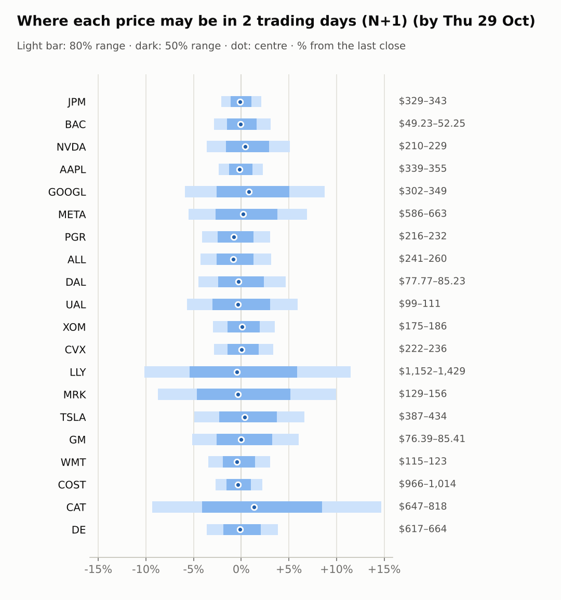
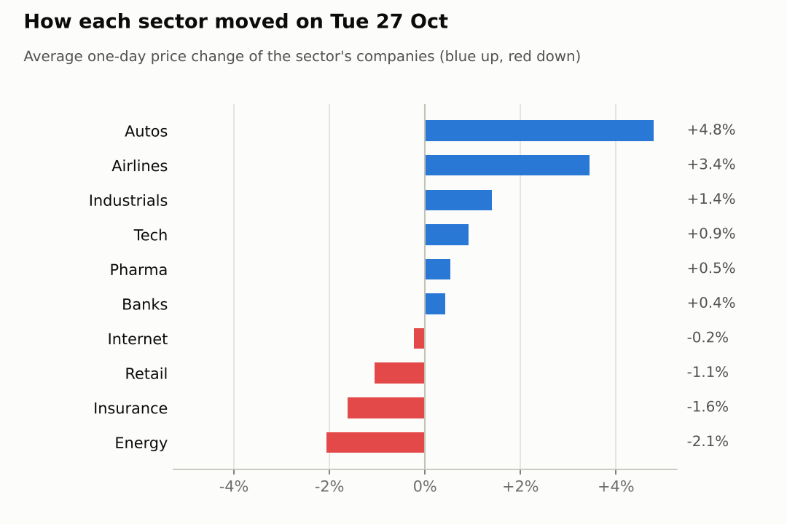
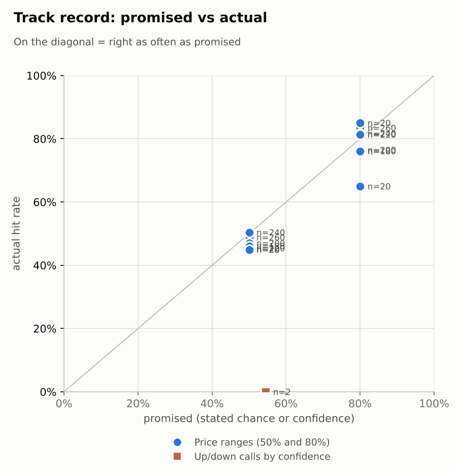

# Market brief: US (NYSE/Nasdaq), 2026-10-28

_Research log, not investment advice. Generated by a scheduled Claude Code routine._
<!-- report-data: as_of=2026-10-27 regime=EVENT_HEAVY outcome=70248abff9bf -->

Easy-to-read version with charts and filters: [2026-10-28.html](2026-10-28.html)

## Headline
No calls today: 16 of 20 companies are held back by a data check on stored news, CAT and MRK report results on 2026-10-29, and DE and PGR show no edge over the model's base rate. The FOMC rate decision and Alphabet's results are both due on 2026-10-28.

## Top 3 today
- The FOMC rate decision on 2026-10-28 makes the regime EVENT_HEAVY; GOOGL reports on 2026-10-28 and CAT, LLY and MRK on 2026-10-29, so their ranges are wide.
- META's $95bn stock offering is still the main verified company story (cca7bea097221e03, corroborated); META fell 10.67% over 5 days and its model P(up) is below one half at N+1.
- Futures point slightly higher before the open: ES +0.18% and NQ +0.44%, with WTI crude up 1.85% to 101.75.

## Yesterday
The S&P 500 ETF rose 0.6% to 769.66 and VIX fell 4.7%; tech led (XLK +1.7%, JETS +2.23%) while energy lagged (XLE -2.05%). GM rose 5.54%, TSLA 4.04% and UAL 3.99%; XOM fell 2.51% and ALL 1.66%.
N+1 80% ranges held 16 of 20; the four misses (DAL, GM, TSLA, UAL) were all upside breaks on big up days, so the ranges were too narrow for that rally, not wrong in direction.
The one scored call, NVDA up over 5 days, missed with a move of -8.44%.

Market on 2026-10-27: S&P 500 ETF 769.66 (+0.6%) · VIX 17.52 (-4.7%) · watchlist 12 up / 8 down · best GM +5.5%, worst XOM -2.5%

### Ranges scored (target date 2026-10-27)

N+1 ranges: **80% hit 16/20** (naive 16/20) · 50% hit 9/20

| Ticker | 80% range | 50% range | Actual | 80% | 50% | Naive 80% |
|---|---|---|---|---|---|---|
| AAPL | $338.03–$352.18 | $341.45–$348.82 | $347.10 | ✅ | ✅ | ✅ |
| ALL | $242.46–$259.05 | $246.43–$255.08 | $251.71 | ✅ | ✅ | ✅ |
| BAC | $49.30–$52.09 | $49.97–$51.42 | $50.68 | ✅ | ✅ | ✅ |
| CAT | $656.93–$716.76 | $671.14–$702.31 | $713.31 | ✅ | ❌ | ✅ |
| COST | $982.54–$1,026.42 | $993.13–$1,016.00 | $992.13 | ✅ | ❌ | ✅ |
| CVX | $225.77–$238.49 | $228.83–$235.46 | $228.23 | ✅ | ❌ | ✅ |
| DAL | $74.40–$80.20 | $75.78–$78.81 | $81.45 | ❌ | ❌ | ❌ |
| DE | $625.19–$669.72 | $635.84–$659.05 | $639.58 | ✅ | ✅ | ✅ |
| GM | $72.91–$79.72 | $74.52–$78.07 | $80.54 | ❌ | ❌ | ❌ |
| GOOGL | $312.11–$331.10 | $316.67–$326.57 | $320.58 | ✅ | ✅ | ✅ |
| JPM | $326.18–$338.69 | $329.21–$335.72 | $335.79 | ✅ | ❌ | ✅ |
| LLY | $1,233.05–$1,326.18 | $1,255.29–$1,303.82 | $1,281.91 | ✅ | ✅ | ✅ |
| META | $614.68–$687.57 | $631.82–$669.81 | $620.19 | ✅ | ❌ | ✅ |
| MRK | $140.58–$150.77 | $143.01–$148.32 | $141.82 | ✅ | ❌ | ✅ |
| NVDA | $203.99–$220.18 | $207.85–$216.28 | $217.94 | ✅ | ❌ | ✅ |
| PGR | $220.34–$235.09 | $223.87–$231.56 | $225.60 | ✅ | ✅ | ✅ |
| TSLA | $360.47–$393.36 | $368.28–$385.41 | $407.46 | ❌ | ❌ | ❌ |
| UAL | $93.92–$103.56 | $96.20–$101.22 | $104.71 | ❌ | ❌ | ❌ |
| WMT | $116.50–$123.63 | $118.21–$121.93 | $119.32 | ✅ | ✅ | ✅ |
| XOM | $177.30–$187.16 | $179.67–$184.81 | $179.91 | ✅ | ✅ | ✅ |

N+2 ranges that matured on the same date: 80% hit 18/20, 50% hit 12/20. N+3 ranges that matured on the same date: 80% hit 16/20, 50% hit 12/20. N+4 ranges that matured on the same date: 80% hit 18/20, 50% hit 12/20. N+5 ranges that matured on the same date: 80% hit 17/20, 50% hit 15/20.

### Calls scored

| Ticker | H | Call | Conf. | Move | Hit |
|---|---|---|---|---|---|
| NVDA | 5d · open→close | up | 54% | -8.44% | ❌ |

## Today (2026-10-28)

**Regime: EVENT_HEAVY** · VIX 17.46 (-0.3%) · benchmark 5d +0.1% · benchmark 10d vol 12.4% · major events: FOMC rate decision

| Ticker | Sector | Close | N+1 80% | N+1 50% | N+5 80% | Call | Cue | Notes |
|---|---|---|---|---|---|---|---|---|
| JPM | Banks | $335.79 | $328.84–$342.81 | $332.11–$339.43 | $323.82–$349.60 | no call | -0.24% | cue -0.24% x0.5; major event x1.15; regime EVENT_HEAVY x1.1 |
| BAC | Banks | $50.68 | $49.23–$52.25 | $49.93–$51.51 | $48.16–$53.73 | no call | -0.16% | cue -0.16% x0.5; major event x1.15; regime EVENT_HEAVY x1.1 |
| NVDA | Tech | $217.94 | $210.09–$229.01 | $214.44–$224.35 | $203.49–$238.50 | no call | +0.84% | cue +0.84% x0.5; major event x1.15; regime EVENT_HEAVY x1.1 |
| AAPL | Tech | $347.10 | $338.87–$355.03 | $342.64–$351.11 | $326.23–$371.92 | no call | -0.38% | cue -0.38% x0.5; earnings in horizon (x3.0 day); major event x1.15; regime EVENT_HEAVY x1.1 |
| GOOGL | Internet | $320.58 | $301.70–$348.66 | $312.25–$336.84 | $296.84–$357.18 | no call | +1.59% | cue +1.59% x0.5; earnings in horizon (x2.94 day, 7 past moves, median 2.5%); earnings in horizon (x3.0 day); major event x1.15; regime EVENT_HEAVY x1.1 |
| META | Internet | $620.19 | $585.99–$663.04 | $603.44–$643.79 | $559.79–$702.79 | no call | +0.37% | cue +0.37% x0.5; major event x1.15; regime EVENT_HEAVY x1.1 |
| PGR | Insurance | $225.60 | $216.29–$232.43 | $220.02–$228.47 | $210.60–$240.45 | no call | -1.59% | cue -1.59% x0.5; major event x1.15; regime EVENT_HEAVY x1.1 |
| ALL | Insurance | $251.71 | $240.98–$259.56 | $245.27–$255.00 | $226.82–$279.51 | no call | -1.66% | cue -1.66% x0.5; earnings in horizon (x3.0 day); major event x1.15; regime EVENT_HEAVY x1.1 |
| DAL | Airlines | $81.45 | $77.77–$85.23 | $79.48–$83.39 | $75.18–$88.99 | no call | -0.55% | cue -0.55% x0.5; major event x1.15; regime EVENT_HEAVY x1.1 |
| UAL | Airlines | $104.71 | $98.76–$110.93 | $101.52–$107.90 | $94.59–$117.18 | no call | -0.68% | cue -0.68% x0.5; major event x1.15; regime EVENT_HEAVY x1.1 |
| XOM | Energy | $179.91 | $174.60–$186.23 | $177.30–$183.39 | $165.66–$198.60 | no call | +0.13% | cue +0.13% x0.5; earnings in horizon (x3.0 day); major event x1.15; regime EVENT_HEAVY x1.1 |
| CVX | Energy | $228.23 | $221.71–$235.84 | $224.99–$232.39 | $210.82–$250.83 | no call | +0.07% | cue +0.07% x0.5; earnings in horizon (x3.0 day); major event x1.15; regime EVENT_HEAVY x1.1 |
| LLY | Pharma | $1,281.91 | $1,151.89–$1,428.90 | $1,212.39–$1,357.31 | $1,152.74–$1,438.21 | no call | -0.95% | cue -0.95% x0.5; earnings in horizon (x3.0 day); earnings in horizon (x3.74 day, 7 past moves, median 9.3%); major event x1.15; regime EVENT_HEAVY x1.1 |
| MRK | Pharma | $141.82 | $129.39–$155.92 | $135.25–$149.14 | $127.04–$160.35 | no call | -0.65% | cue -0.65% x0.5; earnings in horizon (x3.0 day); earnings in horizon (x3.03 day, 7 past moves, median 1.6%); major event x1.15; regime EVENT_HEAVY x1.1 |
| TSLA | Autos | $407.46 | $387.33–$434.48 | $398.05–$422.74 | $371.21–$458.65 | no call | +0.77% | cue +0.77% x0.5; major event x1.15; regime EVENT_HEAVY x1.1 |
| GM | Autos | $80.54 | $76.39–$85.41 | $78.44–$83.16 | $73.30–$90.02 | no call | -0.00% | cue -0.00% x0.5; major event x1.15; regime EVENT_HEAVY x1.1 |
| WMT | Retail | $119.32 | $115.21–$122.91 | $116.99–$121.03 | $112.48–$126.72 | no call | -0.87% | cue -0.87% x0.5; major event x1.15; regime EVENT_HEAVY x1.1 |
| COST | Retail | $992.13 | $965.67–$1,014.23 | $976.99–$1,002.44 | $946.89–$1,036.42 | no call | -0.75% | cue -0.75% x0.5; ex-dividend 1.47 (0.15%); major event x1.15; regime EVENT_HEAVY x1.1 |
| CAT | Industrials | $713.31 | $646.68–$818.30 | $683.87–$773.63 | $636.08–$841.16 | no call | +2.75% | cue +2.75% x0.5; earnings in horizon (x3.0 day); earnings in horizon (x3.2 day, 7 past moves, median 4.8%); major event x1.15; regime EVENT_HEAVY x1.1 |
| DE | Industrials | $639.58 | $616.54–$664.31 | $627.56–$652.59 | $599.74–$688.09 | no call | -0.26% | cue -0.26% x0.5; major event x1.15; regime EVENT_HEAVY x1.1 |

No calls today.
- AAPL, ALL, BAC, COST, CVX, DAL, GM, GOOGL, JPM, LLY, META, NVDA, TSLA, UAL, WMT, XOM: abstain, data failed validation (collect gate DUPLICATE_ID on stored news).
- CAT and MRK: abstain, hard block: results on 2026-10-29 (earnings within 1 day).
- DE and PGR: abstain; model P(up) sits at the base rate (DE 0.5215 at N+1, PGR 0.5190 at N+1) and none of their news has a status that can be main evidence, so nothing can be main evidence.

### Overnight cues and global factors

| Symbol | Name | Last | Change |
|---|---|---|---|
| DAX | DAX | 25,594.14 | +0.01% |
| DXY | US dollar index | 102.37 | +0.05% |
| ES | S&P 500 futures | 7,772.00 | +0.18% |
| FTSE | FTSE 100 | 10,654.65 | -0.30% |
| GOLD | Gold | 4,061.40 | -0.32% |
| HANGSENG | Hang Seng | 23,094.83 | +0.23% |
| KOSPI | KOSPI | 6,012.44 | +6.63% |
| NIKKEI | Nikkei 225 | 63,954.19 | +1.08% |
| NQ | Nasdaq 100 futures | 29,942.75 | +0.44% |
| SPY | S&P 500 ETF | 771.28 | +0.21% |
| STOXX50 | Euro Stoxx 50 | 6,152.54 | -0.20% |
| US10Y | US 10-year yield | 4.99 | +0.14% |
| USDCNY | USD/CNY | 6.65 | -0.23% |
| USDJPY | USD/JPY | 157.87 | +0.21% |
| VIX | VIX | 17.46 | -0.34% |
| WTI | WTI crude | 101.75 | +1.85% |

## Tomorrow and this week

| Date | Event | Type |
|---|---|---|
| 2026-10-28 | Alphabet earnings | company |
| 2026-10-28 | FOMC rate decision | major |
| 2026-10-29 | Caterpillar earnings | company |
| 2026-10-29 | Eli Lilly earnings | company |
| 2026-10-29 | Merck earnings | company |
| 2026-10-30 | Chevron earnings | company |
| 2026-10-30 | Costco ex-dividend (est. 1.47, last dividend) | company |
| 2026-10-30 | ExxonMobil earnings | company |
| 2026-11-02 | Apple earnings | company |
| 2026-11-04 | Allstate earnings | company |
| 2026-11-06 | US jobs report (usually first Friday; check for shifts) | major |
| 2026-11-10 | US CPI (October; provisional date) |  |
| 2026-11-13 | Eli Lilly ex-dividend (est. 1.73, last dividend) | company |
| 2026-11-17 | Nvidia earnings | company |

Today brings the FOMC rate decision and Alphabet's results after the close; CAT, LLY and MRK report on 2026-10-29 and CVX and XOM on 2026-10-30, with COST going ex-dividend the same day. Oil is the main cue: WTI is at 101.75 (+1.85%), which helps XOM and CVX and weighs on DAL and UAL. The US 10-year yield is 4.99 and VIX 17.46, so the market is calm going into the Fed; a surprise there would move every range.

## By sector

### Banks

JPM rose 0.52% and BAC 0.32% while XLF fell 0.25%, so the two moved together on a quiet day. Bull: BAC is oversold with RSI 28 after a 7.79% fall over 20 days. Bear: the only BAC items are target cuts and a lawsuit headline, with nothing verified.

### Tech

AAPL rose 0.93% and NVDA 0.9% as XLK gained 1.7%, a sector move. Bull: NQ futures are up 0.44% before the open. Bear: NVDA is 4.08% lower over 20 days and AAPL reports on 2026-11-02, inside the N+5 window.

### Internet

The two moved apart: GOOGL rose 1.19% before its results today while META fell 1.64%, its fifth weak day (-10.67% over 5 days). Bull: META is oversold (RSI 32) and its offering was well received. Bear: the $95bn offering (cca7bea097221e03, corroborated) dilutes holders, and the model's news term pulls META's N+1 P(up) to 0.4854.

### Insurance

ALL fell 1.66% and PGR 1.59% with IAK down 0.75%, a sector move after a strong month (ALL +11.66% over 20 days). Bull: both still trade near their 20-day highs. Bear: ALL reports on 2026-11-04 and the only fresh ALL item is a target cut.

### Airlines

DAL rose 2.89% and UAL 3.99% with JETS up 2.23%, together. Bull: both bounced after a weak month (UAL -7.05% over 20 days). Bear: WTI crude is up 1.85% before the open, and fuel is their biggest cost.

### Energy

XOM fell 2.51% and CVX 1.63% as XLE dropped 2.05%, together, after a strong month (XOM +11.5% over 20 days). Bull: WTI is up 1.85% this morning. Bear: both have RSI near 65 and report on 2026-10-30, so the run-up may already price good results.

### Pharma

MRK rose 0.86% and LLY 0.22% while XLV was flat. Both report on 2026-10-29, so both are under a hard block for calls. Bull: LLY is up 8.21% over 20 days. Bear: MRK lost 4.37% over 5 days and its OBV trend is weak.

### Autos

GM rose 5.54% on heavy volume and TSLA 4.04%, both ahead of XLY's 1.04% gain, so company news drove them. Bull: GM's $20B buyback (0001467858-26-000056, corroborated) still supports the stock. Bear: TSLA trades at its 20-day high with RSI 65, and the merger talk behind its lift is not verified.

### Retail

WMT fell 0.81% and COST 1.3% with XLP down 0.92%, a sector move. Bull: both are up over 20 days (WMT +11.72%). Bear: premarket cues are negative for both, and COST goes ex-dividend on 2026-10-30.

### Industrials

The two moved apart: CAT rose 3.06% and is 2.75% higher premarket into its results on 2026-10-29, while DE slipped 0.26%. Bull: CAT is oversold after a 13.71% fall over 20 days. Bear: DE has no catalyst until results on 2026-11-25, and CAT's results are a two-way risk.

## Track record

Ranges (targets 50% / 80%; width, score and centre error in % of price, lower is better; naive = last close ± recent typical move, no-change = last close as the centre):

| H | Window | n | 50% cover | 80% cover | Naive 80% | Width | Naive width | Score | Naive score | Centre err | No-change err |
|---|---|---|---|---|---|---|---|---|---|---|---|
| 1d | since start | 260 | 49% | 83% | 76% | 7.07 | 6.14 | 8.911 | 9.608 | 2.05 | 2.17 |
| 1d | last 30 days | 260 | 49% | 83% | 76% | 7.07 | 6.14 | 8.911 | 9.608 | 2.05 | 2.17 |
| 1d legacy_cc | since start | 20 | 45% | 85% | 85% | 4.09 | 4.18 | 7.414 | 7.632 | 1.45 | 1.39 |
| 1d legacy_cc | last 30 days | 20 | 45% | 85% | 85% | 4.09 | 4.18 | 7.414 | 7.632 | 1.45 | 1.39 |
| 2d | since start | 240 | 50% | 82% | 73% | 8.74 | 7.51 | 11.110 | 11.970 | 2.60 | 2.71 |
| 2d | last 30 days | 240 | 50% | 82% | 73% | 8.74 | 7.51 | 11.110 | 11.970 | 2.60 | 2.71 |
| 3d | since start | 220 | 45% | 81% | 69% | 10.31 | 8.66 | 12.687 | 13.602 | 3.12 | 3.24 |
| 3d | last 30 days | 220 | 45% | 81% | 69% | 10.31 | 8.66 | 12.687 | 13.602 | 3.12 | 3.24 |
| 4d | since start | 200 | 47% | 77% | 66% | 11.98 | 9.70 | 15.524 | 16.602 | 3.66 | 3.76 |
| 4d | last 30 days | 200 | 47% | 77% | 66% | 11.98 | 9.70 | 15.524 | 16.602 | 3.66 | 3.76 |
| 5d | since start | 180 | 46% | 76% | 62% | 13.25 | 10.65 | 17.696 | 18.865 | 4.15 | 4.25 |
| 5d | last 30 days | 180 | 46% | 76% | 62% | 13.25 | 10.65 | 17.696 | 18.865 | 4.15 | 4.25 |
| 5d legacy_cc | since start | 20 | 45% | 65% | 50% | 9.91 | 9.35 | 17.346 | 16.489 | 3.60 | 3.63 |
| 5d legacy_cc | last 30 days | 20 | 45% | 65% | 50% | 9.91 | 9.35 | 17.346 | 16.489 | 3.60 | 3.63 |

Ranges by regime (since start):

| H | Regime | n | 50% cover | 80% cover | Naive 80% |
|---|---|---|---|---|---|
| 1d | CALM | 160 | 49% | 84% | 79% |
| 1d | EVENT_HEAVY | 80 | 48% | 83% | 70% |
| 1d | TRENDING | 20 | 50% | 85% | 75% |
| 1d legacy_cc | TRENDING | 20 | 45% | 85% | 85% |
| 2d | CALM | 160 | 56% | 86% | 82% |
| 2d | EVENT_HEAVY | 60 | 40% | 72% | 52% |
| 2d | TRENDING | 20 | 40% | 75% | 65% |
| 3d | CALM | 140 | 51% | 84% | 76% |
| 3d | EVENT_HEAVY | 60 | 33% | 75% | 52% |
| 3d | TRENDING | 20 | 40% | 80% | 65% |
| 4d | CALM | 120 | 55% | 83% | 76% |
| 4d | EVENT_HEAVY | 60 | 32% | 68% | 50% |
| 4d | TRENDING | 20 | 45% | 60% | 55% |
| 5d | CALM | 100 | 49% | 75% | 68% |
| 5d | EVENT_HEAVY | 60 | 40% | 82% | 57% |
| 5d | TRENDING | 20 | 50% | 65% | 50% |
| 5d legacy_cc | TRENDING | 20 | 45% | 65% | 50% |

Up/down calls vs the always-up baseline:

| H | Window | n | Hit rate | Always-up |
|---|---|---|---|---|
| 5d · open→close | since start | 2 | 0% | 0% |
| 5d · open→close | last 30 days | 2 | 0% | 0% |

Calls by confidence band (a band should hit about as often as its confidence):

| Band | n | Avg confidence | Hit rate |
|---|---|---|---|
| 0.50-0.59 · open→close | 2 | 55% | 0% |

Weekly review 2026-W43: 0 proposed range changes for a human to decide · [review-2026-W43.md](review-2026-W43.md)

## Data quality

- Indicators: 20 OK, partial: none, blocked: none
- Regime notes: none

| H | Calibration | History n | Live n | q10 / q90 |
|---|---|---|---|---|
| 1d | pool | 9080 | 260 | -1.13 / 1.25 |
| 2d | pool | 9060 | 240 | -1.15 / 1.30 |
| 3d | pool | 9040 | 220 | -1.15 / 1.31 |
| 4d | pool | 9020 | 200 | -1.18 / 1.33 |
| 5d | pool | 9000 | 180 | -1.16 / 1.37 |

- validation collect DUPLICATE_ID (blocking): news, 20 duplicated ids shown (the check lists at most 20; e.g. 01f6ad725a09e2f5, 034e890a6034e8a5, 0409934ffa713e05, 05b8d7263c4d2a46, 05ffb4896aee2cfc). Old headlines were stored again under their old ids after the 9-day de-dup window (an open issue). Stored data cannot be edited, so the retry cannot clear it. The forecaster abstained on the tickers those rows name: AAPL, ALL, BAC, COST, CVX, DAL, GM, GOOGL, JPM, LLY, META, NVDA, TSLA, UAL, WMT, XOM. None of the ids is cited.
- The AI traders' gate does not apply the collect-gate block: ai.combined.sonnet.v1 stored predictions for blocked tickers too, ai.pattern_mood.sonnet.v1 for TSLA, NVDA, META and BAC, and ai.news_results.sonnet.v1 and ai.combined.opus.v1 for GM at N+5 (paper only; rows are append-only and already locked).
- validation collect COLLECTOR_FAILED (warning): options, no option expiries returned for JPM, BAC, NVDA, AAPL, GOOGL and META.
- validation features, context, news, forecast: passed with no failures or warnings.
- validation report: passed on the retry after unsourced counts were removed from the narrative; warning REPORT_STATUS_UNCITED for the status word in the Autos line (its id comes before the word).
- News enrichment: the news analyst read the watchlist headlines but scored the 1652 pending items with headline rules plus overrides for the material events, with partly templated summaries and no articles read, so sentiment and materiality are coarse (the news gate passed).
- Claims: the claim-checker stored claims for the selected clusters; three events had nothing checkable.
- collect_holdings: SEC acceptance times could not be checked for CIKs 933478, 1167483, 1040273 and 1029160 (no ACCEPTANCE-DATETIME in their oldest filings); stored as served, maybe 4-5h late.
- Results digests: none due (no results release detected in the lookback window; Alphabet reports after today's close).
- Inbox imports: nothing to import (companies 0, paper trades 0).
- AI traders: ai.news_results.sonnet.v1 stored 1 prediction (16 abstained, 4 earnings_window), ai.pattern_mood.sonnet.v1 stored 11 (13 abstained, 4 earnings_window), ai.combined.sonnet.v1 stored predictions for every company outside the earnings window (4 earnings_window), ai.combined.opus.v1 stored 1 (16 abstained, 4 earnings_window); no gate errors.
- Judge FAIL 2026-10-26, spotcheck, round 1: report 2026-10-21 said the 50% misses (AAPL, GM, JPM, LLY, MRK, TSLA) "mostly came from moves of 3% or more"; stored ret_1d shows 3 of 6 (GM, LLY, MRK). Lesson and both claims check out. Nothing dropped.
