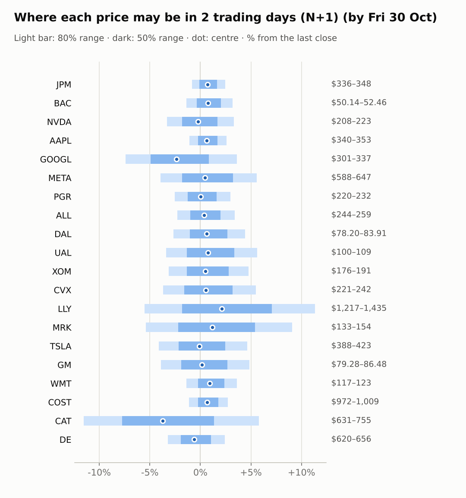
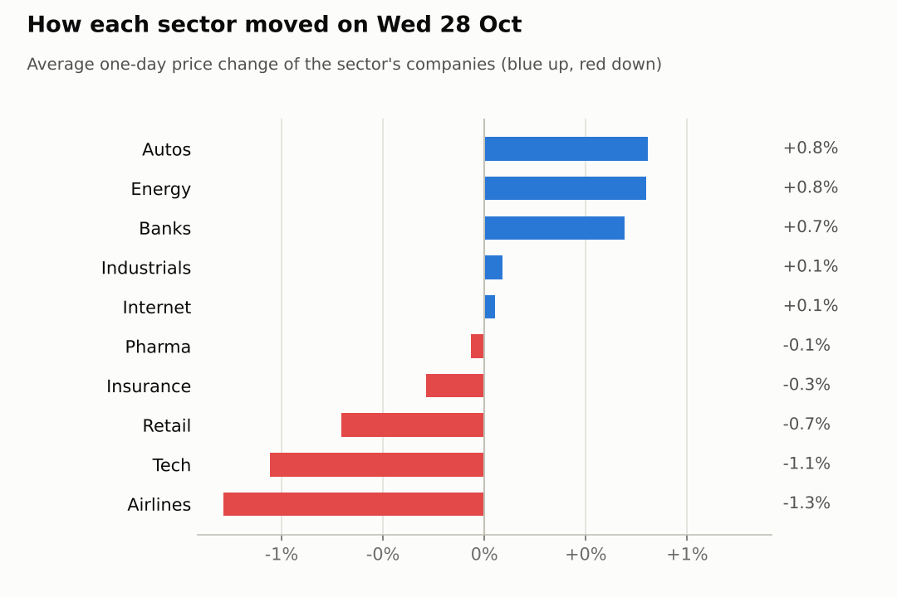
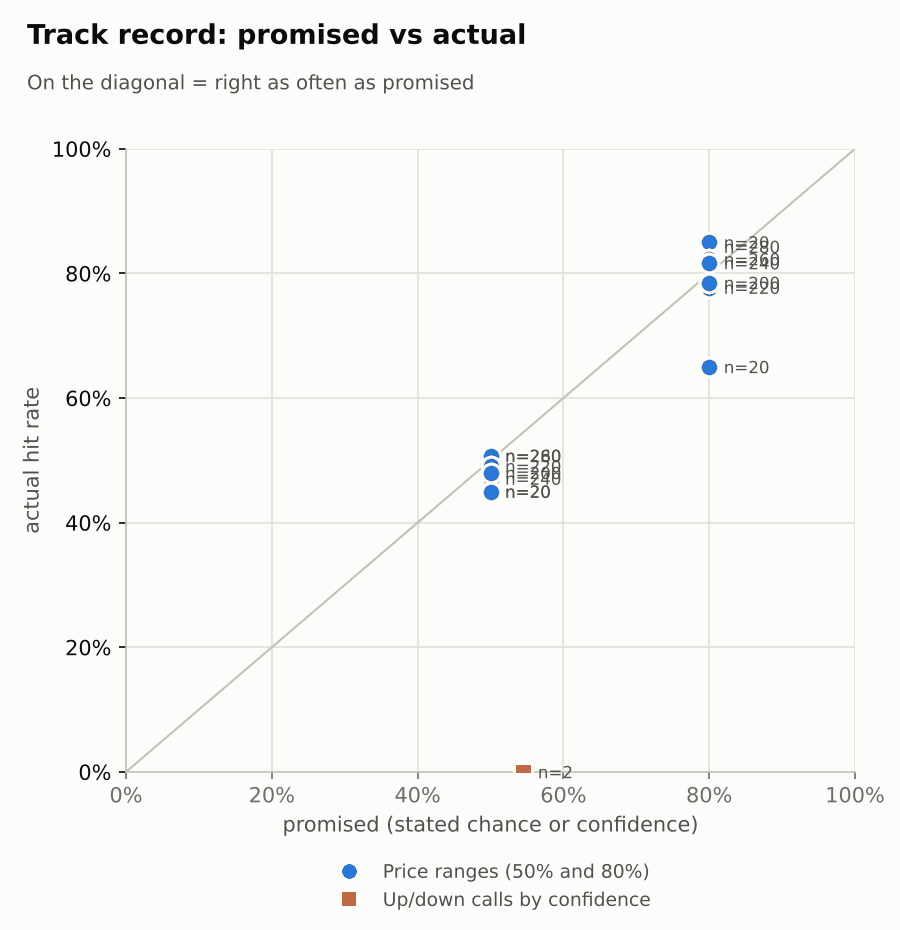

# Market brief: US (NYSE/Nasdaq), 2026-10-29

_Research log, not investment advice. Generated by a scheduled Claude Code routine._
<!-- report-data: as_of=2026-10-28 regime=CALM outcome=70248abff9bf -->

Easy-to-read version with charts and filters: [2026-10-29.html](2026-10-29.html)

## Headline
No calls today: the collect gate blocked 17 of 20 companies again (duplicate stored news ids), MRK reports today, and DE and PGR showed no edge over the base rate. GOOGL is down 11.28% before the open after its results (2722afd0e097a341), and CAT is down 9.43% on its results day.

## Top 3 today
- GOOGL trades 11.28% lower before the open after its quarterly results (2722afd0e097a341); its N+1 80% range is $300.81–$336.63.
- CAT is 9.43% lower before the open on its results day while DE, its sector peer, is 1.19% lower (b59cab5d9c15ec03).
- Nasdaq 100 futures (NQ) are down 1.12% while LLY (+4.27%) and MRK (+2.4%) rise before the open on their results day (1a9c465dd33292cf).

## Yesterday
The S&P 500 ETF rose 0.3% on 2026-10-28, the day of the Fed decision; the watchlist split 10 up and 10 down, GM best at +2.4% and DAL worst at -1.4%.
N+1 80% ranges held 19 of 20. The only miss was GM, which closed above its range after its $20B buyback week. The 50% misses (ALL, COST, JPM, PGR) were small moves near the band edges.
The one scored call, NVDA 5-day up, missed with a move of -8.44%.

Market on 2026-10-28: S&P 500 ETF 772.31 (+0.3%) · VIX 16.91 (-3.5%) · watchlist 10 up / 10 down · best GM +2.4%, worst DAL -1.4%

### Ranges scored (target date 2026-10-28)

N+1 ranges: **80% hit 19/20** (naive 16/20) · 50% hit 15/20

| Ticker | 80% range | 50% range | Actual | 80% | 50% | Naive 80% |
|---|---|---|---|---|---|---|
| AAPL | $335.69–$351.84 | $339.51–$347.95 | $343.83 | ✅ | ✅ | ✅ |
| ALL | $248.34–$267.53 | $252.84–$262.86 | $250.20 | ✅ | ❌ | ✅ |
| BAC | $49.18–$52.28 | $49.91–$51.53 | $50.85 | ✅ | ✅ | ✅ |
| CAT | $665.30–$733.19 | $681.05–$716.53 | $713.38 | ✅ | ✅ | ✅ |
| COST | $980.20–$1,029.02 | $991.74–$1,017.26 | $982.73 | ✅ | ❌ | ❌ |
| CVX | $224.71–$238.89 | $228.04–$235.45 | $229.20 | ✅ | ✅ | ✅ |
| DAL | $76.35–$83.48 | $78.01–$81.74 | $80.35 | ✅ | ✅ | ✅ |
| DE | $618.14–$667.53 | $629.69–$655.50 | $640.67 | ✅ | ✅ | ✅ |
| GM | $73.80–$81.51 | $75.58–$79.61 | $82.48 | ❌ | ❌ | ❌ |
| GOOGL | $295.91–$342.58 | $306.53–$330.92 | $324.89 | ✅ | ✅ | ❌ |
| JPM | $328.21–$342.47 | $331.59–$339.04 | $339.30 | ✅ | ❌ | ❌ |
| LLY | $1,229.40–$1,333.18 | $1,253.63–$1,307.87 | $1,288.30 | ✅ | ✅ | ✅ |
| META | $592.34–$671.94 | $610.60–$652.20 | $612.49 | ✅ | ✅ | ✅ |
| MRK | $135.06–$147.02 | $137.85–$144.10 | $140.93 | ✅ | ✅ | ✅ |
| NVDA | $207.75–$226.93 | $212.21–$222.24 | $215.38 | ✅ | ✅ | ✅ |
| PGR | $222.05–$238.66 | $225.94–$234.62 | $225.66 | ✅ | ❌ | ✅ |
| TSLA | $373.17–$416.77 | $383.23–$406.02 | $404.22 | ✅ | ✅ | ✅ |
| UAL | $96.38–$107.83 | $99.02–$105.00 | $103.43 | ✅ | ✅ | ✅ |
| WMT | $116.48–$124.45 | $118.35–$122.51 | $118.77 | ✅ | ✅ | ✅ |
| XOM | $178.71–$189.88 | $181.34–$187.18 | $182.02 | ✅ | ✅ | ✅ |

N+2 ranges that matured on the same date: 80% hit 18/20, 50% hit 11/20. N+3 ranges that matured on the same date: 80% hit 17/20, 50% hit 13/20. N+4 ranges that matured on the same date: 80% hit 18/20, 50% hit 14/20. N+5 ranges that matured on the same date: 80% hit 20/20, 50% hit 13/20.

### Calls scored

| Ticker | H | Call | Conf. | Move | Hit |
|---|---|---|---|---|---|
| NVDA | 5d · open→close | up | 54% | -8.44% | ❌ |

## Today (2026-10-29)

**Regime: CALM** · VIX 17.10 (+1.1%) · benchmark 5d -0.1% · benchmark 10d vol 11.2%

| Ticker | Sector | Close | N+1 80% | N+1 50% | N+5 80% | Call | Cue | Notes |
|---|---|---|---|---|---|---|---|---|
| JPM | Banks | $339.30 | $336.43–$347.62 | $339.01–$344.90 | $332.43–$353.16 | no call | +1.45% | cue +1.45% x0.5 |
| BAC | Banks | $50.85 | $50.14–$52.46 | $50.67–$51.89 | $49.30–$53.60 | no call | +1.47% | cue +1.47% x0.5 |
| NVDA | Tech | $215.38 | $208.27–$222.53 | $211.52–$219.02 | $203.20–$229.64 | no call | -0.46% | cue -0.46% x0.5 |
| AAPL | Tech | $343.83 | $340.17–$352.72 | $343.06–$349.66 | $330.23–$365.79 | no call | +1.29% | cue +1.29% x0.5; earnings in horizon (x3.0 day) |
| GOOGL | Internet | $324.89 | $300.81–$336.63 | $308.83–$327.65 | $305.35–$335.62 | no call | -11.28% | cue -11.28% x0.5; earnings in horizon (x2.94 day, 7 past moves, median 2.5%) |
| META | Internet | $612.49 | $588.40–$646.68 | $601.54–$632.17 | $568.05–$676.33 | no call | +0.90% | cue +0.90% x0.5 |
| PGR | Insurance | $225.66 | $219.98–$232.35 | $222.81–$229.31 | $215.54–$238.46 | no call | +0.07% | cue +0.07% x0.5 |
| ALL | Insurance | $250.20 | $244.47–$258.72 | $247.73–$255.22 | $233.40–$273.86 | no call | +0.72% | cue +0.72% x0.5; earnings in horizon (x3.0 day) |
| DAL | Airlines | $80.35 | $78.20–$83.91 | $79.50–$82.50 | $76.17–$86.77 | no call | +1.24% | cue +1.24% x0.5 |
| UAL | Airlines | $103.43 | $99.93–$109.22 | $102.03–$106.91 | $96.67–$113.93 | no call | +1.52% | cue +1.52% x0.5 |
| XOM | Energy | $182.02 | $176.29–$190.69 | $179.55–$187.13 | $171.53–$197.48 | no call | +1.02% | cue +1.02% x0.5; earnings in horizon (x1.99 day, 7 past moves, median 1.0%); earnings in horizon (x3.0 day) |
| CVX | Energy | $229.20 | $220.78–$241.74 | $225.51–$236.53 | $216.86–$247.67 | no call | +1.09% | cue +1.09% x0.5; earnings in horizon (x2.53 day, 7 past moves, median 2.3%); earnings in horizon (x3.0 day) |
| LLY | Pharma | $1,288.30 | $1,217.39–$1,434.57 | $1,265.02–$1,379.10 | $1,217.62–$1,441.92 | no call | +4.27% | cue +4.27% x0.5; earnings in horizon (x3.0 day); earnings in horizon (x3.74 day, 7 past moves, median 9.3%) |
| MRK | Pharma | $140.93 | $133.35–$153.73 | $137.85–$148.56 | $131.45–$157.08 | no call | +2.40% | cue +2.40% x0.5; earnings in horizon (x3.0 day); earnings in horizon (x3.03 day, 7 past moves, median 1.6%) |
| TSLA | Autos | $404.22 | $387.50–$422.96 | $395.52–$414.15 | $375.07–$440.90 | no call | -0.18% | cue -0.18% x0.5 |
| GM | Autos | $82.48 | $79.28–$86.48 | $80.90–$84.69 | $76.75–$90.13 | no call | +0.29% | cue +0.29% x0.5 |
| WMT | Retail | $118.77 | $117.13–$123.05 | $118.49–$121.60 | $115.00–$125.97 | no call | +1.89% | cue +1.89% x0.5 |
| COST | Retail | $982.73 | $971.59–$1,009.32 | $980.28–$1,000.12 | $958.44–$1,028.31 | no call | +1.75% | cue +1.75% x0.5; ex-dividend 1.47 (0.15%) |
| CAT | Industrials | $713.38 | $631.17–$754.81 | $658.13–$723.06 | $620.28–$767.57 | no call | -9.43% | cue -9.43% x0.5; earnings in horizon (x3.0 day); earnings in horizon (x3.2 day, 7 past moves, median 4.8%) |
| DE | Industrials | $640.67 | $620.01–$656.20 | $628.28–$647.31 | $607.04–$674.11 | no call | -1.19% | cue -1.19% x0.5 |

No calls today.
- AAPL, ALL, BAC, CAT, COST, CVX, DAL, GM, GOOGL, JPM, LLY, META, NVDA, TSLA, UAL, WMT, XOM: abstain, data failed validation (collect gate DUPLICATE_ID on stored news rows that name them).
- MRK: abstain, results today (days to earnings 0), a hard block.
- DE: abstain, the model's P(up) sits at the base rate and its news has no verified main evidence.
- PGR: abstain, the model's P(up) sits at the base rate and its news has no verified main evidence.

### Overnight cues and global factors

| Symbol | Name | Last | Change |
|---|---|---|---|
| DAX | DAX | 25,952.96 | +0.97% |
| DXY | US dollar index | 102.17 | -0.02% |
| ES | S&P 500 futures | 7,757.00 | -0.34% |
| FTSE | FTSE 100 | 10,736.87 | +0.40% |
| GOLD | Gold | 4,040.20 | -0.28% |
| HANGSENG | Hang Seng | 22,958.65 | -0.59% |
| KOSPI | KOSPI | 5,937.66 | -1.24% |
| NIKKEI | Nikkei 225 | 64,659.47 | +1.10% |
| NQ | Nasdaq 100 futures | 29,644.50 | -1.12% |
| SPY | S&P 500 ETF | 769.83 | -0.32% |
| STOXX50 | Euro Stoxx 50 | 6,183.77 | +0.26% |
| US10Y | US 10-year yield | 5.04 | +1.04% |
| USDCNY | USD/CNY | 6.65 | -0.26% |
| USDJPY | USD/JPY | 157.94 | -0.03% |
| VIX | VIX | 17.10 | +1.12% |
| WTI | WTI crude | 101.45 | -1.29% |

## Tomorrow and this week

| Date | Event | Type |
|---|---|---|
| 2026-10-28 | Alphabet earnings | company |
| 2026-10-29 | Caterpillar earnings | company |
| 2026-10-29 | Eli Lilly earnings | company |
| 2026-10-29 | Merck earnings | company |
| 2026-10-30 | Chevron earnings | company |
| 2026-10-30 | Costco ex-dividend (est. 1.47, last dividend) | company |
| 2026-10-30 | ExxonMobil earnings | company |
| 2026-11-02 | Apple earnings | company |
| 2026-11-04 | Allstate earnings | company |
| 2026-11-06 | US jobs report (usually first Friday; check for shifts) | major |
| 2026-11-10 | US CPI (October; provisional date) |  |
| 2026-11-13 | Eli Lilly ex-dividend (est. 1.73, last dividend) | company |
| 2026-11-17 | Nvidia earnings | company |

Results days: CAT, LLY and MRK report today; CVX and XOM on 2026-10-30; Apple on 2026-11-02 and Allstate on 2026-11-04. Their ranges are widened for earnings.
Cues are mixed: ES -0.34% and NQ -1.12% against DAX +0.97% and Nikkei +1.1%. The US 10-year yield is 5.045 and WTI 101.45. The regime is CALM with VIX at 17.1.
The US jobs report on 2026-11-06 is the next major macro event.

## By sector

### Banks

JPM (+1.45%) and BAC (+1.47%) rise together before the open, a sector move with no company news. BAC's RSI is 30 (oversold).
Bull: BAC is oversold and both get a cue lift. Bear: no company catalyst; both were blocked today.

### Tech

NVDA (-0.46%) and AAPL (+1.29%) move apart before the open. AAPL reports on 2026-11-02.
Bull: AAPL's cue is positive. Bear: NQ futures fall 1.12% and NVDA is below its 20-day high; both were blocked today.

### Internet

GOOGL is 11.28% lower before the open after its results (2722afd0e097a341), while META is 0.9% higher. Company news, not a sector move.
Bull: META is oversold (RSI 31). Bear: GOOGL's miss and META's offering (cca7bea097221e03, corroborated) weigh; both were blocked today.

### Insurance

PGR (+0.07%) and ALL (+0.72%) are quiet; PGR's cue is the previous close. ALL reports on 2026-11-04.
Bull: PGR is up 8.85% over 20 days with RSI 59. Bear: the run-up is extended and there is no catalyst; PGR's model score sits at the base rate.

### Airlines

DAL (+1.24%) and UAL (+1.52%) rise together before the open, a sector move.
Bull: positive cues. Bear: UAL's quarterly miss (8f6eba157a6b9dfc); both were blocked today.

### Energy

CVX (+1.09%) and XOM (+1.02%) rise together into their results on 2026-10-30, while WTI falls 1.29%.
Bull: CVX and XOM both trend up, each with RSI 67. Bear: oil is down and results are a day away; both were blocked today.

### Pharma

LLY (+4.27%) and MRK (+2.4%) rise together on their results day.
Bull: MRK's beat headline (1a9c465dd33292cf). Bear: gap-ups on results can fade, and MRK is down 5.97% over 5 days; no call on results day.

### Autos

TSLA (-0.18%) and GM (+0.29%) are nearly flat before the open.
Bull: GM's buyback momentum (+8.37% over 5 days). Bear: GM closed above its 80% range yesterday and may be stretched; both were blocked today.

### Retail

WMT (+1.89%) and COST (+1.75%) rise together before the open. COST goes ex-dividend on 2026-10-30.
Bull: positive cues and steady trends. Bear: no company catalyst; both were blocked today.

### Industrials

CAT is 9.43% lower before the open on its results day (b59cab5d9c15ec03), and DE is 1.19% lower.
Bull: CAT is oversold (RSI 36). Bear: DE may follow CAT, which is reasoning only; DE's model score sits at the base rate.

## Track record

Ranges (targets 50% / 80%; width, score and centre error in % of price, lower is better; naive = last close ± recent typical move, no-change = last close as the centre):

| H | Window | n | 50% cover | 80% cover | Naive 80% | Width | Naive width | Score | Naive score | Centre err | No-change err |
|---|---|---|---|---|---|---|---|---|---|---|---|
| 1d | since start | 280 | 51% | 84% | 76% | 7.15 | 6.15 | 8.911 | 9.519 | 2.02 | 2.15 |
| 1d | last 30 days | 280 | 51% | 84% | 76% | 7.15 | 6.15 | 8.911 | 9.519 | 2.02 | 2.15 |
| 1d legacy_cc | since start | 20 | 45% | 85% | 85% | 4.09 | 4.18 | 7.414 | 7.632 | 1.45 | 1.39 |
| 1d legacy_cc | last 30 days | 20 | 45% | 85% | 85% | 4.09 | 4.18 | 7.414 | 7.632 | 1.45 | 1.39 |
| 2d | since start | 260 | 51% | 82% | 73% | 8.88 | 7.52 | 11.122 | 11.917 | 2.60 | 2.72 |
| 2d | last 30 days | 260 | 51% | 82% | 73% | 8.88 | 7.52 | 11.122 | 11.917 | 2.60 | 2.72 |
| 3d | since start | 240 | 47% | 82% | 70% | 10.36 | 8.67 | 12.567 | 13.317 | 3.08 | 3.17 |
| 3d | last 30 days | 240 | 47% | 82% | 70% | 10.36 | 8.67 | 12.567 | 13.317 | 3.08 | 3.17 |
| 4d | since start | 220 | 49% | 78% | 68% | 11.96 | 9.68 | 15.370 | 16.256 | 3.58 | 3.68 |
| 4d | last 30 days | 220 | 49% | 78% | 68% | 11.96 | 9.68 | 15.370 | 16.256 | 3.58 | 3.68 |
| 5d | since start | 200 | 48% | 79% | 65% | 13.33 | 10.63 | 17.328 | 18.308 | 4.04 | 4.13 |
| 5d | last 30 days | 200 | 48% | 79% | 65% | 13.33 | 10.63 | 17.328 | 18.308 | 4.04 | 4.13 |
| 5d legacy_cc | since start | 20 | 45% | 65% | 50% | 9.91 | 9.35 | 17.346 | 16.489 | 3.60 | 3.63 |
| 5d legacy_cc | last 30 days | 20 | 45% | 65% | 50% | 9.91 | 9.35 | 17.346 | 16.489 | 3.60 | 3.63 |

Ranges by regime (since start):

| H | Regime | n | 50% cover | 80% cover | Naive 80% |
|---|---|---|---|---|---|
| 1d | CALM | 160 | 49% | 84% | 79% |
| 1d | EVENT_HEAVY | 100 | 53% | 85% | 72% |
| 1d | TRENDING | 20 | 50% | 85% | 75% |
| 1d legacy_cc | TRENDING | 20 | 45% | 85% | 85% |
| 2d | CALM | 160 | 56% | 86% | 82% |
| 2d | EVENT_HEAVY | 80 | 44% | 76% | 58% |
| 2d | TRENDING | 20 | 40% | 75% | 65% |
| 3d | CALM | 160 | 53% | 84% | 78% |
| 3d | EVENT_HEAVY | 60 | 33% | 75% | 52% |
| 3d | TRENDING | 20 | 40% | 80% | 65% |
| 4d | CALM | 140 | 57% | 84% | 77% |
| 4d | EVENT_HEAVY | 60 | 32% | 68% | 50% |
| 4d | TRENDING | 20 | 45% | 60% | 55% |
| 5d | CALM | 120 | 52% | 79% | 71% |
| 5d | EVENT_HEAVY | 60 | 40% | 82% | 57% |
| 5d | TRENDING | 20 | 50% | 65% | 50% |
| 5d legacy_cc | TRENDING | 20 | 45% | 65% | 50% |

Up/down calls vs the always-up baseline:

| H | Window | n | Hit rate | Always-up |
|---|---|---|---|---|
| 5d · open→close | since start | 2 | 0% | 0% |
| 5d · open→close | last 30 days | 2 | 0% | 0% |

Calls by confidence band (a band should hit about as often as its confidence):

| Band | n | Avg confidence | Hit rate |
|---|---|---|---|
| 0.50-0.59 · open→close | 2 | 55% | 0% |

Weekly review 2026-W43: 0 proposed range changes for a human to decide · [review-2026-W43.md](review-2026-W43.md)

## Data quality

- Indicators: 20 OK, partial: none, blocked: none
- Regime notes: none

| H | Calibration | History n | Live n | q10 / q90 |
|---|---|---|---|---|
| 1d | pool | 9100 | 280 | -1.11 / 1.24 |
| 2d | pool | 9080 | 260 | -1.14 / 1.30 |
| 3d | pool | 9060 | 240 | -1.15 / 1.31 |
| 4d | pool | 9040 | 220 | -1.18 / 1.32 |
| 5d | pool | 9020 | 200 | -1.15 / 1.36 |

- validation collect DUPLICATE_ID (blocking): news, 20 duplicated ids shown (the check lists at most 20; 180 ids are duplicated in all; e.g. 01f6ad725a09e2f5, 020d9bf374777f46, 034e890a6034e8a5, 0409934ffa713e05, 05b8d7263c4d2a46). Old headlines were stored again under their old ids after the 9-day de-dup window (an open issue). Stored data cannot be edited, so the retry cannot clear it. The forecaster and the AI traders abstained on the tickers those rows name: AAPL, ALL, BAC, CAT, COST, CVX, DAL, GM, GOOGL, JPM, LLY, META, NVDA, TSLA, UAL, WMT, XOM. None of the ids is cited.
- validation collect COLLECTOR_FAILED (warning): events, 20 failed (Yahoo earnings calendar empty after a rate limit and invalid crumb): all 20 tickers. SEC and NSE earnings backfill had no failures.
- validation collect COLLECTOR_FAILED (warning): options, 20 failed (no option expiries returned after a Yahoo rate limit): all 20 tickers. No implied-vol input today.
- collect_holdings warnings: SEC acceptance times not checkable for 13F filer CIKs 933478, 1167483, 1040273, 1029160 (stored as served, maybe 4-5h late).
- collect_articles: 15 article reads deferred to the next run; 19 skipped as unlisted outlets.
- results digests: prepare detected no results release to digest (0 detected), although GOOGL filed its 10-Q today; nothing was stored.
- news enrichment: the news-analyst scored the 1856 pending items mostly by headline rules, reading only a minority of the watchlist headlines one by one; the news gate passed.
- AI traders: ai.combined.opus.v1 abstained 15, earnings_window 5; ai.combined.sonnet.v1 abstained 13, earnings_window 5 (6 predictions); ai.news_results.sonnet.v1 abstained 15, earnings_window 5; ai.pattern_mood.sonnet.v1 abstained 15, earnings_window 5 (1 prediction). Rule strategies abstained on the earnings-window companies.
- head-to-head picks: 60 written, none viable at the owner's cost.
- AAPL earnings date: the events table has 2026-11-02 while the Yahoo consensus row lists 2026-10-29; not checked further (AAPL was blocked).
- validation: features, context, news and forecast gates passed with no warnings.
- 2026-10-26 spotcheck round 1 FAIL (from the previous run's judge): report 2026-10-21 said the 50% misses (AAPL, GM, JPM, LLY, MRK, TSLA) "mostly came from moves of 3% or more"; stored ret_1d shows 3 of 6 (GM, LLY, MRK). Nothing was dropped.
