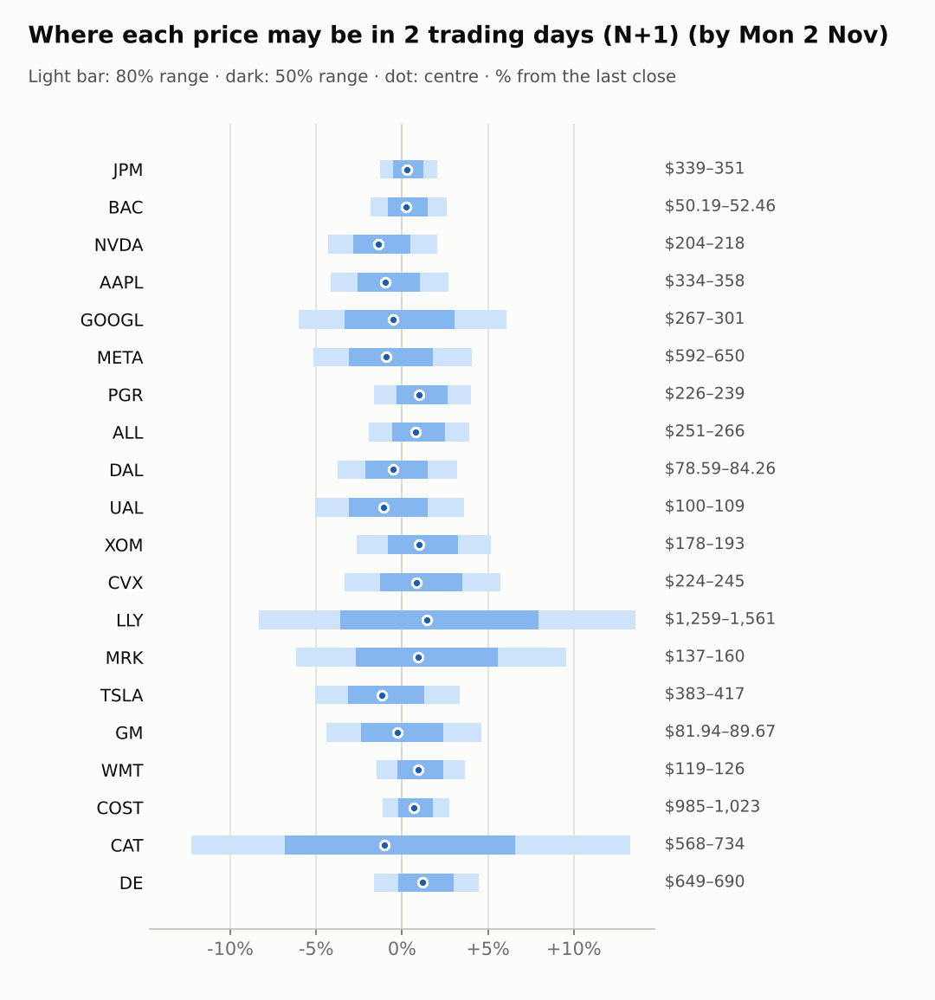
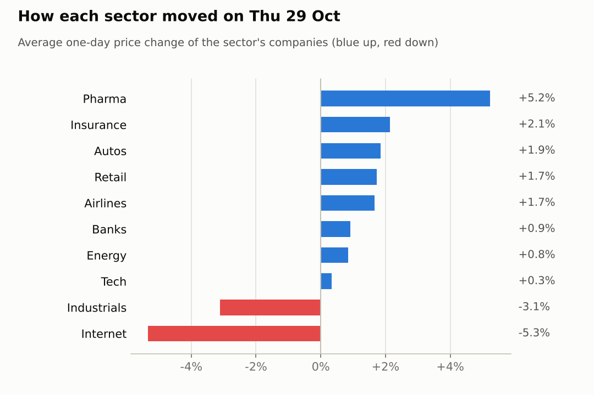
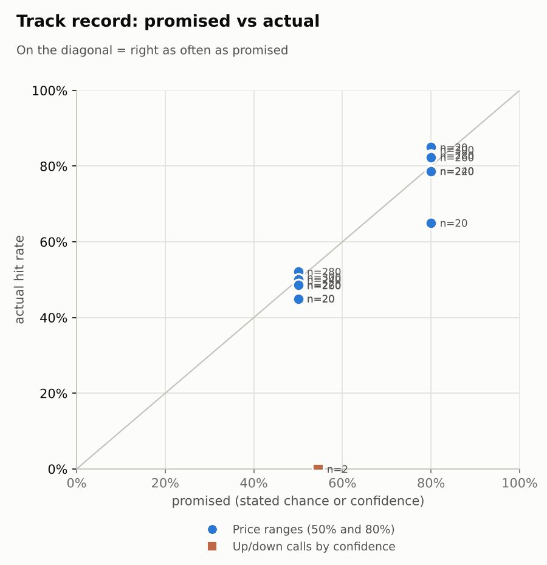

# Market brief: US (NYSE/Nasdaq), 2026-10-30

_Research log, not investment advice. Generated by a scheduled Claude Code routine._
<!-- report-data: as_of=2026-10-29 regime=CALM outcome=70248abff9bf -->

Easy-to-read version with charts and filters: [2026-10-30.html](2026-10-30.html)

## Headline
No calls today: the collect gate blocked 17 of 20 companies again (duplicate stored news ids), and DE, MRK and PGR showed no verified main evidence and no edge over the base rate. Futures point lower (ES -1.05%, NQ -2.49%) after GOOGL fell 12.64% and CAT 9.25% on their results.

## Top 3 today
- GOOGL fell 12.64% on 2026-10-29 after its quarterly results (150636df3dda34ca) and trades 1.03% lower before the open; its N+1 80% range is $266.68–$301.02.
- Nasdaq 100 futures (NQ) are down 2.49% and NVDA 3.24% before the open, while VIX rises 7.2% to 18.44.
- LLY (+6.63%) and MRK (+3.83%) rose on their results day and trade higher again before the open (LLY +2.87%, MRK +1.89%); CVX and XOM report today.

## Yesterday
The S&P 500 ETF fell 0.4% on 2026-10-29; the watchlist split 16 up and 4 down, LLY best at +6.6% and GOOGL worst at -12.6%.
N+1 80% ranges held 17 of 20. GOOGL closed below its range after its results; GM and JPM closed just above theirs. CAT closed at $647.39, just inside its lower 80% edge of $646.68.
The one scored call, NVDA 5-day up, missed with a move of -8.44%.

Market on 2026-10-29: S&P 500 ETF 769.36 (-0.4%) · VIX 17.20 (+1.7%) · watchlist 16 up / 4 down · best LLY +6.6%, worst GOOGL -12.6%

### Ranges scored (target date 2026-10-29)

N+1 ranges: **80% hit 17/20** (naive 15/20) · 50% hit 10/20

| Ticker | 80% range | 50% range | Actual | 80% | 50% | Naive 80% |
|---|---|---|---|---|---|---|
| AAPL | $338.87–$355.03 | $342.64–$351.11 | $348.91 | ✅ | ✅ | ✅ |
| ALL | $240.98–$259.56 | $245.27–$255.00 | $255.92 | ✅ | ❌ | ✅ |
| BAC | $49.23–$52.25 | $49.93–$51.51 | $51.14 | ✅ | ✅ | ✅ |
| CAT | $646.68–$818.30 | $683.87–$773.63 | $647.39 | ✅ | ❌ | ❌ |
| COST | $965.67–$1,014.23 | $976.99–$1,002.44 | $996.08 | ✅ | ✅ | ✅ |
| CVX | $221.71–$235.84 | $224.99–$232.39 | $231.46 | ✅ | ✅ | ✅ |
| DAL | $77.77–$85.23 | $79.48–$83.39 | $81.64 | ✅ | ✅ | ✅ |
| DE | $616.54–$664.31 | $627.56–$652.59 | $660.00 | ✅ | ❌ | ✅ |
| GM | $76.39–$85.41 | $78.44–$83.16 | $85.72 | ❌ | ❌ | ❌ |
| GOOGL | $301.70–$348.66 | $312.25–$336.84 | $283.82 | ❌ | ❌ | ❌ |
| JPM | $328.84–$342.81 | $332.11–$339.43 | $343.58 | ❌ | ❌ | ❌ |
| LLY | $1,151.89–$1,428.90 | $1,212.39–$1,357.31 | $1,373.70 | ✅ | ❌ | ❌ |
| META | $585.99–$663.04 | $603.44–$643.79 | $624.52 | ✅ | ✅ | ✅ |
| MRK | $129.39–$155.92 | $135.25–$149.14 | $146.33 | ✅ | ✅ | ✅ |
| NVDA | $210.09–$229.01 | $214.44–$224.35 | $213.66 | ✅ | ❌ | ✅ |
| PGR | $216.29–$232.43 | $220.02–$228.47 | $230.18 | ✅ | ❌ | ✅ |
| TSLA | $387.33–$434.48 | $398.05–$422.74 | $403.30 | ✅ | ✅ | ✅ |
| UAL | $98.76–$110.93 | $101.52–$107.90 | $105.21 | ✅ | ✅ | ✅ |
| WMT | $115.21–$122.91 | $116.99–$121.03 | $121.25 | ✅ | ❌ | ✅ |
| XOM | $174.60–$186.23 | $177.30–$183.39 | $183.29 | ✅ | ✅ | ✅ |

N+2 ranges that matured on the same date: 80% hit 18/20, 50% hit 14/20. N+3 ranges that matured on the same date: 80% hit 18/20, 50% hit 13/20. N+4 ranges that matured on the same date: 80% hit 18/20, 50% hit 12/20. N+5 ranges that matured on the same date: 80% hit 16/20, 50% hit 11/20.

### Calls scored

| Ticker | H | Call | Conf. | Move | Hit |
|---|---|---|---|---|---|
| NVDA | 5d · open→close | up | 54% | -8.44% | ❌ |

## Today (2026-10-30)

**Regime: CALM** · VIX 18.44 (+7.2%) · benchmark 5d +0.7% · benchmark 10d vol 11.3%

| Ticker | Sector | Close | N+1 80% | N+1 50% | N+5 80% | Call | Cue | Notes |
|---|---|---|---|---|---|---|---|---|
| JPM | Banks | $343.58 | $339.13–$350.65 | $341.80–$347.86 | $333.45–$357.99 | no call | +0.54% | cue +0.54% x0.5; major event x1.15 |
| BAC | Banks | $51.14 | $50.19–$52.46 | $50.72–$51.91 | $49.09–$53.92 | no call | +0.43% | cue +0.43% x0.5; major event x1.15 |
| NVDA | Tech | $213.66 | $204.43–$218.08 | $207.56–$214.74 | $197.30–$226.38 | no call | -3.24% | cue -3.24% x0.5; major event x1.15 |
| AAPL | Tech | $348.91 | $334.45–$358.34 | $339.91–$352.48 | $326.85–$368.81 | no call | -1.94% | cue -1.94% x0.5; earnings in horizon (x2.43 day, 7 past moves, median 2.5%); earnings in horizon (x3.0 day); major event x1.15 |
| GOOGL | Internet | $283.82 | $266.68–$301.02 | $274.38–$292.43 | $250.84–$324.52 | no call | -1.03% | cue -1.03% x0.5; major event x1.15 |
| META | Internet | $624.52 | $592.21–$649.99 | $605.31–$635.69 | $564.98–$688.64 | no call | -1.83% | cue -1.83% x0.5; major event x1.15 |
| PGR | Insurance | $230.18 | $226.47–$239.40 | $229.44–$236.24 | $220.19–$247.80 | no call | +2.00% | cue +2.00% x0.5; major event x1.15 |
| ALL | Insurance | $255.92 | $250.99–$265.99 | $254.44–$262.33 | $236.55–$285.62 | no call | +1.59% | cue +1.59% x0.5; earnings in horizon (x3.0 day); major event x1.15 |
| DAL | Airlines | $81.64 | $78.59–$84.26 | $79.89–$82.87 | $75.87–$87.99 | no call | -1.04% | cue -1.04% x0.5; major event x1.15 |
| UAL | Airlines | $105.21 | $99.89–$109.03 | $101.97–$106.77 | $95.57–$115.11 | no call | -2.10% | cue -2.10% x0.5; major event x1.15 |
| XOM | Energy | $183.29 | $178.49–$192.74 | $181.74–$189.23 | $172.07–$201.63 | no call | +1.95% | cue +1.95% x0.5; earnings in horizon (x1.99 day, 7 past moves, median 1.0%); earnings in horizon (x3.0 day); major event x1.15 |
| CVX | Energy | $231.46 | $223.76–$244.70 | $228.51–$239.52 | $217.78–$253.21 | no call | +1.68% | cue +1.68% x0.5; earnings in horizon (x2.53 day, 7 past moves, median 2.3%); earnings in horizon (x3.0 day); major event x1.15 |
| LLY | Pharma | $1,373.70 | $1,259.19–$1,560.67 | $1,324.33–$1,482.63 | $1,290.59–$1,524.53 | no call | +2.87% | cue +2.87% x0.5; earnings in horizon (x3.74 day, 7 past moves, median 9.3%); major event x1.15 |
| MRK | Pharma | $146.33 | $137.33–$160.28 | $142.41–$154.47 | $138.14–$159.82 | no call | +1.89% | cue +1.89% x0.5; earnings in horizon (x3.03 day, 7 past moves, median 1.6%); major event x1.15 |
| TSLA | Autos | $403.30 | $382.82–$416.80 | $390.55–$408.42 | $366.71–$439.39 | no call | -2.38% | cue -2.38% x0.5; major event x1.15 |
| GM | Autos | $85.72 | $81.94–$89.67 | $83.69–$87.76 | $78.29–$94.83 | no call | -0.52% | cue -0.52% x0.5; major event x1.15 |
| WMT | Retail | $121.25 | $119.47–$125.70 | $120.91–$124.18 | $116.45–$129.73 | no call | +1.86% | cue +1.86% x0.5; major event x1.15 |
| COST | Retail | $996.08 | $984.70–$1,023.45 | $993.67–$1,014.06 | $967.61–$1,050.37 | no call | +2.06% | cue +2.06% x0.5; ex-dividend 1.47 (0.15%); major event x1.15 |
| CAT | Industrials | $647.39 | $567.87–$733.52 | $603.07–$689.99 | $576.51–$725.38 | no call | -2.06% | cue -2.06% x0.5; earnings in horizon (x3.2 day, 7 past moves, median 4.8%); major event x1.15 |
| DE | Industrials | $660.00 | $649.22–$689.52 | $658.47–$679.67 | $629.75–$715.78 | no call | +2.41% | cue +2.41% x0.5; major event x1.15 |

- AAPL, ALL, BAC, CAT, COST, CVX, DAL, GM, GOOGL, JPM, LLY, META, NVDA, TSLA, UAL, WMT, XOM: abstain, data failed validation (collect gate DUPLICATE_ID on stored news rows that name them). CVX and XOM also report today.
- MRK: abstain, its results beat is already in the price (+3.83% on 2026-10-29, +1.89% before the open) and its beat headlines cannot be main evidence.
- DE: abstain, the model's P(up) sits at the base rate and its news has no verified main evidence.
- PGR: abstain, the model's P(up) sits at the base rate and its news has no verified main evidence.

### Overnight cues and global factors

| Symbol | Name | Last | Change |
|---|---|---|---|
| DAX | DAX | 25,888.69 | -0.58% |
| DXY | US dollar index | 101.64 | -0.39% |
| ES | S&P 500 futures | 7,673.00 | -1.05% |
| FTSE | FTSE 100 | 10,749.84 | +0.26% |
| GOLD | Gold | 3,987.40 | -1.09% |
| HANGSENG | Hang Seng | 23,294.42 | +1.46% |
| KOSPI | KOSPI | 5,730.74 | -3.48% |
| NIKKEI | Nikkei 225 | 63,290.11 | -2.12% |
| NQ | Nasdaq 100 futures | 28,825.75 | -2.49% |
| SPY | S&P 500 ETF | 761.23 | -1.06% |
| STOXX50 | Euro Stoxx 50 | 6,153.81 | -0.86% |
| US10Y | US 10-year yield | 4.99 | -1.11% |
| USDCNY | USD/CNY | 6.64 | -0.37% |
| USDJPY | USD/JPY | 157.01 | -0.52% |
| VIX | VIX | 18.44 | +7.21% |
| WTI | WTI crude | 104.10 | +2.06% |

## Tomorrow and this week

| Date | Event | Type |
|---|---|---|
| 2026-10-29 | Eli Lilly earnings | company |
| 2026-10-29 | Merck earnings | company |
| 2026-10-30 | Chevron earnings | company |
| 2026-10-30 | Costco ex-dividend (est. 1.47, last dividend) | company |
| 2026-10-30 | ExxonMobil earnings | company |
| 2026-11-02 | Apple earnings | company |
| 2026-11-04 | Allstate earnings | company |
| 2026-11-06 | US jobs report (usually first Friday; check for shifts) | major |
| 2026-11-10 | US CPI (October; provisional date) |  |
| 2026-11-13 | Eli Lilly ex-dividend (est. 1.73, last dividend) | company |
| 2026-11-17 | Nvidia earnings | company |
| 2026-11-19 | Walmart earnings | company |

Cues lean risk-off: ES -1.05%, NQ -2.49%, Nikkei -2.12% and KOSPI -3.48%, against Hang Seng +1.46%. WTI rises 2.06% to 104.1 and the US 10-year yield is 4.989. The regime is CALM with VIX at 18.44.
Apple reports on 2026-11-02 and Allstate on 2026-11-04; the US jobs report on 2026-11-06 is the next major macro event.

## By sector

### Banks

JPM (+0.54%) and BAC (+0.43%) edge up before the open against falling index futures. BAC's RSI is 33.
Bull: banks hold up while tech falls. Bear: no company catalyst; both were blocked today.

### Tech

NVDA (-3.24%) and AAPL (-1.94%) fall before the open with NQ futures. AAPL reports on 2026-11-02.
Bull: AAPL sits near its 20-day high. Bear: NQ is down 2.49%; both were blocked today.

### Internet

GOOGL fell 12.64% on its results (RSI 22) and trades 1.03% lower again; META is 1.83% lower before the open (RSI 35).
Bull: both are oversold. Bear: XLC is down 7.94% over 20 days; both were blocked today.

### Insurance

PGR rose 2.0% and ALL 2.29% on 2026-10-29; ALL is 1.59% higher before the open and reports on 2026-11-04.
Bull: IAK is up 8.17% over 20 days and PGR's beta is -0.5. Bear: PGR's model P(up) is below the base rate; ALL was blocked.

### Airlines

DAL (-1.04%) and UAL (-2.1%) fall before the open as WTI rises 2.06%.
Bull: both rose on 2026-10-29. Bear: higher oil and weak futures; both were blocked today.

### Energy

CVX (+1.68%) and XOM (+1.95%) rise before the open on their results day, both with RSI 69.
Bull: WTI is up 2.06% and XLE is up 9.59% over 20 days. Bear: results today; both were blocked and in the earnings window.

### Pharma

LLY (+2.87%) and MRK (+1.89%) extend their results-day gains before the open; XLV is up 10.73% over 20 days.
Bull: both beat and raised guidance. Bear: much is priced in; LLY was blocked and MRK showed no edge.

### Autos

TSLA (-2.38%) and GM (-0.52%) fall before the open; GM rose 3.93% on 2026-10-29.
Bull: GM sits at its 20-day high. Bear: weak futures; both were blocked today.

### Retail

WMT (+1.86%) and COST (+2.06%) rise before the open; COST goes ex-dividend today.
Bull: defensive names gain while tech falls. Bear: WMT's RSI is 69; both were blocked today.

### Industrials

CAT fell 9.25% on its results (RSI 26) and is 2.06% lower again before the open; DE rose 3.02% and is 10.59% ahead of its peer over 5 days.
Bull: DE held up against CAT's fall. Bear: DE's model P(up) is below the base rate; CAT was blocked.

## Track record

Ranges (targets 50% / 80%; width, score and centre error in % of price, lower is better; naive = last close ± recent typical move, no-change = last close as the centre):

| H | Window | n | 50% cover | 80% cover | Naive 80% | Width | Naive width | Score | Naive score | Centre err | No-change err |
|---|---|---|---|---|---|---|---|---|---|---|---|
| 1d | since start | 300 | 51% | 84% | 76% | 7.36 | 6.17 | 9.205 | 9.967 | 2.10 | 2.20 |
| 1d | last 30 days | 300 | 51% | 84% | 76% | 7.36 | 6.17 | 9.205 | 9.967 | 2.10 | 2.20 |
| 1d legacy_cc | since start | 20 | 45% | 85% | 85% | 4.09 | 4.18 | 7.414 | 7.632 | 1.45 | 1.39 |
| 1d legacy_cc | last 30 days | 20 | 45% | 85% | 85% | 4.09 | 4.18 | 7.414 | 7.632 | 1.45 | 1.39 |
| 2d | since start | 280 | 52% | 83% | 73% | 9.10 | 7.53 | 11.438 | 12.319 | 2.63 | 2.76 |
| 2d | last 30 days | 280 | 52% | 83% | 73% | 9.10 | 7.53 | 11.438 | 12.319 | 2.63 | 2.76 |
| 3d | since start | 260 | 48% | 82% | 69% | 10.60 | 8.68 | 12.949 | 13.868 | 3.14 | 3.22 |
| 3d | last 30 days | 260 | 48% | 82% | 69% | 10.60 | 8.68 | 12.949 | 13.868 | 3.14 | 3.22 |
| 4d | since start | 240 | 50% | 79% | 69% | 12.10 | 9.69 | 15.519 | 16.331 | 3.58 | 3.66 |
| 4d | last 30 days | 240 | 50% | 79% | 69% | 12.10 | 9.69 | 15.519 | 16.331 | 3.58 | 3.66 |
| 5d | since start | 220 | 49% | 79% | 65% | 13.38 | 10.61 | 17.621 | 18.809 | 4.12 | 4.21 |
| 5d | last 30 days | 220 | 49% | 79% | 65% | 13.38 | 10.61 | 17.621 | 18.809 | 4.12 | 4.21 |
| 5d legacy_cc | since start | 20 | 45% | 65% | 50% | 9.91 | 9.35 | 17.346 | 16.489 | 3.60 | 3.63 |
| 5d legacy_cc | last 30 days | 20 | 45% | 65% | 50% | 9.91 | 9.35 | 17.346 | 16.489 | 3.60 | 3.63 |

Ranges by regime (since start):

| H | Regime | n | 50% cover | 80% cover | Naive 80% |
|---|---|---|---|---|---|
| 1d | CALM | 160 | 49% | 84% | 79% |
| 1d | EVENT_HEAVY | 120 | 53% | 85% | 73% |
| 1d | TRENDING | 20 | 50% | 85% | 75% |
| 1d legacy_cc | TRENDING | 20 | 45% | 85% | 85% |
| 2d | CALM | 160 | 56% | 86% | 82% |
| 2d | EVENT_HEAVY | 100 | 49% | 79% | 61% |
| 2d | TRENDING | 20 | 40% | 75% | 65% |
| 3d | CALM | 160 | 53% | 84% | 78% |
| 3d | EVENT_HEAVY | 80 | 41% | 79% | 54% |
| 3d | TRENDING | 20 | 40% | 80% | 65% |
| 4d | CALM | 160 | 58% | 85% | 78% |
| 4d | EVENT_HEAVY | 60 | 32% | 68% | 50% |
| 4d | TRENDING | 20 | 45% | 60% | 55% |
| 5d | CALM | 140 | 52% | 79% | 71% |
| 5d | EVENT_HEAVY | 60 | 40% | 82% | 57% |
| 5d | TRENDING | 20 | 50% | 65% | 50% |
| 5d legacy_cc | TRENDING | 20 | 45% | 65% | 50% |

Up/down calls vs the always-up baseline:

| H | Window | n | Hit rate | Always-up |
|---|---|---|---|---|
| 5d · open→close | since start | 2 | 0% | 0% |
| 5d · open→close | last 30 days | 2 | 0% | 0% |

Calls by confidence band (a band should hit about as often as its confidence):

| Band | n | Avg confidence | Hit rate |
|---|---|---|---|
| 0.50-0.59 · open→close | 2 | 55% | 0% |

Weekly review 2026-W43: 0 proposed range changes for a human to decide · [review-2026-W43.md](review-2026-W43.md)

## Data quality

- Indicators: 20 OK, partial: none, blocked: none
- Regime notes: none

| H | Calibration | History n | Live n | q10 / q90 |
|---|---|---|---|---|
| 1d | pool | 9120 | 300 | -1.11 / 1.25 |
| 2d | pool | 9100 | 280 | -1.14 / 1.30 |
| 3d | pool | 9080 | 260 | -1.15 / 1.31 |
| 4d | pool | 9060 | 240 | -1.17 / 1.32 |
| 5d | pool | 9040 | 220 | -1.16 / 1.36 |

- validation collect DUPLICATE_ID (blocking): news, 20 duplicated ids shown (the check lists at most 20; 196 ids are duplicated in all; e.g. 01f6ad725a09e2f5, 020d9bf374777f46, 034e890a6034e8a5, 0409934ffa713e05, 05b8d7263c4d2a46; 16 of them were stored again by today's collection). Old headlines were stored again under their old ids after the 9-day de-dup window (an open issue). Stored data cannot be edited, so the retry cannot clear it. The forecaster and the AI traders abstained on the tickers those rows name: AAPL, ALL, BAC, CAT, COST, CVX, DAL, GM, GOOGL, JPM, LLY, META, NVDA, TSLA, UAL, WMT, XOM. None of the ids is cited.
- validation collect COLLECTOR_FAILED (warning): options, 20 failed (no option expiries returned by Yahoo): all 20 tickers. No implied-vol input today.
- collect_holdings warnings: SEC acceptance times not checkable for 13F filer CIKs 933478, 1167483, 1040273, 1029160 (stored as served, maybe 4-5h late).
- collect_articles: 26 article reads deferred to the next run; 181 skipped as unlisted outlets; 70 blocked.
- claims: 15 clusters selected; 48 claims stored for 13 events; 2 CVX clusters had nothing checkable.
- results digests: prepare detected no results release to digest (0 detected), although LLY filed a 10-Q; nothing was stored.
- news enrichment: the news-analyst scored the 2043 pending items by headline rules (the watchlist items with ordered title and ticker rules, not read one by one); the news gate passed with no warnings.
- news tagging: the forecaster found a cluster tagged MRK (21b1e3acf916b638) that is about Merck KGaA, not Merck & Co.; it was not cited.
- quotes: the DE and PGR quotes are from the 2026-10-29 session, so they have no fresh overnight cue.
- AI traders: ai.combined.opus.v1 abstained 18, earnings_window 2; ai.combined.sonnet.v1 abstained 15, earnings_window 2 (9 predictions: DE, MRK, PGR up); ai.news_results.sonnet.v1 abstained 18, earnings_window 2; ai.pattern_mood.sonnet.v1 abstained 17, earnings_window 2 (3 predictions: MRK up).
- lab: rule strategy predictions and abstentions stored; 72 head-to-head picks written, 2 viable at the owner's cost.
- validation: features, context, news and forecast gates passed with no warnings.
- 2026-10-26 spotcheck round 1 FAIL (from the previous run's judge): report 2026-10-21 said the 50% misses (AAPL, GM, JPM, LLY, MRK, TSLA) "mostly came from moves of 3% or more"; stored ret_1d shows 3 of 6 (GM, LLY, MRK). Nothing was dropped.
