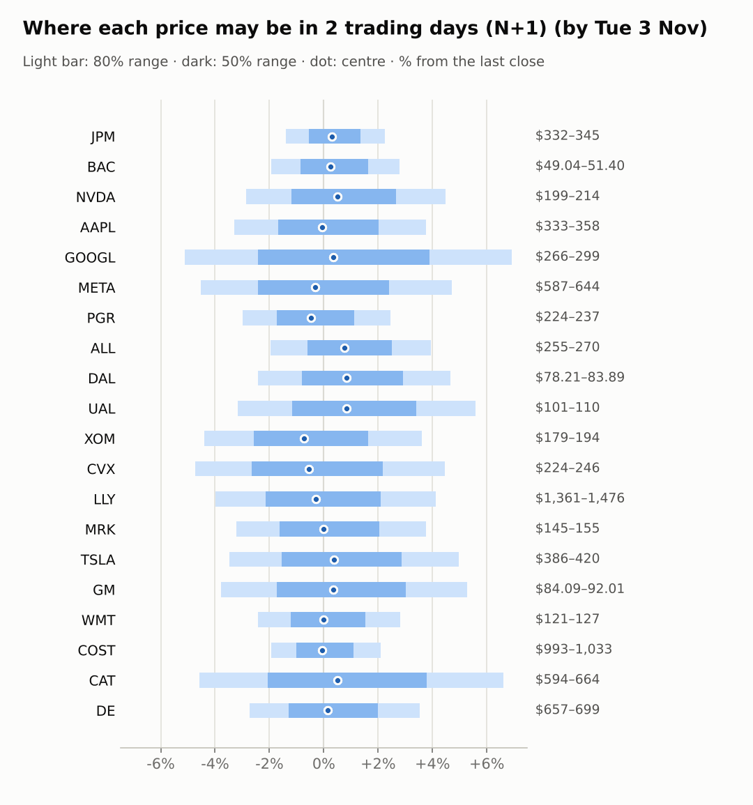
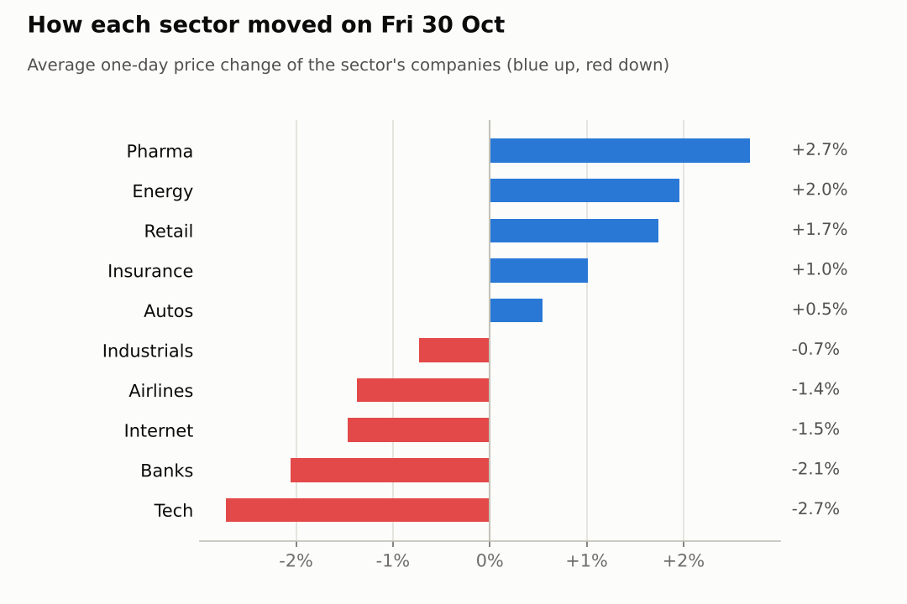
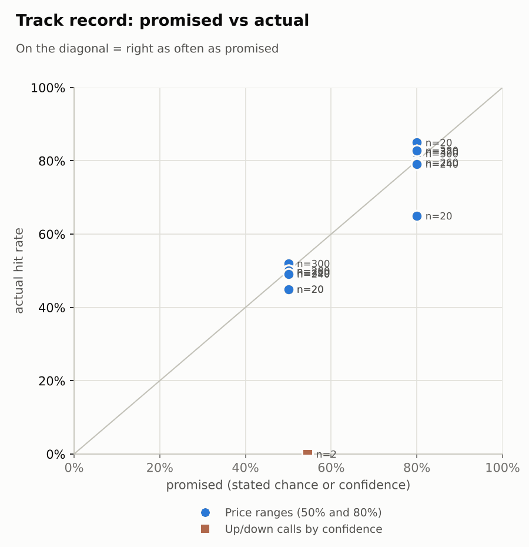

# Market brief: US (NYSE/Nasdaq), 2026-11-02

_Research log, not investment advice. Generated by a scheduled Claude Code routine._
<!-- report-data: as_of=2026-10-30 regime=CALM outcome=70248abff9bf -->

Easy-to-read version with charts and filters: [2026-11-02.html](2026-11-02.html)

## Headline
No calls today: the collect gate blocked 19 of 20 companies on duplicated stored news ids, and PGR, the only open one, has no verified news and a model score at its base rate. Apple reports earnings today, and the session follows a tech-led fall on 2026-10-30 in which NVDA fell 4.2%.

## Top 3 today
- Apple reports earnings today; AAPL is in the no-call earnings window and its N+1 range is widened for the release (1c9c35d20f7c3943).
- Alphabet's Q3 miss is confirmed by its 8-K (confirmed_primary: 3825937aa7df0a13); GOOGL fell 12.61% over 5 sessions and its RSI is 21.
- No calls: DUPLICATE_ID blocks 19 tickers, and PGR has only promotional news (8e8c79de744b06f5, promotional).

## Yesterday
The S&P 500 ETF fell 1.8% on 2026-10-30, led by tech: NVDA fell 4.2% and CAT 3.81%, while LLY rose 3.2%. GOOGL kept falling after its earnings miss (confirmed_primary: 3825937aa7df0a13).
N+1 80% ranges hit 11/20 against 8/20 for the naive band. The misses were mostly the big movers on both sides: GOOGL, NVDA and CAT closed below their ranges; DE, GM, COST and WMT closed above. No call was scored on 2026-10-30: the calls table below repeats the NVDA 5-day call of 2026-10-08, scored on 2026-10-19 (a display fault found by the weekly spot-check).

Market on 2026-10-30: S&P 500 ETF 755.72 (-1.8%) · VIX 19.42 (+12.9%) · watchlist 10 up / 10 down · best LLY +3.2%, worst NVDA -4.2%

### Ranges scored (target date 2026-10-30)

N+1 ranges: **80% hit 11/20** (naive 8/20) · 50% hit 6/20

| Ticker | 80% range | 50% range | Actual | 80% | 50% | Naive 80% |
|---|---|---|---|---|---|---|
| AAPL | $340.17–$352.72 | $343.06–$349.66 | $344.63 | ✅ | ✅ | ✅ |
| ALL | $244.47–$258.72 | $247.73–$255.22 | $259.87 | ❌ | ❌ | ❌ |
| BAC | $50.14–$52.46 | $50.67–$51.89 | $50.01 | ❌ | ❌ | ✅ |
| CAT | $631.17–$754.81 | $658.13–$723.06 | $622.75 | ❌ | ❌ | ❌ |
| COST | $971.59–$1,009.32 | $980.28–$1,000.12 | $1,012.28 | ❌ | ❌ | ❌ |
| CVX | $220.78–$241.74 | $225.51–$236.53 | $235.52 | ✅ | ✅ | ❌ |
| DAL | $78.20–$83.91 | $79.50–$82.50 | $80.15 | ✅ | ✅ | ✅ |
| DE | $620.01–$656.20 | $628.28–$647.31 | $675.48 | ❌ | ❌ | ❌ |
| GM | $79.28–$86.48 | $80.90–$84.69 | $87.40 | ❌ | ❌ | ❌ |
| GOOGL | $300.81–$336.63 | $308.83–$327.65 | $279.84 | ❌ | ❌ | ❌ |
| JPM | $336.43–$347.62 | $339.01–$344.90 | $337.04 | ✅ | ❌ | ✅ |
| LLY | $1,217.39–$1,434.57 | $1,265.02–$1,379.10 | $1,417.54 | ✅ | ❌ | ❌ |
| META | $588.40–$646.68 | $601.54–$632.17 | $614.99 | ✅ | ✅ | ✅ |
| MRK | $133.35–$153.73 | $137.85–$148.56 | $149.52 | ✅ | ❌ | ❌ |
| NVDA | $208.27–$222.53 | $211.52–$219.02 | $204.64 | ❌ | ❌ | ❌ |
| PGR | $219.98–$232.35 | $222.81–$229.31 | $231.28 | ✅ | ❌ | ✅ |
| TSLA | $387.50–$422.96 | $395.52–$414.15 | $399.81 | ✅ | ✅ | ✅ |
| UAL | $99.93–$109.22 | $102.03–$106.91 | $104.24 | ✅ | ✅ | ✅ |
| WMT | $117.13–$123.05 | $118.49–$121.60 | $123.51 | ❌ | ❌ | ❌ |
| XOM | $176.29–$190.69 | $179.55–$187.13 | $187.25 | ✅ | ❌ | ❌ |

N+2 ranges that matured on the same date: 80% hit 14/20, 50% hit 10/20. N+3 ranges that matured on the same date: 80% hit 18/20, 50% hit 14/20. N+4 ranges that matured on the same date: 80% hit 18/20, 50% hit 10/20. N+5 ranges that matured on the same date: 80% hit 17/20, 50% hit 11/20.

### Calls scored

| Ticker | H | Call | Conf. | Move | Hit |
|---|---|---|---|---|---|
| NVDA | 5d · open→close | up | 54% | -8.44% | ❌ |

## Today (2026-11-02)

**Regime: CALM** · VIX 19.38 (-0.2%) · benchmark 5d -0.6% · benchmark 10d vol 13.4%

| Ticker | Sector | Close | N+1 80% | N+1 50% | N+5 80% | Call | Cue | Notes |
|---|---|---|---|---|---|---|---|---|
| JPM | Banks | $337.04 | $332.30–$344.65 | $335.16–$341.63 | $326.34–$352.28 | no call | +0.58% | cue +0.58% x0.5; major event x1.15 |
| BAC | Banks | $50.01 | $49.04–$51.40 | $49.58–$50.82 | $47.90–$52.88 | no call | +0.48% | cue +0.48% x0.5; major event x1.15 |
| NVDA | Tech | $204.64 | $198.79–$213.82 | $202.22–$210.09 | $191.73–$223.38 | no call | +1.03% | cue +1.03% x0.5; major event x1.15 |
| AAPL | Tech | $344.63 | $333.27–$357.57 | $338.82–$351.55 | $325.71–$367.79 | no call | -0.12% | cue -0.12% x0.5; earnings in horizon (x2.43 day, 7 past moves, median 2.5%); earnings in horizon (x3.0 day); major event x1.15 |
| GOOGL | Internet | $279.84 | $265.51–$299.23 | $273.06–$290.71 | $250.21–$321.51 | no call | +0.68% | cue +0.68% x0.5; major event x1.15 |
| META | Internet | $614.99 | $587.16–$643.95 | $600.02–$629.76 | $560.86–$680.68 | no call | -0.62% | cue -0.62% x0.5; major event x1.15 |
| PGR | Insurance | $231.28 | $224.36–$236.98 | $227.26–$233.87 | $218.35–$244.90 | no call | -0.95% | cue -0.95% x0.5; major event x1.15 |
| ALL | Insurance | $259.87 | $254.81–$270.13 | $258.32–$266.35 | $240.28–$289.72 | no call | +1.54% | cue +1.54% x0.5; earnings in horizon (x3.0 day); major event x1.15 |
| DAL | Airlines | $80.15 | $78.21–$83.89 | $79.51–$82.48 | $75.53–$87.50 | no call | +1.67% | cue +1.67% x0.5; major event x1.15 |
| UAL | Airlines | $104.24 | $100.95–$110.05 | $103.02–$107.78 | $96.72–$115.91 | no call | +1.68% | cue +1.68% x0.5; major event x1.15 |
| XOM | Energy | $187.25 | $179.04–$194.03 | $182.45–$190.30 | $176.96–$196.98 | no call | -1.43% | cue -1.43% x0.5; earnings in horizon (x1.99 day, 7 past moves, median 1.0%); major event x1.15 |
| CVX | Energy | $235.52 | $224.37–$246.03 | $229.28–$240.61 | $223.70–$247.30 | no call | -1.07% | cue -1.07% x0.5; earnings in horizon (x2.53 day, 7 past moves, median 2.3%); major event x1.15 |
| LLY | Pharma | $1,417.54 | $1,360.85–$1,476.01 | $1,387.04–$1,447.35 | $1,307.07–$1,549.84 | no call | -0.56% | cue -0.56% x0.5; major event x1.15 |
| MRK | Pharma | $149.52 | $144.70–$155.15 | $147.09–$152.56 | $139.78–$161.78 | no call | -0.03% | cue -0.03% x0.5; major event x1.15 |
| TSLA | Autos | $399.81 | $385.91–$419.66 | $393.58–$411.25 | $370.18–$441.34 | no call | +0.77% | cue +0.77% x0.5; major event x1.15 |
| GM | Autos | $87.40 | $84.09–$92.01 | $85.89–$90.03 | $80.42–$97.13 | no call | +0.71% | cue +0.71% x0.5; major event x1.15 |
| WMT | Retail | $123.51 | $120.53–$126.99 | $122.02–$125.40 | $117.45–$131.03 | no call | -0.00% | cue -0.00% x0.5; major event x1.15 |
| COST | Retail | $1,012.28 | $992.70–$1,033.42 | $1,002.11–$1,023.44 | $973.09–$1,058.68 | no call | -0.14% | cue -0.14% x0.5; major event x1.15 |
| CAT | Industrials | $622.75 | $594.22–$663.90 | $609.89–$646.37 | $562.41–$709.63 | no call | +1.00% | cue +1.00% x0.5; major event x1.15 |
| DE | Industrials | $675.48 | $657.13–$699.29 | $666.79–$688.87 | $637.15–$725.91 | no call | +0.31% | cue +0.31% x0.5; major event x1.15 |

No calls today.

- AAPL, ALL, BAC, CAT, COST, CVX, DAL, DE, GM, GOOGL, JPM, LLY, META, MRK, NVDA, TSLA, UAL, WMT, XOM: abstain, data failed validation (collect gate DUPLICATE_ID on stored news rows that name them, an open issue). AAPL also reports today (earnings within 1 day).
- PGR: abstain. Its only news is promotional (8e8c79de744b06f5, promotional), so no main evidence is allowed, and its model P(up) of 0.5212 at N+1 is below the 0.5269 base rate.
- AI traders: the same blocks applied; ai.pattern_mood.sonnet.v1 and ai.combined.sonnet.v1 stored 3 PGR up predictions each, the other two abstained on all 20. Paper only.

### Overnight cues and global factors

| Symbol | Name | Last | Change |
|---|---|---|---|
| DAX | DAX | 25,781.09 | -0.14% |
| DXY | US dollar index | 101.58 | -0.30% |
| ES | S&P 500 futures | 7,637.50 | +0.31% |
| FTSE | FTSE 100 | 10,711.10 | -0.17% |
| GOLD | Gold | 3,911.40 | +0.32% |
| HANGSENG | Hang Seng | 23,393.32 | +0.42% |
| KOSPI | KOSPI | 5,859.08 | +2.24% |
| NIKKEI | Nikkei 225 | 63,081.86 | -0.33% |
| NQ | Nasdaq 100 futures | 28,708.00 | +0.61% |
| SPY | S&P 500 ETF | 758.40 | +0.35% |
| STOXX50 | Euro Stoxx 50 | 6,124.85 | -0.11% |
| US10Y | US 10-year yield | 4.93 | -1.20% |
| USDCNY | USD/CNY | 6.64 | -0.36% |
| USDJPY | USD/JPY | 157.85 | +0.03% |
| VIX | VIX | 19.38 | -0.21% |
| WTI | WTI crude | 99.71 | -4.24% |

## Tomorrow and this week

| Date | Event | Type |
|---|---|---|
| 2026-10-30 | Costco ex-dividend (est. 1.47, last dividend) | company |
| 2026-11-02 | Apple earnings | company |
| 2026-11-04 | Allstate earnings | company |
| 2026-11-06 | US jobs report (usually first Friday; check for shifts) | major |
| 2026-11-10 | US CPI (October; provisional date) |  |
| 2026-11-13 | Eli Lilly ex-dividend (est. 1.73, last dividend) | company |
| 2026-11-16 | ExxonMobil ex-dividend (est. 1.03, last dividend) | company |
| 2026-11-17 | Nvidia earnings | company |
| 2026-11-18 | Chevron ex-dividend (est. 1.78, last dividend) | company |
| 2026-11-19 | Walmart earnings | company |
| 2026-11-20 | US monthly options expiry |  |

Apple's earnings today and Allstate's on 2026-11-04 are the company events; the US jobs report on 2026-11-06 widens every range that spans it (major event x1.15). Overnight cues lean up (ES +0.31%, NQ +0.61%) with WTI down 4.24%; the regime is CALM with VIX 19.38. Fed speakers called for more hikes and the 10-year yield sits near 5%, a risk for rate-sensitive and high-valuation stocks.

## By sector

### Banks

BAC fell 2.21% and JPM 1.9% on 2026-10-30, together with XLF (-0.76%): a sector move. BAC's RSI is 28.
Bull: BAC is oversold and both trade up premarket. Bear: higher-for-longer rate talk and a weak tape. No calls (gate block).

### Tech

NVDA fell 4.22% and AAPL 1.23% as XLK fell 4.89%: a sector-wide fall. AAPL reports today; NVDA faces reports of a Chinese espionage plot (2c82373a43be5df2, promotional).
Bull: NVDA's RSI of 35 is near oversold and NQ futures are up. Bear: the tech sell-off and the earnings risk for AAPL. No calls (gate block).

### Internet

GOOGL is down 12.61% over 5 sessions after its Q3 miss (confirmed_primary: 3825937aa7df0a13); META is down 4.3% over 5 sessions after S&P cut its outlook to negative (11a2fe14bac7ffdf, single_source).
Bull: GOOGL's RSI of 21 is deeply oversold. Bear: capex worries at both and a report that Meta weighs an equity raise (c1698624c8cbc8a1, unverified). They moved together on spending fears. No calls (gate block).

### Insurance

ALL rose 1.54% and PGR 0.48%, with IAK +8.37% over 20 sessions: the sector is in a steady climb. ALL reports on 2026-11-04.
Bull: trend and flow (PGR's RSI is 65, near its 20-day high). Bear: the stock is extended and BofA cut its target (d6baa7d447435fc4). PGR abstained: no verified news and no model edge.

### Airlines

DAL fell 1.83% and UAL 0.92% as JETS fell 2.04%: a sector move, after DAL rose 4.39% and UAL 6.44% over 5 sessions.
Bull: lower oil (WTI -4.24%) helps fuel costs and both trade up premarket. Bear: a high beta in a falling tape. No calls (gate block).

### Energy

XOM rose 2.16% and CVX 1.75% with XLE (+1.91%), both with RSI 73; Exxon plans 2027 buybacks (7ffa67e9c7114762, promotional).
Bull: record refining profits and buybacks. Bear: WTI is down 4.24% overnight and both trade lower premarket. No calls (gate block).

### Pharma

LLY rose 3.19% and MRK 2.18%, ahead of XLV (+0.45%); LLY reported a strong Q3 (0d2c0e4ad606bbc3, promotional) and is up 24.04% over 20 sessions.
Bull: drug approvals and trial news (70e2c7968e685ad3, unverified). Bear: LLY's RSI of 78 is stretched. No calls (gate block).

### Autos

GM rose 1.96% while TSLA fell 0.87%: they moved apart on company news. GM is up 15.12% over 5 sessions; Tesla opposes new US tariffs on Vietnam (1ea7b5b4baa61507).
Bull: GM's momentum. Bear: TSLA's tariff exposure and high beta. No calls (gate block).

### Retail

WMT rose 1.86% and COST 1.63% with XLP (+1.41%): a defensive rotation. Walmart is expanding its Symbotic automation deal (corroborated: 6693479e4aac8f85).
Bull: automation and the defensive bid; WMT is up 18.46% over 20 sessions. Bear: a Flipkart kickback probe report (29fec6d1047a0af1) and WMT's RSI of 73. No calls (gate block).

### Industrials

CAT fell 3.81% while DE rose 2.35%: they moved apart. CAT is down 26.34% over 20 sessions with RSI 24; Deere added a board member (confirmed_primary: cec9ca99e3dd5518), a low-impact item.
Bull: CAT is deeply oversold and trades up premarket. Bear: CAT's downtrend is steep. No calls (gate block).

## Track record

Ranges (targets 50% / 80%; width, score and centre error in % of price, lower is better; naive = last close ± recent typical move, no-change = last close as the centre):

| H | Window | n | 50% cover | 80% cover | Naive 80% | Width | Naive width | Score | Naive score | Centre err | No-change err |
|---|---|---|---|---|---|---|---|---|---|---|---|
| 1d | since start | 320 | 49% | 83% | 74% | 7.41 | 6.17 | 9.605 | 10.931 | 2.19 | 2.32 |
| 1d | last 30 days | 320 | 49% | 83% | 74% | 7.41 | 6.17 | 9.605 | 10.931 | 2.19 | 2.32 |
| 1d legacy_cc | since start | 20 | 45% | 85% | 85% | 4.09 | 4.18 | 7.414 | 7.632 | 1.45 | 1.39 |
| 1d legacy_cc | last 30 days | 20 | 45% | 85% | 85% | 4.09 | 4.18 | 7.414 | 7.632 | 1.45 | 1.39 |
| 2d | since start | 300 | 52% | 82% | 72% | 9.33 | 7.55 | 11.948 | 13.059 | 2.76 | 2.87 |
| 2d | last 30 days | 300 | 52% | 82% | 72% | 9.33 | 7.55 | 11.948 | 13.059 | 2.76 | 2.87 |
| 3d | since start | 280 | 50% | 83% | 69% | 10.84 | 8.69 | 13.354 | 14.517 | 3.21 | 3.29 |
| 3d | last 30 days | 280 | 50% | 83% | 69% | 10.84 | 8.69 | 13.354 | 14.517 | 3.21 | 3.29 |
| 4d | since start | 260 | 50% | 80% | 69% | 12.37 | 9.71 | 15.912 | 16.832 | 3.68 | 3.75 |
| 4d | last 30 days | 260 | 50% | 80% | 69% | 12.37 | 9.71 | 15.912 | 16.832 | 3.68 | 3.75 |
| 5d | since start | 240 | 49% | 79% | 66% | 13.53 | 10.62 | 17.822 | 19.112 | 4.15 | 4.23 |
| 5d | last 30 days | 240 | 49% | 79% | 66% | 13.53 | 10.62 | 17.822 | 19.112 | 4.15 | 4.23 |
| 5d legacy_cc | since start | 20 | 45% | 65% | 50% | 9.91 | 9.35 | 17.346 | 16.489 | 3.60 | 3.63 |
| 5d legacy_cc | last 30 days | 20 | 45% | 65% | 50% | 9.91 | 9.35 | 17.346 | 16.489 | 3.60 | 3.63 |

Ranges by regime (since start):

| H | Regime | n | 50% cover | 80% cover | Naive 80% |
|---|---|---|---|---|---|
| 1d | CALM | 180 | 47% | 81% | 75% |
| 1d | EVENT_HEAVY | 120 | 53% | 85% | 73% |
| 1d | TRENDING | 20 | 50% | 85% | 75% |
| 1d legacy_cc | TRENDING | 20 | 45% | 85% | 85% |
| 2d | CALM | 160 | 56% | 86% | 82% |
| 2d | EVENT_HEAVY | 120 | 49% | 78% | 59% |
| 2d | TRENDING | 20 | 40% | 75% | 65% |
| 3d | CALM | 160 | 53% | 84% | 78% |
| 3d | EVENT_HEAVY | 100 | 47% | 81% | 56% |
| 3d | TRENDING | 20 | 40% | 80% | 65% |
| 4d | CALM | 160 | 58% | 85% | 78% |
| 4d | EVENT_HEAVY | 80 | 36% | 74% | 56% |
| 4d | TRENDING | 20 | 45% | 60% | 55% |
| 5d | CALM | 160 | 53% | 80% | 71% |
| 5d | EVENT_HEAVY | 60 | 40% | 82% | 57% |
| 5d | TRENDING | 20 | 50% | 65% | 50% |
| 5d legacy_cc | TRENDING | 20 | 45% | 65% | 50% |

Up/down calls vs the always-up baseline:

| H | Window | n | Hit rate | Always-up |
|---|---|---|---|---|
| 5d · open→close | since start | 2 | 0% | 0% |
| 5d · open→close | last 30 days | 2 | 0% | 0% |

Calls by confidence band (a band should hit about as often as its confidence):

| Band | n | Avg confidence | Hit rate |
|---|---|---|---|
| 0.50-0.59 · open→close | 2 | 55% | 0% |

Weekly review 2026-W44: 0 proposed range changes for a human to decide · [review-2026-W44.md](review-2026-W44.md)

## Data quality

- Indicators: 20 OK, partial: none, blocked: none
- Regime notes: none

| H | Calibration | History n | Live n | q10 / q90 |
|---|---|---|---|---|
| 1d | pool | 9140 | 320 | -1.12 / 1.27 |
| 2d | pool | 9120 | 300 | -1.14 / 1.31 |
| 3d | pool | 9100 | 280 | -1.14 / 1.31 |
| 4d | pool | 9080 | 260 | -1.16 / 1.32 |
| 5d | pool | 9060 | 240 | -1.16 / 1.36 |

- validation collect DUPLICATE_ID (blocking): news, 20 duplicated ids shown (the check lists at most 20; 249 ids are duplicated in all, 53 of them stored again by today's collection; e.g. 005e616800060b97, 01f6ad725a09e2f5, 020d9bf374777f46, 034e890a6034e8a5, 0409934ffa713e05). Old headlines were stored again under their old ids after the 9-day de-dup window (an open issue). Stored data cannot be edited, so a retry cannot clear it. The forecaster and the AI traders abstained on the tickers those rows name: AAPL, ALL, BAC, CAT, COST, CVX, DAL, DE, GM, GOOGL, JPM, LLY, META, MRK, NVDA, TSLA, UAL, WMT, XOM. None of the ids is cited.
- validation collect COLLECTOR_FAILED (warning): macro, 3 failed: FRED BAMLH0A0HYM2, BAMLC0A0CM and T10YIE (fred.stlouisfed.org closed the connection without an answer); those series show their last stored values.
- validation collect COLLECTOR_FAILED (warning): news, GlobeNewswire Public Companies answered 403.
- validation collect COLLECTOR_FAILED (warning): news, the first collect_news run was stopped by a Google News HTTP 503 (google_stopped at gnews:"JPMorgan" stock, `ok` false, 18 new items); a second run minutes later succeeded (`ok` true, 2453 new items, window since 2026-10-30 11:49 UTC).
- collect_holdings: SEC acceptance times not verified for CIKs 933478, 1167483, 1040273, 1029160 (no ACCEPTANCE-DATETIME in their oldest filing; stored as served, maybe 4-5h late).
- results digests: prepare detected 0 releases, although GOOGL, LLY, META, MRK, CAT, CVX and XOM filed results 8-Ks since 2026-10-23: no SEC results-release earnings rows are stored when a Yahoo calendar row has the same date (an open issue).
- collect_articles: 36 article reads deferred; 257 headlines from unlisted outlets were skipped (top: marketbeat.com, ad-hoc-news.de, tipranks.com).
- AI traders: abstention codes ai.news_results.sonnet.v1 abstained 20, ai.pattern_mood.sonnet.v1 19, ai.combined.sonnet.v1 19, ai.combined.opus.v1 20 (data failed validation on the 19 blocked tickers; PGR abstained by two traders). Head-to-head picks: 76, none cost-viable at your cost.
- PGR's cue quote of 228.0 (2026-10-30 21:05 UTC) does not match its stored 2026-10-30 close of 231.28; it looks like a stale after-hours print.
- Judge FAIL from an earlier run: 2026-10-26, spotcheck, round 1: report 2026-10-21 said the 50% misses (AAPL, GM, JPM, LLY, MRK, TSLA) mostly came from moves of 3% or more; stored ret_1d shows 3 of 6 (GM, LLY, MRK). Nothing dropped.
- Other gates (features, context, news, forecast, debate record, traders): passed.
